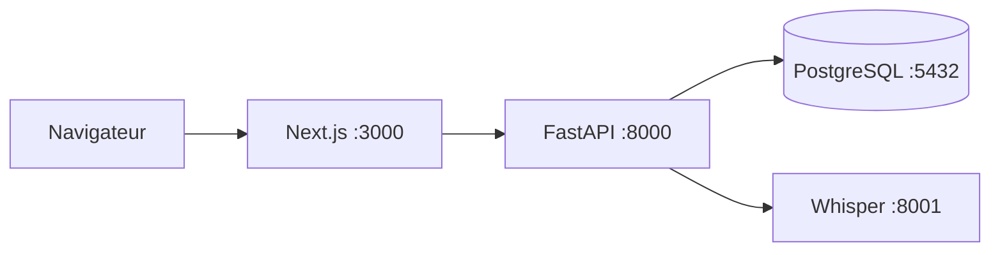

# Architecture du projet

## Vue globale

L’application suit une architecture en couches. PostgreSQL est la source unique de données persistées et FastAPI est la source unique de logique métier. Next.js s’occupe de l’affichage, de la session navigateur, du rendu serveur et des proxies same-origin.



Le navigateur n’a pas besoin de connaître l’adresse interne de FastAPI ni celle de Whisper. Il parle à l’origine Next.js. Les pages rendues côté serveur peuvent appeler FastAPI directement.

## Les deux flux HTTP du frontend

### Flux d’une interaction dans le navigateur

Exemple : l’utilisateur crée une tâche.

```text
TodoClient
→ features/todo/api/todoApi.ts
→ lib/http/apiClient.ts
→ POST /api/tasks dans Next.js
→ lib/server/proxyApiRequest.ts
→ POST /api/tasks dans FastAPI
→ contrat Pydantic
→ routeur puis SQLAlchemy
→ PostgreSQL
```

Pourquoi conserver un proxy Next.js ?

- le navigateur reste sur la même origine ;
- le cookie `life_regime_session` est transmis sans exposer FastAPI publiquement ;
- l’adresse `INTERNAL_API_URL` reste une configuration serveur ;
- toutes les erreurs de service indisponible ont une frontière cohérente.

Les proxies métier présents sous `app/api/` ne calculent rien. Ils recopient méthode, query string, cookie, type du contenu et corps, puis renvoient la réponse FastAPI.

### Flux d’une page rendue sur le serveur

Exemple : la page `/history` est chargée.

```text
app/history/page.tsx
→ requireUser()
→ lib/server/internalApiClient.ts
→ GET /api/history dans FastAPI
→ parser features/history/api/historyApi.ts
→ HTML rendu par Next.js
```

Ce flux évite un aller-retour inutile par une route proxy Next. `requestInternalApiJson` transmet les cookies, désactive le cache, applique un timeout et fait analyser la réponse par le parseur de la feature.

## Frontend

### `app/`

Le dossier `app/` appartient à Next.js App Router :

- `page.tsx` crée une page ;
- `layout.tsx` crée la structure commune ;
- `api/**/route.ts` crée une route HTTP Next.js ;
- les pages serveur chargent leurs données initiales ;
- la page `/login` est publique, tandis que les pages métier appellent `requireUser()`.

### `features/`

Chaque capacité utilisateur dispose d’un dossier `features/<feature>` :

- `components/` : rendu React et orchestration des interactions ;
- `api/` : appels HTTP et validation des réponses `unknown` ;
- `domain/` : types, constantes et fonctions pures propres au métier.

Features principales depuis la refonte : `week` (accueil), `goals`, `knowledge` (coffre Obsidian), `insights` (analyses sourcées) et `ai-providers` (modèles d’IA). Features avancées : `auth`, `calendar`, `daily-log`, `habits`, `history`, `life-terminal`, `objectives`, `settings`, `time-allocation` et `todo`. Voir [`REFONTE.md`](REFONTE.md).

### `components/` et `lib/`

`components/` contient les éléments réellement partagés, par exemple le shell de navigation et les primitives visuelles.

`lib/` contient l’infrastructure transversale :

- `lib/http/apiClient.ts` pour les requêtes du navigateur ;
- `lib/server/proxyApiRequest.ts` pour les proxies Next → FastAPI ;
- `lib/server/internalApiClient.ts` pour les appels SSR ;
- `lib/auth.ts` pour le cookie et l’utilisateur local ;
- `lib/dates.ts` pour les dates partagées ;
- `lib/prisma.ts` uniquement pour l’identité locale et la gestion du schéma côté Prisma.

## Backend FastAPI

Le backend est sous `interface_API/app/` :

- `main.py` assemble l’application, CORS, gestionnaires d’erreurs et routeurs ;
- `config.py` lit et valide la configuration ;
- `security.py` vérifie le cookie compatible avec Next.js ;
- `database.py` ouvre, valide ou annule une transaction SQLAlchemy par requête ;
- `contracts/` contient les modèles Pydantic des requêtes ;
- `routers/` orchestre HTTP, authentification, ownership et réponse ;
- `core/` contient les calculs et agrégats métier réutilisables ;
- `models.py` mappe les tables existantes pour SQLAlchemy.

Une route suit cette direction :

```text
router → contract + core/model → database
```

Le dossier `core/` ne doit pas importer FastAPI, React ou les modules du frontend.

## Base de données : deux outils, deux responsabilités

PostgreSQL contient les données. Prisma et SQLAlchemy ne sont pas deux bases : ils utilisent le même schéma.

- `prisma/schema.prisma` est la définition de référence des tables et relations.
- `prisma/migrations/` contient l’historique des changements de schéma.
- Prisma Client est encore utilisé par `lib/auth.ts` pour retrouver ou créer l’utilisateur local.
- `interface_API/app/models.py` représente les mêmes tables pour SQLAlchemy à l’exécution.
- `interface_API/app/database.py` gère les sessions et transactions FastAPI.

Invariant critique : toute modification de `schema.prisma` qui affecte FastAPI doit être reportée manuellement dans `models.py`, puis dans les contrats et parseurs concernés.

## Authentification

L’authentification du navigateur constitue une frontière particulière :

1. `POST /api/auth/login` dans Next.js compare la clé saisie à `APP_ACCESS_KEY` ;
2. `lib/auth.ts` retrouve ou crée l’utilisateur local via Prisma ;
3. Next.js signe un cookie `life_regime_session` avec HMAC-SHA256 ;
4. FastAPI vérifie le même cookie dans `security.py` ;
5. `AUTH_SECRET` et `APP_ACCESS_KEY` doivent donc être cohérents dans les deux processus.

FastAPI expose aussi `/api/auth/login` et `/api/auth/logout` pour un client direct. Pour le navigateur web actuel, les routes Next.js restent responsables de la création et de la suppression du cookie.

Le format `{userId, exp}`, le nom du cookie, l’algorithme de signature et l’unité de `exp` en millisecondes sont des contrats partagés à ne pas modifier d’un seul côté.

## Transcription vocale

Le flux audio est désormais unique :

```text
DailyLogForm → lib/whisper.ts → proxy Next /api/transcribe
→ FastAPI /api/transcribe → service Whisper /transcribe
```

FastAPI authentifie la requête, limite le type et la taille du fichier, attend Whisper avec un timeout borné et normalise les erreurs. Le service Whisper charge le modèle localement et limite la concurrence. Plus de détails : [`whisper.md`](whisper.md).

## Contrats JSON

Le navigateur envoie et reçoit du JSON en `camelCase`, par exemple `estimatedMinutes`. Python utilise des attributs `snake_case`, par exemple `estimated_minutes`. `ApiRequest` dans `contracts/common.py` configure la conversion avec Pydantic.

Les réponses réseau sont non fiables par définition. Les modules `features/*/api` reçoivent donc `unknown`, vérifient chaque champ puis produisent un type du domaine. Une annotation TypeScript seule ne suffit pas à protéger l’exécution.

## Sens autorisé des dépendances

```text
components → feature api + feature domain
feature api → client HTTP partagé + feature domain
Next proxy → proxy serveur partagé
page SSR → client serveur + parser de feature
FastAPI router → contracts + core + models
core → models et utilitaires backend
database → configuration
```

Directions interdites :

- `domain/` vers React, HTTP, Prisma ou SQLAlchemy ;
- composant React vers `fetch` brut ;
- route proxy Next vers de la logique métier ;
- `core/` Python vers le frontend ;
- FastAPI vers Prisma pour écrire le schéma.

## Pourquoi cette architecture est plus maintenable

- une règle métier n’existe qu’en Python ;
- chaque réponse HTTP a une validation explicite côté TypeScript ;
- les composants volumineux ont été divisés par responsabilités ;
- les proxies sont interchangeables et préservent le contrat public ;
- les transactions ont une frontière unique par requête ;
- les dossiers indiquent où ajouter un nouveau comportement.

## Risques restants connus

- `models.py` et `schema.prisma` peuvent diverger sans contrôle automatique ;
- l’authentification existe en deux implémentations compatibles, Next.js et FastAPI ;
- les tests ne couvrent ni l’interface React, ni un vrai PostgreSQL, ni un parcours complet navigateur → base ;
- aucune CI/CD, stratégie de déploiement, sauvegarde ou rollback n’est définie dans le dépôt ;
- la branche de travail contient un refactoring très large qui doit être relu comme un ensemble cohérent avant intégration.

Le détail des couches se trouve dans [`04-FRONTEND-NEXT-REACT.md`](04-FRONTEND-NEXT-REACT.md), [`05-API-FASTAPI-HTTP.md`](05-API-FASTAPI-HTTP.md) et [`06-BASE-DE-DONNEES.md`](06-BASE-DE-DONNEES.md).
