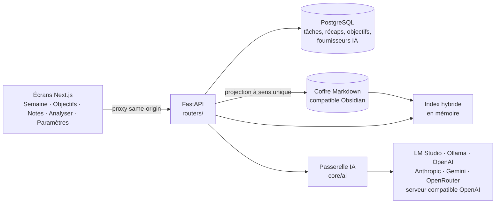

# Refonte UX, IA multi-fournisseurs et second cerveau

Ce document explique la refonte de novembre 2026 : ce qui a été constaté, ce qui a été décidé (y compris les propositions écartées), l'architecture livrée, ce qui a réellement été vérifié et ce qui reste à faire.

Critère de réussite : **ouvrir l'application, noter ce que je veux faire, suivre ma semaine et exploiter mes connaissances sans comprendre la complexité sous-jacente.**

---

## 1. Audit critique de l'existant

### 1.1 Problèmes d'ergonomie constatés dans le code

| Zone | Constat | Effet pour l'utilisateur |
|---|---|---|
| Navigation (`components/AppShell.tsx`) | 14 entrées au même niveau : Accueil, Terminal, Vie, Journal, Émotionnel, Tâches, Réflexion, Objectifs, Performance, Répartition du temps, Habitudes, Calendrier, Historique, Paramètres. | Aucune hiérarchie : on ne sait pas par où commencer. |
| Accueil (`features/home`) | Tableau de bord « régime / risque / phase / qualité des données » avec jargon interne (`CONF 72/100`, `phase`). | L'écran d'arrivée montre des indicateurs dérivés au lieu de « ce que j'ai à faire ». |
| Création de tâche (`TodoClient.tsx`, ~890 lignes) | Tiroir avec titre, choix oui/non de description, description, durée estimée, entreprise, tags, importance, statut, progression, objectif, mode simple/multiple ; 5 vues (liste, semaine, mois, analyses, entonnoir) et 3 filtres. | Ajouter « réviser le chapitre 4 » demande d'ouvrir un tiroir et d'ignorer une dizaine de champs. |
| Objectifs (`ObjectiveForm.tsx`, `ObjectivesClient.tsx`) | Type, horizon, statut, priorité, parent, date cible, semaine, notes, prochaine action, tâches liées, blocs hebdomadaires, prévisions PERT, « mode crème ». | Exprimer un objectif en une phrase est impossible sans comprendre le modèle. |
| Journal (`DailyLogForm.tsx`) | Plus de 25 champs (énergie, friction, calories, fatigue mentale/physique, focus, temps de travail/distraction, sommeil…). | Le récapitulatif libre, le plus utile pour l'analyse, est noyé. |
| Concepts redondants | Tâches datées, blocs hebdomadaires d'objectifs, événements de calendrier, allocations de temps et routines représentent tous « quelque chose de prévu dans la semaine ». | Plusieurs endroits pour la même intention ; données éclatées. |
| Assistant IA (`core/lm_studio.py`) | LM Studio uniquement, IP locales seulement, configuration en `localStorage` et clé gardée en mémoire (perdue à chaque rechargement). | Impossible d'utiliser Ollama natif, OpenAI, Anthropic, Gemini ou OpenRouter. |
| Connaissances | Notes « Réflexion » en base, sans export, sans recherche, sans liens. | Pas de second cerveau exploitable. |

### 1.2 Éléments réutilisables (conservés)

- L'architecture en couches FastAPI (`contracts/` → `routers/` → `core/` → `models.py`) et le proxy Next same-origin : saine, réutilisée telle quelle.
- L'API des tâches (`/api/tasks` création, modification, suppression) : la Semaine et les Objectifs l'appellent au lieu de la dupliquer.
- La validation stricte des sorties JSON de l'assistant (refus des clés dupliquées, des `tool_calls`, des réponses tronquées) : généralisée à tous les fournisseurs.
- `@dnd-kit` (déjà installé), le système de thèmes, la localisation FR/EN, la transcription Parakeet.

### 1.3 Contraintes techniques

- Prisma possède le schéma ; `interface_API/app/models.py` doit être recopié à la main (invariant documenté dans `ARCHITECTURE.md`).
- Les appels IA partent du serveur API (souvent un VPS) : `127.0.0.1` désigne le serveur, pas le PC de l'utilisateur.
- L'application Android (`mobile/`) a son propre shell et ses propres pages ; elle n'a pas été refondue dans cette itération.
- Le déploiement IIS statique reste bloqué (fonctions serveur Next), sans lien avec cette refonte.

---

## 2. Nouvelle UX

### 2.1 Principes

1. **Un champ suffit.** Une tâche = une phrase. Un objectif = une phrase. Une note = un texte. Tout le reste est facultatif et jamais demandé.
2. **La semaine est l'écran d'accueil.** C'est là qu'on écrit, déplace, coche et résume.
3. **Les données d'abord, l'IA ensuite.** Les constats calculés s'affichent sans IA ; l'IA ne répond qu'aux questions et doit citer ses sources.
4. **Rien n'est perdu.** Les anciens écrans restent accessibles dans « Plus d'outils » ; aucune donnée n'est migrée de force.

### 2.2 Écrans

| Écran | Rôle | Interactions essentielles |
|---|---|---|
| **Semaine** (`/`) | Planifier et suivre | Champ « Qu'as-tu à faire ? » + Entrée (jour pré-sélectionné : aujourd'hui) ; « + Ajouter une tâche » dans chaque jour ; clic sur la case = fait ; clic sur le titre = renommer ; glisser-déposer entre jours et vers « À planifier » ; flèches ‹ › pour décaler d'un jour (alternative clavier et mobile) ; ✕ = pas faite ; récap du jour et de la semaine enregistrés à la sortie du champ. |
| **Objectifs** (`/objectives`) | Donner une direction | Une phrase + Entrée ; « Ajouter une étape » (crée une tâche liée, sans date) ; « Proposer des étapes » (IA, propositions modifiables et décochables, rien n'est créé sans validation) ; « Atteint », « Archiver ». |
| **Notes** (`/knowledge`) | Second cerveau | Note rapide (les `#tags` deviennent des métadonnées) ; recherche hybride avec « Pourquoi » affiché ; filtres par type ; lecture d'une note et de ses notes liées ; synchronisation automatique à l'ouverture. |
| **Analyser** (`/insights`) | Comprendre son historique | Période 7/28/90 jours ; constats calculés (prévu/fait, jours de la semaine, tâches récurrentes, reportées, blocages récurrents, objectifs sans activité) avec leurs preuves datées ; questions rapides ou libres → réponse en *Faits / Hypothèses / Recommandations / Affirmations écartées* + sources. |
| **Paramètres** | Réglages | Section « Modèles d'IA » : choisir un fournisseur, coller une clé si nécessaire, tester, choisir le modèle, enregistrer. |

### 2.3 Ce qui a été fusionné, déplacé, automatisé ou supprimé

| Élément | Décision | Raison |
|---|---|---|
| Accueil « régime » | **Remplacé** par la Semaine ; le tableau de bord reste dans « Plus d'outils → Terminal / Vie » | L'écran d'arrivée doit servir l'action, pas la mesure. |
| Création de tâche (tiroir à 10 champs) | **Remplacée** dans le flux principal par un champ unique ; le tiroir complet reste dans « Liste des tâches (avancée) » | Les champs secondaires sont rarement utiles et déjà facultatifs côté API. |
| Formulaire d'objectif | **Remplacé** par une phrase ; horizon trimestre et statut actif par défaut ; l'ancien écran devient « Planification des objectifs » | L'utilisateur commence avec une seule information. |
| Récapitulatif quotidien | **Extrait** du journal détaillé : un champ libre par jour sur la Semaine (écrit dans `DailyLog.textSummary` sans toucher aux autres champs) | C'est la donnée la plus utile pour l'analyse et la plus simple à saisir. |
| Récapitulatif hebdomadaire | **Ajouté** (table `WeeklyRecap`) | Il n'existait pas de bilan libre de semaine. |
| Projection Obsidian | **Automatisée** à l'ouverture de Notes (et via le bouton) | Aucune action manuelle d'export. |
| Métadonnées YAML | **Automatisées** (type, date, semaine, tags, compteurs, `tracker_id`) | L'utilisateur ne gère pas de métadonnées. |
| Configuration IA | **Déplacée** du navigateur vers le serveur, clé chiffrée | Une seule configuration pour le web et le téléphone, clé persistante et protégée. |
| Calendrier, habitudes, répartition du temps, émotionnel, performance, historique, terminal, vie | **Déplacés** dans « Plus d'outils » (repliés par défaut) | Fonctions avancées accessibles sans être imposées. Candidats à une fusion ultérieure (voir §4). |

### 2.4 Propositions de la demande que je n'ai pas suivies telles quelles

- **« Le système complète les champs secondaires avec l'IA à chaque ajout. »** Écarté par défaut. Appeler un modèle à chaque tâche ajoute de la latence, un coût, un point de panne et des modifications que l'utilisateur n'a pas demandées. La meilleure simplification est de ne pas avoir de champs secondaires. L'IA intervient seulement quand on la sollicite (étapes d'un objectif, analyse, dictée).
- **« Synchronisation » bidirectionnelle avec Obsidian.** Écartée. La synchronisation dans les deux sens exige une résolution de conflits fragile. La règle retenue est plus simple : *une seule source de vérité par type de donnée*. Les données structurées (tâches, récaps, objectifs) vivent en base et sont **projetées** dans le coffre. Les connaissances libres vivent dans le coffre. Les ajouts de l'utilisateur dans une note générée, hors du bloc géré, sont conservés.
- **Base vectorielle.** Non activée par défaut (voir §3.5).
- **Chatbot.** L'IA n'a pas d'écran de conversation : une question produit une réponse structurée et sourcée. Une conversation libre rendrait les réponses moins vérifiables et l'interface plus complexe.
- **Suppression immédiate des modules existants.** Reportée. Les supprimer maintenant risquait de perdre des usages et des données sans retour d'expérience ; ils sont déplacés et listés comme candidats.

---

## 3. Architecture technique



### 3.1 Couche IA multi-fournisseurs (`interface_API/app/core/ai/`)

| Fichier | Responsabilité |
|---|---|
| `provider_presets.py` | Liste des types de fournisseurs : protocole, URL par défaut, clé obligatoire, local ou cloud. |
| `endpoint_policy.py` | Quelles URL le serveur a le droit d'appeler (voir sécurité). |
| `http_transport.py` | Requête JSON bornée : délais, taille maximale, pas de redirection, pas de proxy implicite, erreurs en français sans fuite de clé. |
| `adapters/openai_adapter.py` | Chat Completions + `response_format: json_schema` (OpenAI, OpenRouter, LM Studio, vLLM, llama.cpp…). |
| `adapters/anthropic_adapter.py` | Messages API ; sortie structurée obtenue en forçant un appel d'outil unique. |
| `adapters/gemini_adapter.py` | `generateContent` avec `responseMimeType: application/json` et schéma JSON. |
| `adapters/ollama_adapter.py` | API native `/api/tags` et `/api/chat` avec `format` = schéma JSON (pas d'hypothèse de compatibilité OpenAI). |
| `structured_output.py` | Schéma portable (références intégrées, mots-clés mal supportés retirés) et décodage JSON strict. |
| `gateway.py` | Point d'entrée unique : `list_provider_models`, `generate_validated` (validation Pydantic complète après génération). |
| `api_key_cipher.py` | Chiffrement des clés au repos (Fernet, clé dérivée par HKDF de `AI_KEYS_SECRET`, sinon `AUTH_SECRET`). |
| `../ai_provider_store.py` | Persistance (table `AiProvider`) et choix du fournisseur par défaut. |

**Ajouter un fournisseur compatible** : aucun code à modifier, il suffit de choisir « Serveur compatible OpenAI » et de saisir l'URL. **Ajouter un nouveau protocole** : un preset dans `provider_presets.py` et un module d'adaptateur exposant `list_models` et `generate_json`.

**Sécurité**
- Les clés sont envoyées une fois au serveur, chiffrées en base, jamais renvoyées (seuls `hasApiKey` et les 4 derniers caractères sont exposés).
- Les URL avec identifiants, paramètres ou fragment sont refusées ; les adresses link-local, multicast, non spécifiées ou réservées (dont `169.254.169.254`) sont refusées, y compris après résolution DNS ; `http://` n'est accepté que vers loopback, LAN ou Tailscale, pour qu'une clé ne circule jamais en clair sur Internet.
- Les prompts indiquent que les données sont des données et jamais des instructions (protection contre l'injection via une note).

### 3.2 Semaine et récapitulatifs

- `GET /api/week?weekId=` renvoie en une requête les 7 jours, la boîte « À planifier », les récaps et le bilan.
- `PUT /api/week/recap` écrit **uniquement** `DailyLog.textSummary` (le reste du journal est intact) ou `WeeklyRecap.text`.
- Règles pures : `core/week_board.py` (backend) et `features/week/domain/weekBoard.ts` (mises à jour optimistes du tableau).

### 3.3 Second cerveau (`interface_API/app/core/knowledge/`)

**Organisation du coffre**

```text
<KNOWLEDGE_VAULT_DIR>/
├── Tracker/            ← généré par l'application (blocs gérés)
│   ├── Journal/2026-11-03.md
│   ├── Semaines/2026-W45.md
│   ├── Objectifs/<titre>.md
│   └── Idées/<date> <titre>.md   (anciennes notes « Réflexion »)
├── Inbox/              ← notes rapides créées depuis l'application (jamais réécrites)
└── … tes propres notes ← lues et indexées, jamais modifiées
```

**Format d'une note générée**

```markdown
---
type: journal
date: '2026-11-03'
week: 2026-W45
tasks_planned: 2
tasks_done: 1
tags: [tracker/journal]
source: tracker
tracker_id: journal:2026-11-03
---

<!-- tracker:begin — contenu régénéré par Tracker, écrivez en dehors de ce bloc -->
# Journal — mardi 3 novembre 2026
Semaine : [[Tracker/Semaines/2026-W45|2026-W45]]
## Tâches
- [x] Revoir les martingales · [[Tracker/Objectifs/Processus stochastiques|Processus stochastiques]]
<!-- tracker:end -->

Ce que tu écris ici est conservé.
```

**Règles qui empêchent la perte ou la duplication**
- Seul le bloc entre les marqueurs et les clés YAML de l'application sont réécrits ; les autres clés YAML et le texte hors bloc sont conservés.
- Si les marqueurs ont été supprimés, la note est signalée en **conflit** et n'est pas touchée.
- Chaque note porte un `tracker_id` : si tu la déplaces ou la renommes dans `Tracker/`, elle continue d'être mise à jour au nouvel endroit (pas de doublon).
- La projection est idempotente (une seconde synchronisation ne modifie rien) et n'efface jamais de fichier.
- Les écritures sont atomiques (fichier temporaire puis renommage) ; la création d'une note rapide n'écrase jamais un fichier existant.
- Les liens utilisent le chemin complet (`[[Tracker/Journal/…|…]]`) pour rester non ambigus dans un coffre existant.

### 3.4 Moteur d'analyse (`interface_API/app/core/insights/`)

1. `history_patterns.py` calcule sans IA, à partir des enregistrements : prévu/fait/abandonné, taux par jour de semaine, tâches récurrentes (titres normalisés : ordre, accents et pluriels ignorés), tâches reportées plusieurs fois, blocages récurrents (blocages du journal + raisons « pas faite »), mots fréquents, activité par objectif, objectifs sans activité. Chaque constat liste ses preuves datées.
2. `evidence_catalog.py` numérote les preuves (`S1`, `S2`…) : statistiques calculées, récaps de semaine, journaux de jours, notes personnelles trouvées par la recherche. Budget borné ; les données les plus récentes sont gardées et la troncature est signalée au modèle et à l'utilisateur.
3. Le modèle répond selon un contrat strict : `summary`, `facts`, `hypotheses`, `recommendations`, chacun avec ses identifiants de sources.
4. `cited_answer.py` applique la politique de citation : les identifiants inconnus sont retirés ; un « fait » sans source valide est retiré des faits et affiché comme **affirmation écartée**.
5. L'interface affiche les sources citées avec leur contenu exact et un lien vers la note.

La décomposition d'objectif utilise le même principe : propositions seulement, enrichies par les notes personnelles liées à l'objectif.

### 3.5 Recherche hybride et embeddings

`search_index.py` combine : BM25 par section (titre de section inclus), bonus titre, bonus tags/type, propagation par le graphe de liens (les notes liées aux meilleurs résultats gagnent une part de leur score), récence (demi-vie 60 jours), filtres par type et par date. Chaque résultat affiche **pourquoi** il est remonté (texte, titre, tag/type, lié à…). L'index est en mémoire et ne ré-analyse que les fichiers modifiés.

**Pourquoi pas d'embeddings par défaut** : pour un coffre personnel (quelques milliers de notes), le lexical + métadonnées + liens est instantané, déterministe, explicable et ne dépend d'aucun modèle. Les embeddings deviennent utiles quand les questions emploient d'autres mots que les notes (synonymes, paraphrases). Point d'extension prévu : ajouter `embed_texts` aux adaptateurs (OpenAI, Gemini, Ollama le proposent), stocker les vecteurs par section avec la signature du fichier, et ajouter un score de similarité pondéré dans `_score_document` — sans changer l'interface.

---

## 4. Plan de refactorisation priorisé

| Priorité | Travail | État |
|---|---|---|
| P0 | Couche IA multi-fournisseurs, configuration serveur, clés chiffrées, assistant existant migré | Fait |
| P0 | Écran Semaine (capture en un champ, glisser-déposer, récaps) comme accueil | Fait |
| P0 | Objectifs en une phrase + étapes IA facultatives | Fait |
| P0 | Coffre Obsidian : projection, capture, recherche hybride, lecture | Fait |
| P0 | Analyse : constats calculés + réponses sourcées | Fait |
| P0 | Navigation à 4 entrées + « Plus d'outils » | Fait |
| P1 | Appliquer les 4 écrans à l'application Android (`mobile/`) | À faire |
| P1 | Importer les notes « Réflexion » dans `Inbox/` puis retirer l'écran Réflexion (aujourd'hui elles sont projetées en lecture dans `Tracker/Idées/`) | À faire |
| P1 | Raison facultative lors du « pas faite » sur la Semaine (alimente les blocages récurrents) | À faire |
| P1 | Suggestion IA de tags/domaine pour les notes de l'Inbox, en proposition à valider | À faire |
| P2 | Fusionner Terminal, Vie et Performance en un seul tableau de bord facultatif ; fusionner Répartition du temps et Calendrier | À décider après usage |
| P2 | Tâches récurrentes simples (« chaque lundi ») sur la Semaine | À faire |
| P2 | Embeddings optionnels (§3.5) | Si la recherche lexicale s'avère insuffisante |
| P2 | Réponses en streaming pour les modèles lents | À faire |

---

## 5. Vérification

### 5.1 Tests effectivement exécutés

| Vérification | Résultat |
|---|---|
| Tests API Python (`python -m unittest discover -s tests`) avec PostgreSQL 16 réel (`RUN_DATABASE_TESTS=1`) | 192 tests, tous réussis |
| Dont nouveaux tests : adaptateurs des 4 protocoles, politique d’URL, transport, chiffrement des clés, API fournisseurs, Semaine, coffre, recherche, analyses, objectifs | 51 nouveaux tests, plus les tests de l’assistant adaptés |
| Tests de domaine frontend (`pnpm test:week`, `pnpm test:assistant`) | 9 + 8 réussis |
| `pnpm typecheck` et `tsc -p tsconfig.mobile.json` | OK |
| `pnpm build:web` (Vite mobile + Next.js production) | OK |
| Migration : base existante migrée jusqu'à la version précédente, données insérées, puis nouvelle migration appliquée | Données intactes ; `prisma migrate diff` : aucun écart entre schéma et migrations |

### 5.2 Parcours de bout en bout (Playwright, Chromium, application de production + FastAPI + PostgreSQL)

Un faux serveur de modèles local parlait les protocoles OpenAI-compatible et Ollama natif.

| Parcours | Résultat |
|---|---|
| Navigation : 4 entrées principales, outils avancés repliés puis dépliés | OK |
| Saisie d'une tâche : un champ + Entrée, ajout dans « À planifier », renommage en place | OK |
| Cocher (progression mise à jour), décaler d'un jour, glisser-déposer vers un jour | OK (un défaut de dépôt sur le jour voisin a été trouvé et corrigé) |
| Récap du jour et de la semaine, persistance après rechargement | OK |
| Données antérieures (tâche et résumé insérés avant migration) visibles sur la Semaine | OK |
| Paramètres : LM Studio (URL par défaut) testé, modèle choisi, défini par défaut ; Ollama natif testé ; clé obligatoire pour Anthropic ; URL `169.254.169.254` refusée | OK |
| Clé API absente de la liste renvoyée au navigateur | OK |
| Objectif en une phrase ; étapes IA proposées, une décochée, deux ajoutées ; présentes dans « À planifier » avec le nom de l'objectif | OK |
| Notes : synchronisation automatique, note rapide, recherche « martingale » (notes perso, Inbox, journal, objectif) avec raisons, lecture et navigation par liens | OK |
| Analyser : constats calculés, réponse sourcée, affirmation inventée (`S999`) classée « écartée », sources affichées | OK |
| Non-régression : `/todo`, `/daily-log`, `/objectives/planning`, `/calendar`, `/habits`, `/thinking`, `/life-terminal` répondent | OK |
| Téléphone 390 px : pas de défilement horizontal | OK |
| Erreurs JavaScript pendant le parcours | Aucune |

### 5.3 Non vérifié (accès ou configuration indisponibles)

- **Appels réels** à OpenAI, Anthropic, Gemini et OpenRouter : l'environnement de test n'avait ni clés ni accès réseau sortant direct. Les formats de requête et de réponse sont couverts par des tests unitaires ; les messages d'erreur (hôte introuvable, inaccessible) ont été vérifiés.
- **LM Studio et Ollama réels** : remplacés par un serveur simulé. La compatibilité du `json_schema` dépend du modèle chargé.
- **Ouverture du coffre dans l'application Obsidian** : les fichiers sont du Markdown standard avec YAML ; le rendu dans Obsidian n'a pas été observé.
- **Application Android** : non refondue, non testée sur appareil.

---

## 6. Configuration

| Variable | Rôle | Défaut |
|---|---|---|
| `KNOWLEDGE_VAULT_DIR` | Dossier du coffre. Pointe-le vers ton coffre Obsidian existant. | `data/vault` à la racine du dépôt |
| `AI_KEYS_SECRET` | Secret de chiffrement des clés API. Le changer rend les clés enregistrées illisibles (il faut les ressaisir). | `AUTH_SECRET` |

Si l'API tourne sur un VPS, le coffre est sur le VPS : synchronise-le avec ton PC par Syncthing, Obsidian Sync ou Git. Pour un modèle local sur ton PC, utilise son adresse LAN ou Tailscale dans « Modèles d'IA ».

Nouvelle migration à appliquer : `prisma/migrations/20261103120000_ai_providers_weekly_recap` (`pnpm exec prisma migrate deploy`). Nouvelles dépendances Python : `cryptography`, `PyYAML`.

---

## 7. Limites connues

- Les clients HTTP vers les fournisseurs ignorent volontairement les variables `HTTP(S)_PROXY` : derrière un proxy d'entreprise, les fournisseurs cloud ne seront pas joignables sans adaptation.
- L'index de recherche est en mémoire par processus API : avec plusieurs workers, chacun construit le sien (correct, mais plus de mémoire).
- Le coffre est commun au serveur : l'application étant mono-utilisateur, c'est voulu ; en multi-utilisateur il faudrait un coffre par utilisateur.
- Une modification faite dans Obsidian **à l'intérieur** d'un bloc géré est remplacée à la synchronisation suivante (c'est la contrepartie de la règle « base = source de vérité » ; écrire hors du bloc).
- Les tâches supprimées dans l'application ne suppriment pas les anciennes notes de journal (aucun fichier n'est jamais effacé) ; le bloc géré est simplement régénéré sans elles.
- L'application Android garde l'ancienne navigation.
