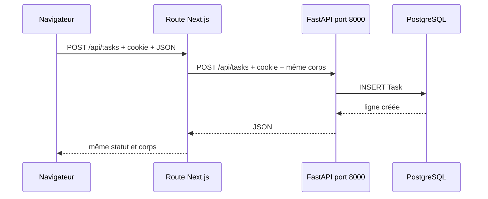

# Périmètre, méthode d’analyse et carte de vérité

## Pourquoi ce chapitre existe

Un cours fondé sur un dépôt doit distinguer trois niveaux de certitude : ce que le code prouve, ce que la configuration rend possible et ce que l’on pourrait améliorer. Sans cette discipline, une documentation peut sembler convaincante tout en inventant des comportements.

Ce chapitre fixe la carte de vérité utilisée dans tout le manuel.

## Inventaire Python observé

L’inventaire exclut les dépendances installées, les caches, `.next`, `node_modules`, `.venv` et les artefacts de build.

| Zone | Rôle | Fichiers Python observés |
| --- | --- | ---: |
| `interface_API/app/contracts/` | schémas Pydantic et énumérations | 10 |
| `interface_API/app/core/` | calculs, agrégats et règles métier | 14 |
| `interface_API/app/routers/` | frontières HTTP FastAPI | 13 |
| `interface_API/app/` hors sous-dossiers | assemblage, configuration, sécurité, ORM | 6 |
| `interface_API/tests/` | tests `unittest` | 5 |
| `interface_API/run.py` | lancement Uvicorn | 1 |
| `services/` | microservice Whisper | 2 |
| Total |  | 51 |

Les fichiers `__init__.py` vides comptent comme fichiers Python parce qu’ils participent à l’organisation en packages, même s’ils n’exécutent aucune règle métier.

## Frameworks et bibliothèques confirmés

| Dépendance | Preuve dans le dépôt | Usage réel |
| --- | --- | --- |
| FastAPI | `FastAPI`, `APIRouter`, décorateurs dans `app/main.py` et `routers/` | routes, validation intégrée, dépendances, erreurs, OpenAPI |
| Uvicorn | `interface_API/run.py` | serveur ASGI qui importe `app.main:app` |
| Pydantic v2 | `BaseModel`, `ConfigDict`, `model_validator`, `model_fields_set` | conversion et validation des entrées |
| SQLAlchemy 2 | `create_engine`, `Session`, `select`, `Mapped` | accès synchrone à PostgreSQL |
| psycopg2 | URL `postgresql+psycopg2` | pilote SQL synchrone |
| httpx | `AsyncClient` dans le routeur de transcription | appel asynchrone au service Whisper |
| python-dotenv | `load_dotenv` | chargement de configuration depuis `.env` |
| openai-whisper | `whisper.load_model` | transcription locale dans le second service |
| imageio-ffmpeg | `get_ffmpeg_exe` | rend FFmpeg trouvable par Whisper |

## Sources de vérité par sujet

| Question | Source prioritaire |
| --- | --- |
| Quelle URL HTTP existe ? | décorateurs des fichiers `interface_API/app/routers/*.py` et `app/main.py` |
| Quel JSON d’entrée est accepté ? | classes de `interface_API/app/contracts/*.py`, plus `LoginBody` |
| Quelle table ou colonne existe ? | `prisma/schema.prisma` |
| Comment Python accède à la table ? | `interface_API/app/models.py` |
| Qui crée ou migre la table ? | Prisma, pas SQLAlchemy dans ce projet |
| Quand la transaction est validée ? | `interface_API/app/database.py:get_db` |
| Comment l’utilisateur est authentifié ? | `interface_API/app/security.py` et, côté Next.js, `lib/auth.ts` |
| Quel calcul métier est appliqué ? | fichiers `interface_API/app/core/*.py` |
| Quel format sort réellement ? | dictionnaire retourné par la route ou sa fonction `core` |
| Comment le navigateur atteint FastAPI ? | `lib/server/proxyApiRequest.ts`, routes Next.js et clients `features/*/api/` |
| Comment la transcription est effectuée ? | routeur `transcribe.py` puis `services/whisper_service.py` |

## Deux applications FastAPI distinctes

### API métier

Objet : `interface_API/app/main.py:app`.

Elle connaît la base de données, l’utilisateur, les tâches, le journal, les habitudes, les objectifs, l’allocation du temps, les rapports et le tableau de bord.

### Service Whisper

Objet : `services/whisper_service.py:app`.

Il ne connaît ni SQLAlchemy ni l’utilisateur. Il reçoit un fichier, vérifie son type et sa taille, le place temporairement sur disque, charge Whisper une seule fois grâce au cache, effectue la transcription dans un thread, supprime le fichier temporaire et renvoie le texte.

### Conséquence pratique

Modifier le port ou l’URL d’un service ne suffit pas : `WHISPER_SERVICE_URL` doit pointer vers l’endpoint complet, actuellement `http://127.0.0.1:8001/transcribe`.

## Frontend et API : deux chemins réseau

### Interaction dans le navigateur

Pour la majorité des mutations, le navigateur appelle une URL relative telle que `/api/tasks`. Le routeur Next.js correspondant transmet la requête à FastAPI avec `proxyApiRequest`.



### Rendu serveur Next.js

Certaines pages serveur appellent FastAPI directement avec `requestInternalApiJson`. Le cookie du navigateur est reconstruit depuis `next/headers` et ajouté à l’appel interne.

### Exception importante : connexion Next.js

Les fichiers actuels `app/api/auth/login/route.ts` et `logout/route.ts` gèrent la session côté Next.js avec `lib/auth.ts` ; ils n’utilisent pas `proxyApiRequest`. L’API Python possède néanmoins ses propres routes `/api/auth/login` et `/api/auth/logout`, utilisables lors d’un appel direct au port 8000. Les deux implémentations restent compatibles parce qu’elles partagent le nom du cookie et le secret de signature.

## Ce qui est indirect mais pas magique

Plusieurs fonctions ne sont jamais appelées explicitement par une autre ligne métier :

- un décorateur `@router.post` donne une fonction à FastAPI ; FastAPI l’appelle plus tard ;
- `Depends(get_current_user)` donne une fonction à l’injecteur de dépendances ;
- `Depends(get_db)` déclenche un générateur, suspendu à `yield`, puis repris après la route ;
- `@app.exception_handler(...)` enregistre un callback sélectionné lors d’une exception ;
- `default=new_id` donne la fonction `new_id` à SQLAlchemy, qui l’appelle lors de l’insertion ;
- `onupdate=utcnow` donne la fonction `utcnow` à SQLAlchemy pour certaines mises à jour ORM ;
- `@lru_cache(maxsize=1)` enveloppe une fonction et réutilise son premier résultat ;
- `@model_validator(mode="after")` enregistre une validation appelée par Pydantic après les champs.

Le chapitre consacré aux callbacks détaille pour chacun le déclencheur, le moment et les données reçues.

## Ce qui n’existe pas dans le code actuel

Il est aussi important de savoir reconnaître une absence :

- pas de Django ni de Flask ;
- pas d’API GraphQL ;
- pas de route WebSocket ;
- pas de méthode HTTP `PUT` ;
- pas de `BackgroundTasks` FastAPI ;
- pas de gestionnaire de cycle de vie `lifespan` ;
- pas de middleware Python personnalisé, seulement `CORSMiddleware` ;
- pas de `relationship()` SQLAlchemy ;
- pas de création de table par `Base.metadata.create_all()` ;
- pas de couche générique nommée `service` dans l’API métier ; le rôle correspondant est porté par `core/` ;
- pas de suppression physique pour les habitudes, objectifs et catégories d’allocation : les routes les désactivent ou les archivent.

## Risques de lecture pour un débutant

### Confondre définition et exécution

Lire `def health():` crée une fonction ; son corps ne s’exécute pas à l’import. En revanche, le décorateur placé juste au-dessus s’exécute pendant l’import et enregistre cette fonction.

### Confondre `flush` et `commit`

`db.flush()` envoie les opérations SQL en attente afin d’obtenir notamment les identifiants et de rendre les données visibles dans la transaction. La transaction n’est durablement validée que lorsque `get_db` reprend après `yield` et appelle `commit()`.

### Confondre schéma Pydantic et modèle SQLAlchemy

`TaskCreateRequest` décrit ce que le client peut envoyer. `Task` décrit une ligne de la table. Les deux peuvent partager certains champs sans avoir le même rôle ni la même durée de vie.

### Confondre `async def` et parallélisme CPU

`async def` permet de suspendre une coroutine pendant une attente. Le calcul Whisper est lourd et bloquant ; le service l’envoie donc dans un thread via `run_in_threadpool`. L’API métier attend l’appel réseau avec `await httpx.AsyncClient.post(...)`.

### Croire qu’un type annoté valide toujours

FastAPI/Pydantic valident les paramètres de route et les modèles de requête. Une annotation interne comme `def clamp_score(score: float) -> int` aide les lecteurs et outils, mais Python ne bloque pas automatiquement tout mauvais type lors d’un appel direct.

## Méthode pour vérifier une affirmation du cours

Pour toute affirmation :

1. trouvez le fichier cité ;
2. localisez la définition avec `rg` ;
3. inspectez les imports en haut du fichier ;
4. recherchez tous les appels de la fonction ;
5. si l’appel direct est absent, inspectez ses décorateurs ou l’endroit où la fonction est passée comme valeur ;
6. suivez les valeurs retournées jusqu’à la route ;
7. cherchez `raise`, `except`, `commit`, `rollback` et les appels externes sur ce trajet.

Exemple :

```powershell
rg -n "recompute_around_date" interface_API
```

Cette recherche montre que les routes de tâches, de calendrier et de journal déclenchent des recalculs. Elle montre aussi la définition dans `core/scoring.py`.

## Exercice avec correction

### Exercice

Classez chaque fichier dans une seule catégorie principale : `contracts/daily_log.py`, `routers/daily_log.py`, `core/scoring.py`, `models.py`, `database.py`.

### Correction

- `contracts/daily_log.py` est une frontière de validation : il transforme et refuse certaines entrées.
- `routers/daily_log.py` est la frontière HTTP : il reçoit les dépendances et orchestre le cas d’usage.
- `core/scoring.py` contient des règles et une orchestration métier de recalcul.
- `models.py` est l’adaptateur ORM entre objets Python et tables existantes.
- `database.py` possède le moteur, la fabrique de sessions et la transaction par requête.

Cette séparation n’est pas absolue au sens académique, mais elle correspond au code réel et donne un bon guide de modification.
