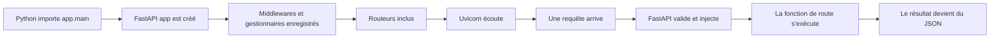

# Python depuis zéro, avec les exemples du projet

## Objectif et périmètre

Ce chapitre part de zéro. Il ne suppose ni connaissance de Python, ni connaissance des API. Les exemples « projet » viennent des fichiers réellement présents dans `interface_API/` et `services/`. Les petits exemples marqués « exemple minimal » sont pédagogiques : ils ne prétendent pas exister dans l’application.

## 1. Lire une ligne Python

### Intuition

Un programme est une suite d’instructions. Python lit en général un fichier de haut en bas. Certaines instructions sont exécutées immédiatement. Une définition `def` ou `class` crée un objet réutilisable, mais n’exécute pas encore son corps.

### Mécanisme exact

Python utilise l’indentation, c’est-à-dire les espaces au début d’une ligne, pour délimiter les blocs. Quatre espaces sont la convention du projet.

```python
if temperature > 20:
    message = "Il fait chaud"
else:
    message = "Il ne fait pas chaud"
```

- `if` ouvre une condition ;
- `temperature > 20` produit `True` ou `False` ;
- `:` annonce un bloc indenté ;
- `=` affecte une valeur à un nom ;
- les guillemets créent une chaîne de caractères ;
- `else` désigne l’autre branche.

### Lien avec le projet

Dans `interface_API/app/config.py`, `_read_positive_integer` lit une variable d’environnement :

```python
raw_value = os.environ.get(name)
if raw_value is None:
    return default
```

Ordre réel : `os.environ.get(name)` cherche la valeur ; elle est stockée dans `raw_value` ; si elle n’existe pas, `return default` arrête immédiatement la fonction et renvoie la valeur par défaut.

### Erreurs fréquentes

- écrire `=` à la place de `==` dans une condition ;
- oublier `:` ;
- mélanger tabulations et espaces ;
- croire qu’une ligne située après `return` sera exécutée.

### Exercice corrigé

Que renvoie la fonction suivante pour `value=None` ?

```python
def choose(value):
    if value is None:
        return 8
    return value
```

Correction : elle renvoie `8`. `is None` teste précisément l’absence de valeur et le premier `return` termine l’appel.

## 2. Commentaires, chaînes et docstrings

Une ligne commençant par `#` est un commentaire ignoré par Python. Une chaîne placée au début d’un module, d’une classe ou d’une fonction est une docstring : un texte de documentation accessible par les outils.

```python
"""Application settings loaded from environment variables / .env file."""
```

Cette docstring réelle ouvre `interface_API/app/config.py`. Elle n’effectue aucun calcul. Les commentaires de ce fichier expliquent aussi pourquoi deux fichiers `.env` sont chargés.

Erreur fréquente : utiliser un commentaire pour expliquer un code obscur au lieu de choisir des noms clairs. Ici, `DEFAULT_DATABASE_URL` est plus explicite que `x`.

Exercice : quelle différence existe entre `# note` et `"note"` seul dans un module ? Correction : le premier est toujours ignoré ; le second crée une chaîne. Seule la première chaîne du module devient sa docstring.

## 3. Variables et constantes

### Intuition

Une variable est une étiquette attachée à une valeur. Une « constante » Python est seulement une convention : son nom est écrit en majuscules pour signaler qu’il ne devrait pas changer.

### Exemple minimal

```python
age = 20
name = "Ada"
ACTIVE = True
```

### Projet réel

`interface_API/app/security.py` déclare :

```python
COOKIE_NAME = "life_regime_session"
SESSION_DAYS = 30
```

`COOKIE_NAME` est réutilisé pour lire, écrire et supprimer le même cookie. `SESSION_DAYS` entre dans le calcul de l’expiration. Modifier une seule de ces constantes modifie tous ses usages dans ce module.

Dans `services/whisper_service.py`, `transcription_slots = asyncio.Semaphore(1)` n’est pas une constante malgré son emplacement global : l’objet sémaphore change d’état lorsqu’une transcription occupe la seule place disponible.

### Ordre et mutation

`x = 3` lie `x` à l’entier `3`. `x = 4` ne modifie pas l’objet `3` ; le nom pointe désormais vers `4`. En revanche, `items.append("a")` modifie la liste existante.

### Erreurs fréquentes

- confondre le nom et la valeur ;
- supposer que les majuscules rendent une valeur immuable ;
- réutiliser un nom pour deux sens différents ;
- oublier qu’un objet mutable partagé peut être modifié ailleurs.

### Exercice corrigé

Après `items = []`, `other = items`, puis `other.append(1)`, que vaut `items` ? Correction : `[1]`, car les deux noms pointent vers la même liste.

## 4. Types fondamentaux

### `None`

`None` signifie « aucune valeur ». Le type `str | None` signifie « chaîne ou absence de chaîne ». `decode_session` renvoie ainsi un identifiant utilisateur ou `None` lorsque le jeton est invalide.

### Booléens

`bool` possède deux valeurs : `True` et `False`. Dans `Settings.is_using_dev_access_key`, l’expression `not self.app_access_key` devient vraie lorsque la chaîne de clé est vide.

### Entiers et nombres décimaux

`int` représente un entier et `float` un nombre à virgule flottante. Le modèle `TimeAllocationCategory` contient par exemple `targetWeight: int` et `beta: float`.

### Chaînes

`str` représente du texte. Une f-string injecte des valeurs :

```python
return f"c{timestamp}{random_block}"
```

Cette ligne réelle de `app/ids.py` concatène `c`, l’horodatage et une partie aléatoire.

### Octets

`bytes` représente des octets bruts. Dans les deux routes de transcription, le contenu audio lu avec `await file.read(...)` est un objet `bytes`, pas du texte.

### Dates

Le projet distingue `date`, jour sans heure, et `datetime`, date avec heure. `to_utc_naive` convertit les dates-heures vers l’UTC puis retire l’information de fuseau pour correspondre au stockage existant.

### Vérification de type à l’exécution

```python
if not isinstance(user_id, str) or not user_id:
    return None
```

Dans `decode_session`, la première partie vérifie le type ; la seconde refuse la chaîne vide.

### Exercice corrigé

Pourquoi `isinstance(exp, bool)` est-il vérifié avant `isinstance(exp, (int, float))` ? En Python, `bool` hérite historiquement de `int`; sans le premier test, `True` pourrait être accepté comme date d’expiration numérique.

## 5. Listes, tuples, ensembles et dictionnaires

### Liste

Une `list` est une séquence ordonnée et modifiable.

```python
titles = ["Lire", "Tester"]
titles.append("Corriger")
```

Dans `create_tasks`, une compréhension filtre les titres vides :

```python
titles = [title for title in titles if title]
```

Elle signifie : parcourir chaque `title`, ne garder que les chaînes non vides, construire une nouvelle liste.

### Tuple

Un `tuple` est une séquence généralement utilisée comme groupe fixe. `encode_session` renvoie `tuple[str, int]`, donc `(token, expiration)`. Le déballage `token, exp = encode_session(user_id)` affecte les deux éléments à deux variables.

### Ensemble

Un `set` contient des valeurs uniques et permet une recherche rapide. `ALLOWED_AUDIO_TYPES = {"application/octet-stream", "video/webm"}` est l’ensemble des types supplémentaires admis.

### Dictionnaire

Un `dict` associe une clé à une valeur. Une réponse FastAPI peut être un dictionnaire :

```python
return {"ok": True}
```

FastAPI le convertit en objet JSON. En JSON, cela devient `{"ok": true}` : remarquez le `true` minuscule.

### Accès sûr

`data["text"]` échoue si la clé manque. `data.get("text")` renvoie `None`. La route proxy utilise `str(data.get("text") or "")` afin de toujours retourner une chaîne.

### Erreurs fréquentes

- utiliser `{}` en pensant créer un ensemble vide : cela crée un dictionnaire ;
- modifier une liste pendant qu’on la parcourt ;
- demander une clé absente avec `[]` ;
- confondre un tuple d’un élément `(x,)` et `(x)`.

### Exercice corrigé

Que produit `{"tasks": [1, 2]}` en JSON ? Correction : un objet avec la propriété `tasks`, dont la valeur est un tableau contenant `1` et `2`.

## 6. Opérateurs et expressions

Les opérateurs arithmétiques sont `+`, `-`, `*`, `/`, `//`, `%` et `**`. Les comparaisons sont `==`, `!=`, `<`, `<=`, `>` et `>=`. Les opérateurs logiques sont `and`, `or` et `not`.

Dans `_base36` :

```python
value, rem = divmod(value, 36)
```

`divmod` renvoie à la fois le quotient et le reste. Les deux résultats sont déballés. Dans `_b64url_decode`, `-len(data) % 4` calcule combien de signes `=` ajouter pour compléter la longueur Base64.

`a or b` retourne `a` si `a` est « truthy », sinon `b`. Ainsi `file.filename or "audio"` choisit un nom par défaut. Les valeurs fausses incluent `None`, `False`, `0`, `""`, `[]` et `{}`.

Exercice : que vaut `(None or "défaut")` ? Correction : `"défaut"`.

## 7. Conditions

### Syntaxe

```python
if condition_a:
    action_a()
elif condition_b:
    action_b()
else:
    action_c()
```

Une seule branche est exécutée. `elif` signifie « sinon, si ».

### Projet réel

Dans `transcribe` du microservice :

```python
if len(content) > MAX_AUDIO_BYTES:
    raise HTTPException(status_code=413, detail="Audio file is too large")
```

Si l’audio dépasse la limite, `raise` interrompt le chemin normal. FastAPI transforme l’exception en réponse HTTP.

### Expression conditionnelle

`a if condition else b` produit une valeur. `date_key = body.date.isoformat() if body.date else to_date_key()` choisit la date envoyée ou la date courante.

### Exercice corrigé

Si `scope == "tomorrow"`, que fait `add_days(to_date_key(), 1)` dans `list_tasks` ? Correction : il calcule la clé du lendemain ; les autres branches de l’expression ne déterminent pas le résultat.

## 8. Boucles

### Boucle `for`

```python
for title in titles:
    print(title)
```

Python affecte successivement chaque élément à `title`. Dans `create_tasks`, chaque titre produit un objet `Task`, ajouté à la session puis à la liste `tasks`.

### Boucle `while`

```python
while value > 0:
    value, rem = divmod(value, 36)
```

Cette boucle réelle de `_base36` continue jusqu’à ce que `value` atteigne zéro.

### `break`, `continue` et compréhensions

`break` arrête une boucle ; `continue` passe à l’itération suivante. Le projet préfère souvent les compréhensions, par exemple pour construire `validation_issues` dans `main.py`.

### Erreurs fréquentes

- boucle `while` infinie ;
- erreur d’un niveau d’indentation ;
- croire que la variable de boucle est un index ;
- effectuer une requête SQL coûteuse à chaque itération sans nécessité.

### Exercice corrigé

Écrivez mentalement le résultat de `[x * 2 for x in [1, 2, 3] if x > 1]`. Correction : `[4, 6]`.

## 9. Fonctions

### Intuition

Une fonction donne un nom à une opération. Elle reçoit éventuellement des entrées, appelées paramètres, et renvoie éventuellement une sortie.

```python
def add(a: int, b: int = 1) -> int:
    return a + b
```

- `def` commence la définition ;
- `add` est le nom ;
- `a` et `b` sont les paramètres ;
- `: int` est une annotation de type ;
- `= 1` est une valeur par défaut ;
- `-> int` documente le type de retour ;
- `return` fournit le résultat à l’appelant.

### Paramètre et argument

Dans la définition, `name` est un paramètre. Dans `_read_positive_integer("API_PORT", 8000)`, `"API_PORT"` et `8000` sont des arguments. Un argument nommé, comme `default=None`, explicite le paramètre ciblé.

### Fonctions privées par convention

Un nom commençant par `_`, comme `_sign`, signale un détail interne. Python n’en interdit pas l’appel : les tests importent même `_sign` et `_b64url_encode` pour fabriquer des jetons invalides contrôlés.

### Portée

Une variable créée dans une fonction est locale. `raw_value` de `_read_positive_integer` n’existe pas hors de cet appel. Les constantes du module sont globales au module.

### Retour implicite

Une fonction sans `return` explicite renvoie `None`. `clear_session_cookie` appelle une méthode mais ne fournit aucune valeur utile, d’où `-> None`.

### Erreurs fréquentes

- oublier d’appeler la fonction : `get_settings` est l’objet fonction, `get_settings()` son résultat ;
- modifier un paramètre mutable partagé ;
- donner une valeur par défaut mutable comme `items=[]` ;
- oublier un chemin de retour ;
- confondre annotation et validation automatique : Python seul ne force pas `: int`.

### Exercice corrigé

Que retourne `_objective_title(db, None)` ? Correction : `None`, car le premier `if not objective_id: return None` arrête la fonction avant toute requête.

## 10. Fonctions imbriquées et fonctions comme valeurs

Une fonction peut être définie dans une autre fonction. `compute_weekly_summary` définit notamment `avg` et `collect`; elles n’existent que pendant cet appel et peuvent lire les variables de la fonction extérieure.

Une fonction peut aussi être passée comme argument. Dans `collect(selector)`, `selector` est une fonction appelée pour choisir un champ de chaque log. Dans `life_terminal.py`, la fonction imbriquée `previous_value(selector)` reçoit elle aussi un callback.

Intuition : on remet une « recette » à une autre fonction. La seconde décide quand l’exécuter. Voilà pourquoi l’appel initial n’est pas toujours visible à côté de la définition.

Erreur fréquente : passer `selector()` au lieu de `selector`. Le premier exécute immédiatement ; le second transmet la fonction.

Exercice : dans `sorted(items, key=my_key)`, qui appelle `my_key` ? Correction : `sorted`, une fois par élément selon son implémentation.

## 11. Classes et objets

### Intuition

Une classe est un plan ; un objet est une instance construite selon ce plan. Les attributs sont les données attachées à l’objet, les méthodes sont ses fonctions.

```python
class Counter:
    def __init__(self, start: int):
        self.value = start

    def increment(self) -> int:
        self.value += 1
        return self.value
```

`self` désigne l’instance courante. `Counter(4)` appelle `__init__`; `counter.increment()` fournit implicitement `counter` à `self`.

### Modèles SQLAlchemy réels

```python
class Task(Base):
    __tablename__ = "Task"
    id: Mapped[str] = mapped_column(String, primary_key=True, default=new_id)
```

`Task` hérite de `Base`. SQLAlchemy inspecte la classe et relie ses attributs à la table existante `Task`. `Mapped[str]` indique le type Python attendu. `mapped_column` décrit la colonne SQL. `default=new_id` transmet la fonction, sans parenthèses : SQLAlchemy l’appellera au moment approprié.

### Modèles Pydantic réels

`TaskCreateRequest(ApiRequest)` décrit des données HTTP validées. Une instance porte des attributs en `snake_case`, même si le client a envoyé du `camelCase`, grâce à `ApiRequest.model_config`.

### Dataclass réelle

`Settings` porte `@dataclass(frozen=True)`. `dataclass` génère notamment le constructeur. `frozen=True` interdit les réaffectations ordinaires après création.

### Héritage

`ApiRequest(BaseModel)` reçoit les capacités de validation Pydantic. `DailyLogUpsertRequest(ApiRequest)` reçoit à son tour cette validation et la configuration commune.

### Erreurs fréquentes

- confondre `Task` avec une ligne précise `task` ;
- oublier `self` dans une méthode ;
- croire qu’une annotation crée une colonne sans `mapped_column` ;
- confondre modèle ORM et schéma de requête.

### Exercice corrigé

Dans `existing.title = body.title`, quels sont les objets ? Correction : `existing` est une instance ORM `Task`; `body` est une instance Pydantic `TaskUpdateRequest`; la valeur textuelle passe de l’une à l’autre.

## 12. Modules, packages et imports

### Intuition

Un fichier `.py` est un module. Un dossier de modules, généralement accompagné de `__init__.py`, est un package. Un import permet de réutiliser un nom défini ailleurs.

```python
from ..core.dates import add_days
```

Depuis `app/routers/tasks.py`, `..` remonte vers `app`, `core.dates` cible `app/core/dates.py`, et `add_days` est le nom importé.

### Formes d’import

```python
import os
from pathlib import Path
from .config import get_settings
from .routers import settings as settings_router
```

- `import os` impose ensuite `os.environ` ;
- `from pathlib import Path` rend `Path` directement disponible ;
- `.` signifie le package courant ;
- `as settings_router` évite la collision entre le module `settings` et la variable de configuration.

### Exécution lors de l’import

Importer exécute une première fois le niveau supérieur du module. Importer `app.main` construit donc l’objet FastAPI, ajoute CORS, enregistre les gestionnaires et inclut les routeurs. Les corps des routes ne s’exécutent pas encore.

`if __name__ == "__main__":` de `run.py` empêche le lancement d’Uvicorn si ce fichier est seulement importé. Il se lance lorsque l’utilisateur exécute `python run.py`.

### Import différé réel

Le test `test_partial_objective_update_does_not_default_kind` importe `ObjectiveUpdateRequest` dans la méthode, alors que les autres contrats sont importés en tête de fichier. L’import est mis en cache par Python ; la seconde exécution ne recharge normalement pas le module.

### Erreurs fréquentes

- lancer depuis le mauvais dossier et obtenir `ModuleNotFoundError: No module named 'app'` ;
- créer deux modules qui s’importent mutuellement ;
- nommer un fichier local `fastapi.py` ou `json.py`, masquant la bibliothèque ;
- supposer qu’un import est purement déclaratif.

### Exercice corrigé

Pourquoi `from __future__ import annotations` est-il en première position ? Correction : les imports `__future__` doivent être placés au début, après l’éventuelle docstring ; ici ils reportent l’évaluation des annotations et simplifient certains types.

## 13. Exceptions

### Intuition

Une exception est un signal qui interrompt le chemin normal. Elle remonte dans les appels jusqu’à être capturée.

```python
try:
    parsed = int(raw)
except ValueError as error:
    raise RuntimeError("valeur invalide") from error
```

`try` protège une opération ; `except` capture un type précis ; `as error` conserve l’exception ; `raise ... from error` crée une nouvelle erreur en gardant la cause.

### `finally`

`get_db` ferme toujours la session dans `finally`, que la route réussisse ou échoue. Le microservice supprime de même le fichier temporaire dans un `finally`.

### Exceptions HTTP

`raise HTTPException(status_code=404, detail="Task not found")` exprime une erreur attendue pour le client. Le gestionnaire de `main.py` uniformise sa réponse sous `{"error": "Task not found"}`.

### Erreurs fréquentes

- capturer `Exception` trop tôt et masquer le vrai problème ;
- oublier le nettoyage ;
- utiliser `return` dans `finally`, ce qui peut masquer une exception ;
- envoyer au client un traceback ou un secret.

### Exercice corrigé

Dans `get_db`, que se passe-t-il si une route lève une exception ? Correction : le contrôle revient au générateur, `rollback()` annule la transaction, `raise` propage la même exception, puis `close()` libère la session.

## 14. Décorateurs

### Intuition

Un décorateur remet une fonction ou une classe à une autre fonction afin de l’enregistrer ou la transformer.

```python
@router.get("")
def list_tasks(...):
    ...
```

Au chargement de `tasks.py`, `router.get("")` fabrique un décorateur. Celui-ci reçoit `list_tasks` et l’enregistre comme gestionnaire GET. La fonction sera appelée plus tard par FastAPI.

### Décorateurs réels

- `@app.exception_handler(...)` enregistre un callback d’erreur ;
- `@router.get/post/patch/delete` enregistre une route ;
- `@model_validator(mode="after")` demande à Pydantic d’appeler la méthode après la validation des champs ;
- `@classmethod` fournit la classe dans `cls` ;
- `@staticmethod` ne fournit ni instance ni classe ;
- `@property` permet `settings.access_key` au lieu de `settings.access_key()` ;
- `@lru_cache(maxsize=1)` mémorise une seule valeur de configuration ou un seul modèle Whisper ;
- `@dataclass(frozen=True)` génère des méthodes pour `Settings`.

### Ordre

Le décorateur agit lors de la définition, donc lors de l’import du module. Le callback de route agit seulement lorsqu’une requête correspondante arrive.

### Exercice corrigé

Pourquoi `default=new_id` et non `default=new_id()` ? Correction : on veut donner à SQLAlchemy un callback à appeler pour chaque nouvelle ligne, pas un identifiant calculé une fois à l’import.

## 15. Générateurs et `yield`

`get_db` n’est pas une fonction ordinaire : la présence de `yield` en fait un générateur.

```python
def get_db() -> Iterator[Session]:
    db = SessionLocal()
    try:
        yield db
        db.commit()
    except Exception:
        db.rollback()
        raise
    finally:
        db.close()
```

Ordre exact sous FastAPI : création de la session ; pause sur `yield db` ; exécution de la dépendance puis de la route ; reprise après `yield` ; `commit` si tout va bien ; sinon `rollback` ; `close` dans tous les cas.

Un `return` aurait fermé la fonction immédiatement et n’aurait pas permis ce nettoyage après la route.

Exercice : quelle partie encadre réellement la route ? Correction : tout ce qui est avant `yield` prépare la ressource, tout ce qui est après la finalise.

## 16. `async`, `await` et gestionnaires de contexte

### Intuition

Une fonction synchrone garde son fil d’exécution jusqu’à son retour. Une coroutine `async def` peut suspendre son travail sur `await`, permettant à la boucle événementielle de traiter autre chose.

```python
async def read_file(file):
    content = await file.read()
    return content
```

Appeler une coroutine ne suffit pas à l’exécuter comme une fonction normale : la boucle événementielle doit la planifier et un appelant asynchrone utilise `await`.

### Projet réel

La route `app/routers/transcribe.py::transcribe` attend :

- la lecture et la fermeture de l’upload ;
- l’entrée/sortie d’un `httpx.AsyncClient` ;
- la requête HTTP vers Whisper.

Le microservice attend lui aussi la lecture du fichier. Comme `whisper.load_model` et `model.transcribe` sont bloquants, il les remet au pool de threads avec `await run_in_threadpool(...)`.

### `async with`

`async with httpx.AsyncClient(...) as client` ouvre puis ferme une ressource asynchrone. `async with transcription_slots` acquiert puis libère le sémaphore, même en cas d’erreur.

### Ce que l’asynchronisme ne fait pas

Il ne rend pas automatiquement un calcul CPU plus rapide. Le modèle Whisper est déporté vers un thread afin de ne pas bloquer la boucle, mais un sémaphore limite explicitement à une transcription simultanée.

### Erreurs fréquentes

- oublier `await` et manipuler un objet coroutine ;
- appeler directement une opération CPU longue dans `async def` ;
- employer un client HTTP synchrone dans la boucle ;
- croire que toutes les routes doivent être `async def`.

### Exercice corrigé

Pourquoi `list_tasks` est-il un simple `def` ? Correction : il utilise une session SQLAlchemy synchrone. FastAPI sait exécuter une route synchrone dans un pool adapté ; ajouter `async` sans rendre la base asynchrone n’apporterait pas le bénéfice attendu.

## 17. Contexte, fichiers et nettoyage

Un gestionnaire `with` garantit la sortie d’une ressource :

```python
with tempfile.NamedTemporaryFile(delete=False, suffix=suffix) as temp:
    temp.write(content)
```

À la sortie, le fichier est fermé. Il reste présent à cause de `delete=False`; le `finally` ultérieur appelle `temp_path.unlink(missing_ok=True)`.

Erreur fréquente : supprimer le fichier avant que Whisper ait fini de le lire, ou oublier le `finally` si la transcription échoue.

Exercice : pourquoi `temp_path` est-il initialisé à `None` ? Correction : le nettoyage peut tester si un chemin a réellement été créé avant d’appeler `unlink`.

## 18. Premier modèle mental du projet



Pour le microservice, un autre processus importe `services.whisper_service:app`. Les deux objets `app` ne sont pas le même objet et n’écoutent pas le même port.

## 19. Atelier de reconstruction

Sans relire, expliquez avec vos mots :

1. la différence entre définition et appel ;
2. la différence entre modèle ORM et modèle Pydantic ;
3. pourquoi `yield` est important dans `get_db` ;
4. qui appelle une fonction décorée par `@router.get` ;
5. pourquoi une opération bloquante pose problème dans une route asynchrone.

### Correction attendue

1. Une définition crée la fonction ; un appel exécute son corps avec des arguments.
2. L’ORM représente les lignes/tables persistées ; Pydantic valide la frontière HTTP.
3. Il permet à FastAPI d’exécuter la route entre ouverture et finalisation de transaction.
4. FastAPI l’appelle lorsque méthode et chemin correspondent.
5. Elle immobilise la boucle événementielle et retarde les autres requêtes.

## 20. Ce que vous devez désormais reconnaître

Vous devez savoir identifier une affectation, une condition, une boucle, une fonction, un retour, une classe, une instance, un import, une exception, un décorateur, un générateur et une coroutine. La suite applique ce vocabulaire aux fonctions et imports réels du dépôt.

## 21. Parcours guidé dans le code réel

Ouvrez ces liens dans l’ordre et nommez la construction Python avant de lire l’explication :

1. [`config.py`, constantes et appels au niveau module](../../interface_API/app/config.py#L12) : affectations globales, `Path`, deux appels `load_dotenv`.
2. [`config.py`, condition et exception](../../interface_API/app/config.py#L38) : paramètre, variable locale, `if`, `try/except`, `raise`, retour.
3. [`config.py`, dataclass et propriétés](../../interface_API/app/config.py#L51) : décorateur de classe, annotations, `self`, `@property`.
4. [`ids.py`, boucle](../../interface_API/app/ids.py#L11) : `while`, déballage de tuple, index d’une chaîne, concaténation.
5. [`security.py`, fonction à plusieurs sorties](../../interface_API/app/security.py#L52) : gardes successives et `None`.
6. [`database.py`, générateur](../../interface_API/app/database.py#L21) : `yield`, transaction, propagation et nettoyage.
7. [`contracts/calendar_events.py`, classe validée](../../interface_API/app/contracts/calendar_events.py#L14) : héritage, champs, union, callback.
8. [`models.py`, modèle ORM Task](../../interface_API/app/models.py#L90) : attributs mappés, types, defaults.
9. [`routers/tasks.py`, boucle de création](../../interface_API/app/routers/tasks.py#L88) : dépendances, normalisation, boucle, mutations, retour.
10. [`routers/transcribe.py`, coroutine](../../interface_API/app/routers/transcribe.py#L17) : `async def`, `await`, gestionnaire asynchrone et exceptions.
11. [`whisper_service.py`, ressource temporaire](../../services/whisper_service.py#L85) : sémaphore, pool de threads, `with`, `try/finally`.
12. [`test_contracts.py`, assertions](../../interface_API/tests/test_contracts.py#L16) : classe de test, cas valide, cas invalide, correction attendue.
13. [`course_timer.py`, programme terminal autonome](../../scripts/course_timer.py#L1) : constantes, fonctions, boucle, affichage, arguments et garde `__main__`.

### Exercice final corrigé

Pour chacun, écrivez « appelé à l’import », « appelé par FastAPI/Pydantic/SQLAlchemy » ou « appelé directement ». Correction : les deux `load_dotenv` sont appelés à l’import ; routes et dépendances sont appelées par FastAPI ; validateurs par Pydantic ; `new_id`/`utcnow` par SQLAlchemy ; helpers comme `parse_date_key` sont appelés directement par les fonctions du projet.

## 22. Lire le timer Python ligne par ligne

Le fichier `scripts/course_timer.py` est volontairement plus simple que l’API et constitue un bon premier programme complet.

```python
DEFAULT_DURATION_SECONDS = 5 * 60
SECONDS_PER_MINUTE = 60
```

Les majuscules signalent deux constantes. La première calcule 300 au chargement du module.

```python
minutes, seconds = divmod(max(0, remaining_seconds), SECONDS_PER_MINUTE)
return f"{minutes:02d}:{seconds:02d}"
```

`max` empêche une valeur négative. `divmod` retourne quotient et reste, déballés en minutes/secondes. Dans la f-string, `02d` signifie entier décimal sur au moins deux caractères, complété par zéro.

`run_countdown` refuse une durée non positive, calcule `deadline` avec l’horloge monotone, boucle avec `while True`, affiche sur la même ligne grâce à `\r` et `end=""`, sort avec `break`, puis annonce la fin. `time.monotonic()` est préférable à l’heure civile : un changement d’horloge système ne fausse pas le délai.

`parse_arguments` crée un analyseur de terminal et ajoute `--seconds`, converti en `int`. `main` capture `ValueError` et `KeyboardInterrupt`. Enfin :

```python
if __name__ == "__main__":
    main()
```

Lors de `python scripts/course_timer.py`, `__name__` vaut `"__main__"` et le compte à rebours démarre. Lors d’un import, les définitions sont créées mais `main()` n’est pas appelé.

Exercice : quelle commande lance deux secondes ? Correction : `python scripts/course_timer.py --seconds 2`. L’ordre attendu est parsing, appel de `run_countdown`, affichages, sortie de boucle, retour de `main`.
