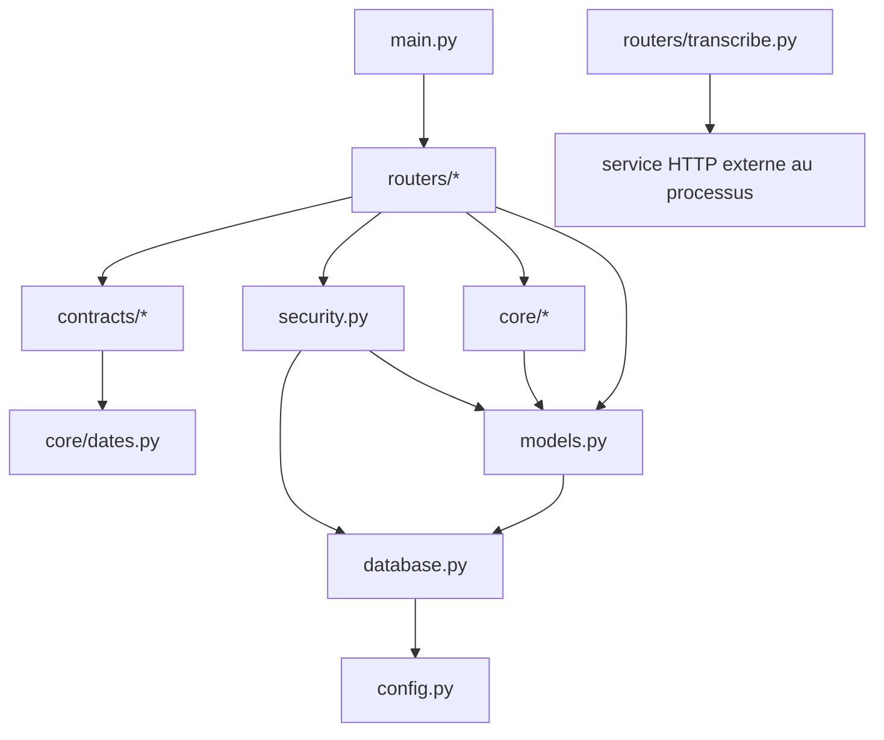

# Lire les fonctions, les imports et les appels réels

## 1. Méthode de lecture

Ne lisez pas une API de la première à la dernière ligne comme un roman. Pour une fonctionnalité, partez de la route, relevez ses paramètres injectés, suivez ses appels, puis revenez aux imports qui donnent leur origine.


Pour chaque fonction, posez sept questions : qui l’appelle ? quand ? que reçoit-elle ? quels types ? que modifie-t-elle ? que renvoie-t-elle ? quelles exceptions peut-elle produire ?

## 2. Anatomie d’une signature réelle

```python
def _read_positive_integer(name: str, default: int) -> int:
```

- `def` définit une fonction synchrone ;
- `_read_positive_integer` est privé par convention ;
- `name` recevra le nom d’une variable d’environnement ;
- `name: str` indique une chaîne ;
- `default: int` indique un entier de remplacement ;
- `-> int` annonce un entier en sortie ;
- le `:` ouvre le corps indenté.

Appel réel : `_read_positive_integer("API_PORT", 8000)`. La sortie devient `Settings.api_port`. La fonction appelle `os.environ.get`, puis éventuellement `int`. Elle peut lever `RuntimeError` si le texte n’est pas un entier positif.

Exercice : que produit `_read_positive_integer("X", 3)` si `X="0"` ? Correction : `int("0")` produit `0`, puis la condition `<= 0` lève `RuntimeError`.

## 3. Les types de paramètres FastAPI

Considérons `list_tasks` dans `app/routers/tasks.py` :

```python
def list_tasks(
    scope: str = Query(default="today"),
    date: str | None = Query(default=None),
    user: User = Depends(get_current_user),
    db: Session = Depends(get_db),
):
```

`scope` et `date` viennent de la query string, par exemple `?scope=tomorrow`. `user` ne vient pas directement du client : FastAPI appelle `get_current_user`. `db` est produit par le générateur `get_db`. La signature est donc aussi une déclaration de graphe d’exécution.

Ordre simplifié : FastAPI extrait la query ; résout `get_db`; fournit cette même session à `get_current_user`; lit le cookie ; charge le `User`; appelle enfin `list_tasks`.

Erreur fréquente : croire que `Depends(get_db)` exécute `get_db` pendant l’import. Il décrit la dépendance ; FastAPI l’exécute pour chaque requête concernée.

Exercice : pourquoi `Depends(get_current_user)` protège-t-il la route ? Correction : si la dépendance lève `HTTPException(401)`, FastAPI n’appelle jamais le corps de la route.

## 4. Valeurs retournées et effets de bord

Une fonction peut produire une sortie, modifier un objet, ou faire les deux.

- `to_date_key` calcule et retourne une chaîne, sans écrire en base.
- `_update_category` modifie l’objet ORM reçu et retourne implicitement `None`.
- `create_tasks` ajoute des objets à la session, déclenche des recalculs et retourne un dictionnaire.
- `set_session_cookie` modifie l’objet `Response` et retourne `None`.
- `get_db` produit une session, commit/rollback puis la ferme.

Le nom `serialize_*` désigne ici une transformation d’objet Python/ORM vers un dictionnaire JSON-compatible. Par exemple `serialize_task` convertit une `date` avec `.isoformat()` et un enum stocké en majuscule avec `.lower()`.

Exercice : `db.flush()` retourne-t-il la tâche ? Correction : non. Il synchronise les modifications en attente avec la base, notamment pour rendre les identifiants/defaults disponibles ; la route conserve l’objet `task` qu’elle avait créé.

## 5. Lecture ligne par ligne de `get_settings`

`get_settings` est défini dans `app/config.py` et décoré par `@lru_cache(maxsize=1)`.

1. Le premier appel lit `ENV`, `APP_ACCESS_KEY` et `AUTH_SECRET`.
2. Si l’environnement est `production` sans les deux secrets, il lève `RuntimeError`.
3. Il lit `FRONTEND_ORIGINS`, sépare sur les virgules, retire les espaces et ignore les valeurs vides.
4. Il construit une instance immuable `Settings`.
5. `_sqlalchemy_url` retire le paramètre Prisma `schema` et choisit le pilote `postgresql+psycopg2`.
6. `_read_positive_integer` valide port, taille audio et délai.
7. Le décorateur mémorise l’instance ; les appels suivants la réutilisent.

Qui l’utilise : `database.py`, `security.py`, `main.py`, `routers/transcribe.py` et `run.py`.

Sans cache, les variables pourraient être relues et une nouvelle instance créée à chaque appel. Dans les tests qui modifient l’environnement, il faut penser à `get_settings.cache_clear()` avant de relire les réglages.

Erreur fréquente : confondre `app/routers/settings.py`, qui expose les préférences utilisateur en base, et `app/config.py`, qui expose la configuration de processus.

## 6. Lecture ligne par ligne de la sécurité

### `_b64url_encode` et `_b64url_decode`

La première transforme des octets en Base64 URL-safe, retire le remplissage `=` et décode le résultat ASCII. La seconde recalcule ce remplissage et retrouve les octets. Ce n’est pas du chiffrement : le contenu demeure décodable.

### `_sign`

1. `get_settings().signing_secret` choisit le secret.
2. `.encode("utf-8")` produit les octets du secret.
3. Le corps est encodé en ASCII.
4. `hmac.new(..., hashlib.sha256).digest()` calcule la signature.
5. `_b64url_encode` la rend transportable dans un cookie.

### `encode_session`

Entrée : `user_id: str`. Sortie : `(token: str, exp: int)`. La date d’expiration est en millisecondes Unix. `json.dumps` crée un JSON compact ; ce JSON est encodé, signé puis assemblé sous la forme `corps.signature`.

### `decode_session`

La fonction rejette successivement l’absence de jeton, l’absence de point, une partie vide, une signature différente, un Base64/JSON invalide, un payload non-dictionnaire, un identifiant invalide, une expiration non numérique ou expirée. Elle ne lève volontairement pas d’erreur pour ces entrées : elle renvoie `None`.

### `ensure_local_user`

Elle exécute `select(User).order_by(...).limit(1)`, renvoie le premier utilisateur ou crée `User(label="Local user")`, l’ajoute et fait `flush`.

### `authenticate_access_key`

Elle compare en temps constant la clé candidate et la clé attendue. Si elles diffèrent, elle renvoie `None`; sinon elle délègue à `ensure_local_user`.

### `get_current_user`

Cette fonction est principalement appelée indirectement par `Depends`. Elle lit le cookie, décode l’identifiant, charge `db.get(User, user_id)`, et renvoie l’utilisateur. Tout échec finit en `HTTPException(401, "Unauthorized")`.

Exercice : pourquoi comparer les signatures avec `hmac.compare_digest` plutôt qu’avec `==` ? Correction : la fonction est conçue pour limiter les différences temporelles qui peuvent révéler progressivement une signature.

## 7. Lecture ligne par ligne de `get_db`

À l’import de `database.py`, `create_engine(...)` construit le moteur SQLAlchemy. `pool_pre_ping=True` teste les connexions réutilisées ; `future=True` choisit l’API moderne. `sessionmaker(...)` fabrique une usine de sessions avec `autoflush=False` et `expire_on_commit=False`.

Pour une requête :

1. `db = SessionLocal()` réserve une session logique ;
2. `yield db` la fournit aux dépendances et à la route ;
3. en succès, `db.commit()` valide la transaction entière ;
4. en échec, `db.rollback()` l’annule ;
5. dans tous les cas, `db.close()` restitue les ressources.

Conséquence importante : une route n’appelle généralement pas `commit` elle-même. Le commit se produit après son retour, dans la dépendance. Plusieurs `flush` de services participent à la même transaction.

Erreur fréquente : intercepter une erreur de base dans une route, retourner une réponse « réussie », puis laisser `get_db` committer un état partiel. Si l’opération doit échouer, il faut propager une exception.

## 8. Lecture de `create_tasks`

Entrée validée : `TaskCreateRequest`; dépendances : utilisateur et session.

1. La date est celle du corps ou aujourd’hui.
2. Si `titles` existe, chaque chaîne est nettoyée par `.strip()`; sinon `title` ou `"Untitled task"` devient une liste d’un élément.
3. Une seconde compréhension retire les titres vides.
4. `_validate_objective_access` vérifie que l’objectif appartient au même utilisateur.
5. Pour chaque titre, la route construit `Task(...)` en convertissant les enums Pydantic avec `.value`.
6. `db.add(task)` place l’objet dans l’unité de travail.
7. `db.flush()` envoie les INSERT sans committer.
8. `recompute_around_date` met à jour les scores affectés.
9. `serialize_task` transforme les objets.
10. La route renvoie à la fois le premier objet sous `task` et tous les objets sous `tasks`.
11. Après le retour, `get_db` commit.

Erreur possible : un `objective_id` inconnu produit 400. Une erreur SQL non capturée remonte au gestionnaire 500 et la dépendance rollback.

Exercice : pourquoi vérifier `Objective.userId == user_id` ? Correction : un identifiant valide appartenant à un autre utilisateur ne doit pas autoriser une liaison entre comptes.

## 9. Lecture de `update_task`

Le schéma exige un `id` non vide. La requête sélectionne une tâche portant cet identifiant et appartenant à l’utilisateur. L’absence produit 404.

Les champs facultatifs ne sont affectés que s’ils ne sont pas `None`, sauf `objective_id`. Pour celui-ci, `body.model_fields_set` distingue « champ absent » et « champ explicitement envoyé à null ». Cette distinction permet de supprimer la liaison à un objectif.

Après mutation : `flush`, recalcul, sérialisation, puis commit indirect.

Piège : remplacer tous les tests par `if body.field:` empêcherait d’enregistrer `False`, `0` ou une chaîne vide. Il faut choisir le test selon la sémantique du champ.

Exercice : pourquoi `if body.productive is not None` est-il correct ? Correction : `False` est une valeur métier valide et ne doit pas être confondue avec un champ absent.

## 10. Lecture d’un validateur Pydantic

Dans `CalendarEventCreateRequest` :

```python
@model_validator(mode="after")
def validate_time_range(self):
    if self.end is not None and to_utc_naive(self.end) < to_utc_naive(self.start):
        raise ValueError("end must be after start")
    return self
```

Pydantic convertit d’abord les textes ISO en `datetime` et valide les champs. Il appelle ensuite ce validateur d’objet. Les deux dates sont normalisées avant comparaison. Une fin antérieure lève `ValueError`, que Pydantic transforme en `ValidationError`, puis FastAPI en 422. Le `return self` rend l’objet validé.

Les validateurs de `HabitUpdateRequest`, `TimeAllocationUpdateRequest` et `ObjectiveCreateRequest` appliquent des règles dépendant de plusieurs champs.

Erreur fréquente : comparer directement un `datetime` avec fuseau et un autre sans fuseau ; le test réel `test_calendar_compares_mixed_timezone_inputs` protège ce cas.

## 11. Lecture du proxy de transcription

La route `app/routers/transcribe.py::transcribe` est asynchrone et authentifiée.

1. `File(...)` exige un champ multipart nommé `file`.
2. `_is_supported_audio_type` accepte `audio/*`, `application/octet-stream` et `video/webm`.
3. La lecture demande au plus `max_audio_bytes + 1` : un octet suffit pour détecter un dépassement sans charger arbitrairement davantage.
4. Le fichier uploadé est fermé.
5. Le dépassement produit 413.
6. Un tuple `(filename, content, content_type)` est construit pour `httpx`.
7. `AsyncClient` envoie au service configuré.
8. `ConnectError` ou `HTTPError` devient 503.
9. Une erreur HTTP du service devient 502, avec un message extrait prudemment.
10. Un JSON upstream invalide devient 502.
11. Le succès retourne seulement `text`, converti en chaîne.

Le paramètre `user` n’est pas lu dans le corps. Sa présence est intentionnelle : sa résolution impose l’authentification.

Exercice : quelle différence entre 503 et 502 ici ? Correction : 503 signifie que le proxy n’a pas pu effectuer correctement la requête vers le service ; 502 signifie qu’il a reçu une réponse upstream invalide ou en erreur.

## 12. Lecture du microservice Whisper

Le second `transcribe` vit dans `services/whisper_service.py` et n’est pas la même fonction.

- il vérifie aussi le type et la taille ;
- il crée un fichier temporaire, car Whisper travaille à partir d’un chemin ;
- `ensure_ffmpeg_on_path` localise FFmpeg et crée si nécessaire un shim Windows ;
- `load_model`, mis en cache, charge le modèle une seule fois par processus ;
- `transcription_slots.locked()` permet de répondre 429 immédiatement si la place est occupée ;
- `async with transcription_slots` réserve la place ;
- `run_in_threadpool` déplace les appels bloquants ;
- un `RuntimeError` de transcription devient 422 ;
- une autre erreur devient 500 et est journalisée ;
- `finally` supprime le temporaire.

Erreur de course possible à comprendre : `locked()` est une observation, puis l’acquisition vient ensuite. Le sémaphore garantit quand même au plus un travail dans la section, mais plusieurs requêtes arrivant presque ensemble pourraient ne pas toutes recevoir immédiatement 429; l’une peut attendre selon l’ordonnancement.

## 13. Les familles d’imports

### Bibliothèque standard

- `os` : environnement et `PATH` ;
- `pathlib.Path` : chemins ;
- `datetime` : dates/heures ;
- `json` : encodage de session ;
- `hmac`, `hashlib`, `base64`, `binascii`, `secrets` : sécurité et identifiants ;
- `time` : epoch et identifiants ;
- `logging` : journaux ;
- `asyncio` : sémaphore ;
- `tempfile`, `shutil` : fichier audio temporaire et copie FFmpeg ;
- `math` : calculs et arrondi ;
- `enum.Enum`, `dataclasses.dataclass`, `functools.lru_cache` : structures et décorateurs ;
- `typing.Literal`, `collections.abc.Iterator` : types.

Ces modules sont livrés avec Python. Les retirer casse les noms utilisés dans les fichiers correspondants.

### FastAPI et Starlette

- `FastAPI` crée les deux applications ;
- `APIRouter` regroupe les routes ;
- `Depends` déclare l’injection ;
- `Query` décrit la query string et les alias ;
- `File`, `UploadFile` gèrent multipart ;
- `Request`, `Response` représentent les échanges ;
- `HTTPException` interrompt avec un statut ;
- `JSONResponse` contrôle corps, statut et headers ;
- `RequestValidationError` représente la validation de frontière ;
- `CORSMiddleware` ajoute les en-têtes CORS ;
- `run_in_threadpool` protège la boucle contre du travail bloquant ;
- `TestClient` appelle l’application sans lancer un serveur réseau.

### SQLAlchemy

- `create_engine`, `sessionmaker`, `Session` : connexion et transaction ;
- `DeclarativeBase`, `Mapped`, `mapped_column` : modèles ;
- `select`, `update`, `func`, `and_`, `case` : expressions SQL ;
- `insert` de `sqlalchemy.dialects.postgresql` : upsert PostgreSQL ;
- `Boolean`, `Date`, `DateTime`, `Float`, `Integer`, `String`, `Text`, `ENUM`, `JSONB` : types de colonnes.

### Pydantic

- `BaseModel` est la base des contrats ;
- `ConfigDict` configure alias et champs supplémentaires ;
- `Field` impose bornes et longueurs ;
- `model_validator` applique une règle inter-champs ;
- `to_camel` convertit `start_friction` en `startFriction` ;
- `ValidationError` est utilisé par les tests.

### Réseau, environnement et audio

- `httpx` est le client HTTP du proxy ;
- `dotenv.load_dotenv` charge `.env` ;
- `imageio_ffmpeg` fournit un exécutable FFmpeg ;
- `whisper` charge et exécute le modèle ;
- `uvicorn` sert l’application ASGI.

## 14. Imports internes et dépendances

Les dépendances suivent globalement ces couches :



Le proxy n’importe pas `services.whisper_service`. Il le contacte par HTTP. C’est une frontière de processus, pas un appel Python.

## 15. Fonctions centrales par domaine

### Dates

`to_date_key`, `parse_date_key`, `add_days`, `get_iso_week_id`, `get_week_date_keys` et `shift_week_id` convertissent les identifiants temporels. `iso_datetime`, `parse_iso_datetime` et `to_utc_naive` traitent les dates-heures. Les fonctions de libellé préparent l’affichage.

### Habitudes

`get_habit_tracker_data` lit habitudes, check-ins et routines pour une date. `upsert_habit_checkin` utilise l’insert PostgreSQL avec mise à jour en cas de conflit. `habit_payload` sérialise.

### Métriques et scoring

`compute_state_score`, `compute_execution_score` et `compute_risk_score` calculent trois scores. `compute_risk_delta` et `compute_risk_acceleration` comparent les jours. `recompute_daily_scores` orchestre les lectures, calculs et mutations ; `recompute_around_date` propage autour d’une date. `javascript_round` garantit la parité avec `Math.round` du frontend historique.

### Régime

`compute_regime` classe l’état courant. `compute_regime_transition`, `simulate_next_week` et `build_transition_matrix_placeholder` produisent transitions et projections. Le mot `placeholder` indique explicitement une approximation existante, pas un modèle final.

### Temps

`allocate_minutes_from_weights` répartit un budget ; `compute_portfolio_metrics` agrège rendement/risque ; `get_time_allocation_data` compose la réponse ; les deux fonctions `upsert_*` persistent allocation et budget.

### Objectifs

Les fonctions `serialize_*` transforment les modèles. `sync_objective_tasks` aligne les liaisons. `get_objectives_data` est un grand assembleur de graphe, planning et statistiques. `bootstrap_objectives_demo` insère des données de démonstration.

### Vue terminal

`get_life_terminal_data` orchestre beaucoup de domaines. Ses helpers `_pressure_for_events`, `_risk_band`, `_trend`, `_data_quality_status`, `_build_weekly_planner` et `_build_life_tape` préparent des sous-structures.

## 16. Fonctions indirectes et callbacks

Les fonctions suivantes sont déclenchées sans appel classique adjacent :

- routes : FastAPI appelle les fonctions décorées ;
- gestionnaires d’erreur : FastAPI choisit le gestionnaire selon la classe d’exception ;
- `get_db` et `get_current_user` : le moteur d’injection les appelle ;
- validateurs `model_validator` : Pydantic les appelle ;
- `new_id` et `utcnow` : SQLAlchemy les appelle comme defaults/onupdate ;
- propriétés de `Settings` : Python appelle la méthode lors de l’accès à l’attribut ;
- `_missing_` de `CaseInsensitiveEnum` : `Enum` l’appelle lorsqu’aucune valeur exacte ne correspond ;
- `load_model` enveloppé : `lru_cache` décide de rappeler ou de retourner le cache ;
- sélecteurs locaux : `collect`/`previous_value` appellent les fonctions reçues ;
- middlewares CORS : Starlette les exécute autour de la route.

Exercice : qui appelle `utcnow` lors d’un INSERT ? Correction : SQLAlchemy, parce que la fonction a été fournie comme `default=utcnow`.

## 17. Recherche pratique

Depuis la racine du dépôt :

```powershell
rg -n "def create_tasks" interface_API
rg -n "create_tasks|TaskCreateRequest" interface_API
rg -n "^from |^import " interface_API/app
rg -n "Depends\(" interface_API/app
rg -n "@router\.(get|post|patch|delete)" interface_API/app/routers
```

Chaque commande est en lecture seule. `rg -n` affiche fichier, numéro de ligne et correspondance.

Erreur fréquente : rechercher uniquement le nom de fonction et oublier les appels indirects. Pour une dépendance ou un décorateur, recherchez aussi `Depends`, `@router`, `default=` et `onupdate=`.

## 18. Exercice de traçage corrigé

Question : tracez `POST /api/tasks` à partir du décorateur.

Correction : `main.py` importe puis inclut `tasks.router`; le décorateur a enregistré `create_tasks`; à la requête, FastAPI valide `TaskCreateRequest`; résout `get_db`; résout `get_current_user`, qui appelle `decode_session` et interroge `User`; la route valide l’objectif, crée les `Task`, fait `flush`, appelle `recompute_around_date`, appelle `serialize_task`, retourne un dictionnaire ; `get_db` commit puis ferme ; FastAPI encode le JSON.

Question : quel import enlèverait la possibilité de protéger cette route ? Correction : retirer `get_current_user` ou `Depends` casserait la déclaration `user: User = Depends(get_current_user)` dès l’import ; remplacer la signature sans cette dépendance supprimerait l’authentification, ce qui serait une modification de sécurité et non un simple nettoyage.

## 19. Checklist avant de modifier une fonction

1. Trouver sa définition et tous ses usages avec `rg`.
2. Identifier appels directs, décorateurs et callbacks.
3. Noter ses entrées, sortie, mutations et exceptions.
4. Repérer la transaction qui l’entoure.
5. Lire le contrat Pydantic et le modèle ORM séparément.
6. Rechercher les tests associés.
7. Vérifier les conventions JSON, notamment camelCase.
8. Modifier le plus petit nombre de couches cohérent.
9. Ajouter un test qui échoue avant la modification.
10. Exécuter toute la suite.

## 20. Liens de traçage précis

Ces entrées relient définition, appelant et test lorsqu’il existe :

| Sujet | Définition réelle | Appelant/consommateur | Test réel |
| --- | --- | --- | --- |
| configuration | [`get_settings`](../../interface_API/app/config.py#L78) | [`database.py`](../../interface_API/app/database.py#L13), [`run.py`](../../interface_API/run.py#L5) | pas de test dédié |
| transaction | [`get_db`](../../interface_API/app/database.py#L21) | [`Depends(get_db)` dans tasks](../../interface_API/app/routers/tasks.py#L57) | couverture indirecte seulement |
| session | [`encode_session`/`decode_session`](../../interface_API/app/security.py#L43) | [`get_current_user`](../../interface_API/app/security.py#L114) | [`test_security.py`](../../interface_API/tests/test_security.py#L8) |
| contrat commun | [`ApiRequest`](../../interface_API/app/contracts/common.py#L9) | [`TaskCreateRequest`](../../interface_API/app/contracts/tasks.py#L13) | [`test_contracts.py`](../../interface_API/tests/test_contracts.py#L17) |
| validateur temporel | [`validate_time_range`](../../interface_API/app/contracts/calendar_events.py#L23) | Pydantic, indirect | [`tests lignes 45 et 54`](../../interface_API/tests/test_contracts.py#L45) |
| création de tâche | [`create_tasks`](../../interface_API/app/routers/tasks.py#L88) | FastAPI via décorateur | pas de test DB actuel |
| recalcul | [`recompute_around_date`](../../interface_API/app/core/scoring.py#L131) | routes tâche/calendrier/journal | parité partielle dans [`test_numeric_parity.py`](../../interface_API/tests/test_numeric_parity.py#L10) |
| proxy audio | [`transcribe` API](../../interface_API/app/routers/transcribe.py#L17) | FastAPI, puis HTTPX | auth dans [`test_api_boundaries.py`](../../interface_API/tests/test_api_boundaries.py#L21) |
| moteur audio | [`transcribe` service](../../services/whisper_service.py#L85) | FastAPI du port 8001 | aucun test actuel |

### Exercice corrigé

Cliquez « proxy audio », puis suivez seulement les noms importés. Vous devez aboutir à `get_settings`, `User`, `get_current_user`, FastAPI et `httpx`, mais pas à un import Python de `services.whisper_service`. La communication entre les deux fonctions homonymes est une requête HTTP vers `settings.whisper_service_url`.
