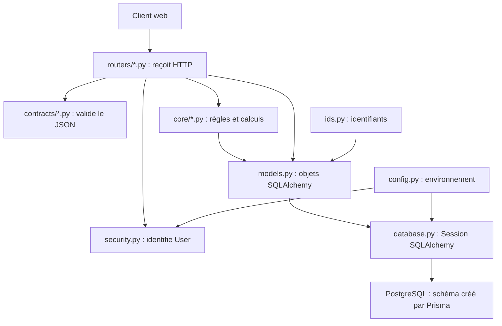
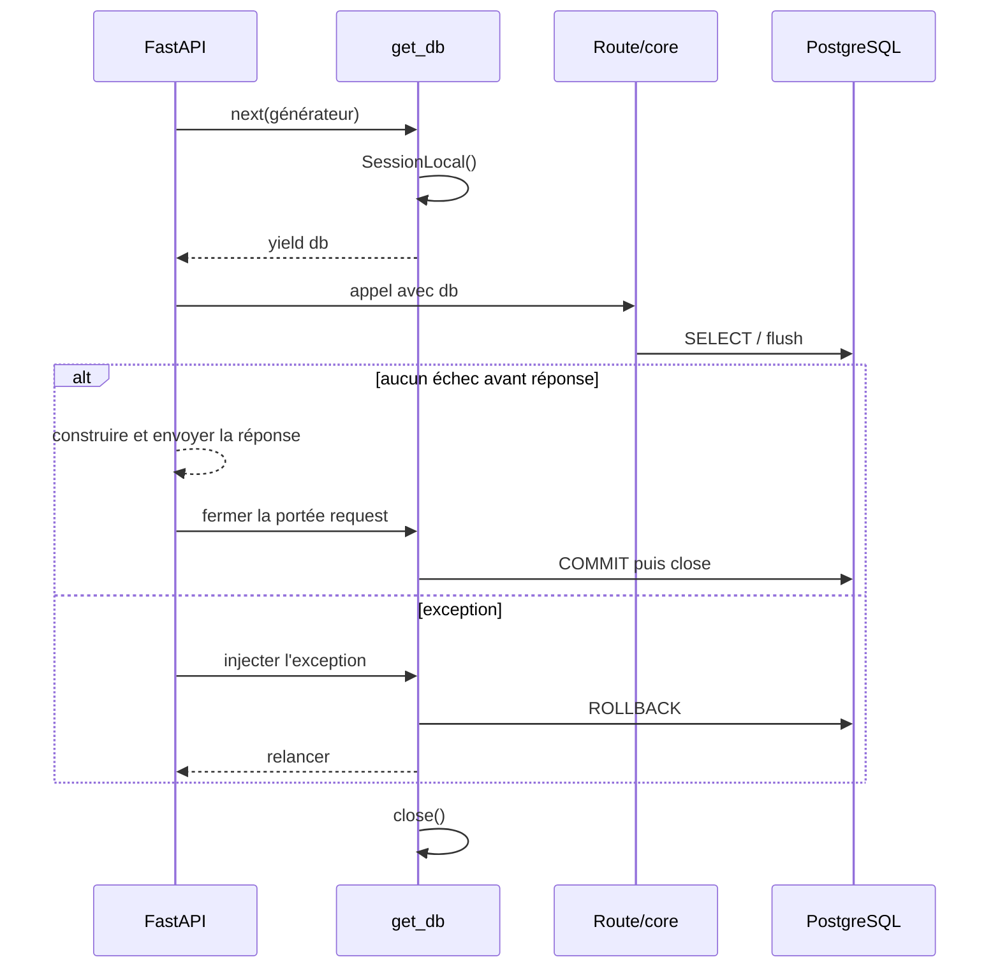
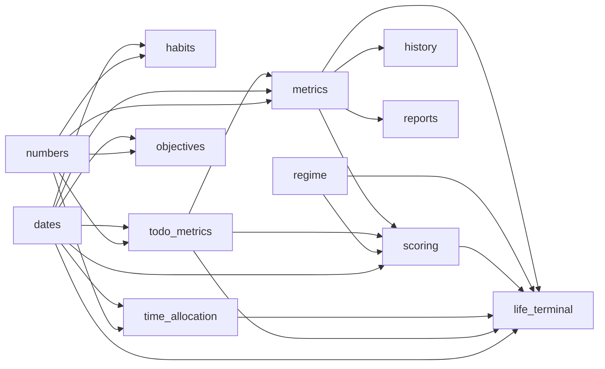

# 3 — Architecture interne et dépendances

## But de ce chapitre

Ce chapitre explique la partie Python située dans `interface_API/app/` en partant de zéro. Il se concentre sur la configuration, la connexion SQL, les modèles et les calculs du dossier `core/`. Les routes HTTP sont détaillées dans les autres chapitres ; ici, nous suivons surtout ce qu'elles appellent.

Toutes les affirmations ci-dessous viennent des fichiers réels analysés. Les numéros de lignes correspondent à l'état du dépôt lors de la rédaction.

## L'idée générale

L'API est organisée en couches :



Une **couche** est un groupe de fichiers ayant une responsabilité. Une route ne doit pas réinventer le calcul du risque ; elle appelle `core/scoring.py`. Un calcul ne doit pas ouvrir lui-même une connexion globale ; il reçoit une `Session` en paramètre.

## Ordre réel d'initialisation

### Import du programme

Quand Uvicorn importe `app.main`, Python exécute immédiatement les instructions placées au niveau supérieur de chaque module importé :

1. `config.py` définit les constantes, puis charge `interface_API/.env` et le `.env` racine aux lignes 20 et 23.
2. `database.py` importe `get_settings` puis exécute `create_engine(...)` à la ligne 12. L'objet moteur est créé à l'import ; une requête SQL n'est pas forcément envoyée à cet instant.
3. `database.py` construit `SessionLocal` à la ligne 14 et déclare `Base`.
4. `models.py` déclare les constantes d'énumération, les fonctions utilitaires, puis les 13 classes mappées. Déclarer une classe enregistre sa table dans les métadonnées SQLAlchemy ; cela n'insère aucune ligne.
5. Les modules `core/*.py` définissent leurs fonctions. Le corps d'une fonction n'est pas exécuté au moment de l'import.
6. Les modules de routes créent leurs objets `APIRouter` et les décorateurs enregistrent les fonctions de route.
7. À chaque requête, FastAPI résout les dépendances, notamment `get_db()` et `get_current_user()`, puis appelle la route.

Point essentiel : le commentaire de `models.py:5` dit explicitement que les modèles Python **ne créent pas le schéma**. Les migrations Prisma restent propriétaires de la structure PostgreSQL.

## Lire la syntaxe des imports

Prenons `from ..models import DailyLog` :

- `from` annonce le module source ;
- `..` remonte de `app/core/` vers `app/` ;
- `models` désigne `models.py` ;
- `import DailyLog` place le nom de classe `DailyLog` dans le module courant.

Dans `from .dates import add_days`, un seul point signifie « depuis le package courant », ici `app.core`.

`from __future__ import annotations`, présent dans tous les fichiers du lot, demande à Python de différer l'évaluation des annotations de types. Cela facilite des annotations comme `DailyLog | None` sans modifier l'exécution métier.

## `config.py` — transformer l'environnement en objet fiable

### Imports et constantes

| Ligne | Import | Ce qu'il fournit | Utilisation réelle |
|---:|---|---|---|
| 5 | `os` | accès aux variables d'environnement | `os.environ.get(...)` |
| 6 | `dataclass` | génération d'une classe de données | décorateur de `Settings` |
| 7 | `lru_cache` | mise en cache d'un résultat | un unique objet `Settings` |
| 8 | `Path` | chemins indépendants du séparateur système | localisation des `.env` |
| 9 | `urllib.parse` | découpage/reconstruction d'URL | adaptation Prisma → SQLAlchemy |
| 11 | `load_dotenv` | lecture de fichiers `.env` | lignes 20 et 23 |

`BASE_DIR = Path(__file__).resolve().parents[1]` part du fichier actuel, obtient son chemin absolu et remonte de deux niveaux d'index : `parents[0]` est `app`, `parents[1]` est `interface_API`.

Les constantes `DEFAULT_*` sont des valeurs de développement. En production, les secrets ne peuvent pas rester vides : `get_settings()` lève une `RuntimeError` aux lignes 82–83.

### `_sqlalchemy_url(raw: str) -> str`

Le préfixe `_` signale une fonction interne au module. Ce n'est pas une protection technique : un autre fichier pourrait l'importer, mais la convention dit de ne pas en faire une API publique.

Ordre exact :

1. `urlsplit(raw)` sépare schéma, hôte, chemin, requête et fragment.
2. `parse_qsl(parts.query)` transforme la requête en couples clé/valeur.
3. La compréhension de liste conserve tout sauf le paramètre `schema`.
4. Un schéma `postgres://` ou `postgresql://` devient `postgresql+psycopg2`.
5. `urlunsplit(...)` reconstruit l'URL.

Exemple minimal :

```python
raw = "postgresql://u:p@db:5432/app?schema=public&sslmode=require"
# résultat conceptuel :
# postgresql+psycopg2://u:p@db:5432/app?sslmode=require
```

Le paramètre `schema` convient à Prisma mais pas comme argument de connexion psycopg2. Le retirer évite une erreur de connexion.

### `_read_positive_integer(name, default)`

Cette fonction lit une chaîne, la convertit avec `int`, puis exige une valeur strictement positive. `except ValueError as error` capture l'erreur de conversion. `raise ... from error` conserve la cause initiale dans le traceback.

### `Settings`

`@dataclass(frozen=True)` est un **décorateur** : il reçoit la classe puis lui ajoute notamment un constructeur. `frozen=True` interdit de modifier ses champs après construction.

Les annotations `database_url: str` décrivent le type attendu. Elles ne créent pas seules de validation à l'exécution ; le constructeur généré stocke les valeurs.

Les trois méthodes marquées `@property` se lisent comme des attributs : `settings.access_key`, sans parenthèses. Elles calculent une valeur à chaque lecture.

- `signing_secret` choisit le premier texte non vide parmi `auth_secret`, `app_access_key`, puis le secret de développement.
- `access_key` utilise la clé configurée ou la clé de développement.
- `is_using_dev_access_key` renvoie `True` si `APP_ACCESS_KEY` est vide.

### `get_settings()` et son cache

`@lru_cache(maxsize=1)` mémorise le premier objet retourné. Les appels suivants rendent le même objet sans relire l'environnement. Conséquence pratique : changer une variable d'environnement après le premier appel ne change pas les réglages du processus ; il faut redémarrer ou vider explicitement le cache dans un test.

`frontend_origins` est un tuple créé en séparant la chaîne sur les virgules, en retirant les espaces et en ignorant les éléments vides.

## `database.py` — durée de vie d'une transaction

### Les trois objets centraux

- `engine` connaît l'URL, le dialecte PostgreSQL et le pool de connexions. `pool_pre_ping=True` vérifie une connexion empruntée au pool avant de l'utiliser.
- `SessionLocal` est une **fabrique** : appeler `SessionLocal()` crée une `Session`.
- `Base` est la classe mère des modèles déclaratifs.

`autoflush=False` signifie que SQLAlchemy ne doit pas systématiquement envoyer les modifications avant chaque requête. Le code appelle donc `db.flush()` aux endroits où il a besoin que les insertions/modifications soient visibles dans la transaction.

`expire_on_commit=False` conserve les attributs déjà chargés après le commit. Sans ce réglage, les lire peut déclencher un rechargement SQL.

### `get_db()` ligne par ligne

```python
def get_db() -> Iterator[Session]:
    db = SessionLocal()
    try:
        yield db
        db.commit()
    except Exception:
        db.rollback()
        raise
    finally:
        db.close()
```

- `Iterator[Session]` décrit une fonction génératrice produisant une session.
- `yield db` suspend la fonction et donne la session à FastAPI.
- FastAPI exécute alors la dépendance d'authentification puis la route.
- Avec `Depends(get_db)` sans option `scope`, FastAPI donne à ce générateur une portée `request` : après une route réussie, la réponse est envoyée, puis l'exécution reprend après `yield` et appelle `commit()`.
- Si une exception traverse la route, `except Exception` appelle `rollback()` puis `raise` relance exactement l'exception.
- `finally` s'exécute dans tous les cas et rend la connexion au pool via `close()`.



`flush` n'est donc pas `commit`. Le premier synchronise l'état en mémoire avec PostgreSQL **dans la transaction courante** ; le second rend la transaction durable.

Conséquence exacte du `scope="request"` implicite : un échec du `commit()` peut arriver après que le client a déjà reçu une réponse de succès. Le code n'indique pas `Depends(get_db, scope="function")`. Cette observation décrit l'exécution actuelle ; elle ne change pas l'application.

## `ids.py` — produire les clés texte

`_ALPHABET` contient 36 caractères. `_base36(value, width)` divise successivement par 36 grâce à `divmod`, ajoute le chiffre correspondant à gauche, complète par des zéros avec `rjust`, puis conserve exactement `width` caractères avec `[-width:]`.

`new_id()` assemble :

1. `c` ;
2. 8 caractères dérivés du temps Unix en millisecondes ;
3. 16 caractères choisis avec `secrets.choice`, adapté aux valeurs imprévisibles.

Le commentaire dit « shaped like a cuid » : c'est une forme compatible avec les colonnes texte et commençant par `c`, pas l'algorithme officiel complet de CUID. Le vrai schéma Prisma utilise `@default(cuid())` lorsque Prisma insère ; Python utilise `default=new_id` lorsque SQLAlchemy insère.

## `models.py` — classes Python vers tables SQL

### Syntaxe d'une colonne

```python
id: Mapped[str] = mapped_column(String, primary_key=True, default=new_id)
```

- `id` est l'attribut Python et le nom de colonne implicite ;
- `Mapped[str]` annonce qu'une instance contient une chaîne ;
- `mapped_column(String, ...)` décrit la colonne SQL ;
- `primary_key=True` indique la clé primaire dans le mapping ;
- `default=new_id` passe la **fonction**, sans parenthèses. SQLAlchemy l'appellera pour chaque nouvelle ligne.

Une annotation `Mapped[int | None]` veut dire « entier ou absence de valeur ». `mapped_column(Integer)` sans `nullable=False` permet ici `NULL`.

`__tablename__ = "DailyLog"` conserve les noms exacts, sensibles à la casse car Prisma crée des identifiants SQL cités.

### Énumérations PostgreSQL

`_enum(values, name)` construit un type `ENUM` SQLAlchemy avec `create_type=False`. Python réutilise le type déjà créé par Prisma. Les tuples `DAILY_LOG_STATUSES`, `TASK_STATUSES`, etc. doivent rester identiques aux enums de `prisma/schema.prisma`.

### Dates de création et modification

`utcnow()` rend une heure UTC **sans information de fuseau**, avec `replace(tzinfo=None)`, pour correspondre au schéma existant. `default=utcnow` s'applique à l'insertion SQLAlchemy et `onupdate=utcnow` à une mise à jour faite via le mapping.

### Limite volontaire du mapping Python

Prisma déclare les relations, clés étrangères, contraintes uniques et index. `models.py` ne déclare que les colonnes, clés primaires et types nécessaires au code Python. Par exemple, `DailyTimeAllocation.categoryId` est un simple `Mapped[str]` côté SQLAlchemy, mais la base possède bien la clé étrangère et l'unicité issues de Prisma. Il ne faut donc pas appeler `Base.metadata.create_all()` pour tenter de reconstruire cette base : le commentaire d'en-tête l'interdit conceptuellement.

## Cartographie des fichiers `core`

| Fichier | Entrées principales | Sorties / effet | Dépend de |
|---|---|---|---|
| `dates.py` | dates, chaînes ISO, semaine ISO | chaînes de date et `datetime` normalisés | bibliothèque `datetime` |
| `numbers.py` | nombre flottant fini | arrondi compatible JavaScript | `math` |
| `todo_metrics.py` | tâches, événements, session, utilisateur | métriques de tâches et contexte calendrier | modèles, dates, numbers |
| `metrics.py` | journal, métriques, calendrier | scores, résumé, trajectoire, export JSON | todo_metrics, dates, modèles |
| `regime.py` | dictionnaires de scores et contexte | régime, confiance, projection | numbers |
| `scoring.py` | session, utilisateur, date | met à jour un `DailyLog` | metrics, regime, todo_metrics |
| `habits.py` | session, utilisateur, date/check-in | payload tracker ou UPSERT | modèles, dates, numbers |
| `history.py` | session, utilisateur, filtre | historique et résumé semaine | metrics, dates |
| `reports.py` | session, utilisateur, semaine | UPSERT logique du rapport | metrics, modèle WeeklyReport |
| `time_allocation.py` | catégories, minutes, poids | allocation, métriques et UPSERT | modèles, dates, numbers |
| `objectives.py` | objectifs, tâches, blocs, événements | arbre et planning agrégés | modèles, dates, numbers |
| `life_terminal.py` | session, `User`, date | grand dictionnaire du tableau de bord | presque tous les modules précédents |

## Graphe des dépendances internes



Il n'y a pas de cycle d'import direct dans ce graphe. `life_terminal.py` est une couche d'agrégation : il consomme les autres, ceux-ci ne l'importent pas.

## Catalogue exact des fonctions du noyau

### Dates et nombres

| Fonction | Lignes | Paramètres → retour | Rôle |
|---|---:|---|---|
| `to_date_key` | dates 16–17 | `date | None → str` | aujourd'hui ou date au format `YYYY-MM-DD` |
| `parse_date_key` | 20–21 | `str → date` | lit les 10 premiers caractères ISO |
| `add_days` | 24–25 | `str, int → str` | décale une date |
| `get_iso_week_id` | 28–31 | `str | None → str` | produit `2026-W31` |
| `get_week_date_keys` | 34–37 | semaine → 7 chaînes | lundi à dimanche |
| `shift_week_id` | 40–41 | semaine, décalage → semaine | décale de N semaines |
| `day_label`, `day_full_label`, `month_year_label` | 44–55 | date → texte anglais | libellés UI |
| `event_time_label` | 58–61 | `datetime → str` | heure 12 h avec AM/PM |
| `iso_datetime` | 64–68 | `datetime | None → str | None` | sérialise comme Prisma/JS avec `Z` |
| `parse_iso_datetime` | 71–74 | `str → datetime` | accepte `Z` ou un décalage |
| `to_utc_naive` | 77–81 | `datetime → datetime` | convertit en UTC puis enlève le fuseau |
| `javascript_round` | numbers 8–12 | `float → int` | `floor(x + 0.5)`, refuse NaN/infini |

### Tâches et calendrier

`calculate_todo_metrics(tasks)` ignore les tâches `CANCELLED`, pondère `LOW=1`, `MEDIUM=2`, `HIGH=3`, puis renvoie : nombre planifié, taux pondéré entre 0 et 1, tâches importantes manquées et taux productif.

`get_todo_metrics(db, user_id, date_key)` exécute un `SELECT Task`, trie par importance puis date de création, et retourne un tuple `(liste_de_tâches, dictionnaire_de_métriques)`.

`detect_active_phase_for_week(events)` applique la priorité `EXAM`, puis `INTERVIEW`, puis `DEADLINE`, puis plusieurs événements à fort impact, sinon `normal_week`.

`weekly_expected_load(events)` calcule les moyennes de stress et préparation. `get_next_high_impact_event(...)` ne garde que `HIGH/CRITICAL`, trie par début et applique `LIMIT 1`.

`get_calendar_context(...)` charge la semaine et les sept prochains jours, puis renvoie phase, nombre d'événements forts, impact maximal et charges moyennes.

### Scores

`weighted_average(parts)` retire les composantes `None` et redistribue implicitement leur poids en divisant par le total restant. Ce détail empêche une donnée absente de compter comme zéro.

`compute_state_score(log)` combine énergie 35 %, productivité 25 %, inverse de la friction 20 %, qualité de concentration 10 % et inverse de la fatigue mentale 10 %.

`compute_execution_score(log, metrics)` part de `weightedCompletionRate × 82`, ajoute 8 si soumis, 6 si entraînement fait et retire 12 si une tâche importante a été évitée.

`compute_risk_score(...)` part de 14 et ajoute des pénalités selon énergie, productivité, friction, calories, entraînement, fatigues, évitement, tâches importantes manquées, journaux manquants, calendrier et dérivées de risque. Le résultat est borné entre 0 et 100.

`compute_risk_delta(today, previous)` calcule la différence première. `compute_risk_acceleration(today_delta, previous_delta)` calcule la différence des différences.

`compute_weekly_summary(...)` charge les journaux de la semaine ISO, calcule les moyennes uniquement sur les valeurs présentes, liste les dates manquantes/sautées et ajoute le contexte calendrier.

`get_trajectory(...)` produit toujours exactement `days` cases : les jours sans ligne deviennent des points `status="missing"` et scores `None`.

`build_weekly_json_export(...)` effectue pour chaque jour un chargement du journal, des tâches et du calendrier, puis réunit entrées, métriques et scores. C'est exact mais cela implique plusieurs requêtes par jour.

### Détection de régime

`compute_regime(...)` applique une chaîne de `if/elif` : le **premier** cas vrai gagne. L'ordre est donc métier : risque d'épuisement, chaos, pression, productif, récupération, dérive, stabilité.

`data_incomplete` est vrai si le journal actuel manque, n'est pas soumis ou si plus d'un jour de la semaine manque. `high_risk_streak` demande au moins deux risques supérieurs à 75 dans les trois derniers journaux soumis.

`simulate_next_week(...)` attribue des poids de transition aux sept régimes, normalise en pourcentages, arrondit et trie. `build_transition_matrix_placeholder(...)` fait la même normalisation pour chaque régime source. Le nom `placeholder` est important : le fichier ne prétend pas contenir un modèle statistique entraîné.

### Recalcul et effet indirect

`recompute_daily_scores(db, user_id, date_key)` :

1. charge le journal ; retourne `None` s'il n'existe pas ;
2. charge métriques de tâches et contexte calendrier ;
3. charge le précédent journal avec risque, le précédent soumis et jusqu'à 14 soumis ;
4. compte les lignes `MISSING` antérieures dans la semaine ;
5. calcule exécution, état, risque, delta et accélération ;
6. calcule le résumé hebdomadaire et le régime ;
7. assigne les champs au modèle ;
8. `flush()` envoie l'`UPDATE`, puis retourne le même objet.

`recompute_around_date(...)` recalcule la date demandée puis, seulement si un journal existe demain, recalcule aussi demain. Ce deuxième recalcul est indispensable car le risque de demain dépend des valeurs précédentes. C'est un effet en cascade déclenché par les routes tâches, calendrier et journal.

### Habitudes

`get_habit_tracker_data(...)` exécute quatre requêtes : habitudes actives, check-ins du jour, blocs de routine `school_day`, puis check-ins des sept jours. Une fonction interne `habit_payload` associe chaque habitude à son check-in ou à une valeur par défaut.

`upsert_habit_checkin(...)` utilise l'`INSERT ... ON CONFLICT DO UPDATE` PostgreSQL sur `(userId, habitId, date)`. Les champs absents ne sont pas écrasés lors de la mise à jour, car `update_values` ne les reçoit que si le paramètre n'est pas `None`.

### Allocation du temps

`allocate_minutes_from_weights(weights, total_minutes)` applique la méthode des plus grands restes : valeurs négatives ramenées à zéro, parts exactes, planchers, puis distribution des minutes restantes selon les fractions les plus grandes. La somme finale égale le budget sûr.

`compute_portfolio_metrics(rows)` traite l'allocation comme un portefeuille : rendement pondéré, racine de somme des risques quadratiques, bêta, rendement de type CAPM et ratio de type Sharpe. Ce sont des indicateurs métaphoriques du produit, pas des métriques financières garanties.

`get_time_allocation_data(...)` charge catégories, allocations du jour, allocations de la semaine et budget. Il choisit le plan manuel si `plannedMinutesManual`, sinon le plan automatique, puis calcule les poids réels et totaux.

`upsert_daily_allocation(...)` et `upsert_day_budget(...)` font des UPSERT ciblés et appellent `flush`, pas `commit`.

### Objectifs

`sync_objective_tasks(...)` déduplique les identifiants avec `dict.fromkeys`, délie les anciennes tâches absentes de la nouvelle liste, lie les nouvelles, puis flush.

`get_objectives_data(...)` charge objectifs, tâches, blocs hebdomadaires et événements. Il crée des dictionnaires d'index, puis la fonction récursive interne `build_node` construit l'arbre. Le `trail: frozenset[str]` détecte un cycle et évite une récursion infinie. La fonction produit aussi les charges journalières, l'allocation par objectif, les prochaines actions et les statistiques.

`bootstrap_objectives_demo(...)` n'insère des exemples que si le nombre d'objectifs actifs vaut zéro. Les `flush()` successifs rendent les identifiants parents disponibles avant de créer les enfants. Le commit final appartient toujours à `get_db()`.

### Rapport, historique et terminal

`get_history_data(...)` valide un filtre parmi quatre valeurs, construit les dates visibles, charge les journaux, les sérialise et joint un résumé de semaine.

`generate_weekly_report(...)` construit l'export ; crée un `WeeklyReport` s'il n'existe pas, sinon remplace `content`, puis flush.

`get_life_terminal_data(...)`, long de 242 lignes, agrège journal courant, précédent, 14 journaux, tâches, calendrier, trajectoire, deux résumés hebdomadaires, export, allocation et interprétation. Il enrichit chaque point de trajectoire avec pression calendrier et complétion des tâches, puis retourne un seul dictionnaire pour le tableau de bord.

## Callbacks et appels invisibles à repérer

- `default=new_id` : SQLAlchemy appelle la fonction à l'insertion ; le code ne contient pas `new_id()` à chaque création.
- `default=utcnow` et `onupdate=utcnow` : SQLAlchemy déclenche ces fonctions lors de la persistance appropriée.
- `Depends(get_db)` : FastAPI démarre et termine le générateur autour de la route.
- `@lru_cache` : le décorateur intercepte les appels de `get_settings`.
- `selector` dans `collect(selector)` et `previous_value(selector)` : ce paramètre est une fonction. Les expressions `lambda log: log.stateScore` sont des callbacks synchrones immédiatement appelés par ces helpers.
- Les décorateurs de route `@router.get/post/patch/delete` enregistrent les fonctions ; le client HTTP les déclenche plus tard.

## Erreurs fréquentes et diagnostic

1. Confondre `None` et `0`. Les formules utilisent parfois une valeur par défaut de 50, parfois excluent `None` de la moyenne.
2. Écrire `default=new_id()` dans un modèle. Cela calculerait une seule valeur à l'import au lieu de passer le callback.
3. Ajouter une enum dans Python sans migration Prisma correspondante. PostgreSQL refuserait la valeur.
4. Ajouter une relation uniquement dans `models.py`. Le propriétaire du schéma est `prisma/schema.prisma`.
5. Retirer `db.flush()` avant de lire un identifiant ou de recalculer. Avec `autoflush=False`, les calculs pourraient voir un état ancien.
6. Appeler `db.commit()` dans chaque fonction `core`. Cela fragmenterait la transaction et empêcherait `get_db()` de tout annuler en cas d'échec ultérieur.
7. Changer l'environnement pendant que le serveur tourne en oubliant le cache de `get_settings()`.

## Exercice corrigé

### Énoncé

Une route modifie une tâche du 10 août, appelle `recompute_around_date`, puis une erreur survient pendant la sérialisation. Les nouveaux scores restent-ils en base ?

### Correction

Non. La route et le recalcul utilisent la même `Session`. `db.flush()` a envoyé les changements dans la transaction, mais n'a pas fait de commit. L'exception remonte jusqu'au générateur `get_db()`, qui exécute `rollback()`. La tâche et les scores sont annulés ensemble. C'est précisément l'intérêt d'une transaction englobant toute la requête.

### Mini-test de lecture

Expliquez pourquoi modifier une tâche du jour peut aussi modifier le journal de demain.

Réponse : `recompute_around_date` recalcule le jour demandé, puis recherche un `DailyLog` au jour suivant et le recalcule s'il existe. Ses deltas et son régime dépendent du passé ; changer aujourd'hui peut donc changer demain.

## Annexe — index exhaustif des fonctions analysées

Cet index permet de partir d'un nom rencontré dans une route et de savoir immédiatement où continuer la lecture. « Pure » signifie que la fonction ne lit ni n'écrit la base pour des entrées ordinaires ; cela ne signifie pas qu'elle est mathématiquement parfaite ou sans exception.

### `config.py`, `database.py`, `ids.py`, `models.py`

| Symbole | Lignes | Nature | Appelé par / déclenché par |
|---|---:|---|---|
| `config._sqlalchemy_url` | 26–35 | transformation pure d'URL | `get_settings` |
| `config._read_positive_integer` | 38–48 | lecture/validation environnement | `get_settings` pour port, taille audio, délai |
| `Settings.signing_secret` | 64–66 | propriété calculée | sécurité de session |
| `Settings.access_key` | 68–70 | propriété calculée | authentification par clé |
| `Settings.is_using_dev_access_key` | 72–74 | propriété booléenne | route santé |
| `config.get_settings` | 77–101 | fabrique mise en cache | base, sécurité, main, transcription, lancement |
| `database.get_db` | 21–30 | dépendance génératrice | `Depends(get_db)` |
| `ids._base36` | 11–16 | conversion d'entier | `new_id` |
| `ids.new_id` | 19–23 | génération d'identifiant | callback `default` des modèles |
| `models._enum` | 33–34 | fabrique de mapping enum | déclarations de colonnes à l'import |
| `models.utcnow` | 37–38 | heure UTC naïve | callbacks de colonnes et UPSERTs |

Les classes `Settings` et `Base` ne sont pas des fonctions. `Settings` regroupe les paramètres ; `Base` sert de classe mère déclarative. Les treize classes de `models.py` sont indexées table par table dans le chapitre base de données.

### `core/dates.py` et `core/numbers.py`

| Symbole | Lignes | Entrée → sortie | Particularité |
|---|---:|---|---|
| `to_date_key` | 16–17 | `date? → str` | défaut `date.today()` |
| `parse_date_key` | 20–21 | `str → date` | ne lit que `[:10]` |
| `add_days` | 24–25 | clé + entier → clé | utilise `timedelta` |
| `get_iso_week_id` | 28–31 | clé? → `AAAA-Wnn` | norme ISO |
| `get_week_date_keys` | 34–37 | semaine → 7 clés | lundi ISO = jour 1 |
| `shift_week_id` | 40–41 | semaine + offset → semaine | offset multiplié par 7 |
| `day_label` | 44–45 | clé → libellé court | tuple anglais |
| `day_full_label` | 48–50 | clé → libellé long | jour, mois abrégé, numéro |
| `month_year_label` | 53–55 | clé → mois/année | tuple anglais |
| `event_time_label` | 58–61 | datetime → heure | format 12 h AM/PM |
| `iso_datetime` | 64–68 | datetime? → texte? | millisecondes et suffixe `Z` |
| `parse_iso_datetime` | 71–74 | texte → datetime | normalise ensuite en UTC naïf |
| `to_utc_naive` | 77–81 | datetime → datetime | conserve un datetime déjà naïf |
| `javascript_round` | numbers 8–12 | flottant → entier | refuse non-fini, fait `floor(x+0.5)` |

### `core/todo_metrics.py`

| Symbole | Lignes | Lecture SQL | Retour |
|---|---:|---|---|
| `calculate_todo_metrics` | 19–42 | non | dictionnaire de 4 métriques |
| `get_todo_metrics` | 45–53 | `Task` d'une date | tuple tâches, métriques |
| `detect_active_phase_for_week` | 56–66 | non | chaîne de phase |
| `count_high_impact_events` | 69–70 | non | entier |
| `weekly_expected_load` | 73–80 | non | tuple stress, préparation |
| `get_next_high_impact_event` | 83–96 | prochain `CalendarEvent` | événement ou `None` |
| `_events_between` | 99–112 | événements d'un intervalle | liste |
| `get_calendar_context` | 118–145 | via `_events_between` deux fois | dictionnaire contexte |

Les imports locaux de `datetime` dans deux fonctions ne sont pas asynchrones. Ils retardent simplement la résolution de ces noms jusqu'à l'appel.

### `core/metrics.py`

| Symbole | Lignes | Appels importants | Retour |
|---|---:|---|---|
| `clamp_score` | 19–20 | `javascript_round` | entier 0–100 |
| `clamp_count` | 23–24 | `javascript_round` | entier 0–maximum |
| `weighted_average` | 27–32 | compréhension + sommes | flottant ou `None` |
| `compute_state_score` | 35–45 | `weighted_average`, `clamp_score` | score ou `None` |
| `compute_execution_score` | 48–56 | `clamp_score` | score entier |
| `compute_risk_score` | 59–111 | règles de pénalité, clamp | score entier |
| `compute_risk_delta` | 114–115 | soustraction | entier |
| `compute_risk_acceleration` | 118–119 | soustraction | entier |
| `compute_weekly_summary` | 122–161 | `DailyLog`, calendrier | dictionnaire hebdomadaire |
| `build_interpretation_messages` | 164–195 | tendances sur trois logs | liste de textes |
| `get_trajectory` | 198–230 | `DailyLog` sur plage | liste continue de points |
| `build_weekly_json_export` | 233–324 | résumé + 7× journal/tâches/calendrier | dictionnaire d'export |
| `serialize_calendar_event` | 327–339 | `iso_datetime` | dictionnaire ou `None` |

Les fonctions locales `avg` et `collect`, lignes 134–138, n'existent que pendant `compute_weekly_summary`. `collect` reçoit un callback `selector` et l'appelle pour chaque log.

### `core/regime.py` et `core/scoring.py`

| Symbole | Lignes | Rôle exact |
|---|---:|---|
| `regime._clamp` | 13–14 | borne/arrondit un nombre |
| `regime._status` | 17–18 | statut majuscule même si log absent |
| `regime._normalize_regime` | 21–22 | refuse un régime hors `REGIMES` |
| `risk_level` | 25–33 | score → `low/medium/high/critical` |
| `compute_regime` | 36–138 | règles ordonnées → régime/confiance/raisons |
| `compute_regime_transition` | 141–152 | poids brut source/cible/contexte |
| `simulate_next_week` | 155–165 | normalise sept poids et trie |
| `build_transition_matrix_placeholder` | 168–182 | sept lignes de probabilités normalisées |
| `scoring._log_as_regime_dict` | 24–40 | modèle ORM → dictionnaire minimal |
| `recompute_daily_scores` | 43–128 | lectures, calculs, mutation et flush du log |
| `recompute_around_date` | 131–141 | jour demandé puis lendemain existant |
| `serialize_daily_log` | 144–179 | modèle complet → dictionnaire JSON-compatible |

Le suffixe `placeholder` appartient au nom réel de la fonction de matrice. Il indique que les probabilités viennent de règles fixes et non d'un modèle calibré sur des données.

### `core/habits.py`, `core/history.py`, `core/reports.py`

| Symbole | Lignes | Entrées | Sortie / effet |
|---|---:|---|---|
| `get_habit_tracker_data` | habits 14–107 | session, utilisateur, date? | habitudes/blocs/check-ins/métriques |
| fonction locale `habit_payload` | habits 57–78 | une `Habit` | dictionnaire avec check-in réel/défaut |
| `upsert_habit_checkin` | habits 110–141 | cible et champs facultatifs | UPSERT, flush, objet |
| `get_history_data` | history 15–40 | filtre | journaux visibles + résumé |
| `serialize_history_log` | history 43–53 | `DailyLog` | sous-ensemble sérialisé |
| `generate_weekly_report` | reports 13–25 | semaine? | crée/remplace contenu, flush, retourne export |

### `core/time_allocation.py`

| Symbole | Lignes | Rôle |
|---|---:|---|
| `_clamp` | 16–17 | entier 0–100 par défaut |
| `_clamp_minutes` | 20–21 | minutes arrondies, jamais négatives |
| `allocate_minutes_from_weights` | 24–45 | méthode des plus grands restes |
| `compute_portfolio_metrics` | 48–66 | rendement/risque/bêta/CAPM/ratio |
| `get_time_allocation_data` | 69–172 | quatre lectures puis agrégation jour/semaine |
| `upsert_daily_allocation` | 175–214 | UPSERT par utilisateur/catégorie/date |
| `upsert_day_budget` | 217–233 | UPSERT par utilisateur/date |

### `core/objectives.py`

| Symbole | Lignes | Rôle |
|---|---:|---|
| `format_minutes` | 28–35 | minutes → texte jours/heures/minutes |
| `serialize_objective` | 38–56 | objectif ORM → dictionnaire |
| `serialize_task` | 59–70 | tâche + titre objectif → dictionnaire |
| `serialize_block` | 73–89 | bloc + objectif éventuel → dictionnaire |
| `serialize_event` | 92–101 | événement → dictionnaire avec plage horaire |
| `default_objective_title` | 104–110 | genre facultatif → titre par défaut |
| `sync_objective_tasks` | 113–125 | délie puis relie les tâches, flush |
| `_objective_sort_key` | 128–133 | horizon/priorité/ordre → tuple de tri |
| `get_objectives_data` | 136–416 | quatre lectures puis arbre/planning/stats |
| fonction locale `build_node` | 215–243 | id + chemin immuable → nœud récursif ou `None` |
| fonction locale `with_date_label` | 351–352 | jour? → jour enrichi? |
| `bootstrap_objectives_demo` | 419–574 | crée une hiérarchie et des blocs si aucun objectif |

### `core/life_terminal.py`

| Symbole | Lignes | Rôle |
|---|---:|---|
| `_serialize_task` | 33–45 | tâche ORM → dictionnaire terminal |
| `_pressure_for_events` | 48–56 | événements → pression 0–100 |
| `_risk_band` | 59–67 | score facultatif → bande textuelle |
| `_trend` | 70–73 | deux valeurs facultatives → différence ou 0 |
| `_data_quality_status` | 76–81 | couverture → `complete/partial/missing` |
| `_build_weekly_planner` | 84–126 | tâches/événements/semaine → planning |
| `_build_life_tape` | 129–156 | logs/métriques/pression → cinq indicateurs |
| fonction locale `previous_value` | 145–146 | callback → valeur précédente ou `None` |
| `_events_between` | 159–170 | bornes dont fin exclusive → événements |
| `_tasks_between` | 173–184 | bornes inclusives → tâches |
| `get_life_terminal_data` | 187–428 | toutes les sources → payload terminal complet |

## Annexe — pourquoi chaque famille d'imports existe

| Import | Fichiers du lot | Sans lui |
|---|---|---|
| `datetime`, `date`, `time`, `timedelta`, `timezone` | modèles, dates, metrics, scoring, objectifs, terminal | aucune conversion de date, borne SQL ou calcul de délai |
| `math` | numbers, allocation | pas de test de nombre fini, racine, plancher |
| `secrets`, `time` | ids | pas de bloc aléatoire sûr ni composante temporelle |
| `os`, `pathlib`, `urllib.parse`, `dotenv` | config | pas de réglages fiables depuis `.env`/URL |
| `dataclass`, `lru_cache` | config | pas d'objet immuable généré ni cache de configuration |
| `create_engine`, `Session`, `sessionmaker`, `DeclarativeBase` | database | pas de moteur, transaction ni base ORM |
| `select`, `update`, `func`, `case` selon les fichiers | core/routes | pas de construction typée des lectures/mises à jour/agrégats SQL |
| `postgresql.insert` | habitudes, allocation, journal | pas de `ON CONFLICT DO UPDATE` PostgreSQL |
| `Mapped`, `mapped_column` | modèles | pas de mapping déclaratif SQLAlchemy 2 |
| `ENUM`, `JSONB` | modèles | pas de correspondance fidèle des enums/JSON PostgreSQL |
| imports relatifs `..models` | tous les services avec SQL | pas d'entités/colonnes à sélectionner |
| imports relatifs `.dates`, `.numbers` | plusieurs services | duplication et divergences de formats/arrondis |

La présence d'un import ne déclenche pas forcément son action métier. Elle rend le nom disponible. Un appel, une instanciation, un décorateur ou un callback déclenche ensuite le comportement.
