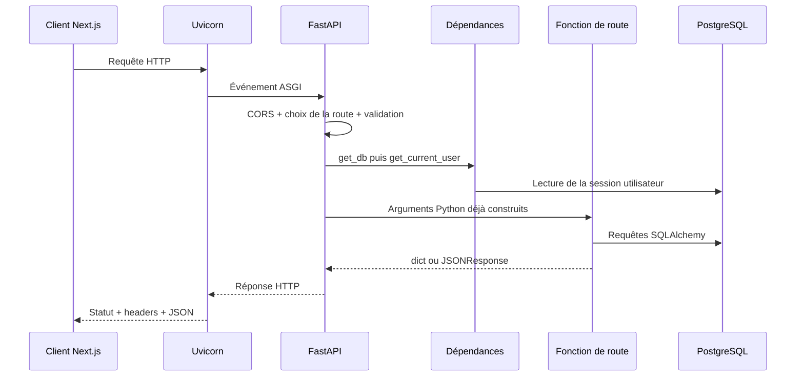

# Partie 4 et 5 — HTTP et FastAPI dans cette API

## Objectif du chapitre

Ce chapitre part de zéro. À la fin, vous saurez lire la création de l'application dans `interface_API/app/main.py`, comprendre ce que fait FastAPI avant d'appeler une route, reconnaître les données venant de l'URL, du JSON, d'un fichier ou d'un cookie, et prévoir la forme d'une erreur.

Le framework réellement utilisé est **FastAPI**. Le serveur ASGI de développement est **Uvicorn**. Les contrats de requête sont validés par **Pydantic 2**. Les routes utilisent **SQLAlchemy 2** pour dialoguer avec PostgreSQL.

## 1. L'intuition : un serveur est un standardiste

Une application cliente, ici principalement le frontend Next.js, envoie un message réseau. Ce message indique notamment :

- une méthode, par exemple `GET` ou `POST` ;
- une URL, par exemple `/api/tasks?scope=today` ;
- des en-têtes, ou *headers* ;
- parfois un corps contenant du JSON ou un fichier ;
- ici, souvent un cookie de session nommé `life_regime_session`.

FastAPI joue le rôle du standardiste. Il compare la méthode et le chemin à toutes les routes enregistrées, extrait les données, les valide, exécute les dépendances, appelle la bonne fonction Python, puis transforme le résultat en réponse HTTP.



## 2. Vocabulaire HTTP indispensable

### Client et serveur

Le **client** démarre l'échange. Un navigateur, le frontend, `curl` ou un test peut être client. Le **serveur** attend des requêtes sur une adresse et répond. Dans ce dépôt, deux applications FastAPI distinctes existent :

- l'API principale, généralement sur `127.0.0.1:8000` ;
- le service Whisper, généralement sur `127.0.0.1:8001`.

L'API principale est elle-même cliente du service Whisper : la route `/api/transcribe` reçoit un fichier puis envoie une seconde requête HTTP vers `/transcribe` du microservice.

### URL, chemin et query string

Dans l'URL suivante :

```text
http://127.0.0.1:8000/api/tasks?scope=tomorrow&date=2026-07-31
```

- `http` est le protocole ;
- `127.0.0.1` est l'hôte ;
- `8000` est le port ;
- `/api/tasks` est le chemin ;
- ce qui suit `?` est la *query string* ;
- `scope` et `date` sont des paramètres de requête séparés par `&`.

Dans le code, `Query(default=...)` rend cette provenance explicite.

### Corps JSON

Un corps JSON est un texte structuré. Exemple réel accepté par `POST /api/tasks` :

```json
{
  "title": "Lire le chapitre FastAPI",
  "date": "2026-07-31",
  "importance": "high",
  "estimatedMinutes": 45
}
```

JSON connaît des chaînes, nombres, booléens, listes, objets et `null`. Il ne connaît pas les objets Python `date` ou `Enum`. Pydantic transforme donc la chaîne `"2026-07-31"` en `datetime.date` et `"high"` en membre de `TaskImportance` avant l'appel de la fonction de route.

### Headers

Les en-têtes décrivent la requête ou la réponse. Exemples importants :

- `Content-Type: application/json` : le corps est du JSON ;
- `Content-Type: multipart/form-data; boundary=...` : le corps contient un formulaire/fichier ;
- `Cookie: life_regime_session=...` : le navigateur joint la session ;
- `Set-Cookie: life_regime_session=...` : le serveur crée la session ;
- `Content-Disposition: attachment; filename="..."` : le rapport hebdomadaire est proposé comme téléchargement.

### Méthodes réellement utilisées

| Méthode | Intuition | Usage réel dans le dépôt |
|---|---|---|
| `GET` | Lire | santé, listes, journal, historique, rapports, réglages |
| `POST` | Créer ou lancer une commande | connexion, création, upsert du journal, transcription |
| `PATCH` | Modifier partiellement | tâches, événements, habitudes, objectifs, réglages, allocations |
| `DELETE` | Supprimer ou désactiver | événements, habitudes, objectifs, catégories d'allocation |
| `PUT` | Remplacer entièrement | aucune route de ce projet |

Une convention n'est pas une garantie. `GET /api/reports/week` lit des données **et écrit** le rapport généré dans `WeeklyReport`. De même, plusieurs `DELETE` sont des suppressions logiques : une habitude, un objectif ou une catégorie est désactivé/archivé au lieu d'être physiquement effacé.

## 3. Les codes de statut

| Code | Signification | Situation dans ce projet |
|---|---|---|
| `200 OK` | succès | statut par défaut de toutes les routes, y compris les `POST` |
| `201 Created` | ressource créée | convention utile, mais aucune route ne le déclare actuellement |
| `400 Bad Request` | requête métier invalide | identifiant manquant, parent invalide, plage de dates invalide |
| `401 Unauthorized` | authentification absente/invalide | mauvais access key ou cookie invalide |
| `403 Forbidden` | authentifié mais action interdite | aucun `403` explicite dans le code actuel |
| `404 Not Found` | ressource de cet utilisateur absente | tâche, événement, habitude, objectif, bloc ou catégorie introuvable |
| `409 Conflict` | conflit d'état | aucun `409` explicite dans le code actuel |
| `413 Content Too Large` | fichier trop volumineux | transcription |
| `415 Unsupported Media Type` | type de fichier refusé | transcription |
| `422 Unprocessable Content` | validation ou audio inexploitable | Pydantic, intervalle d'événement, Whisper |
| `429 Too Many Requests` | service occupé | le microservice Whisper n'accepte qu'une transcription active |
| `500 Internal Server Error` | erreur non prévue | gestionnaire global de l'API principale, erreur interne Whisper |
| `502 Bad Gateway` | réponse incorrecte du service amont | API principale face à une erreur/JSON invalide de Whisper |
| `503 Service Unavailable` | service amont inaccessible | connexion ou requête HTTP vers Whisper échouée |

Point subtil : FastAPI utilise normalement `422` pour une erreur de validation. `main.py` garde ce statut, mais remplace la forme standard de l'erreur par un objet plus simple.

## 4. Création de l'application principale

Le cœur de `interface_API/app/main.py` est :

```python
app = FastAPI(
    title="Life Regime Tracker API",
    version="0.1.0",
    description="Standalone backend API for the Life Regime Tracker frontend.",
)
```

Explication ligne par ligne :

1. `FastAPI` est une classe importée avec `from fastapi import FastAPI`.
2. `FastAPI(...)` appelle son constructeur et crée un objet application.
3. `app =` conserve une référence vers cet objet dans une variable globale.
4. `title`, `version` et `description` sont des arguments nommés.
5. Ces métadonnées apparaissent dans le schéma OpenAPI et la documentation automatique.

La variable doit s'appeler `app` parce que `run.py` demande précisément à Uvicorn de charger `app.main:app` :

```python
uvicorn.run("app.main:app", host=settings.api_host, port=settings.api_port, reload=True)
```

La chaîne signifie : « importe le module Python `app.main`, puis récupère sa variable `app` ». `reload=True` demande à Uvicorn de redémarrer en développement lorsque les fichiers changent.

### Ordre d'import réel

Au démarrage :

1. Python exécute `run.py` ;
2. `if __name__ == "__main__"` est vrai lors de `python run.py` ;
3. `get_settings()` lit la configuration, avec cache ;
4. Uvicorn importe `app.main` ;
5. Python exécute les imports de `main.py`, donc les modules de routes ;
6. les décorateurs de routes de ces modules enregistrent leurs fonctions dans leurs `APIRouter` ;
7. `FastAPI(...)` crée l'application ;
8. le middleware et les gestionnaires d'erreur sont enregistrés ;
9. la route santé est enregistrée ;
10. `include_router(...)` copie les routes de chaque routeur dans l'application ;
11. Uvicorn commence à accepter des connexions.

Il n'existe aucun décorateur `startup`, `shutdown` ou `lifespan` dans `main.py`. La création du moteur SQLAlchemy se fait à l'import de `database.py`; les sessions, elles, sont créées requête par requête.

## 5. Routeurs et composition des URL

Un routeur regroupe des endpoints :

```python
router = APIRouter(prefix="/api/tasks", tags=["tasks"])

@router.get("")
def list_tasks(...):
    ...
```

Le chemin final est la concaténation du `prefix` et du chemin du décorateur : `"/api/tasks" + ""`, donc `/api/tasks`. Le tag sert au classement dans Swagger UI.

`main.py` exécute ensuite :

```python
app.include_router(tasks.router)
```

Sans cette ligne, le module pourrait exister et son routeur contenir des routes, mais l'application principale répondrait `404` car elle ne les connaîtrait pas.

## 6. Ce qu'est un décorateur

Un décorateur est une syntaxe qui remet une fonction à une autre fonction au moment de la définition. Intuition : la fonction reste le traitement, tandis que le décorateur colle une étiquette « appelle-moi pour tel message HTTP ».

```python
@router.get("")
def list_tasks(...):
    ...
```

est conceptuellement proche de :

```python
def list_tasks(...):
    ...

list_tasks = router.get("")(list_tasks)
```

Ce pseudo-dépliage sert à comprendre le mécanisme ; le code du projet utilise bien la forme avec `@`. Lors de l'import, `router.get("")` produit un décorateur. Ce décorateur reçoit l'objet fonction `list_tasks`, inspecte sa signature et enregistre la route.

La fonction n'est donc pas appelée à l'import. Elle est seulement enregistrée. FastAPI l'appellera plus tard quand une requête correspondra.

## 7. Comment FastAPI comprend les paramètres

Considérons une signature réelle simplifiée :

```python
def list_tasks(
    scope: str = Query(default="today"),
    date: str | None = Query(default=None),
    user: User = Depends(get_current_user),
    db: Session = Depends(get_db),
):
```

### `scope: str`

Le deux-points introduit une annotation de type. `scope` doit devenir une chaîne Python. `Query(default="today")` dit que la valeur vient de la query string et vaut `"today"` si le client ne l'envoie pas.

### `str | None`

`|` signifie union. La valeur peut être une chaîne ou `None`. `None` représente l'absence de valeur.

### `Depends(get_current_user)`

Le client ne fournit pas un objet `User`. `Depends` demande à FastAPI d'appeler `get_current_user`, puis d'injecter sa valeur retournée dans `user`.

### Un modèle Pydantic sans `Query`

```python
def create_tasks(body: TaskCreateRequest, ...):
```

Une classe héritant de `BaseModel` est interprétée comme un corps JSON. FastAPI lit le JSON, construit `TaskCreateRequest`, et n'appelle la route que si la construction réussit.

### Un fichier

```python
async def transcribe(file: UploadFile = File(...), ...):
```

`File(...)` signifie fichier obligatoire. Les trois points sont l'objet Python `Ellipsis`; FastAPI/Pydantic l'emploient ici pour dire « aucune valeur par défaut ». Le client doit utiliser `multipart/form-data`, pas JSON.

### Un paramètre nommé `from`

`from` est un mot réservé Python. La route calendrier utilise donc :

```python
from_: str | None = Query(default=None, alias="from")
```

Dans l'URL, le client écrit `?from=...`; dans Python, la variable s'appelle `from_`.

## 8. Contrats Pydantic du projet

### La base commune `ApiRequest`

Tous les contrats, sauf `LoginBody`, héritent de `ApiRequest` :

```python
class ApiRequest(BaseModel):
    model_config = ConfigDict(
        alias_generator=to_camel,
        populate_by_name=True,
        extra="ignore",
    )
```

- `class` définit une classe, c'est-à-dire un plan d'objets ;
- `BaseModel` fournit analyse, conversion et validation ;
- `alias_generator=to_camel` convertit `estimated_minutes` en alias JSON `estimatedMinutes` ;
- `populate_by_name=True` accepte aussi le nom Python `estimated_minutes` ;
- `extra="ignore"` ignore silencieusement les champs JSON inconnus.

Exemple :

```json
{
  "estimatedMinutes": 30,
  "champInconnu": "ignoré"
}
```

donne `body.estimated_minutes == 30`. `champInconnu` n'est ni conservé ni rejeté. C'est un choix réel du projet : une faute de frappe dans un nom de champ peut donc passer sans erreur tout en n'ayant aucun effet.

### `Field`

```python
energy: int | None = Field(default=None, ge=0, le=100)
```

- `energy` est le nom Python ;
- `int | None` autorise entier ou absence ;
- `default=None` rend le champ facultatif ;
- `ge` signifie *greater than or equal*, donc supérieur ou égal ;
- `le` signifie *less than or equal*, donc inférieur ou égal.

Une énergie `101` provoque un `422` avant l'entrée dans la route.

```python
id: str = Field(min_length=1)
```

Ici le champ est obligatoire parce qu'il n'a pas de valeur par défaut, et une chaîne vide est refusée.

### Valeurs par défaut et `default_factory`

```python
linked_task_ids: list[str] = Field(default_factory=list)
```

`list[str]` signifie liste de chaînes. `default_factory=list` donne la fonction `list` à Pydantic. Pydantic l'appelle pour chaque nouvel objet afin de créer une liste vide distincte. Partager une seule liste globale entre plusieurs requêtes serait une source de bugs de mutation.

### Les énumérations insensibles à la casse

`TaskImportance`, `TaskStatus`, `CalendarEventType`, `CalendarImpact`, `ObjectiveKind`, `ObjectiveHorizon`, `ObjectiveStatus`, `ObjectivePriority`, `WeeklyPlanCategory` et `DailyLogStatus` héritent de `CaseInsensitiveEnum`.

La méthode spéciale :

```python
@classmethod
def _missing_(cls, raw_value: object):
    ...
```

est appelée indirectement par `Enum` quand aucune valeur ne correspond exactement. Elle met une chaîne en majuscules et cherche un membre. Ainsi `"high"`, `"HIGH"` et `"High"` deviennent tous `TaskImportance.HIGH`. Une valeur inconnue comme `"urgent"` reste invalide et produit `422`.

### Les validateurs de modèle

Exemple du calendrier :

```python
@model_validator(mode="after")
def validate_time_range(self):
    if self.end is not None and to_utc_naive(self.end) < to_utc_naive(self.start):
        raise ValueError("end must be after start")
    return self
```

`mode="after"` demande à Pydantic d'appeler la méthode après conversion de tous les champs. `self` est l'objet déjà construit. Le validateur compare les dates normalisées. Lever `ValueError` transforme la requête en erreur `422`. Retourner `self` confirme l'objet validé.

Des validateurs analogues imposent :

- une `date` pour une commande objectif `weekly_block` ;
- un `habitId` pour une mise à jour habitude de type `checkin` ;
- un `id` pour une mise à jour d'habitude normale ;
- un `categoryId` pour une allocation ;
- un `name` non vide pour un portfolio ;
- un `id` pour une mise à jour de catégorie normale.

Important : `CalendarEventUpdateRequest` ne peut comparer `start` et `end` dans son validateur que si les deux sont présents. La route reconstruit ensuite l'intervalle avec les anciennes valeurs et effectue une seconde vérification métier.

## 9. Injection de dépendances et authentification

### La dépendance de base de données

`get_db()` est une fonction génératrice : elle contient `yield`.

```python
def get_db() -> Iterator[Session]:
    db = SessionLocal()
    try:
        yield db
        db.commit()
    except Exception:
        db.rollback()
        raise
    finally:
        db.close()
```

Ordre :

1. FastAPI appelle `get_db()` ;
2. une session SQLAlchemy est créée ;
3. `yield db` prête cette session à la dépendance et à la route ;
4. la route exécute ses `select`, `add`, `execute`, `flush` ;
5. quand le traitement de la dépendance se termine normalement, le générateur reprend après `yield` et appelle `commit()` ;
6. si une exception remonte, `rollback()` annule la transaction ;
7. `finally` appelle toujours `close()`.

`flush()` envoie les changements à PostgreSQL et permet d'obtenir les identifiants générés, mais ce n'est pas encore le commit définitif. Le commit est centralisé dans `get_db`.

### La dépendance d'utilisateur

```python
def get_current_user(request: Request, db: Session = Depends(get_db)) -> User:
```

FastAPI voit que `get_current_user` dépend elle-même de `get_db`. Il construit un graphe. Il fournit la requête HTTP dans `request`, la session dans `db`, puis :

1. lit le cookie `life_regime_session` ;
2. vérifie et décode le jeton ;
3. charge `User` avec `db.get(User, user_id)` ;
4. retourne l'utilisateur ou lève `HTTPException(401, "Unauthorized")`.

Par défaut, FastAPI met une dépendance en cache pendant une requête. Lorsque la route demande elle aussi `Depends(get_db)`, l'intention et le comportement normal sont de réutiliser la même session, pas d'en ouvrir une par paramètre.

### Forme de la session

Le jeton est :

```text
base64url({"userId":"...","exp":...}).signature-HMAC-SHA256
```

HMAC prouve que le corps n'a pas été modifié sans connaître le secret. Base64url n'est **pas** du chiffrement : le contenu est encodé, pas caché. La comparaison utilise `hmac.compare_digest`, conçu pour éviter certaines attaques temporelles.

Le cookie est :

- `httponly=True` : JavaScript du navigateur ne peut pas le lire ;
- `samesite="lax"` : limite certains envois intersites ;
- `secure=True` seulement en production ;
- valable sur `path="/"` ;
- configuré pour 30 jours.

## 10. CORS

Le navigateur applique la politique de même origine. Le frontend sur le port `3000` et l'API sur le port `8000` ont des origines différentes, même si l'hôte est identique. Le middleware CORS ajoute les headers nécessaires :

```python
app.add_middleware(
    CORSMiddleware,
    allow_origins=get_settings().frontend_origins,
    allow_credentials=True,
    allow_methods=["*"],
    allow_headers=["*"],
)
```

- `allow_origins` vient de la configuration ;
- `allow_credentials=True` autorise les cookies pour les origines admises ;
- toutes les méthodes et tous les headers sont admis ;
- une requête de pré-vérification `OPTIONS`, appelée *preflight*, peut être traitée par le middleware sans atteindre la route.

Le microservice Whisper possède sa propre application et sa propre liste CORS statique : uniquement `http://127.0.0.1:3000` et `http://localhost:3000`. En fonctionnement normal, l'API principale l'appelle côté serveur, où CORS ne s'applique pas.

## 11. Gestion des erreurs dans l'API principale

### Validation

Le décorateur :

```python
@app.exception_handler(RequestValidationError)
```

enregistre un callback. Quand FastAPI détecte une erreur Pydantic, il appelle :

```python
async def validation_exception_handler(request, exc):
```

La fonction parcourt `exc.errors()`, joint les morceaux de localisation avec des points et retourne :

```json
{
  "error": "Request validation failed",
  "details": [
    {
      "location": "body.energy",
      "message": "Input should be less than or equal to 100",
      "type": "less_than_equal"
    }
  ]
}
```

Le texte exact de `message` et `type` vient de la version de Pydantic ; l'exemple illustre la forme garantie par le gestionnaire.

### Erreurs HTTP voulues

Une route peut faire :

```python
raise HTTPException(status_code=404, detail="Task not found")
```

`raise` interrompt immédiatement la fonction. Le gestionnaire global produit :

```json
{"error": "Task not found"}
```

Il conserve aussi les headers éventuels de l'exception.

### Erreurs imprévues

Le gestionnaire `Exception` est le dernier filet : il journalise le chemin et la traceback avec `logger.exception`, puis cache les détails internes au client :

```json
{"error": "Internal server error"}
```

avec le statut `500`. La session `get_db` voit l'exception, exécute `rollback`, la relance, puis le gestionnaire la transforme en réponse.

### Différence avec le microservice Whisper

`services/whisper_service.py` n'enregistre pas ces trois gestionnaires. Ses `HTTPException` utilisent donc la forme FastAPI standard, par exemple :

```json
{"detail": "Unsupported audio type"}
```

L'API principale comprend les deux formes `detail` et `error` quand elle relaie une erreur Whisper.

## 12. Réponses et sérialisation

Quand une route retourne un `dict`, FastAPI crée une réponse JSON. Les fonctions de sérialisation du projet convertissent notamment :

- les noms SQLAlchemy en camelCase ;
- les `date`/`datetime` en chaînes ISO ;
- certaines valeurs enum de base en minuscules.

Quand la route retourne directement `JSONResponse`, elle contrôle explicitement statut et headers. C'est le cas de la connexion invalide, des gestionnaires d'erreur et du rapport hebdomadaire.

Aucune route principale ne déclare `response_model=...`. Les contrats Pydantic couvrent les **entrées**, pas les sorties. FastAPI documente donc moins strictement les formes de réponse, et une faute dans un dictionnaire de sortie ne serait pas détectée par un modèle de réponse.

## 13. Documentation automatique

Avec les valeurs par défaut de FastAPI, l'application expose normalement :

- `/docs` : Swagger UI interactive ;
- `/redoc` : ReDoc ;
- `/openapi.json` : description machine OpenAPI.

Les titres, tags, paramètres annotés et modèles Pydantic alimentent ces pages. Les réponses sont moins précises faute de `response_model`. Le service Whisper a sa documentation séparée sur son propre port.

## 14. Exemple minimal puis lien avec le projet

### Exemple minimal

```python
from fastapi import FastAPI, Query

app = FastAPI()

@app.get("/bonjour")
def bonjour(nom: str = Query(default="monde")) -> dict[str, str]:
    return {"message": f"Bonjour {nom}"}
```

Explication :

1. l'import rend `FastAPI` et `Query` accessibles ;
2. `app` contient l'application ;
3. le décorateur enregistre `GET /bonjour` ;
4. `nom` vient de `?nom=...`, avec `"monde"` par défaut ;
5. `-> dict[str, str]` annonce un dictionnaire dont clés et valeurs sont des chaînes ;
6. la f-string insère `nom` ;
7. FastAPI convertit le dictionnaire en JSON.

### Correspondance réelle

`GET /api/health` suit exactement cette logique, sans paramètre :

```python
@app.get("/api/health")
def health() -> dict[str, bool]:
    return {"ok": True, "usingDevAccessKey": get_settings().is_using_dev_access_key}
```

La valeur retournée indique à la fois que le processus répond et si la clé de développement de repli est utilisée. Ce n'est pas un test de connexion PostgreSQL ni un test du service Whisper.

## 15. Erreurs fréquentes lorsque vous modifiez une route

1. Oublier `app.include_router(...)` : le fichier est correct mais l'URL renvoie `404`.
2. Écrire un nom snake_case dans le JSON sans connaître la configuration : ce projet accepte les deux formes, mais le frontend utilise camelCase.
3. Croire que `flush()` rend la transaction définitive : c'est `get_db` qui commit après le traitement.
4. Ajouter une route protégée sans `Depends(get_current_user)` : elle devient publique.
5. Utiliser `async def` puis appeler directement une fonction lente et bloquante : la boucle d'événements est bloquée.
6. Retourner un objet non sérialisable : sans sérialiseur ou modèle de réponse, cela peut devenir un `500`.
7. Attendre `201` après un `POST` : le projet renvoie actuellement `200` par défaut.
8. Supposer qu'un champ supplémentaire est rejeté : `extra="ignore"` l'ignore.
9. Ajouter un `PUT` en croyant compléter un endpoint existant : aucun `PUT` n'est actuellement enregistré.
10. Exposer le détail d'une exception interne : le gestionnaire global le journalise mais répond par un message générique, ce qui est volontaire.

## 16. Exercice corrigé

### Énoncé

Sans exécuter le code, prédisez ce qui arrive avec :

```http
PATCH /api/settings
Content-Type: application/json
Cookie: life_regime_session=eyJleGVtcGxlIjoic2Vzc2lvbiJ9.signature-exemple

{"calorieTarget": 25000, "theme": "light"}
```

Répondez à quatre questions : d'où vient `user`, d'où vient `db`, le champ `theme` est-il appliqué, et quel statut obtient-on ?

### Correction

1. `user` est la valeur retournée par `get_current_user`, qui lit le cookie et interroge la base.
2. `db` est la session fournie par le générateur `get_db`.
3. `theme` est un champ supplémentaire : `ApiRequest` le configure avec `extra="ignore"`, donc il est ignoré. De plus, `_settings_payload` renvoie toujours `"theme": "dark"`.
4. `calorieTarget=25000` dépasse `le=20_000`. Pydantic arrête la requête avant la route et le gestionnaire renvoie `422` avec `error` et `details`. Aucun changement n'est commité.

## 17. Points de reconstruction active

Essayez de reformuler sans relire :

- un décorateur de route enregistre-t-il ou appelle-t-il immédiatement la fonction ?
- quelle différence faites-vous entre query string, corps JSON et cookie ?
- pourquoi `Depends(get_current_user)` peut-il empêcher la route de s'exécuter ?
- pourquoi `flush` et `commit` ne sont-ils pas synonymes ?
- pourquoi `/api/transcribe` doit-il être `async def` dans son implémentation actuelle ?

Réponses attendues : enregistrement à l'import ; trois emplacements HTTP distincts ; la dépendance peut lever `401` ; `flush` synchronise la transaction alors que `commit` la valide ; la route attend des lectures de fichier et un appel HTTP asynchrones.

## 18. Catalogue des imports de la couche HTTP

Un import ne « copie » pas le code dans le fichier. Python charge le module si nécessaire, puis lie un nom local à l'objet demandé. Retirer un import utilisé provoque généralement `NameError` à l'exécution de la ligne ou empêche l'import du module. Importer le mauvais objet peut empêcher tout le serveur de démarrer.

### Bibliothèque standard

| Import | Fichiers concernés | Objet fourni et usage réel | Sans lui |
|---|---|---|---|
| `logging` | `main.py`, service Whisper | `getLogger`, `logger.exception` | les erreurs imprévues ne peuvent pas être journalisées par ces lignes |
| `datetime`, `date`, `time`, `timedelta` | contrats et routeurs | types validés, bornes de jours, ajout d'une heure/délai | parsing/arithmétique temporelle indisponible |
| `Literal` | contrats, historique | limite statique/runtime Pydantic à certaines chaînes | les unions de commandes et filtres perdent leur contrainte |
| `Enum` | `contracts/enums.py` | base des énumérations | statuts/types ne sont plus des enums validables |
| `base64`, `binascii` | `security.py` | encode/décode base64url et type d'erreur | jeton de session impossible à encoder/décoder proprement |
| `hashlib`, `hmac` | `security.py` | SHA-256, signature et comparaison constante | aucune vérification cryptographique de session/access key |
| `json` | `security.py` | sérialise/désérialise `{userId,exp}` | corps du jeton impossible à construire/lire |
| `time` | `security.py` | epoch courant en millisecondes | expiration impossible à calculer/vérifier |
| `asyncio` | service Whisper | `Semaphore(1)` | aucune exclusion asynchrone des transcriptions |
| `os` | service Whisper | variables d'environnement et `PATH` | configuration Whisper/ffmpeg inaccessible |
| `shutil` | service Whisper | copie du binaire vers un shim Windows | branche de préparation ffmpeg cassée |
| `tempfile` | service Whisper | fichier audio temporaire | Whisper n'a plus de chemin local à lire |
| `lru_cache` | service Whisper | cache du modèle | modèle rechargé à chaque appel si le décorateur disparaît |
| `Path` | service Whisper | chemins portables et suppression | manipulation des chemins à réécrire |

Les lignes `from __future__ import annotations` reportent l'évaluation de certaines annotations. Elles permettent des annotations plus souples et évitent que chaque type soit nécessairement résolu immédiatement pendant la définition.

### FastAPI et Starlette exposés par FastAPI

| Objet importé | Rôle exact |
|---|---|
| `FastAPI` | crée les deux applications ASGI |
| `APIRouter` | groupe les routes par préfixe et tag |
| `Depends` | décrit le graphe `get_db` / `get_current_user` |
| `HTTPException` | interrompt avec un statut/motif HTTP voulu |
| `Query` | déclare provenance, défaut et alias des paramètres d'URL |
| `Request` | donne cookies, URL et contexte aux dépendances/handlers |
| `Response` | type injecté pour manipuler la réponse, utilisé par logout et cookies |
| `File` | déclare un champ multipart de fichier obligatoire |
| `UploadFile` | interface asynchrone de lecture/fermeture de l'upload |
| `RequestValidationError` | type intercepté par le handler `422` |
| `CORSMiddleware` | traite les règles cross-origin |
| `JSONResponse` | construit explicitement corps JSON, statut et headers |
| `run_in_threadpool` | exécute chargement/inférence Whisper bloquants hors event loop |

`run_in_threadpool` est importé depuis `fastapi.concurrency`; les autres objets viennent de `fastapi`, `fastapi.exceptions`, `fastapi.middleware.cors` ou `fastapi.responses`. Changer seulement le chemin d'import sans vérifier l'API publique peut casser le démarrage.

### Pydantic

| Objet | Usage |
|---|---|
| `BaseModel` | classe mère des contrats et de `LoginBody` |
| `ConfigDict` | configure alias, noms et champs supplémentaires |
| `to_camel` | callback générant les noms JSON camelCase |
| `Field` | ajoute défauts, bornes et longueur minimale |
| `model_validator` | décore les contrôles impliquant plusieurs champs |

Sans Pydantic, FastAPI ne pourrait pas construire les objets `body` avec ces règles. Il faudrait lire un dictionnaire et refaire toutes les conversions/erreurs manuellement.

### SQLAlchemy

| Objet | Usage réel |
|---|---|
| `Session` | type et API de transaction (`execute`, `add`, `flush`, `delete`, `get`) |
| `select` | construit les lectures SQL |
| `update` | mises à jour en masse des liens/blocs |
| `and_` | condition de jointure tâches-objectifs |
| `case` | conserve un statut de journal protégé pendant un brouillon |
| `insert` PostgreSQL | construit les upserts `ON CONFLICT DO UPDATE` |

`sqlalchemy.dialects.postgresql.insert` est volontairement spécifique à PostgreSQL : l'`insert` SQLAlchemy générique n'expose pas de la même manière l'upsert PostgreSQL utilisé ici.

### Réseau, audio et environnement

| Import | Usage | Risque si absent |
|---|---|---|
| `httpx` | client HTTP asynchrone de la passerelle | aucune communication avec le service Whisper |
| `imageio_ffmpeg` | localise un exécutable ffmpeg embarqué | Whisper ne sait pas forcément décoder l'audio |
| `whisper` | charge le modèle et transcrit | cœur de transcription absent |
| `load_dotenv` | charge le `.env` racine du service | variables non injectées depuis ce fichier |

### Imports internes du projet

Les imports commençant par `..` remontent d'un package ; ceux commençant par `.` restent dans le package courant.

| Famille | Ce qu'elle fournit aux routeurs | Ce qui casserait |
|---|---|---|
| `..contracts.*` | classes Pydantic et enums | corps non typés/non validés, noms introuvables |
| `..database.get_db` | dépendance transactionnelle | aucune session DB ni commit/rollback centralisé |
| `..models` | classes SQLAlchemy `User`, `Task`, etc. | requêtes et créations impossibles |
| `..security.get_current_user` | protection et objet utilisateur | routes soit impossibles à charger, soit à repenser sans auth |
| `..config.get_settings` | origines, limites, URL/timeout Whisper, secrets | comportement de configuration absent |
| `..core.dates` | dates ISO, parsing, semaine, UTC naïf | comparaisons et filtres temporels cassés |
| `..core.scoring` | recalcul et sérialisation du journal | réponses/scores désynchronisés après mutations |
| `..core.habits` | tracker et upsert check-in | branches habitudes incomplètes |
| `..core.objectives` | agrégat, bootstrap, synchro tâches | routes objectifs réduites à de simples lignes DB |
| `..core.time_allocation` | agrégat et upserts | routes allocation incapables de calculer leurs réponses |
| `..core.history`, `life_terminal`, `reports` | read models/exports | endpoints agrégés sans implémentation |
| `..core.todo_metrics` | métriques tâches et contexte calendrier | journal sans contexte calculé |

L'alias :

```python
from .routers import settings as settings_router
```

évite de confondre le module routeur avec d'autres variables nommées `settings`. Plus bas, `app.include_router(settings_router.router)` indique clairement que l'on veut l'attribut `router` du module.
