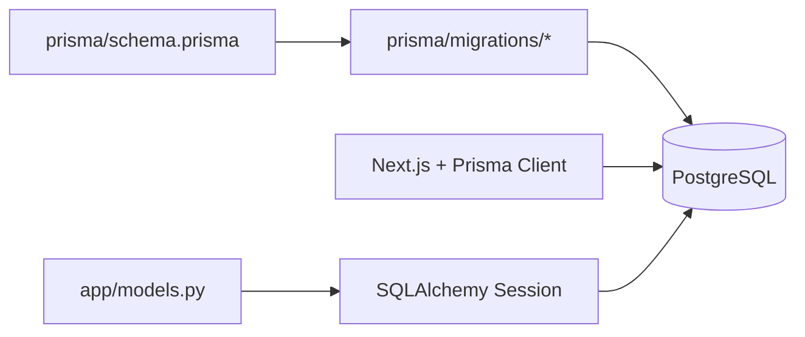
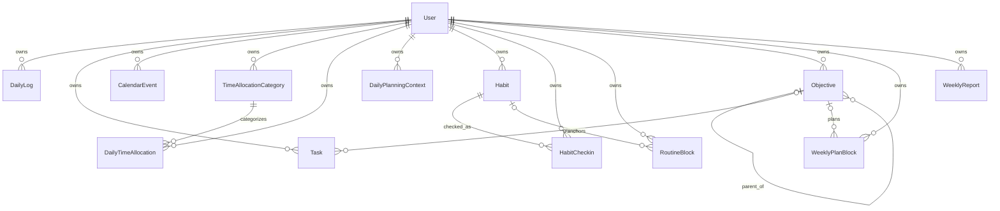

# 6 — Base de données, ORM et transactions

## Ce que le projet utilise réellement

La base est **PostgreSQL**. Deux technologies y accèdent :

- Prisma, côté application Next.js, décrit le schéma dans `prisma/schema.prisma` et possède les migrations ;
- SQLAlchemy, côté API Python, mappe les mêmes tables dans `interface_API/app/models.py` et exécute les requêtes.

Il n'existe donc pas deux bases. Il existe deux clients du même PostgreSQL.



## Vocabulaire minimal

- Une **base de données** conserve des données de façon durable.
- Une **table** ressemble à un tableau : chaque ligne est un enregistrement, chaque colonne une propriété.
- Une **clé primaire** identifie une ligne de façon unique.
- Une **clé étrangère** contient l'identifiant d'une ligne d'une autre table.
- Une **contrainte unique** interdit les doublons sur une ou plusieurs colonnes.
- Un **index** aide PostgreSQL à retrouver des lignes plus vite, au prix d'espace et de travail lors des écritures.
- `NULL` signifie « valeur absente ». Ce n'est ni zéro, ni chaîne vide, ni `False`.
- Une **requête SQL** demande de lire ou modifier les données.
- Un **ORM** traduit entre objets du langage et lignes SQL. Ici, ORM veut dire SQLAlchemy côté Python et Prisma côté TypeScript.
- Une **transaction** regroupe plusieurs opérations : elles réussissent ensemble ou sont annulées ensemble.

## Lire `schema.prisma`

### Générateur et source

```prisma
generator client {
  provider = "prisma-client-js"
}

datasource db {
  provider = "postgresql"
  url      = env("DATABASE_URL")
}
```

Le bloc `generator` demande un client JavaScript. Le bloc `datasource` choisit PostgreSQL et lit l'URL dans `DATABASE_URL`. Ces lignes ne lancent pas le serveur Python.

### Syntaxe d'un champ

```prisma
id        String   @id @default(cuid())
createdAt DateTime @default(now())
updatedAt DateTime @updatedAt
```

- le premier mot est le nom ;
- le deuxième est le type ;
- `@id` marque la clé primaire ;
- `@default(...)` fournit une valeur à l'insertion ;
- `@updatedAt` demande à Prisma de modifier l'heure lors de ses mises à jour.

`String?` est facultatif et accepte `NULL`. `Task[]` représente plusieurs lignes liées ; ce champ de relation n'est pas une colonne contenant une liste.

`DateTime @db.Date` demande une colonne PostgreSQL de type `DATE`, sans heure. Un `DateTime` sans `@db.Date` stocke date et heure.

### Directives de table

```prisma
@@unique([userId, date])
@@index([userId, date])
```

`@@` vise le modèle entier. L'unicité composite signifie qu'un utilisateur ne peut avoir qu'un journal par date. L'index accélère la recherche par utilisateur/date.

## Les enums

Une enum limite une colonne à un ensemble fermé de valeurs.

| Enum | Valeurs exactes |
|---|---|
| `DailyLogStatus` | `EMPTY`, `DRAFT`, `SUBMITTED`, `ANALYZED`, `MISSING`, `SKIPPED` |
| `TaskImportance` | `LOW`, `MEDIUM`, `HIGH` |
| `TaskStatus` | `PLANNED`, `IN_PROGRESS`, `DONE`, `POSTPONED`, `CANCELLED` |
| `CalendarEventType` | `EXAM`, `INTERVIEW`, `DEADLINE`, `ADMIN`, `SOCIAL`, `TRAINING`, `RECOVERY`, `TRAVEL`, `PERSONAL` |
| `CalendarImpact` | `LOW`, `MEDIUM`, `HIGH`, `CRITICAL` |
| `ObjectiveKind` | `OBJECTIVE`, `PROJECT`, `MILESTONE` |
| `ObjectiveHorizon` | `YEAR`, `QUARTER`, `MONTH`, `WEEK` |
| `ObjectiveStatus` | `PLANNED`, `ACTIVE`, `ON_TRACK`, `AT_RISK`, `PAUSED`, `DONE` |
| `ObjectivePriority` | `LOW`, `MEDIUM`, `HIGH`, `CRITICAL` |
| `WeeklyPlanCategory` | `WORK`, `STUDY`, `SPORT`, `REST`, `ADMIN`, `PERSONAL`, `SOCIAL`, `TRAVEL` |

Dans `models.py:19–30`, les mêmes listes sont des tuples Python. `_enum(..., create_type=False)` indique à SQLAlchemy de référencer les types PostgreSQL existants sans tenter de les créer.

## Carte relationnelle complète



`||` représente exactement un parent, `o|` zéro ou un, `o{` zéro ou plusieurs.

## Table `User`

Rôle : utilisateur propriétaire de toutes les données.

| Colonne | Type | Défaut | Sens |
|---|---|---|---|
| `id` | texte, PK | CUID / `new_id` | identifiant |
| `label` | texte | `Local user` | libellé visible |
| `calorieTarget` | entier | 2200 | cible calorique |
| `defaultSleepDelayMin` | entier | 20 | délai de sommeil par défaut |
| `createdAt` | date-heure | maintenant | création |
| `updatedAt` | date-heure | actualisé | modification |

Toutes les relations de `User` ont `onDelete: Cascade`. Supprimer un utilisateur supprime donc ses données dépendantes. Le code Python ne propose pas ici une route de suppression d'utilisateur.

## Table `DailyLog`

Rôle : journal quotidien et résultats calculés. Unicité `(userId, date)`.

Les colonnes se répartissent en groupes :

- identité : `id`, `userId`, `date`, `status` ;
- saisie subjective : `energy`, `productivity`, `startFriction`, `mentalFatigue`, `physicalFatigue`, `focusQuality` ;
- activité : `trainingDone`, `workTimeMinutes`, `distractionTimeMinutes`, `avoidedImportantTask` ;
- calories : `calorieTarget`, `caloriePercent` ;
- texte : `mainBlocker`, `improvementTomorrow`, `textSummary`, `voiceTranscript` ;
- sommeil : `sleepIntentClickedAt`, `estimatedSleepDelayMin`, `estimatedSleepStart` ;
- calculs : `executionScore`, `stateScore`, `riskScore`, `riskDelta`, `riskAcceleration`, `regime`, `regimeConfidence` ;
- audit : `createdAt`, `updatedAt`, `submittedAt`.

Presque toutes les saisies et tous les scores acceptent `NULL`. Cela permet un brouillon partiel. Le calcul `weighted_average` exclut les composantes absentes ; d'autres formules substituent des valeurs neutres.

## Table `Task`

Rôle : tâche datée, éventuellement rattachée à un objectif.

| Groupe | Colonnes |
|---|---|
| identité/propriétaire | `id`, `userId` |
| lien facultatif | `objectiveId` → `Objective.id` |
| contenu | `title`, `date` |
| mesure | `importance`, `productive`, `estimatedMinutes`, `completionPercent`, `status` |
| audit | `createdAt`, `updatedAt` |

La suppression de l'objectif applique `SetNull` : la tâche survit, mais `objectiveId` devient `NULL`. Les index `(userId, date)` et `(userId, objectiveId)` correspondent aux recherches des routes et de `core/objectives.py`.

## Tables d'allocation du temps

### `TimeAllocationCategory`

Décrit un axe de temps : nom, objectif texte, poids cible, rendement attendu, risque, bêta, couleur et état actif. `allocations` est la relation vers les lignes quotidiennes.

### `DailyTimeAllocation`

Relie utilisateur, catégorie et date. Elle stocke minutes planifiées, indicateur de plan manuel, minutes réelles et note. La contrainte unique `(userId, categoryId, date)` permet l'UPSERT de `core/time_allocation.py`.

Si la catégorie est supprimée, les allocations sont supprimées en cascade. Dans la route réelle, `DELETE /api/time-allocation` effectue toutefois une suppression logique : `active = False`.

### `DailyPlanningContext`

Stocke le budget de minutes d'un utilisateur pour un jour. Défaut 720, soit 12 heures. Unicité `(userId, date)` utilisée par `upsert_day_budget`.

## Tables d'habitudes

### `Habit`

Une définition d'habitude : `name`, `category`, description facultative, heure cible texte, durée attendue, ordre, activité et source. Index `(userId, active)`.

### `HabitCheckin`

Un état quotidien par habitude : statut texte, minutes réelles, note. Unicité `(userId, habitId, date)`, exactement utilisée par `upsert_habit_checkin`. Supprimer l'habitude supprime ses check-ins.

### `RoutineBlock`

Un bloc horaire récurrent avec `dayType`, `label`, `startTime`, `endTime`, ordre et activité. Le lien vers une habitude est facultatif ; supprimer l'habitude met `habitId` à `NULL`.

Les heures `startTime` et `endTime` sont du texte, pas un type horaire PostgreSQL. Leur validité dépend donc de la validation applicative.

## `CalendarEvent`

Rôle : événement daté avec type, intervalle `start`/`end`, impact, stress prévu et charge de préparation. Index `(userId, start)` pour les requêtes de plage.

À la différence d'une `Task.date`, `start` et `end` contiennent aussi une heure. Les helpers Python convertissent les dates avec fuseau vers UTC sans fuseau avant stockage.

## `WeeklyReport`

Rôle : mémoriser un export hebdomadaire.

- `weekId` est un texte comme `2026-W31` ;
- `content` est du JSON PostgreSQL, mappé en `JSONB` côté SQLAlchemy ;
- unicité `(userId, weekId)` : au maximum un rapport par semaine et utilisateur.

`generate_weekly_report` ne fait pas un UPSERT SQL atomique : il exécute un `SELECT`, puis `add` ou remplace `existing.content`.

## `Objective` et son arbre

`Objective` s'auto-référence : `parentId` pointe vers une autre ligne `Objective`. Prisma nomme cette relation `ObjectiveTree`. Une racine a `parentId = NULL`.

Les champs de classement sont `kind`, `horizon`, `status`, `priority`, `targetDate`, `weekId`, `sortOrder` et `archived`. Les relations vers tâches et blocs permettent d'agréger progression et minutes.

`onDelete: SetNull` sur `parentId` signifie que supprimer un parent transforme ses enfants en racines. La route d'objectifs peut également effectuer des mises à jour explicites ; il faut vérifier les deux niveaux avant de changer ce comportement.

## `WeeklyPlanBlock`

Rôle : bloc de planning hebdomadaire. Il possède une date, éventuellement des heures de début/fin, une durée, un indicateur de flexibilité et une note. Le rattachement à `Objective` est facultatif et devient `NULL` si l'objectif disparaît.

## Correspondance Prisma → SQLAlchemy

| Prisma | SQLAlchemy Python | PostgreSQL conceptuel |
|---|---|---|
| `String` | `String` ou `Text` | texte |
| `Int` | `Integer` | entier |
| `Float` | `Float` | flottant |
| `Boolean` | `Boolean` | booléen |
| `DateTime @db.Date` | `Date` | date seule |
| `DateTime` | `DateTime` | date et heure |
| `Json` | `JSONB` | JSON binaire indexable |
| enum Prisma | `postgresql.ENUM` | enum PostgreSQL |
| `Type?` | `Mapped[type | None]` | colonne nullable |

SQLAlchemy utilise `Mapped[...]` pour le type Python et `mapped_column(...)` pour le type SQL. Les deux informations servent à des moments différents : l'annotation aide l'éditeur et SQLAlchemy 2 ; la colonne construit le mapping.

## Le chemin d'une lecture SQL

Exemple réel simplifié de `get_todo_metrics` :

```python
statement = select(Task).where(
    Task.userId == user_id,
    Task.date == parse_date_key(date_key),
)
tasks = list(db.execute(statement).scalars())
```

1. `select(Task)` construit un objet de requête, sans envoyer SQL.
2. `Task.userId == user_id` ne produit pas immédiatement `True/False` : SQLAlchemy surcharge `==` et crée une expression SQL paramétrée.
3. La virgule dans `where(a, b)` signifie `AND`.
4. `db.execute(statement)` demande l'exécution.
5. `.scalars()` extrait les objets `Task` au lieu de lignes enveloppes.
6. `list(...)` consomme le résultat.

La requête équivalente approximative, à ne pas copier comme remplacement du code ORM, est :

```sql
SELECT * FROM "Task"
WHERE "userId" = :user_id AND "date" = :day;
```

`:user_id` est un paramètre séparé du texte SQL, ce qui protège contre l'injection SQL dans ce chemin.

## Les méthodes de résultat

- `.scalar_one_or_none()` attend zéro ou une valeur ; plus d'une est une erreur.
- `.scalar_one()` attend exactement une valeur.
- `.scalars()` donne une suite de premières colonnes/entités.
- `.all()` renvoie toutes les lignes, utile pour `select(Task, Objective.title)`.
- `db.get(Model, id)` cherche par clé primaire et peut utiliser le cache de session.

## CREATE, READ, UPDATE, DELETE dans ce projet

### Create

```python
task = Task(userId=user.id, title=title, date=day, ...)
db.add(task)
db.flush()
```

L'objet commence en mémoire. `add` l'attache à la session. `flush` émet l'`INSERT` et remplit l'identifiant généré.

### Read

Les lectures utilisent surtout `select(...).where(...)`, puis une méthode de résultat.

### Update

Deux formes coexistent :

- modifier un attribut d'objet, par exemple `existing.status = ...` ; SQLAlchemy détecte la modification ;
- construire `update(Task).where(...).values(...)`, comme `sync_objective_tasks`.

### Delete

Le code peut appeler `db.delete(...)` dans certaines routes. Pour les catégories d'allocation, il fait plutôt une **suppression logique** en mettant `active=False` ; la ligne reste en base.

## UPSERT PostgreSQL

UPSERT signifie « insérer, ou mettre à jour si la clé existe déjà ».

```python
insert_statement = insert(HabitCheckin).values(...)
statement = insert_statement.on_conflict_do_update(
    index_elements=[HabitCheckin.userId, HabitCheckin.habitId, HabitCheckin.date],
    set_=update_values,
).returning(HabitCheckin)
checkin = db.execute(statement).scalar_one()
```

La base peut détecter le conflit grâce à la contrainte unique Prisma. `returning` demande à PostgreSQL de rendre la ligne finale. C'est utilisé pour `HabitCheckin`, `DailyTimeAllocation`, `DailyPlanningContext` et directement dans la route de journal.

Attention à `actualMinutes=actual_minutes or 0` lors de l'insertion : `None` et `0` donnent tous deux zéro. Lors de la mise à jour, le test `is not None` permet bien d'enregistrer explicitement zéro.

## Transaction, `flush`, `commit`, `rollback`

### Analogie

Imaginez un brouillon de virement bancaire :

- modifier les objets prépare les opérations ;
- `flush` les envoie au serveur dans une enveloppe encore annulable ;
- `commit` scelle l'enveloppe ;
- `rollback` détruit tout le brouillon depuis le début de la transaction.

### Dans le code réel

Les fonctions métier appellent `flush()` lorsqu'elles ont besoin :

- de l'identifiant d'un nouvel objet ;
- que les requêtes suivantes voient les changements malgré `autoflush=False` ;
- de détecter tôt une erreur de contrainte.

Elles ne font pas `commit()`. Avec la portée `request` implicite des dépendances génératrices FastAPI, `get_db()` le fait après l'envoi d'une réponse normale. Si une exception remonte avant cet envoi, il fait `rollback()` puis ferme la session. Un échec du commit lui-même peut donc survenir trop tard pour remplacer une réponse déjà transmise.

### Propriété atomique d'une requête

Dans `POST /api/daily-log`, l'UPSERT du journal et le recalcul des scores appartiennent à la même transaction. Si le recalcul échoue, le journal n'est pas partiellement sauvegardé.

Dans `GET /api/reports/week`, une requête GET écrit pourtant `WeeklyReport`. Ce choix est réel dans le projet. Le flush se produit avant la construction de la réponse ; le commit de la dépendance de portée requête se produit après l'envoi de cette réponse, comme pour les routes de mutation.

## Relations non déclarées dans `models.py`

`models.py` n'utilise ni `ForeignKey` ni `relationship`. Cela signifie :

- le code Python manipule souvent les identifiants à la main ;
- il ne peut pas écrire naturellement `task.objective.title` ;
- les jointures sont explicites, par exemple `outerjoin(Objective, ...)` ;
- la base continue à faire respecter les clés étrangères créées par les migrations Prisma.

C'est une architecture de transition annoncée dans le docstring du fichier. Ajouter une relation Python peut améliorer l'ergonomie, mais ne remplace jamais une migration du schéma réel.

## Migrations réelles du dépôt

Le dossier `prisma/migrations/` contient, dans l'ordre lexical :

1. `20260618222328_init` ;
2. `20260618231454_life_dashboard_fields` ;
3. `20260620120000_add_regime_fields` ;
4. `20260620123000_add_task_estimated_minutes` ;
5. `20260622120000_add_time_allocation_habits` ;
6. `20260622131500_add_time_allocation_objective` ;
7. `20260622193000_add_objectives_planning` ;
8. `20260623093000_add_daily_planning_context`.

Le `package.json` expose les commandes réelles :

```powershell
pnpm prisma:generate
pnpm prisma:migrate
```

La première régénère le client Prisma. La seconde exécute `prisma migrate dev`. Ne lancez pas une migration juste pour modifier une formule Python ; une migration sert à changer la structure ou les contraintes de la base.

## Procédure sûre pour ajouter une colonne

1. Modifier `prisma/schema.prisma`, source de vérité structurelle.
2. Créer/appliquer une migration Prisma dans un environnement de développement.
3. Régénérer le client Prisma.
4. Ajouter la colonne correspondante à la bonne classe de `models.py` avec le même nom, type et caractère nullable.
5. Ajouter la validation d'entrée dans le contrat concerné.
6. Lire/écrire le champ dans la route ou le service.
7. Ajouter le champ à la sérialisation seulement s'il doit sortir dans le JSON.
8. Tester insertion, lecture, mise à jour, valeur absente et rollback.

Ne mélangez pas le code existant et cette procédure proposée : les étapes ci-dessus sont un guide de modification, pas une description d'une colonne déjà présente.

## Erreurs typiques

### `IntegrityError`

Cause possible : violation d'unicité ou de clé étrangère. Exemple : deux `DailyLog` pour le même `(userId, date)` sans UPSERT, ou `categoryId` inexistant.

### `DataError`

Cause possible : valeur hors type ou date incorrecte.

### Valeur enum invalide

PostgreSQL refusera une chaîne absente de l'enum. Les contrats de requête doivent l'arrêter avant la base, mais la base reste la dernière protection.

### Transaction annulée

Après une erreur SQL, la transaction doit être rollbackée avant réutilisation. `get_db()` le fait automatiquement si l'erreur remonte. Capturer une erreur SQL dans une route et continuer sans rollback serait dangereux.

### État ancien après modification

Avec `autoflush=False`, une requête ultérieure peut ignorer une modification non flushée. Le projet appelle explicitement `db.flush()` avant les recalculs ou sérialisations qui en dépendent.

## Exercices corrigés

### Exercice 1 — identifier la contrainte

Pourquoi `upsert_day_budget` peut-il cibler `[userId, date]` ?

**Correction :** `DailyPlanningContext` déclare `@@unique([userId, date])` dans Prisma. PostgreSQL possède donc un arbitre d'unicité correspondant pour `ON CONFLICT`.

### Exercice 2 — choisir `NULL` ou zéro

Une énergie inconnue doit-elle être stockée comme `0` ?

**Correction :** non. Dans le domaine, zéro représenterait une énergie mesurée extrêmement basse. `NULL` représente l'absence de mesure et permet à `weighted_average` d'écarter cette composante.

### Exercice 3 — prédire le rollback

Une route ajoute trois tâches, flush, puis la troisième viole une contrainte et l'exception remonte. Combien de tâches sont durablement enregistrées ?

**Correction :** aucune. Le `flush` ne valide pas la transaction. `get_db()` reçoit l'exception et exécute `rollback()` sur l'ensemble.

### Exercice 4 — relation supprimée

Que devient une tâche quand son objectif est supprimé au niveau PostgreSQL ?

**Correction :** la relation Prisma `Task.objective` utilise `onDelete: SetNull`. La tâche reste, avec `objectiveId = NULL`.

## Annexe — correspondance exhaustive des modèles Python

Cette table confirme qu'aucune classe mappée du fichier `models.py` n'a été omise.

| Classe SQLAlchemy | Lignes | `__tablename__` | Modèle Prisma | Clé logique importante |
|---|---:|---|---|---|
| `User` | 41–49 | `User` | 92–111 | `id` |
| `DailyLog` | 52–87 | `DailyLog` | 113–151 | `(userId, date)` unique |
| `Task` | 90–104 | `Task` | 153–171 | `id`; index utilisateur/date |
| `TimeAllocationCategory` | 107–121 | `TimeAllocationCategory` | 173–190 | `id`; index utilisateur/actif |
| `DailyTimeAllocation` | 124–136 | `DailyTimeAllocation` | 192–208 | `(userId, categoryId, date)` unique |
| `DailyPlanningContext` | 139–147 | `DailyPlanningContext` | 210–221 | `(userId, date)` unique |
| `Habit` | 150–164 | `Habit` | 223–241 | `id`; index utilisateur/actif |
| `HabitCheckin` | 167–178 | `HabitCheckin` | 243–258 | `(userId, habitId, date)` unique |
| `RoutineBlock` | 181–194 | `RoutineBlock` | 260–276 | `id`; index utilisateur/type/actif |
| `CalendarEvent` | 197–210 | `CalendarEvent` | 278–293 | `id`; index utilisateur/début |
| `WeeklyReport` | 213–221 | `WeeklyReport` | 295–305 | `(userId, weekId)` unique |
| `Objective` | 224–243 | `Objective` | 307–334 | auto-relation `parentId` |
| `WeeklyPlanBlock` | 246–261 | `WeeklyPlanBlock` | 336–355 | `id`; index utilisateur/date |

Il y a donc treize classes de table : `User` plus douze familles de données.

## Annexe — toutes les contraintes et tous les index Prisma

| Table | Unicité déclarée | Index déclarés | Conséquence directe dans le code |
|---|---|---|---|
| `User` | clé primaire `id` | aucun `@@index` | recherche par `db.get` ou premier créé |
| `DailyLog` | `(userId, date)` | `(userId, date)` | UPSERT du journal, lectures journalières |
| `Task` | clé primaire | `(userId, date)`, `(userId, objectiveId)` | listes par jour et liens d'objectifs |
| `TimeAllocationCategory` | clé primaire | `(userId, active)` | catégories actives |
| `DailyTimeAllocation` | `(userId, categoryId, date)` | `(userId, date)` | UPSERT et agrégats jour/semaine |
| `DailyPlanningContext` | `(userId, date)` | `(userId, date)` | UPSERT du budget |
| `Habit` | clé primaire | `(userId, active)` | tracker des habitudes actives |
| `HabitCheckin` | `(userId, habitId, date)` | `(userId, date)` | UPSERT et métriques sur sept jours |
| `RoutineBlock` | clé primaire | `(userId, dayType, active)` | routine `school_day` active |
| `CalendarEvent` | clé primaire | `(userId, start)` | plages chronologiques |
| `WeeklyReport` | `(userId, weekId)` | aucun autre | un export persistant par semaine |
| `Objective` | clé primaire | `(userId, archived, horizon)`, `(userId, weekId)`, `(parentId)` | arbre, filtres et semaine |
| `WeeklyPlanBlock` | clé primaire | `(userId, date)`, `(userId, objectiveId)` | planning et allocation par objectif |

Une clé primaire crée elle-même un index unique PostgreSQL. La mention « aucun `@@index` » ne veut donc pas dire « aucun index du tout ».

## Annexe — matrice des suppressions relationnelles

| Enfant | Parent | Politique Prisma | Si le parent est supprimé |
|---|---|---|---|
| `DailyLog` | `User` | `Cascade` | journal supprimé |
| `Task` | `User` | `Cascade` | tâche supprimée |
| `Task` | `Objective` | `SetNull` | tâche conservée, lien retiré |
| `TimeAllocationCategory` | `User` | `Cascade` | catégorie supprimée |
| `DailyTimeAllocation` | `User` | `Cascade` | allocation supprimée |
| `DailyTimeAllocation` | `TimeAllocationCategory` | `Cascade` | allocation supprimée |
| `DailyPlanningContext` | `User` | `Cascade` | budget supprimé |
| `Habit` | `User` | `Cascade` | habitude supprimée |
| `HabitCheckin` | `User` | `Cascade` | check-in supprimé |
| `HabitCheckin` | `Habit` | `Cascade` | check-in supprimé |
| `RoutineBlock` | `User` | `Cascade` | bloc supprimé |
| `RoutineBlock` | `Habit` | `SetNull` | bloc conservé sans habitude |
| `CalendarEvent` | `User` | `Cascade` | événement supprimé |
| `WeeklyReport` | `User` | `Cascade` | rapport supprimé |
| `Objective` | `User` | `Cascade` | objectif supprimé |
| `Objective` | parent `Objective` | `SetNull` | enfant conservé comme racine |
| `WeeklyPlanBlock` | `User` | `Cascade` | bloc supprimé |
| `WeeklyPlanBlock` | `Objective` | `SetNull` | bloc conservé sans objectif |

Ces effets sont exécutés par PostgreSQL à cause des clés étrangères de la migration. Ils restent vrais même si `models.py` ne déclare pas `ForeignKey`.

## Annexe — cycle de vie d'un objet SQLAlchemy

Une instance passe conceptuellement par plusieurs états :

1. **transient** : `Task(...)` existe seulement en Python ;
2. **pending** : `db.add(task)` l'attache à la session en attente d'insertion ;
3. **persistent** : après `flush`, sa ligne existe dans la transaction et son identifiant est disponible ;
4. **committed** : après `get_db` et `commit`, les autres transactions peuvent durablement voir la ligne ;
5. **detached** : après `close`, l'objet n'est plus attaché à cette session.

Pour une ligne chargée par `select`, l'objet est directement persistent dans la session. Une assignation comme `existing.content = report` marque l'attribut comme modifié ; le prochain flush émet l'`UPDATE`.

`expire_on_commit=False` évite d'effacer les attributs chargés au commit. Ce choix facilite une sérialisation autour de la fin de requête, mais ne rend pas l'objet attaché après `close`.

## Annexe — cinq lectures SQLAlchemy expliquées symbole par symbole

### Une condition simple

```python
select(DailyLog).where(DailyLog.userId == user_id)
```

`DailyLog.userId` au niveau de la classe n'est pas la chaîne d'un utilisateur. C'est un descripteur de colonne capable de construire une expression SQL. `==` est surchargé et le `user_id` devient un paramètre SQL.

### Plusieurs conditions

```python
.where(
    CalendarEvent.userId == user_id,
    CalendarEvent.start >= start,
    CalendarEvent.start < end,
)
```

La virgule entre expressions signifie un `AND`. La borne gauche est incluse, la borne droite exclue. Deux intervalles adjacents ne comptent donc pas deux fois un événement situé exactement sur la frontière.

### Une liste avec `IN`

```python
DailyLog.date.in_([parse_date_key(day) for day in days])
```

La compréhension transforme chaque chaîne en `date`. `.in_(...)` construit SQL `IN (...)`. Le suffixe `_` évite de prendre le mot-clé Python `in` comme nom de méthode.

### Une valeur non nulle

```python
DailyLog.riskScore.is_not(None)
```

Cela produit `IS NOT NULL`. Écrire du SQL avec `!= NULL` serait incorrect, car `NULL` suit une logique à trois valeurs.

### Une agrégation

```python
select(func.count()).select_from(DailyLog).where(...)
```

`func.count()` représente la fonction SQL `COUNT`. `select_from(DailyLog)` indique la table de départ puisqu'aucune entité entière n'est sélectionnée. `.scalar_one()` extrait l'unique nombre rendu.

## Annexe — ce que les migrations protègent et ce qu'elles ne protègent pas

La base protège :

- les types fondamentaux ;
- les valeurs des enums PostgreSQL ;
- les clés primaires ;
- les clés étrangères ;
- les contraintes uniques ;
- les règles de suppression ;
- le caractère obligatoire des champs non facultatifs.

Le schéma visible ne déclare pas de contrainte `CHECK` pour forcer par exemple `energy` entre 0 et 100 ou `completionPercent` entre 0 et 100. Cette protection est apportée par les contrats Pydantic des routes. Un autre client SQL qui contournerait l'API pourrait donc insérer certaines valeurs sémantiquement invalides si aucune migration additionnelle ne les interdit.

La base ne garantit pas non plus que `CalendarEvent.end` soit après `start`, ni que `RoutineBlock.startTime` soit un texte horaire bien formé, d'après le schéma analysé. Toute amélioration de ces garanties nécessiterait de distinguer validation applicative et contrainte de migration.
