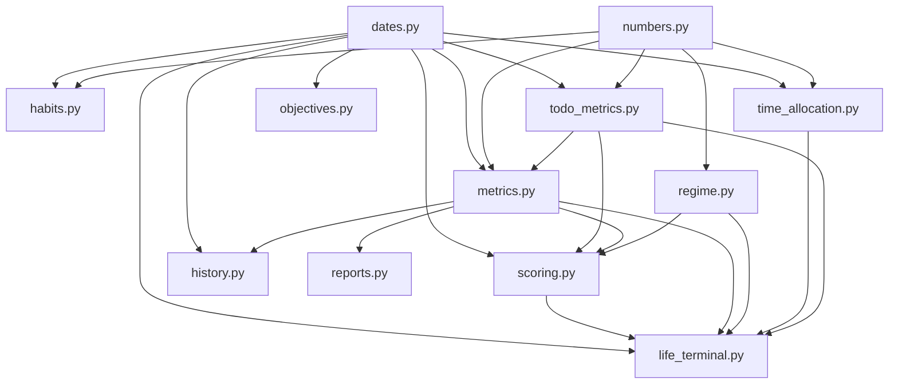

# Référence guidée des fonctions métier de `core/`

## But de cette référence

Le dossier `interface_API/app/core/` contient les calculs et les agrégations réutilisés par les routes. Ce chapitre ne remplace pas les bases de Python : il applique ces bases à chaque fonction importante du code réel.

Pour chaque fonction, on répond aux mêmes questions :

1. où est-elle définie ;
2. quelles valeurs reçoit-elle ;
3. quelle valeur retourne-t-elle ;
4. dans quel ordre travaille-t-elle ;
5. quelles fonctions ou tables utilise-t-elle ;
6. qui l’appelle ;
7. quelles erreurs ou surprises sont possibles.

Un nom commençant par `_` est une convention Python : l’auteur annonce que la fonction est interne au module. Python n’interdit toutefois pas techniquement son import. Le projet importe d’ailleurs `_log_as_regime_dict` depuis `life_terminal.py`.

## Comment lire une signature

Prenons une signature réelle simplifiée :

```python
def add_days(date_key: str, days: int) -> str:
```

- `def` commence la définition d’une fonction synchrone.
- `add_days` est le nom appelable.
- `date_key` est le premier paramètre.
- `: str` indique que ce paramètre est attendu sous forme de chaîne.
- `days` est le second paramètre.
- `: int` indique un nombre entier.
- `-> str` documente le type retourné.
- le `:` final ouvre le bloc indenté.

Les annotations n’effectuent pas seules une validation à l’exécution. Elles servent aux lecteurs, aux éditeurs et aux outils de typage. La validation des entrées HTTP vient surtout de FastAPI et Pydantic.

# Module `core/dates.py`

## Rôle du module

Ce module centralise les dates afin que les routeurs ne réimplémentent pas les mêmes conversions. Une « clé de date » est une chaîne `YYYY-MM-DD`, par exemple `2026-08-01`.

Ses imports sont tous issus de la bibliothèque standard : `date`, `datetime`, `timedelta` et `timezone`. Aucune requête SQL n’est exécutée ici.

## `to_date_key(value: date | None = None) -> str`

### Entrée et sortie

`value` peut être un objet `date` ou `None`. La valeur par défaut `None` signifie que l’appelant peut omettre l’argument. La sortie est toujours une chaîne ISO.

### Ordre exact

1. L’expression `value or date.today()` choisit `value` lorsqu’il est présent.
2. Sinon elle appelle `date.today()`.
3. `.isoformat()` produit `YYYY-MM-DD`.
4. `return` rend la chaîne à l’appelant.

### Appelants

De nombreux routeurs l’utilisent comme date par défaut : journal, tâches, habitudes, objectifs, allocation et terminal.

### Piège

`date.today()` utilise la date locale du processus. Cette fonction ne reçoit pas explicitement de fuseau horaire.

## `parse_date_key(date_key: str) -> date`

### Mécanisme

La tranche `date_key[:10]` conserve les dix premiers caractères, puis `date.fromisoformat(...)` crée un objet `date`.

### Erreur possible

Une chaîne invalide provoque `ValueError`. Les routeurs ne la convertissent pas toujours explicitement en erreur HTTP ; le gestionnaire générique peut alors produire `500` si FastAPI n’a pas validé la valeur auparavant.

### Exemple

```python
day = parse_date_key("2026-08-01T09:00:00Z")
```

La tranche conserve `2026-08-01`, donc `day` représente uniquement le jour.

## `add_days(date_key: str, days: int) -> str`

### Étapes

1. `parse_date_key` transforme la chaîne en `date`.
2. `timedelta(days=days)` représente le déplacement.
3. L’addition calcule le nouveau jour.
4. `.isoformat()` reconvertit en chaîne.

Une valeur négative recule. `add_days("2026-08-01", -1)` retourne `2026-07-31`.

## `get_iso_week_id(date_key: str | None = None) -> str`

### Sortie

La sortie ressemble à `2026-W31`. `W` sépare l’année ISO du numéro de semaine.

### Étapes

1. La fonction parse `date_key` ou prend aujourd’hui.
2. `day.isocalendar()` renvoie année ISO, semaine ISO et jour ISO.
3. `_` reçoit le jour inutilisé.
4. `f"{iso_year}-W{iso_week:02d}"` force deux chiffres pour la semaine.

### Piège

L’année ISO n’est pas toujours l’année civile autour du Nouvel An. Il faut utiliser `isocalendar`, pas seulement `day.year`.

## `get_week_date_keys(week_id: str) -> list[str]`

### Entrée

`week_id` doit suivre la forme `AAAA-WNN`.

### Étapes

1. `split("-W")` sépare année et semaine.
2. `int(...)` convertit les deux fragments.
3. `date.fromisocalendar(..., 1)` trouve le lundi.
4. La compréhension de liste exécute sept additions, pour les indices `0` à `6`.
5. Chaque date devient une chaîne.

### Erreurs

Une forme invalide ou une semaine impossible produit `ValueError`.

## `shift_week_id(week_id: str, offset: int) -> str`

Cette composition appelle trois fonctions du même module : elle prend le lundi de la semaine, ajoute `offset * 7` jours puis recalcule l’identifiant ISO. Avec `offset=-1`, elle retourne la semaine précédente.

## `day_label(date_key: str) -> str`

`date.weekday()` renvoie `0` pour lundi et `6` pour dimanche. Cet entier indexe `WEEKDAY_SHORT`. La sortie est anglaise, par exemple `Mon`.

## `day_full_label(date_key: str) -> str`

La fonction combine le tableau `WEEKDAY_LONG`, le tableau `MONTH_SHORT` et le numéro du jour. Elle retourne par exemple `Saturday, Aug 1`.

## `month_year_label(date_key: str) -> str`

Le mois Python va de `1` à `12`, tandis qu’un index de tuple va de `0` à `11`. L’expression `day.month - 1` effectue cette conversion. La sortie peut être `August 2026`.

## `event_time_label(value: datetime) -> str`

### Mécanisme 24 h vers 12 h

- `value.hour % 12 or 12` transforme minuit et midi en `12`.
- le suffixe vaut `AM` avant 12 h et `PM` à partir de 12 h.
- `:02d` ajoute un zéro à gauche.

La fonction ne convertit pas le fuseau : elle formate l’heure contenue dans l’objet reçu.

## `iso_datetime(value: datetime | None) -> str | None`

### Contrat

`None` entre, `None` sort. Sinon la fonction produit une chaîne ressemblant à Prisma/JavaScript : `2026-08-01T09:30:00.123Z`.

### Détail important

`value.microsecond // 1000` passe des microsecondes aux millisecondes. Le `Z` est ajouté littéralement. Le code suppose que la date naïve représente déjà UTC.

## `parse_iso_datetime(value: str) -> datetime`

1. `.replace("Z", "+00:00")` rend le suffixe compatible avec `fromisoformat`.
2. `datetime.fromisoformat` parse la chaîne.
3. `to_utc_naive` normalise le résultat.

## `to_utc_naive(value: datetime) -> datetime`

Si `tzinfo` est absent, la valeur est rendue telle quelle. Sinon `astimezone(timezone.utc)` convertit l’instant en UTC, puis `replace(tzinfo=None)` retire l’information de fuseau pour correspondre aux colonnes Prisma existantes.

### Exercice corrigé

Prédisez `to_utc_naive` pour `2026-08-01T10:00:00+02:00`.

Correction : le même instant en UTC est `08:00:00`, puis le fuseau est retiré. L’objet final est naïf mais représente conventionnellement UTC.

# Module `core/numbers.py`

## `javascript_round(value: float) -> int`

### Pourquoi elle existe

La logique a été portée depuis JavaScript. Python et JavaScript ne traitent pas exactement toutes les valeurs à mi-chemin de la même façon. La fonction reproduit `Math.round` sur le domaine fini utilisé.

### Étapes

1. `math.isfinite` refuse `NaN`, l’infini positif et l’infini négatif.
2. En cas de valeur non finie, `raise ValueError(...)` interrompt l’appel.
3. Sinon `math.floor(value + 0.5)` arrondit vers l’infini positif aux égalités.

Les tests prouvent notamment `52.5 -> 53` et `-1.5 -> -1`.

# Module `core/todo_metrics.py`

## Vue d’ensemble

Ce module transforme les tâches et événements en métriques. Il accède à `Task` et `CalendarEvent` avec SQLAlchemy.

## `calculate_todo_metrics(tasks: list[Task]) -> dict`

### Entrée

Une liste d’objets ORM `Task` déjà chargés.

### Étapes

1. Exclure les tâches `CANCELLED`.
2. Additionner les poids d’importance : `LOW=1`, `MEDIUM=2`, `HIGH=3`.
3. Pondérer chaque pourcentage d’avancement.
4. Isoler les tâches productives.
5. Calculer leur avancement moyen.
6. Compter les tâches importantes non terminées.
7. Retourner quatre métriques en `camelCase`.

### Sortie

`weightedCompletionRate` et `productiveTaskCompletion` sont des ratios entre `0` et `1`, pas des pourcentages entre `0` et `100`.

### Piège

La fonction suppose que `task.importance` appartient à `IMPORTANCE_WEIGHT`. Une autre valeur déclencherait `KeyError`, mais l’enum PostgreSQL et les contrats empêchent normalement ce cas.

## `get_todo_metrics(db, user_id, date_key) -> tuple[list[Task], dict]`

### Accès SQL

La requête filtre simultanément `Task.userId` et `Task.date`, puis ordonne par importance décroissante et création croissante.

### Retour double

Le tuple contient d’abord la liste brute des tâches, puis le dictionnaire calculé. Certains appelants ignorent la liste avec `_` :

```python
_, metrics = get_todo_metrics(db, user_id, date_key)
```

## `detect_active_phase_for_week(events) -> str`

L’ordre des conditions fait partie de la règle. Une semaine contenant à la fois examen et entretien sera classée `exam_week`, car la condition examen vient d’abord. Ensuite viennent entretien, deadline, plus d’un événement à fort impact, puis `normal_week`.

## `count_high_impact_events(events) -> int`

La compréhension conserve `HIGH` et `CRITICAL`. `len(...)` retourne le nombre d’éléments filtrés.

## `weekly_expected_load(events) -> tuple[int, int]`

Sans événement, la fonction retourne `(0, 0)`. Sinon elle calcule séparément la moyenne de `expectedStress` et celle de `expectedPreparationLoad`, puis utilise `javascript_round`.

## `get_next_high_impact_event(db, user_id, date_key)`

La fonction construit le début du jour à `00:00`, cherche les événements futurs `HIGH` ou `CRITICAL`, les trie par début croissant, limite à une ligne et retourne `None` si rien n’est trouvé.

## `_events_between(db, user_id, from_key, to_key_exclusive)`

Le nom `to_key_exclusive` annonce la condition `< end`. L’intervalle inclut le début et exclut la borne de fin. C’est utile pour éviter de compter minuit deux fois entre deux périodes.

## `get_calendar_context(db, user_id, date_key) -> dict`

### Ordre

1. Trouver les sept jours de la semaine ISO.
2. Charger les événements de cette semaine.
3. Charger les événements des sept jours à venir.
4. Calculer charges hebdomadaires et moyennes futures.
5. Parcourir les événements futurs pour trouver l’impact maximal selon `IMPACT_RANK`.
6. Retourner phase, compte, impact maximal et charges.

### Appelants

Journal, scores, métriques hebdomadaires, terminal et exports l’utilisent. Une modification ici a donc une portée large.

# Module `core/metrics.py`

## `clamp_score(score: float) -> int`

La fonction arrondit d’abord avec la règle JavaScript, puis borne entre `0` et `100`. `min(100, ...)` coupe le haut ; `max(0, ...)` coupe le bas.

## `clamp_count(count: int, maximum: int = 7) -> int`

Même principe pour un nombre d’éléments, avec une borne supérieure configurable. La semaine utilise naturellement `7`.

## `weighted_average(parts) -> float | None`

### Entrée

Une liste de couples `(valeur éventuelle, poids)`. Une valeur `None` signifie « donnée absente » et est retirée.

### Règle importante

Les poids restants sont renormalisés par leur somme. Une donnée absente ne vaut donc pas zéro. Si aucune donnée n’existe, la fonction retourne `None`.

## `compute_state_score(log) -> int | None`

Les composantes réelles sont : énergie `0,35`, productivité `0,25`, inverse de friction `0,20`, concentration `0,10`, inverse de fatigue mentale `0,10`.

`100 - valeur` inverse les mesures négatives : une friction faible doit améliorer le score. La fonction retourne `None` si toutes les composantes sont absentes, sinon un entier borné.

## `compute_execution_score(log, metrics) -> int`

La complétion pondérée peut apporter jusqu’à `82` points. Un journal soumis ajoute `8`, un entraînement réalisé ajoute `6`, et l’évitement d’une tâche importante retire `12`. Le résultat final est borné entre `0` et `100`.

## `compute_risk_score(...) -> int`

### Paramètres

- `log` : journal courant ;
- `metrics` : métriques des tâches ;
- `calendar` : contexte calculé ;
- `missing_logs` : jours manquants déjà créés avec statut `MISSING` ;
- `previous_risk_delta` et `previous_risk_acceleration` : dynamique passée.

### Ordre de contribution

Le risque commence à `14`. Le code ajoute ensuite des pénalités selon énergie, productivité, friction, écart calorique, entraînement, fatigues, évitement, tâches importantes manquées, journaux manquants, pression calendrier et dynamique du risque.

### Valeurs par défaut

Une énergie, productivité ou friction absente devient `50`; un pourcentage calorique absent devient `100`. Ce sont des choix métier présents dans le code, pas des règles universelles.

## `compute_risk_delta(today_risk, previous_risk) -> int`

Sans risque précédent, la variation vaut `0`. Sinon elle vaut `today_risk - previous_risk`.

## `compute_risk_acceleration(today_delta, previous_delta) -> int`

Même structure : l’accélération compare la variation courante à la variation précédente.

## `compute_weekly_summary(db, user_id, week_id=None) -> dict`

### Requêtes et transformations

1. Obtenir l’identifiant de semaine et ses sept dates.
2. Charger les `DailyLog` de l’utilisateur sur ces dates.
3. Construire l’ensemble des dates existantes.
4. Les fonctions locales `avg` et `collect` extraient les valeurs non nulles.
5. Calculer jours manquants, ignorés, soumis et jours d’entraînement.
6. Appeler `get_calendar_context`.
7. Retourner période, moyennes, comptes et contexte.

### Nuance

Un jour sans ligne `DailyLog` est « manquant » dans ce résumé. Une ligne avec statut `MISSING` appartient au contraire à l’ensemble des lignes existantes. Il faut distinguer absence de ligne et valeur de statut.

## `build_interpretation_messages(...) -> list[str]`

Cette fonction génère des phrases anglaises à partir de signaux : hausse du risque sur les trois derniers journaux soumis, hausse de friction, amélioration d’exécution, pression calendrier et données incomplètes. Sans signal fort, elle ajoute une phrase par défaut.

## `get_trajectory(db, user_id, days=30, end_date=None) -> list[dict]`

### Mécanisme

Une seule requête charge les journaux de la période. Un dictionnaire `by_date` permet ensuite de construire exactement `days` points. Un jour sans journal produit un point de statut `missing` avec mesures `None`.

### Pourquoi ne pas faire une requête par jour

La requête groupée évite le problème N+1. Le coût SQL ne croît pas d’une requête supplémentaire par date.

## `build_weekly_json_export(db, user_id, week_id=None) -> dict`

### Ordre exact

1. Calculer le résumé de semaine.
2. Pour chacun des sept jours, charger le journal correspondant.
3. Pour chaque jour, charger métriques de tâches et contexte calendrier.
4. Construire les sections `inputs`, `todo_metrics`, `calendar_context` et `computed_scores`.
5. Recharger les journaux de la période pour produire l’interprétation.
6. Ajouter date de génération et synthèse.

### Performance

Contrairement à `get_trajectory`, cette fonction exécute plusieurs requêtes par jour. Le code est correct fonctionnellement, mais c’est un endroit à surveiller si le volume ou la fréquence augmente.

## `serialize_calendar_event(event) -> dict | None`

Le sérialiseur convertit les enums stockées en majuscules vers des chaînes minuscules et les dates via `iso_datetime`. `None` reste `None`.

# Module `core/regime.py`

## `_clamp(value, minimum=0, maximum=100) -> int`

Équivalent local de bornage utilisant l’arrondi compatible JavaScript.

## `_status(log: dict | None) -> str`

`(log or {})` remplace `None` par un dictionnaire vide. `.get("status") or ""` évite ensuite l’absence. `.upper()` normalise la casse.

## `_normalize_regime(value) -> str | None`

La valeur n’est acceptée que si elle appartient au tuple `REGIMES`; sinon la fonction retourne `None`.

## `risk_level(risk_score) -> str`

Les seuils sont testés du plus grand au plus petit : `>=75 critical`, `>=60 high`, `>=40 medium`, sinon `low`.

## `compute_regime(...) -> dict`

### Entrées

Le journal courant, le précédent journal soumis, jusqu’à quatorze journaux récents, le contexte calendrier, les métriques de tâches et le nombre de jours manquants.

### Pré-calculs

La fonction calcule notamment `data_incomplete`, `high_risk_streak`, `execution_falling`, `state_stable`, `pressure_signal`, `risk_decreasing` et `last_regime`.

### Priorité des régimes

La chaîne `if/elif` signifie qu’un seul régime gagne. L’ordre est : risque de burnout par série de risques élevés, risque de burnout par faible énergie/friction, chaotique, pression, productif, récupération, dérive, stable.

### Sortie

Le dictionnaire contient `regime`, `confidence`, `why`, `lastRegime` et `changed`. `why` contient au moins une phrase.

## `compute_regime_transition(current, target, calendar) -> float`

Il s’agit d’une heuristique fixe : même régime `0,48`, pression contextuelle `0,24`, burnout avec stress élevé `0,14`, dérive `0,14`, récupération `0,10`, autre `0,06`.

Ce n’est pas une probabilité déjà normalisée. Les fonctions suivantes normalisent l’ensemble.

## `simulate_next_week(regime, calendar) -> list[dict]`

La fonction calcule un poids pour chacun des sept régimes, additionne les poids, transforme chacun en pourcentage, borne, puis trie par probabilité décroissante.

## `build_transition_matrix_placeholder(regime, calendar) -> list[dict]`

Elle répète le calcul pour chaque régime source et marque la ligne correspondant au régime actuel avec `active=True`. Le mot `placeholder` appartient au nom réel et annonce une approximation, pas un modèle statistique entraîné.

# Module `core/scoring.py`

## `_log_as_regime_dict(log) -> dict | None`

Cette fonction adapte un objet ORM `DailyLog` au dictionnaire attendu par `compute_regime`. Elle évite de rendre le module de régime dépendant de SQLAlchemy.

## `recompute_daily_scores(db, user_id, date_key) -> DailyLog | None`

### Étape 1 — charger le journal

La requête filtre par utilisateur et date. Si aucune ligne n’existe, la fonction retourne immédiatement `None`.

### Étape 2 — charger le contexte

Elle appelle `get_todo_metrics` et `get_calendar_context`, puis cherche le précédent journal portant un score de risque et le précédent journal soumis.

### Étape 3 — charger l’historique utile

Elle prend jusqu’à quatorze journaux soumis, calcule le lundi de la semaine et compte les lignes antérieures de statut `MISSING`.

### Étape 4 — calculer

Elle appelle les fonctions d’exécution, d’état, de risque, de variation, d’accélération et de résumé hebdomadaire.

### Étape 5 — détecter le régime

Le dictionnaire courant est enrichi avec les nouveaux scores avant l’appel de `compute_regime`. Cela garantit que le régime utilise les valeurs recalculées, pas seulement les anciennes colonnes.

### Étape 6 — écrire sans valider définitivement

Les attributs ORM sont modifiés, puis `db.flush()` envoie les changements. Le `commit` appartient encore à `get_db` après le retour de la route.

## `recompute_around_date(db, user_id, date_key)`

La fonction recalcule le jour demandé, puis cherche un journal le lendemain. S’il existe, elle le recalcule aussi. Cette propagation est nécessaire parce que les deltas et accélérations du lendemain dépendent du passé.

Les routes de journal, tâches et calendrier l’appellent après des modifications pertinentes.

## `serialize_daily_log(log) -> dict | None`

Le sérialiseur expose les attributs ORM avec les clés attendues par le frontend, convertit les dates et remplace certains textes `None` par une chaîne vide. Les scores restent éventuellement `None`.

# Module `core/habits.py`

## `get_habit_tracker_data(db, user_id, date_key=None) -> dict`

### Quatre lectures SQL

1. habitudes actives ;
2. check-ins du jour ;
3. blocs de routine actifs de type `school_day` ;
4. check-ins des sept derniers jours.

### Transformations

Un dictionnaire relie chaque `habitId` à son check-in. La fonction locale `habit_payload` construit une réponse avec un check-in par défaut lorsqu’il manque. Les métriques comptent les réalisations du jour et des sept jours.

### Sortie

Le dictionnaire contient `date`, `habits`, `routineBlocks` et `metrics`.

## `upsert_habit_checkin(...) -> HabitCheckin`

### UPSERT

`insert(HabitCheckin).values(...)` prépare l’insertion. `on_conflict_do_update` cible la contrainte unique utilisateur + habitude + date. Seuls les champs explicitement non `None` entrent dans `update_values`, en plus de `updatedAt`.

`returning(HabitCheckin)` demande à PostgreSQL de renvoyer la ligne. `scalar_one()` exige exactement une ligne.

# Module `core/history.py`

## `get_history_data(db, user_id, history_filter="last30") -> dict`

### Validation interne

La fonction vérifie que le filtre appartient à `HISTORY_FILTERS`. La route Pydantic utilise déjà un `Literal`, mais cette garde protège aussi les appels Python directs.

### Périodes

- `week` : sept dates ISO de la semaine, inversées ;
- `last7` : aujourd’hui puis six jours antérieurs ;
- `last30` : aujourd’hui puis vingt-neuf jours antérieurs ;
- `all` : aucune restriction de dates.

Après la requête, elle sérialise les journaux et ajoute `compute_weekly_summary`.

## `serialize_history_log(log) -> dict`

Ce sérialiseur volontairement réduit ne rend que date, statut, date de mise à jour et cinq mesures principales.

# Module `core/reports.py`

## `generate_weekly_report(db, user_id, week_id=None) -> dict`

### Étapes

1. Choisir la semaine.
2. Appeler `build_weekly_json_export`.
3. Chercher un `WeeklyReport` existant pour utilisateur + semaine.
4. Créer une ligne ou remplacer son `content`.
5. `flush` puis retour du rapport.

Cette route GET produit donc un effet d’écriture. C’est inhabituel en HTTP : relire un rapport persiste ou met à jour son cache en base.

# Module `core/time_allocation.py`

## `_clamp` et `_clamp_minutes`

`_clamp` borne un indicateur entre 0 et 100. `_clamp_minutes` garantit seulement un entier positif ou nul, sans maximum interne.

## `allocate_minutes_from_weights(weights, total_minutes) -> list[int]`

### Problème résolu

Répartir un nombre entier de minutes selon des poids sans perdre les minutes dues aux arrondis.

### Algorithme

1. Borner le total à zéro minimum.
2. Remplacer les poids négatifs par zéro.
3. Retourner des zéros si total ou somme des poids vaut zéro.
4. Calculer les parts décimales exactes.
5. Prendre le plancher de chaque part.
6. Calculer les minutes restantes.
7. Classer les catégories par plus grande partie fractionnaire.
8. Distribuer une minute à la fois dans cet ordre.

La somme finale est exactement `total_minutes` lorsque des poids positifs existent.

## `compute_portfolio_metrics(rows) -> dict`

La fonction applique des analogies financières à l’allocation du temps : rendement cible/réel, risque quadratique, bêta, rendement CAPM et ratio de type Sharpe. Ces formules sont des choix de produit, pas des conseils financiers.

## `get_time_allocation_data(db, user_id, date_key=None) -> dict`

### Lectures

La fonction charge catégories actives, allocations du jour, allocations de la semaine et budget du jour.

### Calculs

Elle agrège les minutes hebdomadaires par catégorie, calcule les allocations automatiques selon les poids, respecte une valeur manuelle si `plannedMinutesManual=True`, calcule les poids réels et construit les lignes.

### Sortie

La réponse inclut totaux, dépassement ou restant du budget, présence de dérogations manuelles, lignes et métriques de portefeuille.

## `upsert_daily_allocation(...) -> DailyTimeAllocation`

L’UPSERT cible utilisateur + catégorie + date. Les arguments `None` signifient « ne pas modifier ce champ lors d’un conflit ». Attention : lors d’une nouvelle insertion, `planned_minutes or 0` convertit aussi zéro en zéro, ce qui est correct ici.

## `upsert_day_budget(...) -> DailyPlanningContext`

Même technique pour la contrainte unique utilisateur + date. Le budget est borné à zéro minimum et `updatedAt` est actualisé en cas de conflit.

# Module `core/objectives.py`

## `format_minutes(total_minutes) -> str`

La fonction arrondit, empêche les valeurs négatives, décompose avec `divmod` en jours, heures et minutes, retire les parties vides et les joint. Zéro devient explicitement `0m`.

## `serialize_objective`, `serialize_task`, `serialize_block`, `serialize_event`

Ces quatre fonctions convertissent des objets ORM en dictionnaires de présentation. Elles :

- passent les enums en minuscules ;
- convertissent dates et heures ;
- ajoutent des informations liées déjà fournies en paramètre ;
- ne lancent aucune requête SQL elles-mêmes.

## `default_objective_title(kind) -> str`

Après normalisation en minuscules, `project` donne `New project`, `milestone` donne `New milestone`, toute autre valeur donne `New objective`.

## `sync_objective_tasks(db, user_id, objective_id, linked_task_ids) -> None`

### Étapes

1. Retirer identifiants vides et doublons tout en conservant l’ordre.
2. Délier les tâches actuellement associées mais absentes de la nouvelle liste.
3. Lier les tâches de la nouvelle liste.
4. `flush`.

Les deux requêtes filtrent par utilisateur. Cela empêche de lier directement la tâche d’un autre utilisateur.

## `_objective_sort_key(objective) -> tuple`

Le tuple trie d’abord par horizon, puis priorité décroissante grâce au signe moins, puis `sortOrder`. Python compare les tuples composante par composante.

## `get_objectives_data(db, user_id, week_id=None) -> dict`

### Chargements

La fonction charge objectifs non archivés, tâches d’une fenêtre élargie, blocs de la semaine et événements de la semaine.

### Index en mémoire

Elle crée `objective_map`, `tasks_by_objective`, `blocks_by_objective` et `children_by_parent`. Ces dictionnaires évitent de reparcourir toutes les listes pour chaque relation.

### Fonction récursive `build_node`

`build_node` construit l’arbre. Le `trail` immuable mémorise les identifiants déjà traversés. Si un cycle existe malgré les validations, la récursion retourne `None` au lieu de boucler indéfiniment.

### Calculs supplémentaires

Elle calcule progression par tâches, minutes planifiées, jours hebdomadaires, allocation par objectif, charge du jour, statistiques, actions suivantes et modèles suggérés.

### Portée

Cette fonction alimente presque toute la page objectifs. Toute modification de forme doit être coordonnée avec les parseurs TypeScript.

## `bootstrap_objectives_demo(db, user_id, week_id=None) -> dict`

### Garde initiale

Si un objectif actif existe déjà, la fonction ne crée rien et retourne les données actuelles.

### Création

Sinon elle crée successivement un objectif annuel, trimestriel, mensuel, hebdomadaire et un projet. Chaque `flush` rend l’identifiant disponible pour le `parentId` suivant. Elle ajoute ensuite deux jalons et trois blocs avec `add_all`, puis retourne l’agrégat complet.

# Module `core/life_terminal.py`

## Rôle général

Ce module compose le plus grand « read model » du projet. Il rassemble journal, tâches, calendrier, trajectoire, semaine, régimes, allocation du temps et export. La route correspondante reste courte parce que cette orchestration est ici.

## `_serialize_task(task) -> dict`

Sérialiseur local réduit pour les sections du terminal.

## `_pressure_for_events(events) -> int`

Sans événement, zéro. Sinon la fonction combine à 60 % la pression du niveau d’impact le plus fort et à 40 % la moyenne stress/préparation, puis borne à 100.

## `_risk_band(risk_score) -> str`

Même famille de seuils que `risk_level` : critique à 75, élevé à 60, moyen à 40, faible sinon.

## `_trend(today, previous) -> int`

Si l’une des deux valeurs manque, zéro ; sinon différence courante moins précédente.

## `_data_quality_status(enough_for_trend, submitted_logs, missing_days) -> str`

`complete` exige assez de données et zéro jour manquant. Sinon au moins un journal soumis donne `partial`; zéro journal donne `missing`.

## `_build_weekly_planner(tasks, events, week_days) -> dict`

La fonction sélectionne jusqu’à trois tâches importantes actives, les événements majeurs et formule un objectif textuel. Elle groupe aussi les tâches par jour. L’opérateur `:=` utilisé pour les événements sérialise et teste la valeur en une expression.

## `_build_life_tape(today_log, previous_log, todo_metrics, calendar_pressure) -> dict`

Elle construit cinq indicateurs : état, risque, exécution, friction et énergie. Chaque entrée reçoit valeur, delta et drapeau `inverted` indiquant si une hausse est négative. Sans score d’exécution stocké, elle utilise le taux de complétion des tâches.

## `_events_between` et `_tasks_between`

Ces deux fonctions effectuent des requêtes bornées par dates et utilisateur. Les événements utilisent une fin exclusive en `datetime`; les tâches utilisent une fin inclusive en `date`.

## `get_life_terminal_data(db, user, today=None) -> dict`

### Phase 1 — définir les périodes

La fonction calcule semaine, fenêtre de trente jours passée et trente jours futurs, ainsi que les bornes hebdomadaires.

### Phase 2 — charger les données centrales

Elle charge journal du jour, précédent journal soumis, journaux récents, métriques du jour, contexte calendrier, prochain événement fort, trajectoire, résumés des semaines, événements, tâches, export hebdomadaire et allocation.

### Phase 3 — interpréter

Elle calcule messages d’interprétation, pression du jour et régime. Elle enrichit chaque point de trajectoire avec pression calendrier et complétion de tâches.

### Phase 4 — préparer les vues

Elle construit sections de tâches, métriques hebdomadaires, `quickLog` avec valeurs par défaut, bandeau terminal, bande d’indicateurs, projection, matrice, calendrier, allocation et planificateur.

### Sortie

Un grand dictionnaire prêt à être sérialisé en JSON. Il contient aussi `weeklyExportPreview`, ce qui explique une partie de son coût de calcul.

# Dépendances entre modules `core`



# Exercices transversaux corrigés

## Exercice 1 — ordre de recalcul

Une tâche du jour passe de 0 % à 100 %. Pourquoi `PATCH /api/tasks` appelle-t-il `recompute_around_date` ?

### Correction

La complétion modifie `weightedCompletionRate`. Cette métrique contribue au score d’exécution et au risque. Le risque courant modifie delta et accélération ; le lendemain peut dépendre du nouveau risque précédent. Le recalcul porte donc sur le jour et, s’il existe, son lendemain.

## Exercice 2 — absence ou zéro

Pourquoi `weighted_average` retire-t-elle une valeur `None` plutôt que de la remplacer par zéro ?

### Correction

`None` signifie mesure absente, pas performance nulle. La remplacer par zéro punirait artificiellement le score. Les poids des mesures disponibles sont donc renormalisés.

## Exercice 3 — transaction

`bootstrap_objectives_demo` exécute plusieurs `flush`. Que se passe-t-il si la dernière construction lève une exception avant le retour de la route ?

### Correction

Les `flush` ont envoyé du SQL dans la transaction, mais `get_db` n’a pas encore exécuté `commit`. Son bloc `except` appelle `rollback`; les créations de la requête sont annulées ensemble.

## Exercice 4 — identifier une fonction pure

Choisissez la plus pure parmi `allocate_minutes_from_weights`, `get_time_allocation_data` et `upsert_day_budget`.

### Correction

`allocate_minutes_from_weights` est pure pour des entrées ordinaires : elle ne lit ni base, ni horloge, ni environnement et ne modifie pas de ressource externe. `get_time_allocation_data` lit SQL; `upsert_day_budget` écrit SQL.

## Exercice 5 — ajout sûr

Vous souhaitez ajouter un sixième élément à `lifeTape`. Où commencer ?

### Correction

Commencez dans `_build_life_tape`, identifiez la source de la valeur et son précédent nécessaire, puis vérifiez le type TypeScript qui parse ou rend `lifeTape`. Ajoutez un test de forme ou de calcul avant de modifier la présentation. Ne placez pas le calcul uniquement dans le composant React si la règle appartient au backend.
