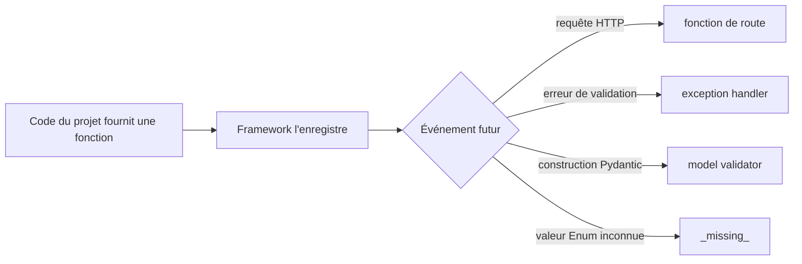
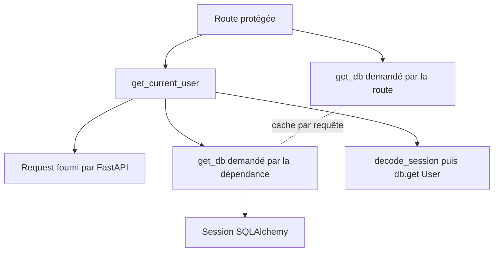
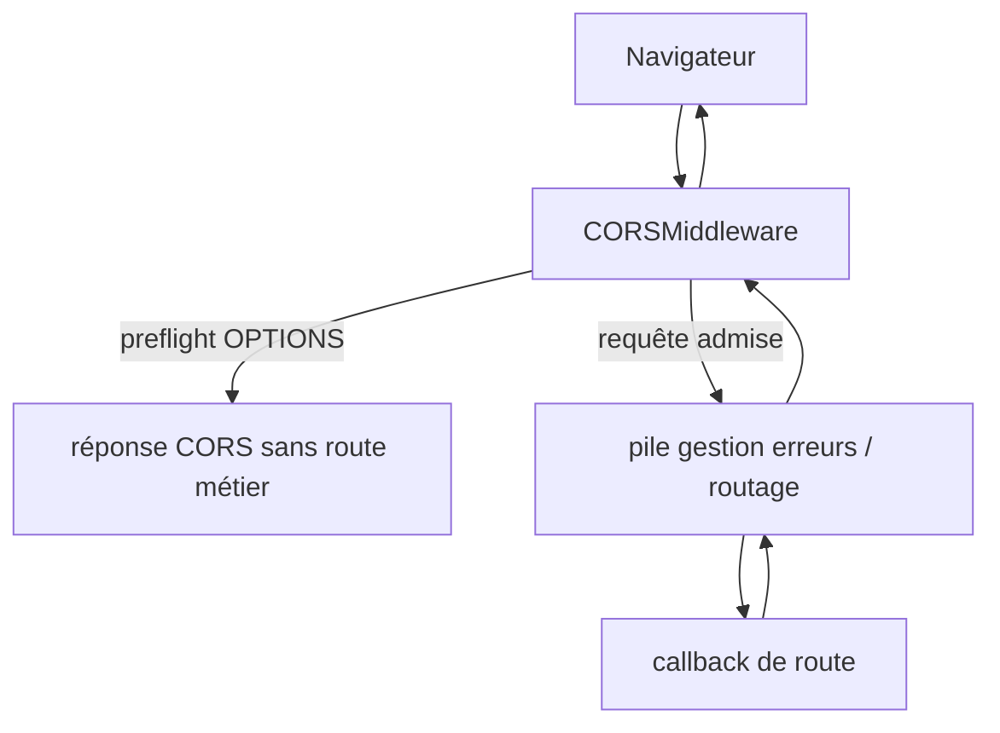
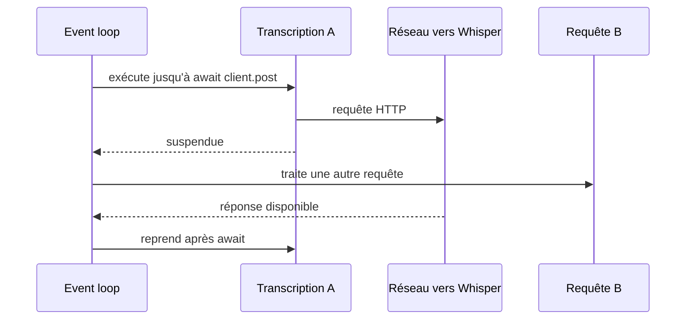
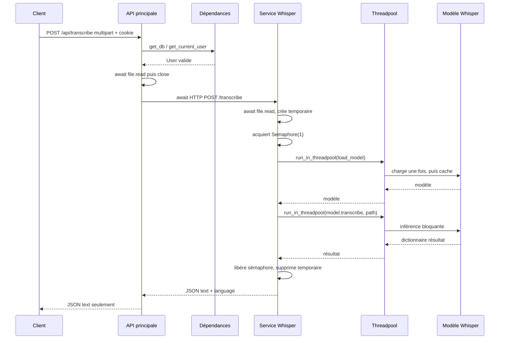

# Parties 8 et 9 — Callbacks, exécution indirecte, `async` et `await`

## Objectif

Une grande partie de cette API paraît « magique » quand on débute : personne n'appelle `list_tasks`, `get_current_user` ou `validation_exception_handler` avec une ligne Python classique, pourtant ces fonctions s'exécutent. Ce chapitre rend cette magie mécanique.

Nous allons distinguer :

- un appel direct, écrit avec `fonction(...)` ;
- une fonction enregistrée pour plus tard ;
- une dépendance appelée par FastAPI ;
- un validateur appelé par Pydantic ;
- un gestionnaire appelé quand une exception survient ;
- une fonction synchrone déportée dans un thread ;
- une coroutine suspendue par `await`.

## 1. Appel direct et appel indirect

### Appel direct

```python
report = generate_weekly_report(db, user.id, week_id)
```

Le nom de la fonction apparaît avec des parenthèses. Python l'appelle immédiatement, attend son retour, puis range ce retour dans `report`.

### Fonction transmise sans l'appeler

```python
model = await run_in_threadpool(load_model)
```

`load_model` n'a pas de parenthèses. C'est l'objet fonction qui est transmis à `run_in_threadpool`. Celui-ci décidera où et quand l'appeler. Écrire `run_in_threadpool(load_model())` serait différent : le chargement bloquant aurait déjà eu lieu avant l'entrée dans le threadpool.

Autre exemple réel :

```python
result = await run_in_threadpool(model.transcribe, str(temp_path))
```

`model.transcribe` est une méthode liée : elle connaît déjà `model`, mais n'est pas encore appelée. `str(temp_path)` est l'argument que `run_in_threadpool` lui passera.

### Callback

Un **callback** est une fonction fournie à un mécanisme qui la rappellera à un événement ou moment défini. Dans cette API, le terme couvre notamment les routes, les gestionnaires d'erreur et les validateurs.



## 2. Tout commence pendant l'import

Python exécute le niveau supérieur d'un module une fois lors de son premier import dans le processus. Une définition `def` crée un objet fonction ; son corps n'est pas exécuté. Un décorateur placé au-dessus de `def` est en revanche appliqué immédiatement.

Pour un routeur :

```python
router = APIRouter(prefix="/api/tasks", tags=["tasks"])

@router.get("")
def list_tasks(...):
    ...
```

Ordre d'import :

1. `APIRouter(...)` crée l'objet `router` ;
2. Python crée l'objet fonction `list_tasks` ;
3. `router.get("")` crée un décorateur ;
4. le décorateur reçoit `list_tasks` et enregistre sa méthode, son chemin et sa signature ;
5. le corps de `list_tasks` reste inexécuté ;
6. plus tard, `main.py` fait `app.include_router(tasks.router)` ;
7. la route devient visible dans l'application.

Le pseudo-code conceptuel est :

```python
def list_tasks(...):
    ...

list_tasks = router.get("")(list_tasks)
```

Ce pseudo-code explique l'ordre ; ne remplacez pas le décorateur réel sans raison.

## 3. Tous les callbacks de route

Chaque fonction suivante est enregistrée à l'import et appelée par FastAPI lorsqu'une méthode et un chemin correspondent :

| Application | Événement HTTP | Callback |
|---|---|---|
| principale | `GET /api/health` | `main.health` |
| principale | `POST /api/auth/login` | `auth.login` |
| principale | `POST /api/auth/logout` | `auth.logout` |
| principale | `GET/POST/PATCH/DELETE /api/calendar-events` | `list_events`, `create_event`, `update_event`, `delete_event` |
| principale | `GET /api/daily-log/statuses`, `GET/POST /api/daily-log` | trois fonctions de `daily_log.py` |
| principale | `GET/POST/PATCH/DELETE /api/habits` | quatre fonctions de `habits.py` |
| principale | `GET /api/history` | `get_history` |
| principale | `GET /api/life-terminal` | `life_terminal` |
| principale | `GET/POST/PATCH/DELETE /api/objectives` | quatre fonctions de `objectives.py` |
| principale | `GET /api/reports/week` | `weekly_report` |
| principale | `GET/PATCH /api/settings` | deux fonctions de `settings.py` |
| principale | `GET/POST/PATCH /api/tasks` | trois fonctions de `tasks.py` |
| principale | `GET/POST/PATCH/DELETE /api/time-allocation` | quatre fonctions de `time_allocation.py` |
| principale | `POST /api/transcribe` | callback asynchrone `routers.transcribe.transcribe` |
| Whisper | `GET /health` | `whisper_service.health` |
| Whisper | `POST /transcribe` | callback asynchrone `whisper_service.transcribe` |

Il n'y a aucun appel classique à ces fonctions dans `main.py`. `include_router` transfère leurs enregistrements ; Uvicorn/FastAPI les déclenchent à la réception de messages ASGI.

## 4. Le callback route reçoit des arguments construits

FastAPI inspecte la signature de la fonction. Exemple :

```python
def update_task(
    body: TaskUpdateRequest,
    user: User = Depends(get_current_user),
    db: Session = Depends(get_db),
):
```

La fonction ne sait pas lire HTTP elle-même. FastAPI prépare :

- `body` en analysant le JSON avec Pydantic ;
- `user` en exécutant `get_current_user` ;
- `db` en exécutant/entrant dans `get_db`.

Puis il effectue conceptuellement :

```python
result = update_task(body=validated_body, user=current_user, db=session)
```

Le vrai framework gère plus d'étapes, mais l'appel final a cette logique.

## 5. `Depends` : le graphe caché

### Syntaxe

```python
user: User = Depends(get_current_user)
```

- `user` : nom du paramètre que la route utilisera ;
- `User` : type annoncé ;
- `=` : valeur par défaut au sens de la signature Python ;
- `Depends(...)` : marqueur lu par FastAPI ;
- `get_current_user` : fonction transmise, non appelée à la définition.

FastAPI ne passe pas l'objet `Depends` à la route. Il appelle la dépendance et remplace le marqueur par le résultat.

### Dépendance imbriquée

```python
def get_current_user(
    request: Request,
    db: Session = Depends(get_db),
) -> User:
```

`get_current_user` dépend elle-même de `get_db`. FastAPI construit donc un graphe :



Par défaut, les dépendances sont mises en cache au sein d'une requête. Le même callable `get_db` demandé par deux chemins est donc résolu une seule fois, sauf configuration `use_cache=False` absente ici.

### Court-circuit

Si `get_current_user` lève :

```python
raise HTTPException(status_code=401, detail="Unauthorized")
```

FastAPI n'appelle pas la fonction de route. C'est un garde placé avant le traitement métier.

### Ordre d'une route protégée avec JSON

L'ordre utile à retenir est :

1. le middleware reçoit la requête ;
2. FastAPI choisit la route ;
3. FastAPI résout le graphe de paramètres et dépendances ;
4. `get_db` crée une session et s'arrête à `yield db` ;
5. `get_current_user` lit le cookie, décode, charge `User` ou lève `401` ;
6. le corps est lu et validé en modèle Pydantic dans la phase de résolution ;
7. si toutes les erreurs sont absentes, la route est appelée ;
8. le résultat est converti en réponse ;
9. le cycle de dépendance à `yield` reprend : commit ou rollback, puis close ;
10. le middleware termine la réponse.

L'ordre fin entre sous-parties de résolution est une responsabilité interne de FastAPI. La garantie importante est que la **fonction de route** n'est pas appelée avec un corps invalide ni un utilisateur invalide.

## 6. `yield` transforme `get_db` en gestionnaire de cycle de vie

Une fonction contenant `yield` est une fonction génératrice. L'appeler crée un générateur ; le code avance jusqu'au prochain `yield`, rend une valeur, puis peut reprendre plus tard.

```python
def get_db() -> Iterator[Session]:
    db = SessionLocal()
    try:
        yield db
        db.commit()
    except Exception:
        db.rollback()
        raise
    finally:
        db.close()
```

### Chemin de succès

1. `SessionLocal()` crée la session ;
2. `yield db` la fournit ;
3. route et services utilisent la transaction ;
4. reprise après `yield` ;
5. `commit()` valide ;
6. `finally` ferme.

### Chemin d'erreur

1. la route, un service ou la sérialisation fait remonter une exception ;
2. l'exception est réinjectée au point du `yield` ;
3. `except Exception` appelle `rollback()` ;
4. `raise` sans argument relance la même exception ;
5. `finally` ferme ;
6. un gestionnaire FastAPI transforme éventuellement l'exception en réponse.

### Pourquoi les routes font `flush()`

`flush` demande à SQLAlchemy d'envoyer les instructions en cours à la base sans terminer la transaction. Cela permet de lire un id créé et de détecter une contrainte avant la fin. Le callback de dépendance centralise le commit. Oublier cette différence conduit à croire qu'une écriture est définitive trop tôt.

## 7. Gestionnaires d'exception : callbacks choisis par type

`main.py` enregistre trois fonctions :

```python
@app.exception_handler(RequestValidationError)
async def validation_exception_handler(request, exc): ...

@app.exception_handler(HTTPException)
async def http_exception_handler(request, exc): ...

@app.exception_handler(Exception)
async def unhandled_exception_handler(request, exc): ...
```

Le paramètre donné au décorateur est une classe d'exception. FastAPI/Starlette cherche le gestionnaire correspondant au type de l'objet levé.

### Validation

Le gestionnaire reçoit `exc.errors()`. La compréhension :

```python
validation_issues = [
    {
        "location": ".".join(str(part) for part in issue["loc"]),
        "message": issue["msg"],
        "type": issue["type"],
    }
    for issue in exc.errors()
]
```

se lit ainsi : pour chaque `issue`, créer un dictionnaire. `issue["loc"]` est une séquence comme `("body","energy")`; l'expression génératrice convertit chaque morceau en chaîne ; `join` produit `body.energy`.

### `HTTPException`

Le handler prend `exc.detail`, le convertit en chaîne, conserve `status_code` et `headers`. C'est pourquoi les routes principales répondent `{"error":"..."}` au lieu du `{"detail":"..."}` FastAPI par défaut.

### Exception inconnue

`logger.exception(..., exc_info=exc)` écrit le message et la traceback. La réponse masque le détail : `Internal server error`. Cela sépare l'information de diagnostic côté serveur de l'information sûre côté client.

### Pourquoi `async def` sans `await` ?

Ces trois handlers sont déclarés asynchrones même s'ils n'attendent rien. C'est autorisé : leur appel crée une coroutine qui s'exécute sans suspension effective. Ils pourraient techniquement être synchrones ; le choix actuel reste compatible avec l'interface asynchrone de Starlette.

## 8. Pydantic déclenche ses propres callbacks

### `alias_generator=to_camel`

```python
model_config = ConfigDict(alias_generator=to_camel, ...)
```

`to_camel` est une fonction fournie à Pydantic. Lors de la construction des champs du modèle, Pydantic l'appelle pour produire les alias :

```text
expected_preparation_load -> expectedPreparationLoad
default_sleep_delay_min   -> defaultSleepDelayMin
```

Le projet ne contient pas une liste manuelle de tous les alias.

### `default_factory=list`

Dans `ObjectiveCreateRequest` :

```python
linked_task_ids: list[str] = Field(default_factory=list)
```

La classe intégrée `list` est un callback de fabrique. Pydantic l'appelle pour chaque instance sans valeur afin d'éviter une liste mutable partagée.

### `@model_validator(mode="after")`

Les méthodes suivantes sont appelées après conversion des champs :

| Classe | Callback | Condition refusée |
|---|---|---|
| `CalendarEventCreateRequest` | `validate_time_range` | fin avant début |
| `CalendarEventUpdateRequest` | `validate_time_range` | début et fin fournis, fin avant début |
| `HabitUpdateRequest` | `validate_target` | check-in sans `habitId`, ou update normal sans `id` |
| `ObjectiveCreateRequest` | `validate_weekly_block` | bloc sans date |
| `TimeAllocationUpdateRequest` | `validate_target` | branche sans cible/nom/id requis |

Lever `ValueError` ne sort pas directement jusqu'au handler `Exception`. Pydantic l'enveloppe dans ses erreurs de validation, FastAPI produit `RequestValidationError`, puis le handler `422` intervient.

### `Enum._missing_`

`CaseInsensitiveEnum` redéfinit un hook standard :

```python
@classmethod
def _missing_(cls, raw_value: object):
```

`@classmethod` donne la classe dans `cls` au lieu d'une instance dans `self`. `Enum` appelle `_missing_` quand la correspondance normale échoue. La méthode cherche alors sans tenir compte de la casse. C'est une exécution indirecte définie par la bibliothèque standard Python.

## 9. Middleware CORS : enveloppe indirecte de toutes les requêtes

```python
app.add_middleware(CORSMiddleware, ...)
```

Cette ligne ne traite aucune requête au moment de l'import. Elle ajoute une couche dans la pile ASGI. Plus tard, toutes les requêtes passent par cette couche.

Le middleware peut :

- répondre lui-même à une requête `OPTIONS` de pré-vérification ;
- refuser de produire les headers CORS pour une origine non admise ;
- laisser descendre une requête normale vers FastAPI ;
- enrichir la réponse en remontant.



Il n'existe pas de middleware personnalisé dans les fichiers étudiés. Le seul middleware explicitement ajouté aux deux applications est `CORSMiddleware`.

## 10. Cache par décorateur `lru_cache`

Deux fonctions importantes sont décorées :

- `config.get_settings`, avec `@lru_cache(maxsize=1)` ;
- `whisper_service.load_model`, avec `@lru_cache(maxsize=1)`.

Le décorateur remplace la fonction exposée par un wrapper doté d'un cache. Au premier appel avec un ensemble d'arguments, le corps s'exécute et le retour est mémorisé. Aux appels suivants identiques, le wrapper rend la valeur mémorisée sans réexécuter le corps.

`maxsize=1` suffit ici parce que les deux fonctions n'ont aucun argument : une seule clé d'appel existe.

Conséquences :

- changer une variable d'environnement après le premier `get_settings()` ne change pas l'objet sans vider le cache/redémarrer ;
- Whisper charge son modèle lourd une seule fois par processus ;
- si le premier chargement lève une exception, aucun résultat n'est mis en cache et un appel futur peut réessayer.

## 11. Synchrone : une instruction bloque la suivante

Une fonction classique :

```python
def health():
    return {"ok": True}
```

est synchrone. Son appel produit directement un retour. Pendant une opération lente dans le même thread, ce thread ne fait rien d'autre.

Dans FastAPI, les fonctions de route déclarées avec `def` sont normalement exécutées dans un threadpool pour ne pas bloquer la boucle d'événements principale. C'est adapté aux routes SQLAlchemy synchrones de ce projet : le pilote `psycopg2` et `Session` sont synchrones.

Les fonctions internes synchrones appelées depuis ces routes restent dans le même worker thread. Par exemple :

```text
thread worker -> list_tasks -> db.execute -> PostgreSQL -> serialize_task
```

## 12. Asynchrone : suspendre une tâche pendant l'attente

### `async def`

```python
async def transcribe(...):
```

Appeler une fonction `async def` ne fait pas immédiatement tout son travail ; cela produit un objet coroutine. La boucle d'événements exécute cette coroutine.

### `await`

```python
content = await file.read(limit + 1)
```

`await` signifie : démarre/poursuis l'opération attendable ; si elle doit attendre, suspends cette coroutine et rends la main à l'event loop ; reprends-la quand le résultat est prêt.

`await` n'est autorisé que dans une fonction `async def` (hors outils interactifs particuliers).

### Event loop

L'**event loop**, boucle d'événements, garde une liste de tâches prêtes et de tâches en attente d'I/O. Elle peut servir beaucoup de connexions avec peu de threads si les fonctions asynchrones lui rendent la main lors des attentes.



### `await` n'accélère pas le calcul

Un calcul CPU lourd ne devient pas non bloquant en ajoutant `await` au hasard. Il faut le déplacer vers un thread/processus ou utiliser une bibliothèque réellement asynchrone. C'est pourquoi Whisper emploie `run_in_threadpool`.

## 13. Analyse ligne par ligne de la passerelle asynchrone

Fichier : `interface_API/app/routers/transcribe.py`.

### Signature

```python
@router.post("")
async def transcribe(
    file: UploadFile = File(...),
    user: User = Depends(get_current_user),
) -> dict[str, str]:
```

- décorateur : enregistre `POST /api/transcribe` ;
- `async def` : callback coroutine ;
- `UploadFile` : abstraction FastAPI/Starlette pour l'upload ;
- `File(...)` : fichier obligatoire ;
- `user` : garde d'authentification, même si son objet n'est ensuite pas lu ;
- `-> dict[str,str]` : annonce un dictionnaire de chaînes.

### Lecture bornée

```python
content = await file.read(settings.max_audio_bytes + 1)
await file.close()
if len(content) > settings.max_audio_bytes:
    raise HTTPException(status_code=413, detail="Audio file is too large")
```

Lire limite + 1 distingue exactement « au plus la limite » de « trop grand ». Fermer libère la ressource d'upload. Le contrôle utilise la longueur des octets réellement lus.

Attention pédagogique : si `file.read` lui-même levait avant `file.close`, ce fichier de passerelle n'a pas de `finally` autour de la fermeture. Le chemin normal et le dépassement après lecture ferment correctement.

### Client HTTP asynchrone

```python
timeout = httpx.Timeout(settings.whisper_timeout_seconds)
async with httpx.AsyncClient(timeout=timeout) as client:
    upstream = await client.post(settings.whisper_service_url, files=files)
```

`async with` appelle indirectement les méthodes asynchrones d'entrée/sortie de contexte de `AsyncClient`. À la sortie, le client et ses connexions sont fermés proprement, même en cas d'exception. `await client.post` suspend pendant l'I/O réseau.

### Conversion des exceptions

```python
except httpx.ConnectError as error:
    raise HTTPException(...) from error
```

`from error` crée une chaîne d'exceptions : le client reçoit le message HTTP sûr, tandis que la traceback conserve la cause technique. Le `ConnectError` plus spécifique est placé avant `HTTPError`, dont il est une sous-classe ; inverser l'ordre rendrait le premier bloc inutile.

### Validation de la réponse amont

Un statut >= 400 devient `502` même si le service avait renvoyé `413`, `415`, `422`, `429` ou `500`. L'API principale agit ici comme passerelle et choisit de représenter toute réponse d'échec amont comme *Bad Gateway*. Elle extrait d'abord `detail`, puis `error`, puis le texte.

Sur succès, `upstream.json()` peut encore lever `ValueError`. La route le transforme en `502 Whisper returned invalid JSON`. Enfin, elle force la valeur `text` en chaîne et ne renvoie pas `language`.

## 14. Analyse ligne par ligne du service Whisper

### Sémaphore global

```python
transcription_slots = asyncio.Semaphore(1)
```

Un sémaphore contient un nombre de permis. Avec `1`, une seule coroutine peut être dans la section protégée.

```python
if transcription_slots.locked():
    raise HTTPException(status_code=429, detail="Transcription service is busy")
async with transcription_slots:
    ...
```

`locked()` observe s'il n'y a plus de permis. `async with` acquiert le permis, éventuellement par attente, puis le libère à la sortie. Le test préalable vise à refuser au lieu de mettre en file.

Nuance de concurrence : « tester » puis « acquérir » sont deux opérations. Deux requêtes presque simultanées pourraient toutes deux observer un slot libre avant que l'une l'acquière ; l'une attendrait alors au `async with` au lieu de recevoir `429`. Le sémaphore garantit toujours au maximum une transcription dans la section, mais le refus immédiat n'est pas une opération atomique avec l'acquisition.

### Préparation du fichier temporaire

```python
with tempfile.NamedTemporaryFile(delete=False, suffix=suffix) as temp:
    temp_path = Path(temp.name)
    temp.write(content)
    temp.flush()
```

`with` est un gestionnaire de contexte **synchrone**. Le fichier est fermé à la fin du bloc. `delete=False` est nécessaire pour que Whisper/ffmpeg puisse rouvrir le chemin, notamment sous Windows. Cette écriture s'effectue directement dans la coroutine et peut brièvement bloquer l'event loop ; la limite de taille borne le dommage, mais ce n'est pas une I/O asynchrone.

### Déport des appels bloquants

```python
model = await run_in_threadpool(load_model)
result = await run_in_threadpool(model.transcribe, str(temp_path))
```

`whisper.load_model` et l'inférence sont synchrones et lourds. `run_in_threadpool` appelle les callables dans un thread worker. La coroutine attend leur résultat sans bloquer l'event loop.

Le calcul Whisper peut être CPU/GPU intensif. Un thread ne rend pas nécessairement le calcul plus rapide ; il évite surtout de figer la boucle qui accepte les requêtes de santé et produit les réponses.

### Cache du modèle

`@lru_cache(maxsize=1)` autour de `load_model` signifie : le premier worker appelle `ensure_ffmpeg_on_path`, lit `WHISPER_MODEL` avec défaut `tiny`, charge ; les suivants récupèrent le même objet. Le sémaphore réduit aussi les accès concurrents au modèle.

### `try` imbriqués

Le `try` interne distingue :

- `RuntimeError` -> `422 Audio could not be transcribed` ;
- toute autre `Exception` -> log + `500 Whisper transcription failed`.

Le `try/finally` externe englobe l'acquisition et le traitement. Qu'il y ait succès, `429`, `422`, `500` ou annulation après création du fichier, `finally` tente la suppression.

```python
try:
    temp_path.unlink(missing_ok=True)
except OSError:
    pass
```

`missing_ok=True` ne considère pas l'absence comme erreur. Une autre erreur système est ignorée avec `pass`; cela privilégie la réponse HTTP, au prix possible d'un fichier temporaire restant.

## 15. Autres exécutions indirectes à reconnaître

### Context managers

- `with NamedTemporaryFile(...)` appelle `__enter__` et `__exit__` ;
- `async with AsyncClient(...)` appelle `__aenter__` et `__aexit__` ;
- `async with transcription_slots` appelle les méthodes asynchrones d'acquisition/libération.

Ces méthodes spéciales ne sont pas visibles sous forme d'appel explicite, mais la syntaxe les déclenche.

### Sérialisation FastAPI

Une route retourne souvent un `dict`. Aucun code de route n'appelle `json.dumps`. FastAPI encode indirectement le résultat et construit la réponse. `JSONResponse` rend cette étape explicite dans quelques routes.

### SQLAlchemy

Les expressions `select(Model).where(...)` construisent une requête ; c'est `db.execute(...)` qui la lance. `db.add` n'insère pas forcément immédiatement ; `flush` déclenche l'émission. Les valeurs Python `default` et `onupdate` des modèles peuvent être évaluées par SQLAlchemy lors du flush. Il n'existe cependant aucun listener SQLAlchemy personnalisé (`event.listen`) dans les fichiers étudiés.

### Méthodes spéciales Python

- `len(content)` appelle indirectement `content.__len__()` ;
- `for member in cls` utilise le protocole d'itération ;
- `async with` et `with` utilisent les protocoles de contexte ;
- les f-strings appellent la conversion des valeurs.

Ces mécanismes sont généraux à Python, pas des callbacks métier propres à l'API.

## 16. Mécanismes absents : ne pas les inventer

L'analyse du code ne trouve pas :

- `BackgroundTasks` FastAPI ;
- `asyncio.create_task` ou tâche « fire-and-forget » ;
- endpoint WebSocket ;
- hook `startup`, `shutdown` ou fonction `lifespan` ;
- middleware applicatif personnalisé ;
- gestionnaire `404` personnalisé ;
- callback de streaming ;
- système de signaux ;
- queue Celery/RQ ;
- session SQLAlchemy asynchrone ;
- retry automatique vers Whisper.

Ne décrivez donc pas la transcription comme une tâche en arrière-plan : la requête HTTP attend la fin de Whisper ou le timeout.

## 17. Blocage : les pièges précis du projet

### Bloquer dans une route `async def`

Dans la passerelle, `httpx.AsyncClient` et `UploadFile` sont attendus correctement. Dans le microservice, deux opérations synchrones restent directement dans la coroutine : `ensure_ffmpeg_on_path()` appelé avant le temporaire, et l'écriture `temp.write`. Elles peuvent bloquer brièvement.

Le chargement et l'inférence les plus lourds sont correctement déportés au threadpool.

### Utiliser SQLAlchemy synchrone depuis `async def`

La route asynchrone principale demande `get_current_user`, qui utilise une session SQLAlchemy synchrone. La dépendance est définie avec `def`, donc FastAPI peut l'exécuter dans son pool de threads. La route elle-même ne fait ensuite aucune requête DB directe.

### Appeler une coroutine sans `await`

Écrire :

```python
content = file.read(100)
```

dans cette route ne donnerait pas des octets mais une coroutine/valeur attendable non exécutée comme voulu. Le code réel utilise `await`.

### Mettre `await` devant une fonction normale

`await get_settings()` serait incorrect : `get_settings` retourne directement `Settings`, qui n'est pas awaitable. Le code l'appelle normalement.

## 18. Flux asynchrone complet de transcription



À chaque flèche `await`, l'event loop peut traiter autre chose. Les flèches threadpool représentent du travail bloquant hors de la boucle.

## 19. Exercices corrigés

### Exercice 1 — Parenthèses ou non

Pourquoi ce code est-il juste ?

```python
await run_in_threadpool(load_model)
```

Et pourquoi celui-ci est-il problématique ?

```python
await run_in_threadpool(load_model())
```

**Correction.** Dans le premier, on transmet la fonction ; le threadpool l'appelle dans un worker. Dans le second, Python évalue d'abord les arguments : `load_model()` s'exécute donc dans l'event loop avant même l'appel de `run_in_threadpool`. Son résultat, un modèle probablement non callable, serait ensuite transmis comme si c'était une fonction.

### Exercice 2 — Route jamais atteinte

Une requête protégée a un cookie invalide et un JSON invalide. Peut-on compter sur le gestionnaire `422` ?

**Correction.** Non comme règle métier. La résolution FastAPI comprend dépendances et corps ; une dépendance `get_current_user` peut lever `401` et court-circuiter la route. La garantie est que la fonction métier ne sera pas appelée. Il ne faut pas concevoir une API en supposant quel défaut concurrent sera présenté en priorité sans test lié à la version FastAPI.

### Exercice 3 — Prédire le sémaphore

Une transcription est active. Une deuxième arrive. Quel callback produit la réponse et le temporaire est-il supprimé ?

**Correction.** La même fonction `whisper_service.transcribe` traite la deuxième requête. Elle a déjà lu le fichier et créé le temporaire avant le test `locked()`. Elle lève `HTTPException(429)` dans le `try` externe ; le `finally` s'exécute et supprime le temporaire. Le gestionnaire HTTP par défaut de l'application Whisper produit `{"detail":"Transcription service is busy"}`.

### Exercice 4 — Reconstruire `Depends`

Expliquez sans le mot « magie » comment `user` reçoit un modèle `User`.

**Correction.** À l'import, FastAPI inspecte/enregistre la signature. À la requête, son solveur voit le marqueur `Depends(get_current_user)`. Il résout d'abord les propres paramètres de cette fonction : `Request` depuis le contexte et `Session` via `get_db`. Il appelle `get_current_user`; celle-ci vérifie le cookie et retourne le modèle chargé. Le solveur place ce retour dans l'argument `user` lors de l'appel final de la route.

## 20. Test de rappel

Sans remonter dans le chapitre, répondez :

1. Quand un décorateur de route s'exécute-t-il, et quand le corps de route s'exécute-t-il ?
2. Pourquoi `get_db` peut-il exécuter du code après avoir fourni la session ?
3. Quelle différence entre `with` et `async with` dans les deux transcriptions ?
4. Quel travail est réellement envoyé au threadpool ?
5. Pourquoi `@lru_cache` est-il un mécanisme indirect ?
6. Quels mécanismes d'arrière-plan sont absents ?

Réponses : décorateur à l'import/corps à la requête ; générateur suspendu à `yield` puis repris ; context manager synchrone contre asynchrone ; chargement du modèle et `model.transcribe` ; le wrapper décide de rappeler ou non la fonction ; aucune tâche de fond, queue, WebSocket ou `create_task` dans le code étudié.
