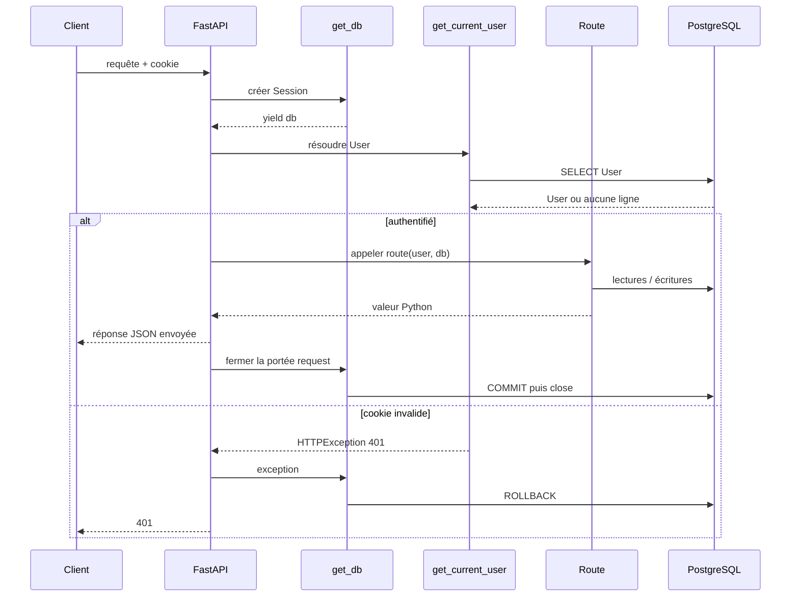
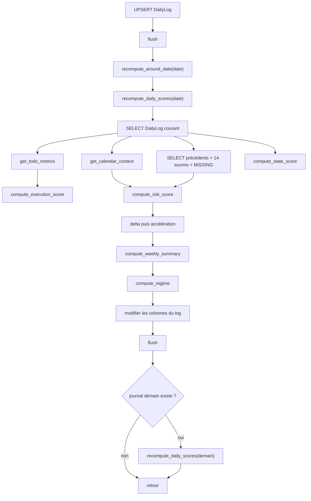
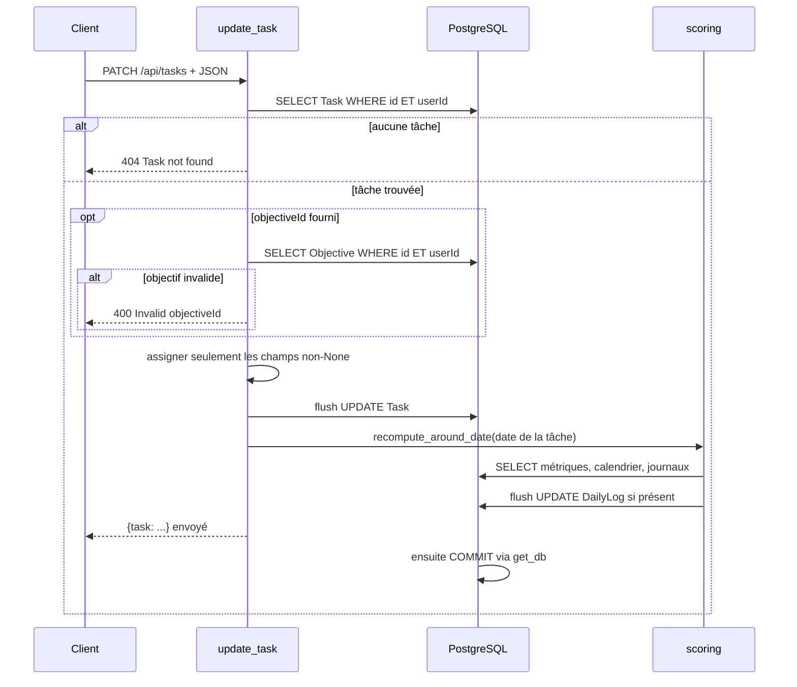
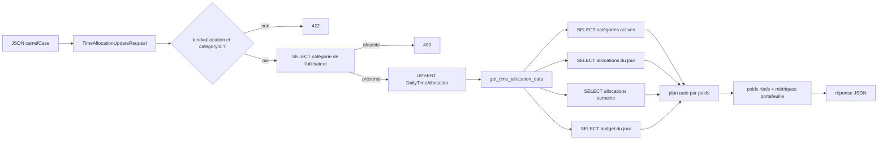
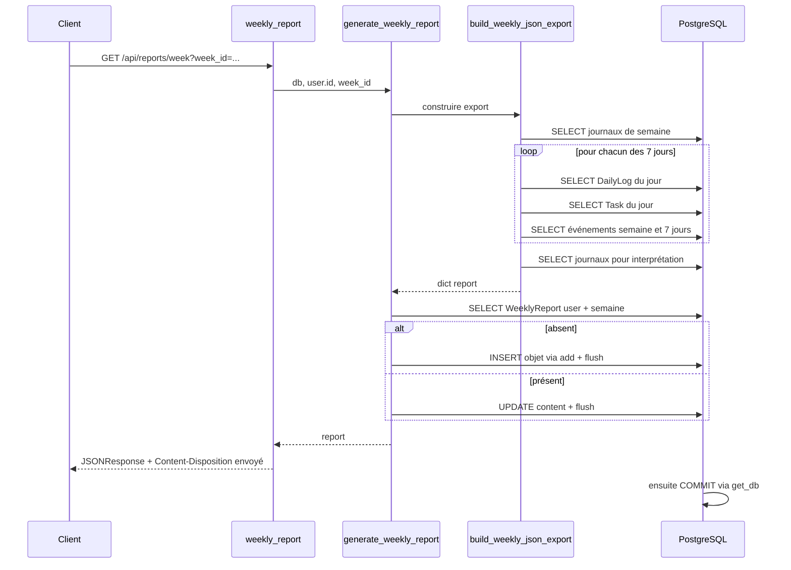
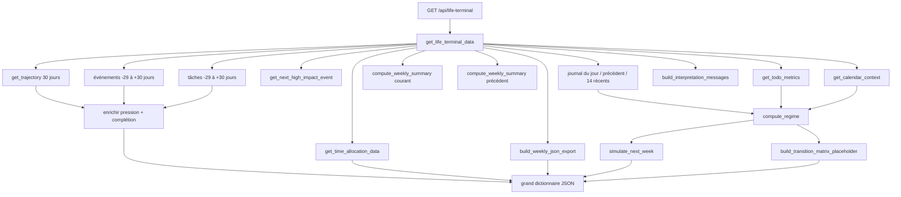
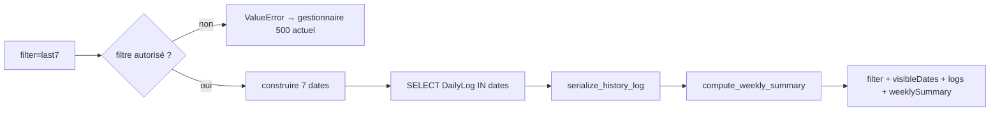

# 9 — Flux complets : du client à la réponse

## Comment lire un flux

Une API paraît abstraite parce qu'une simple action de l'interface traverse plusieurs mécanismes invisibles. Pour chaque exemple, nous suivrons ce modèle :

```text
Client → HTTP → FastAPI → validation → authentification → route
       → service/core → SQLAlchemy → PostgreSQL → transformation → JSON
```

Les valeurs JSON des exemples sont pédagogiques. La **forme** vient des contrats et des sérialisateurs réels ; les identifiants et scores numériques illustratifs dépendent des données de votre base.

## Socle commun à toutes les requêtes protégées

### 1. Le client envoie HTTP

Une requête HTTP contient au minimum une méthode et une URL. Elle peut ajouter des en-têtes, des cookies, des paramètres d'URL et un corps.

Exemple conceptuel :

```http
POST /api/daily-log HTTP/1.1
Content-Type: application/json
Cookie: life_regime_session=...

{"date":"2026-08-01","status":"submitted","energy":70}
```

### 2. Le décorateur choisit la fonction

`@router.post("")` au-dessus de `upsert_daily_log` a enregistré cette fonction pour `POST /api/daily-log`, car le routeur possède le préfixe `/api/daily-log`.

Le décorateur s'exécute à l'import de l'application. La fonction de route, elle, ne s'exécute que lorsqu'une requête correspondante arrive.

### 3. Pydantic valide le corps

Les classes de `contracts/` héritent de `ApiRequest`. Sa configuration transforme automatiquement les noms Python `snake_case` en clés JSON `camelCase` :

```text
start_friction       ↔ startFriction
completion_percent  ↔ completionPercent
category_id         ↔ categoryId
```

`populate_by_name=True` autorise aussi le nom Python comme entrée. `extra="ignore"` ignore les clés inconnues au lieu de les refuser.

Un champ `Field(ge=0, le=100)` doit être supérieur ou égal à 0 et inférieur ou égal à 100. Si la validation échoue, FastAPI n'appelle pas la route et renvoie une erreur 422, reformattée par le gestionnaire global de l'application.

### 4. FastAPI résout `Depends`

La plupart des routes déclarent :

```python
user: User = Depends(get_current_user)
db: Session = Depends(get_db)
```

`Depends` ne contient pas le résultat : il décrit à FastAPI comment le produire.

`get_current_user` dépend lui-même de `get_db`. FastAPI met normalement en cache une même dépendance pendant une requête : la session demandée directement par la route et celle demandée par l'authentification proviennent du même appel de dépendance.

### 5. Le cookie devient un utilisateur

Dans `security.py`, l'ordre est :

1. lire le cookie `life_regime_session` ;
2. séparer corps et signature ;
3. recalculer HMAC-SHA256 avec le secret de configuration ;
4. comparer les signatures avec `hmac.compare_digest` ;
5. décoder le JSON base64url ;
6. vérifier `userId` et l'expiration ;
7. charger `User` par clé primaire ;
8. renvoyer l'utilisateur, ou lever `HTTPException(401, "Unauthorized")`.

### 6. La transaction encadre tout

`get_db()` crée la session et la cède avec `yield`. Comme `Depends(get_db)` ne précise pas `scope="function"`, cette dépendance génératrice a la portée FastAPI `request` : sur succès, la réponse est envoyée puis le générateur reprend, commit et ferme. Si une exception traverse le traitement avant l'envoi, il rollback puis ferme.



Cette chronologie a une conséquence : si `commit()` échoue, le succès HTTP peut déjà avoir été envoyé. Pour une exception de route avant réponse, l'empilement FastAPI déroule la dépendance, exécute le rollback, puis le gestionnaire d'exception produit la réponse d'erreur.

# Flux A — enregistrer un journal et recalculer les scores

## Requête

- Méthode : `POST`
- URL : `/api/daily-log`
- Route : `routers/daily_log.py:65–145`
- Contrat : `DailyLogUpsertRequest`

Exemple de corps accepté :

```json
{
  "date": "2026-08-01",
  "status": "submitted",
  "energy": 70,
  "productivity": 65,
  "startFriction": 30,
  "calorieTarget": 2200,
  "caloriePercent": 95,
  "trainingDone": true,
  "mentalFatigue": 35,
  "physicalFatigue": 40,
  "focusQuality": 75,
  "workTimeMinutes": 300,
  "distractionTimeMinutes": 45,
  "avoidedImportantTask": false,
  "mainBlocker": "notifications",
  "improvementTomorrow": "couper le téléphone",
  "estimatedSleepDelayMin": 20,
  "textSummary": "journée régulière",
  "voiceTranscript": null
}
```

Les scores ne figurent pas dans le contrat : le client ne peut pas choisir directement `riskScore` ou `executionScore`. L'API les calcule.

## Fichiers traversés

```text
app/main.py
app/contracts/common.py
app/contracts/daily_log.py
app/security.py
app/database.py
app/routers/daily_log.py
app/core/dates.py
app/core/scoring.py
app/core/todo_metrics.py
app/core/metrics.py
app/core/regime.py
app/models.py
prisma/schema.prisma → PostgreSQL
```

## Ordre exact de la fonction de route

1. La date devient `body.date.isoformat()` ou la date du jour.
2. `body.status.value` transforme l'enum Pydantic en chaîne PostgreSQL majuscule.
3. `to_utc_naive` normalise l'heure de clic de sommeil.
4. Si clic et délai existent, `timedelta` calcule `estimatedSleepStart`.
5. Le dictionnaire `values` traduit les noms Pydantic en noms de colonnes camelCase.
6. `submitted_at = utcnow()` uniquement pour `SUBMITTED`.
7. `insert(DailyLog).values(...)` construit l'insertion.
8. Si une ligne `(userId, date)` existe, `on_conflict_do_update` la met à jour.
9. Cas spécial : une nouvelle sauvegarde `DRAFT` ne remplace pas un statut protégé `SUBMITTED`, `SKIPPED` ou `ANALYZED`. L'expression SQL `case` conserve le statut existant.
10. `db.execute(...)` exécute l'UPSERT ; `db.flush()` synchronise.
11. `recompute_around_date(...)` recalcule la date et éventuellement le lendemain.
12. La route recharge les métriques de tâches et le contexte calendrier.
13. `serialize_daily_log(updated)` transforme le modèle en dictionnaire JSON-compatible.
14. La route renvoie un dictionnaire avec `log`, `todoMetrics`, `calendarContext`.
15. FastAPI construit et envoie la réponse ; à la fermeture de la portée `request`, `get_db()` commit puis ferme la transaction.

## Sous-flux de recalcul



## Valeurs pendant le calcul

Avec les données d'exemple et des tâches dont `weightedCompletionRate = 0.75` :

- score d'exécution initial : `0.75 × 82 = 61.5` ;
- statut soumis : `+8` ;
- entraînement fait : `+6` ;
- aucune tâche importante évitée : pas de `-12` ;
- total avant borne : `75.5` ;
- `javascript_round` donne 76.

Le score d'état utilise :

```text
énergie × 0,35
+ productivité × 0,25
+ (100 - friction) × 0,20
+ concentration × 0,10
+ (100 - fatigue mentale) × 0,10
```

Les valeurs absentes sont retirées de la moyenne pondérée. Le risque suit une grille de pénalités, pas une moyenne.

## Réponse

Forme réelle, valeurs illustratives :

```json
{
  "log": {
    "id": "c...",
    "date": "2026-08-01",
    "status": "submitted",
    "energy": 70,
    "executionScore": 76,
    "stateScore": 70,
    "riskScore": 19,
    "riskDelta": -4,
    "riskAcceleration": -2,
    "regime": "productive",
    "regimeConfidence": 76,
    "submittedAt": "2026-08-01T12:00:00.000Z",
    "updatedAt": "2026-08-01T12:00:00.000Z"
  },
  "todoMetrics": {
    "tasksPlanned": 2,
    "weightedCompletionRate": 0.75,
    "missedImportantTasks": 0,
    "productiveTaskCompletion": 0.75
  },
  "calendarContext": {
    "activePhase": "normal_week",
    "highImpactEventsNext7d": 0,
    "maxImpact": null,
    "averageStress": 0,
    "averagePreparationLoad": 0,
    "weeklyExpectedStressLoad": 0,
    "weeklyExpectedPreparationLoad": 0
  }
}
```

Le vrai objet `log` contient aussi tous les champs de saisie listés par `serialize_daily_log`; l'exemple les abrège pour mettre le flux en évidence.

## Erreurs possibles

- 401 : cookie absent, invalide ou expiré.
- 422 : score hors bornes, date illisible, statut enum invalide, mauvais type.
- 500 : erreur SQL ou calcul inattendu ; la transaction entière est rollbackée.
- Une erreur après le premier `flush` ne laisse pas une moitié de mise à jour, car aucun commit n'a encore eu lieu.

## Exercice corrigé

**Question :** pourquoi le lendemain est-il recalculé alors que la requête ne le modifie pas directement ?

**Correction :** le risque du lendemain possède un delta par rapport au précédent risque et une accélération par rapport au précédent delta. Une modification d'aujourd'hui change donc les dérivées de demain.

# Flux B — modifier une tâche et propager son effet

## Requête

- Méthode : `PATCH`
- URL : `/api/tasks`
- Route : `routers/tasks.py:122–154`
- Contrat : `TaskUpdateRequest`

```json
{
  "id": "ctask123",
  "completionPercent": 100,
  "status": "done"
}
```

`id` est obligatoire et non vide. Les autres champs sont facultatifs. Le code consulte `body.model_fields_set` pour distinguer un `objectiveId` réellement fourni d'une valeur simplement absente.

## Parcours



## Transformation métier

`calculate_todo_metrics` ignore les tâches annulées. Pour chaque tâche active, le poids dépend de l'importance. Une tâche importante achevée fait monter `weightedCompletionRate`, ce qui augmente potentiellement `executionScore` du journal de la même date et réduit le signal de dérive dans `compute_regime`.

La réponse sérialise les enums en minuscules, la date avec `isoformat()` et les dates-heures avec suffixe `Z`.

```json
{
  "task": {
    "id": "ctask123",
    "userId": "cuser123",
    "title": "Finir le rapport",
    "date": "2026-08-01",
    "importance": "high",
    "productive": true,
    "estimatedMinutes": 120,
    "completionPercent": 100,
    "status": "done",
    "objectiveId": null,
    "objectiveTitle": null,
    "createdAt": "2026-08-01T08:00:00.000Z",
    "updatedAt": "2026-08-01T12:00:00.000Z"
  }
}
```

## Détail à connaître pour modifier le code

Si `body.date` est fourni, la route remplace d'abord `existing.date`, puis recalcule `existing.date.isoformat()`. Elle recalcule donc la **nouvelle** date. Le code montré n'appelle pas explicitement le recalcul de l'ancienne date. Cette phrase décrit le comportement actuel ; elle ne prétend pas qu'une correction a déjà été appliquée.

## Exercice corrigé

**Question :** une tâche `HIGH` à 50 % compte-t-elle comme une tâche `LOW` à 50 % ?

**Correction :** non. La contribution pondérée vaut importance × progression. `HIGH` utilise 3 et `LOW` utilise 1. Le dénominateur est lui aussi pondéré.

# Flux C — mettre à jour une allocation quotidienne

## Requête

- Méthode : `PATCH`
- URL : `/api/time-allocation`
- Route : `routers/time_allocation.py:91–177`
- Branche : `body.kind == "allocation"`

```json
{
  "kind": "allocation",
  "date": "2026-08-01",
  "categoryId": "ccategory123",
  "plannedMinutes": 180,
  "plannedMinutesManual": true,
  "actualMinutes": 120,
  "note": "deux blocs"
}
```

Le validateur `@model_validator(mode="after")` vérifie que `categoryId` existe dans le corps pour cette branche. Il ne vérifie pas encore l'existence en base ; la route le fait.

## Parcours exact

1. Pydantic vérifie les types et bornes : minutes planifiées/réelles entre 0 et 10080.
2. La route choisit la date fournie ou aujourd'hui.
3. Elle sélectionne `TimeAllocationCategory` avec **les deux** conditions `id` et `userId`.
4. Si absente, elle lève 400 `Invalid categoryId`.
5. `upsert_daily_allocation` transforme la date en objet `date`.
6. Il construit les valeurs d'insertion avec valeurs par défaut.
7. Il construit séparément `update_values`. Seuls les paramètres non `None` écrasent une ligne existante.
8. Le conflit est détecté sur `(userId, categoryId, date)`.
9. `.returning(DailyTimeAllocation)` fait revenir l'objet final.
10. `flush()` synchronise.
11. La route appelle `get_time_allocation_data` et renvoie la vue recalculée.
12. La réponse est envoyée, puis `get_db()` commit lors de la fermeture de sa portée requête.



## Plan manuel contre plan automatique

Pour chaque catégorie :

```python
planned_minutes = planned_minutes_stored if planned_minutes_manual else auto_planned_minutes
```

Si `plannedMinutesManual` vaut `true`, la valeur 180 est utilisée. Sinon, `allocate_minutes_from_weights` distribue le budget selon tous les `targetWeight` actifs.

La méthode des plus grands restes garantit des minutes entières dont la somme égale le budget lorsque les poids sont positifs. Exemple minimal : budget 10, poids `[1, 1, 1]`. Parts brutes 3,333 chacune, planchers `[3,3,3]`, reste 1, résultat `[4,3,3]` selon l'ordre de classement des fractions égales.

## Forme de réponse

```json
{
  "date": "2026-08-01",
  "weekId": "2026-W31",
  "dayBudgetMinutes": 720,
  "targetWeightTotal": 100,
  "plannedMinutesTotal": 720,
  "plannedMinutesAutoTotal": 720,
  "actualMinutesTotal": 120,
  "weekActualMinutesTotal": 480,
  "remainingBudgetMinutes": 0,
  "overBudgetMinutes": 0,
  "hasManualPlanOverrides": true,
  "rows": [],
  "metrics": {
    "targetReturn": 60,
    "actualReturn": 55,
    "targetRisk": 40,
    "actualRisk": 45,
    "beta": 1.1,
    "capmExpectedReturn": 81,
    "sharpeLike": 0.78
  }
}
```

Le tableau `rows` est vide uniquement pour abréger l'exemple ; dans une vraie réponse, il contient une ligne par catégorie active.

## Erreurs possibles

- 422 : `kind` invalide, `categoryId` absent, minute négative ou au-dessus de 10080.
- 400 : identifiant fourni mais aucune catégorie appartenant à l'utilisateur.
- 401 : session invalide.
- 500 : contrainte SQL ou erreur inattendue, suivie d'un rollback.

# Flux D — générer et persister un rapport hebdomadaire

## Requête

- Méthode : `GET`
- URL : `/api/reports/week?week_id=2026-W31`
- Route : `routers/reports.py:14–25`

Le paramètre Python et HTTP s'appelle `week_id`, avec underscore. S'il manque, `get_iso_week_id()` choisit la semaine courante.

## Particularité

Cette route GET effectue une écriture : elle crée ou actualise `WeeklyReport`. Une convention HTTP recommande généralement qu'un GET soit sans effet de bord, mais le comportement actuel du projet est bien celui-ci.

## Ordre détaillé



`build_weekly_json_export` appelle d'abord `compute_weekly_summary`. Puis, pour chaque date de la semaine, il charge journal, tâches et contexte. Il transforme les clés vers un format d'export en `snake_case`, contrairement à la majorité des réponses UI en camelCase.

La réponse ajoute cet en-tête :

```http
Content-Disposition: attachment; filename="life-regime-2026-W31.json"
```

Le navigateur peut ainsi proposer un téléchargement.

La racine du JSON contient exactement : `week_id`, `generated_at`, `period`, `calendar_context`, `weekly_summary`, `days`, `missing_days`, `skipped_days`, `interpretation`.

## Transformation de format

```text
DailyLog.energy              → days[n].inputs.energy
DailyLog.startFriction       → days[n].inputs.start_friction
todo weightedCompletionRate → todo_metrics.weighted_completion_rate, arrondi à 2 décimales
DailyLog.riskScore           → computed_scores.risk_score
datetime Python             → texte ISO millisecondes + Z
```

## Erreurs possibles

- une semaine mal formée atteint `get_week_date_keys`, dont `split("-W")` ou les conversions `int` peuvent lever une exception ;
- une erreur de lecture ou d'écriture SQL annule la transaction ;
- un cookie invalide produit 401 ;
- aucun journal n'est pas une erreur : l'export contient des jours `missing` et des valeurs `null`.

## Exercice corrigé

**Question :** pourquoi `generate_weekly_report` appelle-t-il `flush` avant de rendre le dictionnaire alors que la réponse ne contient pas l'objet `WeeklyReport` ?

**Correction :** le flush force l'insertion ou la mise à jour dans la transaction et révèle les erreurs SQL avant le retour normal. Le commit durable reste exécuté par `get_db`.

# Flux E — construire le tableau de bord Life Terminal

## Requête

- Méthode : `GET`
- URL : `/api/life-terminal?date=2026-08-01`
- Route : `routers/life_terminal.py:13–19`
- Agrégateur : `core/life_terminal.py:187–428`

La route elle-même est courte : elle choisit une date, puis délègue tout à `get_life_terminal_data(db, user, date)`.

## Carte des appels



## Étapes de préparation des bornes

1. `today` prend le paramètre ou aujourd'hui.
2. `week_id` devient une semaine ISO.
3. `week_days` contient sept dates, lundi à dimanche.
4. La plage large commence à `today - 29 jours` et finit à `today + 30 jours`.
5. Les chaînes deviennent des objets `date` ou `datetime` uniquement pour les comparaisons SQL.

## Lectures directes

L'agrégateur charge :

- le journal exact du jour ;
- le dernier journal antérieur ayant le statut `SUBMITTED` ;
- jusqu'à 14 journaux soumis jusqu'au jour choisi ;
- les logs depuis le premier du mois pour les messages d'interprétation ;
- les événements et tâches sur la plage large et sur la semaine.

Les helpers `_events_between` utilisent une borne de fin exclusive (`start < lendemain_de_fin`). `_tasks_between` utilise deux bornes inclusives (`date >= début`, `date <= fin`). Cette différence est intentionnelle car les événements ont une heure et les tâches une date seule.

## Calcul de pression calendrier

`_pressure_for_events` :

1. retourne zéro sans événement ;
2. convertit chaque impact en pression (`LOW=24`, `MEDIUM=48`, `HIGH=76`, `CRITICAL=94`) ;
3. prend le plus fort ;
4. moyenne stress et préparation de tous les événements ;
5. combine `60 %` du plus fort et `40 %` de la charge moyenne ;
6. borne à 100.

## Enrichissement de trajectoire

`get_trajectory` fabrique 30 points continus, même si la base n'a pas de journal. Pour chaque point, `life_terminal` filtre en mémoire les événements et tâches de la date, puis ajoute :

- `calendarPressure` ;
- `todoCompletion`, taux pondéré converti en pourcentage entier.

## Construction du régime

Le journal ORM est transformé en dictionnaire par `_log_as_regime_dict`. Cette transformation évite que `regime.py` dépende de SQLAlchemy.

`compute_regime` applique les règles dans cet ordre :

1. `burnout_risk` par répétition de risque > 75 ;
2. `burnout_risk` par énergie < 35 et friction > 70 ;
3. `chaotic` par accélération ≥ 14 et données incomplètes ;
4. `pressure` par signaux calendrier ;
5. `productive` par exécution > 70 et risque < 50 ;
6. `recovery` par entraînement et risque décroissant ;
7. `drift` par manque de données, exécution en baisse ou complétion < 35 % ;
8. `stable` si état stable et risque non élevé.

Parce qu'il s'agit de `elif`, une pression calendrier vraie gagne avant le cas productif.

## Structure finale

Le dictionnaire contient les sections :

| Clé | Source principale |
|---|---|
| `today`, `weekId` | helpers de dates |
| `terminalHeader` | régime, calendrier, journal, qualité |
| `lifeTape` | état, risque, exécution, friction, énergie et deltas |
| `regime` | `compute_regime` |
| `quant.projection` | `simulate_next_week` |
| `quant.transitionMatrix` | `build_transition_matrix_placeholder` |
| `calendarContext` | contexte + prochain événement + pression |
| `trajectory` | 30 points enrichis |
| `initialEvents` | événements sérialisés de la plage |
| `taskSections` | aujourd'hui, semaine, retard, importance, productif |
| `taskMetrics` | métriques du jour et de semaine |
| `timeAllocation` | résumé et lignes d'allocation |
| `quickLog` | journal actuel ou valeurs de brouillon |
| `weeklyPlanner` | objectif déduit, priorités, tâches/jour, événements |
| `dataQuality` | couverture et aperçu de l'export |
| `weeklySummary` | moyennes et absences |
| `interpretation` | messages textuels déterministes |

## Valeurs par défaut sans journal

S'il n'y a aucun `DailyLog` aujourd'hui, `quickLog` n'est pas `null`. Le code fabrique un brouillon : énergie/productivité/friction/fatigues/concentration à 50, calories à la cible utilisateur, 0 minute, champs texte vides et statut `draft`.

Cette valeur n'est pas insérée en base. C'est uniquement une forme de réponse pour initialiser l'interface.

## Coût et ordre des calculs

Le terminal effectue de nombreuses lectures, et `build_weekly_json_export` relance des lectures par jour. Le code privilégie ici un agrégat complet pour l'interface. Si vous l'optimisez plus tard, gardez les mêmes bornes, valeurs par défaut et formats de clés, puis comparez les réponses avant/après.

## Erreurs possibles

- 401 avant l'agrégation si l'utilisateur n'est pas authentifié ;
- date mal formée lors de `date.fromisoformat` ;
- incohérence d'enum en base, par exemple un impact absent de `IMPACT_PRESSURE`, provoquerait une erreur de clé ;
- erreur SQL pendant l'une des nombreuses lectures ;
- erreur numérique si un calcul fournit une valeur non finie à `javascript_round`.

# Flux F — lire l'historique avec un callback interne

## Requête et parcours

`GET /api/history?filter=last7` appelle `get_history_data(db, user.id, history_filter)`.

1. Le filtre doit appartenir à `("last7", "last30", "week", "all")`, sinon `ValueError`.
2. `last7` construit sept dates de la plus récente à la plus ancienne.
3. SQLAlchemy charge les `DailyLog` correspondants et les trie par date décroissante.
4. `serialize_history_log` conserve date, statut, mise à jour, énergie, productivité et trois scores.
5. `compute_weekly_summary` ajoute le résumé de la semaine actuelle.



Dans `compute_weekly_summary`, les fonctions internes `avg` et `collect` sont créées à chaque appel. `collect(lambda log: log.stateScore)` passe une fonction anonyme ; `collect` l'appelle sur chaque journal. C'est un callback synchrone visible par la variable `selector`, même sans appel nommé `stateScore()`.

# Flux G — UPSERT d'un check-in d'habitude

Une route d'habitudes peut appeler `upsert_habit_checkin(db, user_id, habit_id, date_key, ...)` lors d'une mise à jour. Le noyau :

1. transforme la date ;
2. prépare une insertion avec défauts `planned` et zéro minute ;
3. prépare `update_values` avec `updatedAt` ;
4. n'ajoute `status`, `actualMinutes`, `note` que si le paramètre n'est pas `None` ;
5. utilise l'unicité `(userId, habitId, date)` ;
6. demande `RETURNING HabitCheckin` ;
7. extrait exactement un objet ;
8. flush et retourne l'objet.

La distinction entre « absent » et « zéro » est importante : `actual_minutes=0` met bien la valeur à zéro lors de la mise à jour, car le test porte sur `is not None`.

# Comparaison lecture, mutation et recalcul indirect

| Flux | Lit | Écrit | Recalcule autre chose | Commit |
|---|---|---|---|---|
| GET journal | journal, tâches, calendrier | rien | métriques en mémoire | transaction sans mutation |
| POST journal | journal UPSERT + contexte | `DailyLog` courant | scores courant et demain | fin de requête |
| PATCH tâche | tâche, objectif éventuel | `Task` | journal date de tâche et demain | fin de requête |
| PATCH allocation | catégorie, allocations, budget | allocation/budget/catégorie | agrégat allocation | fin de requête |
| GET rapport | journaux, tâches, événements | `WeeklyReport` | export complet | fin de requête |
| GET terminal | nombreuses tables | rien dans le core montré | agrégats en mémoire | transaction sans mutation |

# Méthode pratique pour tracer un nouveau flux

1. Trouvez le décorateur de route avec `rg -n "@router" interface_API/app/routers`.
2. Notez préfixe, méthode et suffixe.
3. Lisez le contrat du paramètre `body` et la classe mère `ApiRequest`.
4. Dessinez les `Depends` avant le corps de route.
5. Suivez chaque fonction importée de `core/`.
6. Dans chaque fonction, relevez `select`, `insert`, `update`, `db.add`, `db.delete`, `flush`.
7. Identifiez les appels passés comme valeurs : `lambda`, `default=fonction`, décorateurs.
8. Reconstituez les conversions : JSON camelCase → attributs snake_case → colonnes camelCase → dictionnaire de réponse.
9. Terminez toujours par la suite de `get_db`: commit, rollback, close.

# Exercice final corrigé

## Énoncé

Le client envoie une tâche terminée. Expliquez la chaîne complète sans employer « automatiquement » comme explication.

## Correction

Le client envoie `PATCH /api/tasks` avec JSON et cookie. FastAPI choisit `update_task` grâce au décorateur, Pydantic construit `TaskUpdateRequest`, puis les dépendances ouvrent une session et chargent l'utilisateur depuis le cookie signé. La route sélectionne la tâche par `id` et `userId`, assigne `completionPercent` et `status`, puis flush. Elle appelle explicitement `recompute_around_date` avec la date de la tâche. Cette fonction appelle `recompute_daily_scores`, qui sélectionne le journal, les tâches, le calendrier et les journaux précédents, calcule les scores et le régime, assigne les colonnes et flush. Elle cherche ensuite le journal du lendemain et répète le recalcul s'il existe. La route sérialise la tâche et retourne un dictionnaire. FastAPI sérialise et envoie la réponse ; ensuite, en fermant la dépendance de portée requête, le générateur `get_db` commit toutes les écritures et ferme la session. Si une exception de traitement traverse la chaîne avant réponse, `get_db` rollback au lieu de commit.
