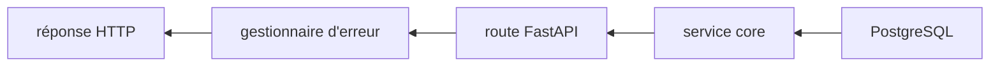

# Erreurs, débogage et tests du projet

## 1. Le modèle mental d’une panne

Une erreur a toujours un lieu d’observation, mais pas forcément son lieu d’origine. Une réponse `500` est observée par le client ; sa cause peut être une conversion dans `config.py`, une requête SQL dans `core/`, ou une incompatibilité de table dans `models.py`.



Pour diagnostiquer, partez du symptôme, relevez le statut et le corps, consultez le traceback serveur, trouvez la dernière ligne appartenant au projet, puis remontez ses entrées.

## 2. Exception, traceback et chaîne de causes

### Syntaxe minimale

```python
try:
    value = int(raw_value)
except ValueError as error:
    raise RuntimeError("PORT must be an integer") from error
```

`try` délimite ce qui peut échouer. `except ValueError` ne capture que cette famille. `as error` donne un nom à l’exception capturée. `raise ... from error` produit une nouvelle exception tout en conservant la cause dans le traceback.

Le code réel de `_read_positive_integer` utilise ce motif dans `app/config.py`. Le microservice possède une fonction parallèle `read_positive_integer`.

### Lire un traceback

Lisez d’abord la dernière ligne : type et message. Remontez ensuite jusqu’à la dernière ligne sous `interface_API/app/` ou `services/`. Chaque bloc `File ..., line ...` représente un appel. Le haut est ancien, le bas est proche de l’échec.

### Exercice corrigé

Dernière ligne : `RuntimeError: API_PORT must be an integer`. Cause précédente : `ValueError: invalid literal for int()`. Diagnostic : la variable `API_PORT` existe mais ne contient pas un entier décimal. Correction de configuration : une valeur comme `8000`, pas `"eight thousand"`.

## 3. Les trois gestionnaires de l’API métier

`app/main.py` enregistre trois callbacks avec `@app.exception_handler`.

### Validation : 422

`validation_exception_handler` reçoit `RequestValidationError`. Sa compréhension parcourt `exc.errors()` et transforme chaque problème en :

```json
{
  "location": "body.energy",
  "message": "Input should be less than or equal to 100",
  "type": "less_than_equal"
}
```

Le corps global est `{"error":"Request validation failed","details":[...]}`. Le point dans `location` vient de `".".join(str(part) for part in issue["loc"])`.

### Erreur HTTP attendue

`http_exception_handler` transforme `HTTPException` en `{"error": str(exc.detail)}` tout en gardant statut et headers. Ainsi l’exception `HTTPException(401, "Unauthorized")` de `security.py` devient exactement le JSON vérifié dans `test_api_boundaries.py`.

### Erreur inattendue : 500

`unhandled_exception_handler` journalise le traceback avec `logger.exception`, mais ne retourne que `{"error":"Internal server error"}`. C’est une frontière de sécurité : le client ne reçoit ni SQL, ni chemin local, ni secret.

### Ordre indirect

La route ne les appelle jamais. Starlette capture l’exception, choisit le gestionnaire le plus spécifique enregistré, l’attend parce qu’il est `async`, puis utilise sa `JSONResponse`.

### Exercice corrigé

Une tâche inexistante produit-elle 500 ? Non. `update_task` lève explicitement `HTTPException(404, "Task not found")`; le gestionnaire HTTP conserve 404 et uniformise le corps.

## 4. Catalogue commenté des erreurs de démarrage

### `APP_ACCESS_KEY and AUTH_SECRET are required in production`

Origine : `get_settings` lorsque `ENV=production`. Le serveur peut échouer dès l’import, car `database.py` et `main.py` appellent la configuration au niveau module. Vérifier le `.env` de `interface_API` et celui de la racine.

### `... must be an integer`

Origine : `API_PORT`, `MAX_AUDIO_BYTES` ou `WHISPER_TIMEOUT_SECONDS` non convertible. Une chaîne numérique est acceptée ; les décimales comme `8000.0` ne le sont pas.

### `... must be greater than zero`

Origine : même validateur, mais valeur `0` ou négative.

### `ModuleNotFoundError: No module named 'app'`

Cause habituelle : commande lancée depuis la racine avec un chemin qui n’ajoute pas `interface_API` aux imports. Suivre le README : `Set-Location interface_API`, puis `python run.py` ou `python -m unittest discover -s tests -v`.

### Connexion PostgreSQL refusée

`engine` est créé au chargement, mais la première connexion réelle survient généralement lors d’une opération. Vérifier `DATABASE_URL`, le serveur PostgreSQL et la base. L’API ne crée pas le schéma : Prisma reste propriétaire des migrations.

## 5. Erreurs de validation 422

Pydantic rejette les valeurs avant d’appeler la route.

- scores de `DailyLogUpsertRequest` hors `0..100` ;
- minutes hors des bornes déclarées par `Field` ;
- `TaskUpdateRequest.id` vide ;
- dates non convertibles ;
- enums non reconnus, après tentative insensible à la casse ;
- événement dont `end < start` ;
- check-in sans `habitId` ;
- allocation sans `categoryId` ;
- mise à jour portefeuille sans nom non blanc ;
- mise à jour de catégorie sans `id` ;
- bloc hebdomadaire sans `date`.

La route calendrier ajoute aussi une vérification 422 après fusion d’une mise à jour partielle avec les valeurs existantes. Le validateur Pydantic ne peut comparer que `start` et `end` reçus ensemble ; la route peut comparer une nouvelle valeur à l’ancienne.

### Diagnostic

Lire chaque entrée `details`: `location` dit où, `message` dit pourquoi, `type` permet un traitement programmatique. Comparer les noms JSON camelCase aux attributs Python snake_case.

### Exercice corrigé

`{"energy": 101}` n’entre jamais dans `upsert_daily_log`. `Field(ge=0, le=100)` échoue, FastAPI lève `RequestValidationError`, le callback retourne 422.

## 6. Erreurs d’authentification et d’autorisation

### 401 Unauthorized

`get_current_user` renvoie 401 si le cookie manque, si le jeton est mal formé, si la signature diffère, si l’expiration est invalide/passée ou si l’utilisateur n’existe plus.

### Login refusé

`auth.login` appelle `authenticate_access_key`. Une mauvaise clé produit une réponse JSON 401. Une bonne clé obtient/crée l’utilisateur local et pose le cookie.

### Appartenance des données

Les sélections de route combinent l’identifiant et `user.id`. Une ressource d’un autre utilisateur apparaît donc comme introuvable. `_validate_objective_access`, `_validate_objective_parent` et `_validate_block_objective` ajoutent des règles explicites.

### Débogage sûr

Ne journalisez jamais le cookie, `AUTH_SECRET` ou `APP_ACCESS_KEY`. Pour tester un jeton, utilisez `encode_session`/`decode_session` localement ou le flux login, sans imprimer le secret.

## 7. Erreurs métier par route

| Statut | Message réel | Origine |
| --- | --- | --- |
| 400 | `Invalid daily-log status range` | plage `from > to` dans `daily_log.py` |
| 400 | `Invalid objectiveId` | tâche liée à un objectif inaccessible |
| 400 | `Missing event id` | suppression calendrier sans `id` |
| 400 | `Invalid habitId` | check-in vers une habitude inaccessible |
| 400 | `Missing habit id` | suppression habitude sans `id` |
| 400 | `Objective hierarchy cannot contain a cycle` | parent égal à soi ou descendant |
| 400 | `Invalid parentId` | parent inaccessible/invalide |
| 400 | `Invalid objectiveId` | bloc lié à un objectif invalide |
| 400 | `Missing id` | suppression objectif/bloc sans identifiant |
| 400 | `Invalid categoryId` | allocation vers catégorie inaccessible |
| 400 | `Missing category id` | suppression temps sans identifiant |
| 404 | `Task not found` | PATCH tâche inconnue |
| 404 | `Event not found` | PATCH/DELETE événement inconnu |
| 404 | `Habit not found` | PATCH/DELETE habitude inconnue |
| 404 | `Weekly block not found` | PATCH/DELETE bloc inconnu |
| 404 | `Objective not found` | PATCH/DELETE objectif inconnu |
| 404 | `Allocation category not found` | PATCH/DELETE catégorie inconnue |
| 422 | `Event end must be after its start` | cohérence après PATCH calendrier |

`core/history.py` peut lever `ValueError("Unsupported history filter")`, mais la route borne `filter` avec `Literal["last7", "last30", "week", "all"]`; via HTTP, une autre valeur est normalement rejetée en 422 avant le core.

## 8. Erreurs audio

### Proxy authentifié

- 415 : type MIME non accepté ;
- 413 : fichier trop volumineux ;
- 503 : connexion Whisper impossible ou erreur `httpx` ;
- 502 : Whisper répond en erreur ou retourne un JSON invalide.

### Microservice

- 415 et 413 : mêmes frontières ;
- 429 : le sémaphore est déjà occupé ;
- 422 : Whisper lève `RuntimeError` sur l’audio ;
- 500 : autre échec Whisper, avec log serveur.

### Fichier temporaire

Le `finally` tente `unlink(missing_ok=True)` et ignore `OSError`. Cela privilégie la réponse principale si le nettoyage échoue, mais peut laisser un fichier temporaire. Pour enquêter, chercher le log Whisper et surveiller le dossier temporaire du système.

### Exercice corrigé

Le client de l’API reçoit 502 alors que Whisper a renvoyé 422. Pourquoi ? Le proxy considère toute réponse upstream `>=400` comme une mauvaise réponse de passerelle et l’expose en 502, tout en réutilisant le message `detail`.

## 9. Transactions et erreurs SQL

`flush` envoie les opérations SQL sans confirmer la transaction. `commit` de `get_db` la confirme. `rollback` annule tout depuis le début de cette transaction. `close` libère la session.

Une contrainte PostgreSQL peut échouer lors de `flush` ou `commit`. Si `flush` échoue dans la route, l’exception remonte immédiatement. Si seul `commit` échoue après le retour de la route, la dépendance lève encore l’exception avant la finalisation de la réponse.

Les upserts réels utilisent `postgresql.insert(...).on_conflict_do_update(...)` dans journal, habitudes et temps. Ils dépendent de contraintes uniques existantes dans le schéma Prisma. Si le modèle SQLAlchemy diverge du schéma, l’erreur sera une erreur SQL, pas une ValidationError Pydantic.

### Pièges ORM

- modèle et migration Prisma désalignés ;
- mauvais nom camelCase de colonne ;
- enum SQL manquant ou valeur différente ;
- objet d’un autre utilisateur sélectionné sans filtre ;
- oubli de `flush` avant de sérialiser un identifiant par défaut ;
- `commit` manuel prématuré qui casse l’atomicité de `get_db`.

## 10. Journaux

`logging.getLogger(__name__)` nomme le logger selon le module. `logger.exception(...)` doit être appelé dans un `except`; il inclut le traceback actif. Deux emplacements le font : le gestionnaire inattendu de l’API et l’échec Whisper.

Le projet ne configure pas ici un format global de logs : Uvicorn fournit sa configuration au lancement. Un log utile inclut l’opération et un identifiant non sensible, jamais les secrets.

Amélioration proposée, non présente : ajouter des identifiants de corrélation par requête. Ne supposez pas qu’ils existent aujourd’hui.

## 11. Les tests réellement présents

La suite utilise `unittest`, dans quatre fichiers.

### `test_security.py`

`test_round_trip_session` vérifie `encode_session` puis `decode_session`. `test_malformed_session_is_rejected_without_error` parcourt plusieurs jetons et utilise `subTest` pour identifier le cas fautif. `_signed_payload`, méthode statique, construit des payloads signés mais sémantiquement invalides.

### `test_contracts.py`

Il vérifie : alias camelCase ; enum insensible à la casse ; score hors plage ; normalisation UTC ; ordre des dates ; comparaison de fuseaux mixtes ; PATCH objectif sans valeur par défaut indésirable ; cibles exigées pour habitudes/temps ; date exigée pour bloc ; coercition de chaînes numériques.

### `test_numeric_parity.py`

Il protège `javascript_round(52.5) == 53` et `javascript_round(-1.5) == -1`, comportement de `Math.round` différent du `round` Python sur certains cas. `SimpleNamespace` fabrique un faux log minimal pour tester `compute_state_score` sans base.

### `test_api_boundaries.py`

`setUpClass` construit `TestClient(app)` une fois. Le test health vérifie statut et ensemble exact des clés publiques. Le test transcription sans cookie vérifie 401 et le corps uniformisé.

### Limite déclarée

Ces tests ne couvrent pas une vraie base PostgreSQL. Ils couvrent surtout fonctions pures, contrats, session et deux frontières HTTP.

## 12. Syntaxe `unittest` ligne par ligne

```python
class NumericParityTests(unittest.TestCase):
    def test_javascript_round_uses_positive_infinity_for_ties(self) -> None:
        self.assertEqual(javascript_round(52.5), 53)
```

- la classe hérite de `TestCase` ;
- le préfixe `test_` permet la découverte ;
- `self` est l’instance de test ;
- `-> None` indique l’absence de résultat métier ;
- `assertEqual(actual, expected)` échoue avec un diagnostic si les deux diffèrent.

```python
with self.assertRaises(ValidationError):
    DailyLogUpsertRequest.model_validate({"energy": 101})
```

Le gestionnaire `with` exige qu’une `ValidationError` soit levée dans son bloc. Aucune exception ou un autre type fait échouer le test.

## 13. Exécuter les tests

Depuis la racine :

```powershell
pnpm test:api
```

Depuis `interface_API` :

```powershell
python -m unittest discover -s tests -v
```

Un seul module :

```powershell
python -m unittest tests.test_contracts -v
```

Un seul test :

```powershell
python -m unittest tests.test_contracts.RequestContractTests.test_calendar_rejects_reverse_time_range -v
```

`python -m unittest` utilise le même interpréteur que `python`. `discover -s tests` cherche les fichiers `test*.py`. `-v` affiche les noms.

## 14. Procédure de diagnostic reproductible

1. Reproduire avec la plus petite requête ou le plus petit test.
2. Noter méthode, URL, query, headers pertinents, corps, statut et réponse.
3. Ne jamais copier les cookies/secrets dans un rapport partagé.
4. Identifier la route avec `rg -n '@router' interface_API/app/routers`.
5. Lire le contrat correspondant.
6. Suivre les dépendances `Depends`.
7. Relever la dernière ligne projet du traceback.
8. Inspecter les données juste avant l’échec, avec logs temporaires non sensibles.
9. Écrire un test qui échoue pour la bonne raison.
10. Corriger au niveau responsable.
11. Exécuter le test ciblé puis toute la suite.
12. Retirer les traces temporaires.

## 15. Scénario : une requête reçoit 401

Requête : `POST /api/transcribe` sans cookie. La route est enregistrée, mais FastAPI résout d’abord `user=Depends(get_current_user)`. `request.cookies.get(COOKIE_NAME)` donne `None`; `decode_session(None)` donne `None`; `get_current_user` lève 401. La lecture audio n’a jamais lieu. Le test `test_transcription_requires_authentication` confirme statut et JSON.

Si le test échoue avec un essai d’appel Whisper, la dépendance d’authentification a probablement été supprimée ou contournée.

## 16. Scénario : un champ valide n’est pas mis à jour

Comparez le JSON envoyé, l’alias Pydantic et la logique `if`. Pour `productive=false`, `body.productive` vaut `False`. Le code correct est `if body.productive is not None`. Un hypothétique `if body.productive` sauterait la mutation.

Inspectez `body.model_fields_set` quand `null` doit signifier « effacer ». `objective_id` emploie précisément cette technique.

## 17. Scénario : données écrites malgré une erreur

Dans le code actuel, toute exception propagée traverse `get_db`, qui rollback. Cherchez une capture trop large qui retournerait normalement au lieu de relancer. Vérifiez aussi qu’aucun `commit()` n’a été ajouté dans un service avant la fin de toutes les opérations.

Un test fiable nécessite une vraie transaction de test PostgreSQL ou une session substituée via `app.dependency_overrides[get_db]`. Cette infrastructure n’existe pas encore dans la suite.

## 18. Améliorations proposées, séparées du code actuel

Les éléments suivants sont des recommandations, pas des comportements existants :

- tests d’intégration PostgreSQL pour chaque CRUD et rollback ;
- tests des routes calendrier, habitudes, objectifs et temps ;
- tests du proxy avec `httpx` simulé ;
- test concurrent du sémaphore Whisper ;
- journal structuré avec identifiant de requête ;
- exception métier typée pour éviter les `ValueError` génériques du core ;
- mesure et alerte sur les fichiers temporaires non supprimés.

## 19. Exercices de transfert corrigés

### Exercice A

Un client envoie `PATCH /api/tasks` avec `{"id":"absent","productive":false}`. Prédisez le flux.

Correction : Pydantic accepte l’id et `False`; l’authentification et la session sont résolues ; la sélection ne trouve rien ; 404 `Task not found`; `get_db` rollback puis ferme ; aucune mutation.

### Exercice B

`MAX_AUDIO_BYTES=-1` et le service démarre. Où chercher ?

Correction : `read_positive_integer` est appelé au niveau module pour construire `MAX_AUDIO_BYTES`; il lève avant que l’objet app ne puisse servir normalement. Corriger l’environnement, pas la route.

### Exercice C

Pourquoi le test health compare-t-il `set(response.json())` plutôt qu’un dictionnaire complet ?

Correction : il verrouille les noms exposés, notamment l’absence de secrets, tout en testant séparément le statut. Il n’impose pas ici la valeur de `usingDevAccessKey`, qui dépend de l’environnement.

## 20. Checklist avant de déclarer une correction terminée

- le symptôme original est reproduit ;
- un test échoue avant et passe après ;
- le statut HTTP reste sémantiquement correct ;
- le format uniforme `error/details` reste respecté ;
- aucun secret ne fuit ;
- la transaction rollback en erreur ;
- les ressources sont fermées ;
- le test ciblé et `python -m unittest discover -s tests -v` passent ;
- le modèle SQLAlchemy reste aligné sur Prisma si le schéma a changé.

## 21. Raccourcis vers les lignes de diagnostic

- [transformation des erreurs de validation](../../interface_API/app/main.py#L43) ;
- [uniformisation de `HTTPException`](../../interface_API/app/main.py#L62) ;
- [log et réponse 500](../../interface_API/app/main.py#L67) ;
- [rollback et fermeture DB](../../interface_API/app/database.py#L21) ;
- [rejet de session](../../interface_API/app/security.py#L52) ;
- [erreurs explicites calendrier](../../interface_API/app/routers/calendar_events.py#L80) ;
- [erreurs explicites objectifs](../../interface_API/app/routers/objectives.py#L21) ;
- [traduction des pannes Whisper par le proxy](../../interface_API/app/routers/transcribe.py#L36) ;
- [log, 422/500 et nettoyage côté Whisper](../../services/whisper_service.py#L100) ;
- [tests de frontière HTTP](../../interface_API/tests/test_api_boundaries.py#L10) ;
- [tests de contrats](../../interface_API/tests/test_contracts.py#L16) ;
- [tests numériques](../../interface_API/tests/test_numeric_parity.py#L10) ;
- [tests de sécurité](../../interface_API/tests/test_security.py#L8).

Exercice : si le corps est `{"error":"Internal server error"}`, quelle ligne lire côté client pour connaître la cause ? Correction : aucune, volontairement. Il faut retrouver le `logger.exception` serveur et son traceback ; le corps public masque la cause.
