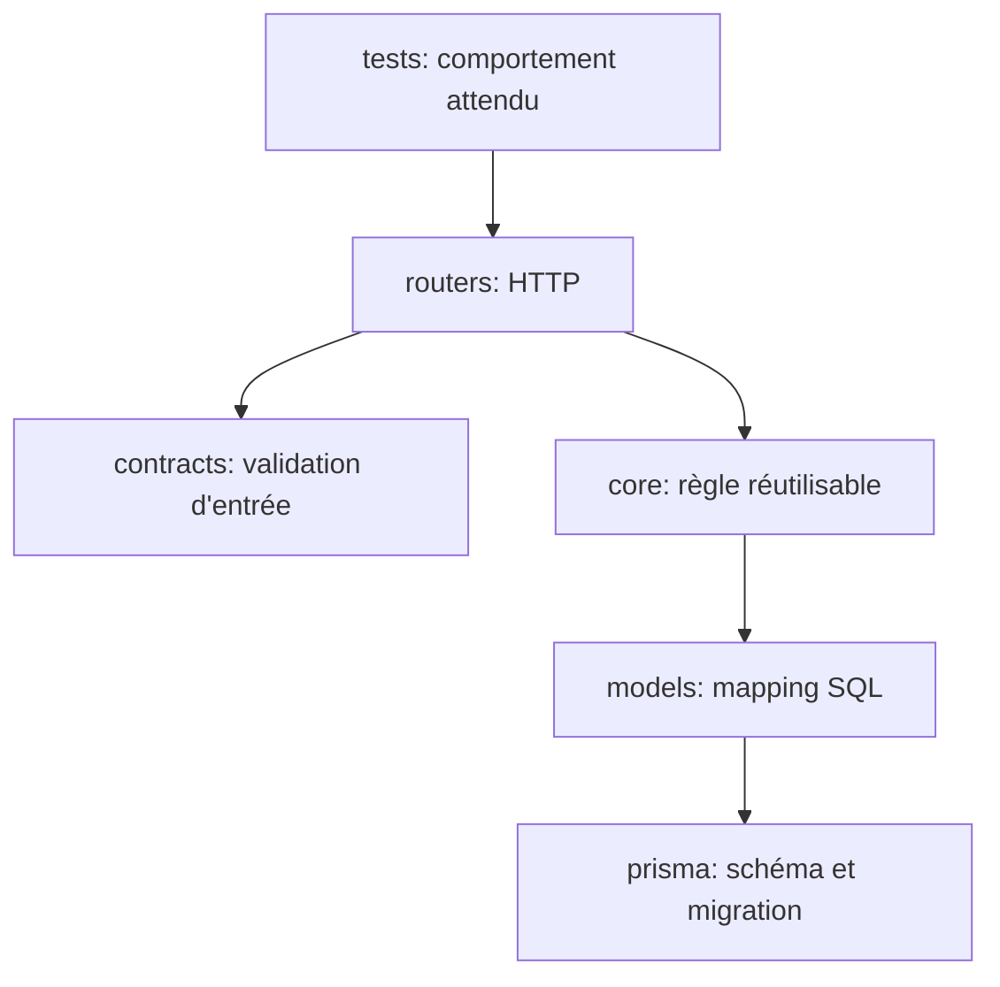

# Modifier l’API sans casser le projet

## 1. Règle de sécurité de ce chapitre

Tout le code sous « Code actuel » est une citation ou une description du dépôt. Tout le code sous « Proposition pédagogique » est une modification possible qui **n’a pas été appliquée**. Les tutoriels sont conçus pour vous apprendre à faire une branche, écrire le test, modifier le minimum et vérifier.

Le schéma PostgreSQL reste géré par Prisma dans `prisma/`. Ajouter une classe SQLAlchemy ne crée aucune table. Toute modification persistante exige d’abord une migration Prisma, puis l’alignement manuel de `interface_API/app/models.py`.

## 2. Avant toute modification

Depuis la racine :

```powershell
git status --short
pnpm test:api
```

La première commande montre les fichiers déjà modifiés : ne les écrasez pas. La seconde établit l’état initial. Depuis `interface_API`, l’équivalent détaillé est :

```powershell
python -m unittest discover -s tests -v
```

Cherchez ensuite le chemin concerné :

```powershell
rg -n "@router|def list_tasks|TaskCreateRequest|class Task" interface_API/app
```

## 3. Comprendre les couches à toucher



Une modification ne touche pas forcément chaque couche. Un nouveau filtre de lecture peut ne modifier qu’une route et ses tests. Une nouvelle colonne touche Prisma, le modèle, le contrat, la route/sérialisation et les tests.

## 4. Tutoriel 1 — ajouter une route simple authentifiée

### But proposé

Ajouter `GET /api/tasks/count` qui renvoie le nombre de tâches de l’utilisateur. Attention : dans FastAPI/Starlette, déclarez une route statique comme `/count` avant une éventuelle route dynamique `/{id}`. Le fichier actuel n’a pas de route dynamique.

### Étape A : test d’abord

Proposition pédagogique dans un nouveau test d’intégration utilisant une base de test :

```python
def test_task_count_requires_authentication(self) -> None:
    response = self.client.get("/api/tasks/count")

    self.assertEqual(response.status_code, 401)
```

Ligne 1 définit un test découvert par `unittest`. Ligne 2 passe par l’application réelle. Ligne 4 vérifie que la nouvelle route conserve la dépendance de sécurité.

### Étape B : route minimale

Proposition pédagogique dans `app/routers/tasks.py` :

```python
from sqlalchemy import and_, func, select


@router.get("/count")
def count_tasks(
    user: User = Depends(get_current_user),
    db: Session = Depends(get_db),
) -> dict[str, int]:
    count = db.scalar(
        select(func.count()).select_from(Task).where(Task.userId == user.id)
    )
    return {"count": int(count or 0)}
```

Explication ligne par ligne :

1. `func` est ajouté à l’import SQLAlchemy existant ; il fabrique `COUNT` SQL.
2. Le décorateur enregistre un GET sous le préfixe existant `/api/tasks`.
3. Les deux dépendances sont identiques aux autres routes du fichier.
4. `select(func.count())` exprime l’agrégat.
5. `select_from(Task)` fixe la table.
6. `where(Task.userId == user.id)` isole l’utilisateur courant.
7. `db.scalar` récupère la première valeur plutôt qu’une ligne complexe.
8. `int(count or 0)` garantit un entier JSON.

Pourquoi ne pas modifier `main.py` ? `tasks.router` y est déjà inclus ; toute nouvelle route ajoutée à cet objet est découverte lors de l’import.

### Erreurs fréquentes

- oublier le filtre `userId` et compter les données de tous les utilisateurs ;
- oublier `Depends(get_current_user)` ;
- importer `func` depuis le mauvais module ;
- retourner l’objet `Result` au lieu d’un entier.

### Exercice corrigé

Ajoutez mentalement `?date=2026-08-01`. Correction : il faudrait déclarer un paramètre `date`, le convertir avec `parse_date_key`, puis ajouter une condition `Task.date == ...`; une query non déclarée est simplement ignorée par la route actuelle.

## 5. Tutoriel 2 — ajouter un paramètre de query

### But proposé

Permettre `GET /api/tasks?importance=high`.

### Code actuel concerné

`list_tasks` reçoit `scope`, `date`, `user`, `db`, puis construit une expression `query` avant d’ajouter la date.

### Proposition pédagogique

```python
from ..contracts.enums import TaskImportance


def list_tasks(
    scope: str = Query(default="today"),
    date: str | None = Query(default=None),
    importance: TaskImportance | None = Query(default=None),
    user: User = Depends(get_current_user),
    db: Session = Depends(get_db),
):
    # construction actuelle de query...
    if importance is not None:
        query = query.where(Task.importance == importance.value)
```

`TaskImportance | None` rend le filtre facultatif. FastAPI/Pydantic accepte `high` grâce à `CaseInsensitiveEnum._missing_`. Quand le paramètre est absent, aucune condition n’est ajoutée. Quand il existe, `.value` fournit la forme SQL `HIGH`.

### Test unitaire du bord

Avant le test base, le comportement de l’enum est déjà indirectement couvert pour le journal. Ajoutez un test ciblé de route dans une infrastructure DB de test. Vérifiez au minimum : absent retourne toutes les importances du jour ; `high` ne retourne que `HIGH`; valeur inconnue retourne 422.

### Erreurs fréquentes

- comparer la colonne à l’objet enum au lieu de sa `.value` alors que la colonne ORM est typée `str` ;
- filtrer après `.all()`, ce qui charge trop de lignes ;
- utiliser une chaîne libre et oublier de valider.

### Exercice corrigé

Pourquoi préférer l’enum existant ? Il constitue une seule source de vérité pour `LOW`, `MEDIUM`, `HIGH`, accepte la casse frontend et produit automatiquement une documentation OpenAPI contrainte.

## 6. Tutoriel 3 — créer un schéma de requête

### But proposé

Créer une commande de suppression groupée de tâches. Cet exemple enseigne le contrat sans affirmer que l’endpoint existe.

### Proposition pédagogique dans `app/contracts/tasks.py`

```python
class TaskBulkDeleteRequest(ApiRequest):
    ids: list[str] = Field(min_length=1, max_length=100)
```

- `class` crée le type ;
- l’héritage `ApiRequest` conserve alias camelCase, population par nom et champs supplémentaires ignorés ;
- `ids` est une liste de chaînes ;
- `min_length=1` interdit une commande vide ;
- `max_length=100` limite le coût d’une requête.

### Validation plus stricte proposée

```python
from pydantic import Field, field_validator


class TaskBulkDeleteRequest(ApiRequest):
    ids: list[str] = Field(min_length=1, max_length=100)

    @field_validator("ids")
    @classmethod
    def validate_ids(cls, ids: list[str]) -> list[str]:
        normalized_ids = [task_id.strip() for task_id in ids]
        if any(not task_id for task_id in normalized_ids):
            raise ValueError("ids must not contain an empty value")
        if len(set(normalized_ids)) != len(normalized_ids):
            raise ValueError("ids must be unique")
        return normalized_ids
```

Pydantic appelle le callback après conversion du champ. La compréhension nettoie. `any` détecte au moins une chaîne vide. `set` supprime les doublons pour comparer les tailles. Le retour remplace la liste par sa version normalisée.

### Test proposé

```python
def test_bulk_delete_rejects_duplicate_ids(self) -> None:
    with self.assertRaises(ValidationError):
        TaskBulkDeleteRequest.model_validate({"ids": ["task-1", "task-1"]})
```

### Erreur fréquente

Ne mettez pas une requête SQL dans un validateur Pydantic. Le contrat valide la forme ; l’appartenance des ids à l’utilisateur nécessite la session et appartient à la route/service.

## 7. Tutoriel 4 — ajouter une validation inter-champs

### Patron actuel

`CalendarEventCreateRequest.validate_time_range` est le meilleur exemple réel : `mode="after"`, comparaison après conversion, `ValueError`, `return self`.

### But proposé

Refuser une tâche marquée `DONE` avec une progression inférieure à 100 dans `TaskCreateRequest`.

```python
from pydantic import Field, model_validator


class TaskCreateRequest(ApiRequest):
    # champs actuels inchangés...

    @model_validator(mode="after")
    def validate_done_completion(self):
        if self.status == TaskStatus.DONE and self.completion_percent < 100:
            raise ValueError("a done task must have 100% completion")
        return self
```

Mécanisme : les deux champs ont déjà leurs types ; le validateur exprime une relation ; le `ValueError` devient 422 ; la route n’est pas appelée.

Mais décidez d’abord la règle métier : une autre stratégie serait de forcer automatiquement 100. Refuser est plus explicite et évite une mutation silencieuse.

### Cas PATCH

Le même validateur naïf ne suffit pas à `TaskUpdateRequest`, car un PATCH peut ne fournir qu’un des deux champs. Comme dans le calendrier, la route doit fusionner les valeurs nouvelles et existantes avant de vérifier :

```python
next_status = body.status.value if body.status is not None else existing.status
next_completion = (
    body.completion_percent
    if body.completion_percent is not None
    else existing.completionPercent
)
if next_status == "DONE" and next_completion < 100:
    raise HTTPException(status_code=422, detail="A done task must have 100% completion")
```

### Exercice corrigé

Pourquoi ne pas tester `if body.completion_percent` ? Une progression `0` est valide mais fausse en contexte booléen. `is not None` distingue correctement absence et zéro.

## 8. Tutoriel 5 — ajouter une opération CRUD `DELETE /api/tasks`

L’API actuelle propose GET, POST et PATCH sur `/api/tasks`, mais pas DELETE. Voici une extension cohérente.

### Test de comportement proposé

Avec une session/base de test : créer une tâche appartenant à l’utilisateur, appeler `DELETE /api/tasks?id=...`, vérifier 200, vérifier que la tâche n’existe plus, puis vérifier que l’id d’un autre utilisateur donne 404.

### Proposition pédagogique dans `routers/tasks.py`

```python
@router.delete("")
def delete_task(
    id: str | None = Query(default=None),
    user: User = Depends(get_current_user),
    db: Session = Depends(get_db),
) -> dict[str, bool]:
    if not id:
        raise HTTPException(status_code=400, detail="Missing task id")

    existing = db.execute(
        select(Task).where(Task.id == id, Task.userId == user.id)
    ).scalar_one_or_none()
    if existing is None:
        raise HTTPException(status_code=404, detail="Task not found")

    affected_date = existing.date.isoformat()
    db.delete(existing)
    db.flush()
    recompute_around_date(db, user.id, affected_date)
    return {"ok": True}
```

Explication :

1. Le décorateur utilise le même préfixe.
2. L’id de query est facultatif au niveau signature afin de produire le message métier 400 ; le rendre `str` sans défaut laisserait FastAPI produire 422.
3. La sélection filtre aussi `userId`.
4. La date est mémorisée avant suppression.
5. `delete` marque l’objet ; `flush` exécute le DELETE.
6. Les scores sont recalculés, comme après création/mise à jour.
7. Le commit reste dans `get_db`.

### Pourquoi cette forme est cohérente

Elle suit `calendar_events.delete_event`, `habits.delete_habit` et `time_allocation.delete_category`. Elle ne réinvente ni transaction ni format d’erreur.

### Erreurs fréquentes

- `db.get(Task, id)` sans contrôler `userId` ;
- oublier le recalcul dérivé ;
- appeler `commit` dans la route ;
- retourner l’objet après l’avoir supprimé et risquer un accès expiré.

## 9. Tutoriel 6 — extraire un service

### Problème proposé

Si plusieurs routes doivent créer des tâches, la boucle de `create_tasks` devient une règle réutilisable. Le dossier `core/` accueille déjà les règles métier, mais ne doit pas dépendre de FastAPI.

### Proposition pédagogique : `app/core/tasks.py`

```python
from sqlalchemy.orm import Session

from ..models import Task
from .dates import parse_date_key


def create_task_records(
    db: Session,
    user_id: str,
    titles: list[str],
    date_key: str,
    objective_id: str | None,
    importance: str,
    productive: bool,
    estimated_minutes: int,
    completion_percent: int,
    status: str,
) -> list[Task]:
    tasks: list[Task] = []
    for title in titles:
        task = Task(
            userId=user_id,
            title=title,
            date=parse_date_key(date_key),
            objectiveId=objective_id,
            importance=importance,
            productive=productive,
            estimatedMinutes=estimated_minutes,
            completionPercent=completion_percent,
            status=status,
        )
        db.add(task)
        tasks.append(task)
    db.flush()
    return tasks
```

Le service reçoit des types métier simples, ne connaît ni `Depends`, ni `Request`, ni `HTTPException`. La route conserve validation HTTP, accès utilisateur et sérialisation. Le service conserve la création persistante réutilisable.

### Refactor proposé de la route

Après normalisation des titres et validation de l’objectif :

```python
tasks = create_task_records(
    db=db,
    user_id=user.id,
    titles=titles,
    date_key=date_key,
    objective_id=body.objective_id or None,
    importance=body.importance.value,
    productive=body.productive,
    estimated_minutes=body.estimated_minutes,
    completion_percent=body.completion_percent,
    status=body.status.value,
)
```

Les arguments nommés rendent les onze paramètres lisibles et limitent les inversions.

### Test de non-régression

Le résultat JSON de la route doit être identique avant/après. Ajoutez aussi un test unitaire du service avec session de test. Un refactoring ne doit pas simultanément changer le contrat.

## 10. Tutoriel 7 — ajouter une erreur métier

### Situation proposée

Interdire la suppression d’une tâche `IN_PROGRESS`.

### Option simple, cohérente avec l’existant

Dans la route DELETE proposée, avant `db.delete` :

```python
if existing.status == "IN_PROGRESS":
    raise HTTPException(
        status_code=409,
        detail="An in-progress task cannot be deleted",
    )
```

409 signifie conflit avec l’état courant de la ressource. Le gestionnaire global produira `{"error":"An in-progress task cannot be deleted"}`.

### Option architecturale proposée

Si cette règle est appelée ailleurs, définissez une exception métier dans `core/tasks.py`, par exemple `TaskStateConflict`, puis traduisez-la en `HTTPException(409)` dans la route. Le core ne doit pas avoir à importer FastAPI.

```python
class TaskStateConflict(Exception):
    pass


def ensure_task_can_be_deleted(task: Task) -> None:
    if task.status == "IN_PROGRESS":
        raise TaskStateConflict("An in-progress task cannot be deleted")
```

Route :

```python
try:
    ensure_task_can_be_deleted(existing)
except TaskStateConflict as error:
    raise HTTPException(status_code=409, detail=str(error)) from error
```

Le `from error` conserve la cause dans le traceback serveur.

### Exercice corrigé

Pourquoi pas 400 ? 400 pourrait fonctionner, mais 409 exprime mieux que la syntaxe est valide et que l’état actuel empêche l’action.

## 11. Tutoriel 8 — ajouter un test de contrat

### But proposé

Tester la règle `DONE => 100%` avant de l’implémenter.

```python
from app.contracts.tasks import TaskCreateRequest


def test_done_task_requires_full_completion(self) -> None:
    with self.assertRaises(ValidationError):
        TaskCreateRequest.model_validate(
            {"title": "Terminer le cours", "status": "done", "completionPercent": 50}
        )
```

Le test utilise les noms JSON réels (`completionPercent`) et la casse basse tolérée. Avant la validation proposée, il échoue parce qu’aucune exception n’est levée. Après, il passe.

Ajoutez le cas positif :

```python
def test_done_task_accepts_full_completion(self) -> None:
    request = TaskCreateRequest.model_validate(
        {"status": "done", "completionPercent": 100}
    )

    self.assertEqual(request.status, TaskStatus.DONE)
    self.assertEqual(request.completion_percent, 100)
```

Un test négatif seul peut cacher une règle trop stricte ; le cas positif protège la valeur admise.

## 12. Tutoriel 9 — tester une route avec dépendance substituée

Le projet utilise déjà `TestClient`, mais pas encore de substitution DB. FastAPI fournit `app.dependency_overrides`.

Proposition conceptuelle :

```python
def override_get_current_user():
    return User(id="user-test", label="Test")


app.dependency_overrides[get_current_user] = override_get_current_user
```

Pour la base, fournissez un générateur de session relié à une base PostgreSQL de test compatible :

```python
def override_get_db():
    db = TestSessionLocal()
    try:
        yield db
        db.commit()
    except Exception:
        db.rollback()
        raise
    finally:
        db.close()
```

Nettoyez après chaque test :

```python
app.dependency_overrides.clear()
```

Ne remplacez pas PostgreSQL par SQLite sans audit : le code utilise `JSONB`, `ENUM` PostgreSQL et `insert(...).on_conflict_do_update`, qui peuvent diverger.

## 13. Tutoriel 10 — ajouter un champ persistant

### But proposé

Ajouter une description facultative à `Task`. Cette opération traverse plusieurs sources de vérité.

### Étape 1 : Prisma

Dans le modèle Prisma réel `Task`, ajouter conceptuellement :

```prisma
description String?
```

Puis générer une migration nommée :

```powershell
pnpm prisma:migrate --name add_task_description
pnpm prisma:generate
```

Inspectez le SQL généré avant de l’appliquer hors développement.

### Étape 2 : SQLAlchemy

Proposition dans `app/models.py`, classe `Task` :

```python
description: Mapped[str | None] = mapped_column(Text)
```

Le nom doit correspondre exactement à la colonne Prisma. `Text` est déjà importé.

### Étape 3 : contrats

Ajouter `description: str | None = None` aux deux requêtes. Pour PATCH, utilisez `model_fields_set` si `null` doit effacer la description.

### Étape 4 : écriture

À la création : `description=body.description`. À la mise à jour :

```python
if "description" in body.model_fields_set:
    existing.description = body.description
```

### Étape 5 : réponse

Ajouter `"description": task.description` à `serialize_task`.

### Étape 6 : tests

Testez création, lecture, mise à jour textuelle, effacement par `null`, isolement utilisateur et ancien enregistrement contenant NULL.

### Erreurs fréquentes

- modifier seulement SQLAlchemy sans migration ;
- migrer mais oublier la sérialisation ;
- utiliser `if body.description is not None`, empêchant l’effacement ;
- oublier la compatibilité du frontend TypeScript.

## 14. Tutoriel 11 — refactoriser une fonction de sérialisation

### Situation réelle

Il existe deux fonctions nommées `serialize_task` : dans `routers/tasks.py` et dans `core/objectives.py`. Elles servent des vues différentes : la première inclut notamment l’objectif résolu ; la seconde alimente le domaine objectifs. Ne les fusionnez pas uniquement parce que leur nom est identique.

### Démarche sûre

1. Comparer clé par clé les deux dictionnaires.
2. Identifier les consommateurs frontend et tests.
3. Extraire uniquement un noyau commun si les formats sont réellement identiques.
4. Garder des fonctions d’adaptation par vue.
5. Tester les JSON complets avant/après.

### Proposition pédagogique

```python
def serialize_task_base(task: Task) -> dict:
    return {
        "id": task.id,
        "userId": task.userId,
        "title": task.title,
        "date": task.date.isoformat(),
        "importance": task.importance.lower(),
        "productive": task.productive,
        "estimatedMinutes": task.estimatedMinutes,
        "completionPercent": task.completionPercent,
        "status": task.status.lower(),
        "objectiveId": task.objectiveId,
        "createdAt": iso_datetime(task.createdAt),
        "updatedAt": iso_datetime(task.updatedAt),
    }
```

Chaque sérialiseur ferait ensuite `payload = serialize_task_base(task)` puis ajouterait ses clés de vue. Cette proposition n’est valable qu’après confirmation des contrats.

### Erreur fréquente

Unifier des fonctions qui se ressemblent mais ont des invariants différents crée une dépendance cachée entre endpoints.

## 15. Tutoriel 12 — modifier un calcul

### Cas réel

`javascript_round` existe pour reproduire l’arrondi JavaScript. Remplacer par `round` semble plus simple mais casserait `-1.5` et certains demi-entiers. Le test de parité protège ce choix.

Procédure :

1. lire tous les appels avec `rg -n "javascript_round" interface_API/app` ;
2. formaliser l’ancien et le nouveau comportement avec exemples ;
3. ajouter les tests de frontière ;
4. modifier une seule fonction centrale ;
5. vérifier les agrégats de métriques et les réponses dépendantes.

Une modification de formule peut traverser `metrics`, `regime`, `time_allocation`, `objectives`, `habits`, `todo_metrics` et `life_terminal`. Le petit fichier `numbers.py` est une source de vérité partagée.

## 16. Tutoriel 13 — ajouter une nouvelle erreur de configuration

### But proposé

Exiger une URL Whisper HTTP(S).

Proposition dans `get_settings`, avant la construction :

```python
whisper_service_url = os.environ.get(
    "WHISPER_SERVICE_URL",
    DEFAULT_WHISPER_SERVICE_URL,
)
if urlsplit(whisper_service_url).scheme not in {"http", "https"}:
    raise RuntimeError("WHISPER_SERVICE_URL must use http or https")
```

Puis passer `whisper_service_url=whisper_service_url`. `urlsplit` est déjà importé. Testez valeur absente, `http`, `https` et schéma invalide. Comme `get_settings` est caché, chaque test environnemental doit nettoyer puis appeler `get_settings.cache_clear()`.

## 17. Tutoriel 14 — modifier une route asynchrone

Supposons que vous ajoutiez un header à la requête Whisper. Le changement appartient au dictionnaire passé à `client.post`, pas au microservice si le header est seulement pour le proxy.

```python
headers = {"X-Request-Source": "life-regime-api"}
upstream = await client.post(
    settings.whisper_service_url,
    files=files,
    headers=headers,
)
```

`await` reste obligatoire. Testez avec un transport `httpx` simulé plutôt qu’un vrai modèle Whisper. Ne placez aucun secret dans un header journalisé.

## 18. Tutoriel 15 — préserver le nettoyage

Si vous modifiez `services/whisper_service.py::transcribe`, conservez le `finally` qui supprime `temp_path`. Tout nouveau `return` doit rester dans le `try` afin que Python exécute quand même `finally`. Toute nouvelle ressource devrait avoir son propre gestionnaire `with` ou nettoyage.

Exercice : un `return` dans le `try` saute-t-il `finally` ? Correction : non, Python exécute `finally` avant de rendre la valeur. En revanche, un arrêt brutal du processus ne garantit pas ce nettoyage.

## 19. Revue avant fusion

### Contrat

- méthode et URL inchangées sauf intention ;
- noms JSON camelCase respectés ;
- champs facultatifs et `null` distingués ;
- statuts et corps d’erreur documentés ;
- OpenAPI inspecté sur `/docs`.

### Sécurité

- `Depends(get_current_user)` présent ;
- toutes les requêtes filtrent `userId` ;
- aucun secret dans réponse/log ;
- limites de taille et timeout conservés.

### Base

- migration Prisma présente si nécessaire ;
- modèle SQLAlchemy aligné ;
- aucun `commit` prématuré ;
- `flush` utilisé seulement quand nécessaire ;
- rollback testé.

### Qualité

- test reproduisant l’ancien échec ;
- cas heureux, frontière et erreur ;
- fonctions core indépendantes de FastAPI si possible ;
- pas de duplication de formule ;
- suite complète réussie.

## 20. Projet final corrigé sur papier

Concevez `DELETE /api/tasks` avec conflit pour tâche en cours.

La solution complète combine : query `id`; dépendances user/db ; 400 si id manque ; sélection `(Task.id == id, Task.userId == user.id)` ; 404 si absente ; 409 si statut `IN_PROGRESS`; mémorisation de la date ; `db.delete`; `db.flush`; `recompute_around_date`; `{"ok": True}`; commit indirect. Tests : sans auth 401, id absent 400, étrangère 404, en cours 409, supprimable 200 et absence en base, recalcul appelé/effet vérifié.

Vous savez alors ajouter une fonctionnalité simple en respectant la validation, la sécurité, la transaction, les données dérivées et les tests du projet.

## 21. Fichiers réels à comparer avant d’appliquer les tutoriels

- Pour une nouvelle route, comparez [`tasks.py`](../../interface_API/app/routers/tasks.py#L12) et l’inclusion existante dans [`main.py`](../../interface_API/app/main.py#L79).
- Pour un `DELETE`, suivez le patron réel de [`delete_event`](../../interface_API/app/routers/calendar_events.py#L115) et de [`delete_category`](../../interface_API/app/routers/time_allocation.py#L180).
- Pour une validation inter-champs, copiez la structure, pas le métier, de [`CalendarEventCreateRequest`](../../interface_API/app/contracts/calendar_events.py#L14).
- Pour la sémantique PATCH et `model_fields_set`, lisez [`update_task`](../../interface_API/app/routers/tasks.py#L123).
- Pour extraire un service, observez la frontière route/core entre [`reports.py` route](../../interface_API/app/routers/reports.py#L14) et [`generate_weekly_report`](../../interface_API/app/core/reports.py#L13).
- Pour écrire en transaction, gardez le cycle de [`get_db`](../../interface_API/app/database.py#L21).
- Pour une colonne, alignez [`models.py`](../../interface_API/app/models.py#L90) avec [`prisma/schema.prisma`](../../prisma/schema.prisma).
- Pour un test de contrat, utilisez la forme de [`test_contracts.py`](../../interface_API/tests/test_contracts.py#L16).

### Exercice final corrigé

Vous ajoutez un champ de réponse calculé, sans stockage et sans nouvelle entrée. Quelles couches sont probablement inutiles ? Correction : aucune migration Prisma, aucun nouveau `mapped_column`, probablement aucun contrat de requête. Ajoutez le calcul au core approprié ou au sérialiseur, exposez-le dans la route et testez le JSON. Vérifiez néanmoins tous les consommateurs du format.
