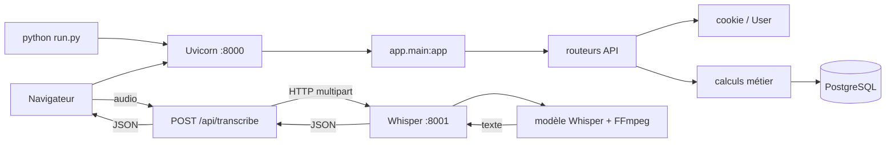
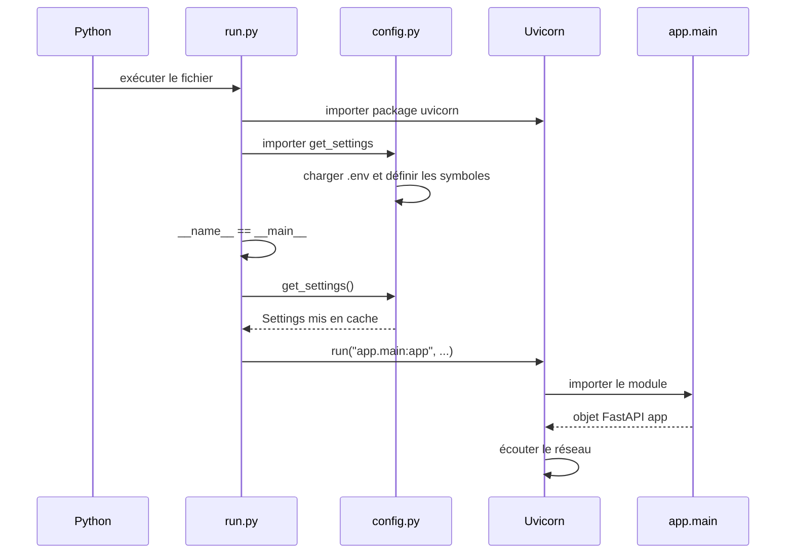
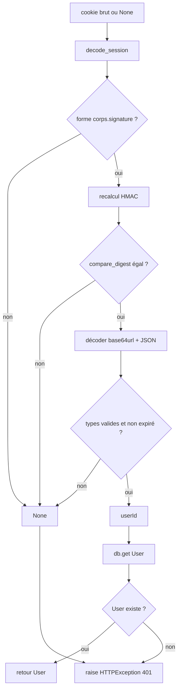
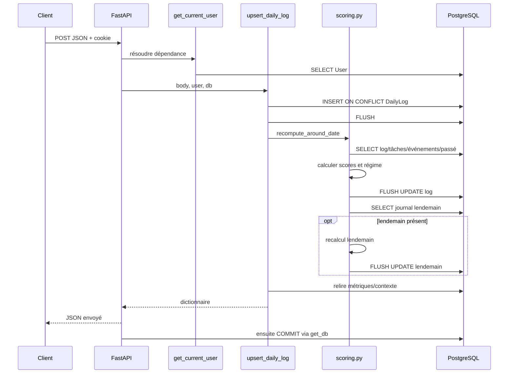
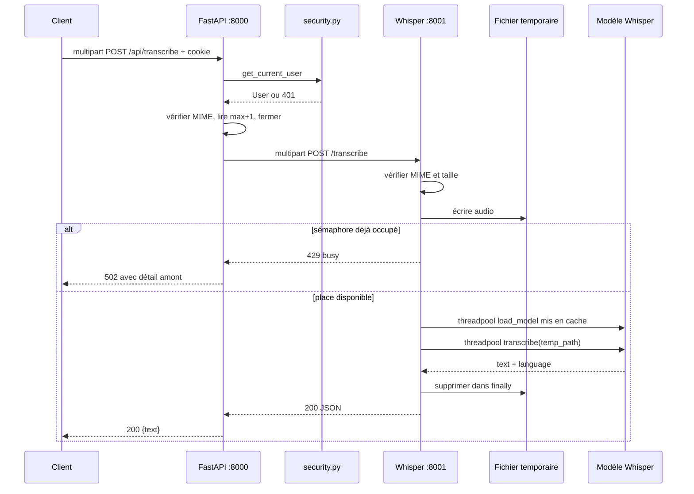
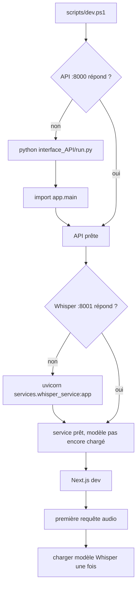

# 13 — Lecture guidée de l'exécution réelle

## À qui s'adresse ce chapitre

Ce chapitre suppose que vous n'avez jamais programmé en Python. Nous allons lire des fichiers réels du dépôt et répondre constamment à quatre questions :

1. Est-ce que cette ligne s'exécute au démarrage, à l'import, ou pendant une requête ?
2. Quelles valeurs entrent dans le bloc ?
3. Quelle valeur ressort, ou quel effet est produit ?
4. Quel fichier sera exécuté ensuite ?

Nous étudions deux processus différents :

- l'API principale FastAPI, généralement sur le port 8000 ;
- le service Whisper, généralement sur le port 8001.

Ils ne partagent pas la même instance `FastAPI`. L'API principale reçoit le client, vérifie sa session, puis relaie l'audio au second service avec HTTP.

## La carte avant les détails



## Trois moments qu'il ne faut jamais confondre

### Moment 1 — Python lit un module

Lors d'un `import`, Python exécute les lignes au niveau supérieur : imports, affectations de constantes, création de l'application et enregistrement par décorateur. En revanche, il n'exécute pas le corps des fonctions qu'il ne fait que définir.

### Moment 2 — Uvicorn attend

Après le démarrage, la boucle événementielle attend des connexions réseau. Le serveur n'exécute pas toutes les routes en boucle. Une route est choisie lorsqu'une méthode et un chemin correspondent.

### Moment 3 — une requête arrive

FastAPI extrait les données, résout les dépendances, valide les entrées et appelle la fonction de route. La résolution des dépendances et la validation du corps sont toutes deux terminées avant l'appel de la route ; il ne faut pas dépendre d'un ordre relatif précis entre leurs détails internes.

# Partie I — `interface_API/run.py`, le point de départ de développement

Le fichier ne contient que neuf lignes, mais elles introduisent imports, condition spéciale, objet de configuration et appel de fonction.

## Lignes 1 à 5 — préparer les noms

```python
"""Development entry point: python run.py"""

import uvicorn

from app.config import get_settings
```

### Ligne 1

Les triples guillemets créent une chaîne. Placée au début du fichier, elle devient le **docstring du module**, c'est-à-dire sa documentation accessible à Python. Créer cette chaîne n'ouvre aucun serveur.

### Ligne 3

`import uvicorn` demande à Python de charger le package Uvicorn et associe le nom `uvicorn` à son module. Uvicorn est le serveur ASGI : il écoute le réseau et transmet les requêtes à l'application.

Dans `requirements.txt`, le projet fixe `uvicorn[standard]==0.51.0`. Les crochets demandent les dépendances optionnelles usuelles du serveur.

### Ligne 5

`from app.config import get_settings` charge d'abord le package `app`, puis le module `config.py`, puis place seulement le nom `get_settings` dans `run.py`.

Pendant cet import, `config.py` charge les fichiers `.env` et définit ses fonctions. Le corps de `get_settings` n'est exécuté qu'à son premier appel.

## Lignes 7 à 9 — lancer seulement comme script

```python
if __name__ == "__main__":
    settings = get_settings()
    uvicorn.run("app.main:app", host=settings.api_host, port=settings.api_port, reload=True)
```

### Comprendre `__name__`

Python crée automatiquement la variable `__name__`.

- avec `python run.py`, sa valeur dans ce fichier est `"__main__"` ;
- avec `import run`, sa valeur est `"run"`.

Le `if` signifie donc : « exécuter le lancement seulement si ce fichier est le programme principal ».

Le deux-points `:` ouvre un bloc. Les lignes indentées de quatre espaces appartiennent au bloc. Retirer l'indentation changerait le sens ou provoquerait une erreur.

### Ligne 8

`settings = get_settings()` appelle la fonction et stocke l'objet `Settings` dans une variable locale nommée `settings`.

Les parenthèses déclenchent l'appel. Sans elles, `settings = get_settings` stockerait la fonction elle-même.

`get_settings` :

1. lit `ENV`, `APP_ACCESS_KEY`, `AUTH_SECRET` et les autres variables ;
2. refuse une production sans les deux secrets ;
3. convertit l'URL PostgreSQL pour SQLAlchemy ;
4. valide les entiers positifs ;
5. construit un objet `Settings` immuable ;
6. le garde en cache pour les appels suivants.

### Ligne 9

`uvicorn.run(...)` reçoit quatre arguments.

| Argument | Valeur | Signification |
|---|---|---|
| premier, positionnel | `"app.main:app"` | module `app.main`, puis variable `app` |
| `host=` | `settings.api_host` | adresse d'écoute, défaut `127.0.0.1` |
| `port=` | `settings.api_port` | port, défaut 8000 |
| `reload=` | `True` | surveiller les fichiers et redémarrer en développement |

`"app.main:app"` est une chaîne car Uvicorn doit pouvoir réimporter l'application dans le processus de rechargement. Le premier `app` est le package ; `main` est le fichier ; le dernier `app` est l'objet FastAPI.

`True` est un booléen Python. `reload=True` est pratique en développement mais n'est pas un réglage de production.

## Ordre complet de `python run.py`



## Exercice 1

### Question

Que se passe-t-il si un test fait `import run` ?

### Correction

Python importe Uvicorn et `get_settings`, puis évalue le `if`. Comme `__name__` vaut `"run"`, le bloc ne s'exécute pas. Le serveur n'est pas lancé. Cette protection rend le module importable sans effet de démarrage.

## Exercice 2

### Question

Pourquoi `host=settings.api_host` contient-il un signe égal alors que le premier argument n'en contient pas ?

### Correction

Le premier est un argument positionnel : sa place indique son paramètre. `host`, `port` et `reload` sont des arguments nommés : le nom à gauche du signe égal indique explicitement le paramètre ciblé.

# Partie II — `app/main.py`, assembler l'application

## Lignes 1 à 8 — imports externes

```python
"""Life Regime Tracker standalone API application."""

import logging

from fastapi import FastAPI, HTTPException, Request
from fastapi.exceptions import RequestValidationError
from fastapi.middleware.cors import CORSMiddleware
from fastapi.responses import JSONResponse
```

`logging` appartient à la bibliothèque standard. Il écrit des diagnostics structurés.

Les imports FastAPI fournissent :

- `FastAPI`, la classe de l'application ;
- `HTTPException`, l'exception métier transformable en réponse HTTP ;
- `Request`, l'objet représentant la requête ;
- `RequestValidationError`, l'erreur produite par la validation ;
- `CORSMiddleware`, le composant qui ajoute les règles CORS ;
- `JSONResponse`, une réponse dont le contenu est encodé en JSON.

Un **middleware** s'exécute autour des routes. CORS signifie Cross-Origin Resource Sharing. Le navigateur l'utilise lorsque le frontend et l'API n'ont pas exactement la même origine.

## Lignes 10 à 24 — imports internes et alias

```python
from .config import get_settings
from .routers import (
    auth,
    calendar_events,
    daily_log,
    habits,
    history,
    life_terminal,
    objectives,
    reports,
    settings as settings_router,
    tasks,
    time_allocation,
    transcribe,
)
```

Le point de `.config` signifie « depuis le package `app` actuel ».

Les parenthèses permettent un import sur plusieurs lignes. La virgule finale est valide et facilite les modifications.

`settings as settings_router` crée un alias. Sans lui, le nom `settings` pourrait être confondu avec une variable de configuration. Le module est donc accessible sous `settings_router`.

Importer chaque routeur exécute son niveau supérieur : création de `router = APIRouter(...)`, définition des fonctions et enregistrement via `@router.get`, `@router.post`, etc. Les corps de route attendent encore une requête.

## Ligne 26 — logger du module

```python
logger = logging.getLogger(__name__)
```

`logging.getLogger` obtient un logger portant le nom du module, normalement `app.main`. Il sera utilisé par le gestionnaire des erreurs inattendues.

## Lignes 28 à 32 — objet FastAPI

```python
app = FastAPI(
    title="Life Regime Tracker API",
    version="0.1.0",
    description="Standalone backend API for the Life Regime Tracker frontend.",
)
```

`FastAPI(...)` appelle le constructeur de la classe et renvoie une instance. La variable globale `app` est exactement celle que cherche `app.main:app`.

Les trois chaînes alimentent notamment le schéma OpenAPI et la page `/docs`. Elles ne changent pas les calculs métier.

## Lignes 34 à 40 — middleware CORS

```python
app.add_middleware(
    CORSMiddleware,
    allow_origins=get_settings().frontend_origins,
    allow_credentials=True,
    allow_methods=["*"],
    allow_headers=["*"],
)
```

La méthode `add_middleware` reçoit la classe du middleware et ses options.

`get_settings().frontend_origins` appelle la configuration puis lit sa propriété tuple. L'appel se produit à l'import de `main.py`, pas à chaque requête.

`allow_credentials=True` autorise le navigateur à inclure des informations comme le cookie, à condition que l'origine soit autorisée.

`["*"]` est une liste contenant la chaîne joker `*`. Ici, toutes les méthodes et tous les en-têtes sont autorisés dans la réponse CORS, pour les origines explicitement listées.

## Lignes 43 à 59 — erreur de validation

```python
@app.exception_handler(RequestValidationError)
async def validation_exception_handler(
    request: Request,
    exc: RequestValidationError,
) -> JSONResponse:
    validation_issues = [
        {
            "location": ".".join(str(part) for part in issue["loc"]),
            "message": issue["msg"],
            "type": issue["type"],
        }
        for issue in exc.errors()
    ]
    return JSONResponse(
        {"error": "Request validation failed", "details": validation_issues},
        status_code=422,
    )
```

### Le décorateur

`@app.exception_handler(RequestValidationError)` appelle une méthode d'enregistrement au moment de l'import. FastAPI conserve la fonction comme callback à utiliser plus tard pour cette classe d'erreur.

### `async def`

`async def` définit une coroutine. L'appeler produit d'abord un objet coroutine ; la boucle événementielle FastAPI l'exécute. Ce gestionnaire ne contient pas `await`, mais sa signature asynchrone est acceptée par FastAPI.

### Les paramètres

`request` est injecté par FastAPI. Le corps de cette fonction ne l'utilise pas, mais sa présence respecte la forme du gestionnaire.

`exc` contient les erreurs détaillées de Pydantic/FastAPI.

`-> JSONResponse` est une annotation de retour. Elle aide la lecture et les outils ; Python ne bloque pas mécaniquement un autre retour.

### La compréhension de liste

`for issue in exc.errors()` parcourt chaque problème. Pour chacun, le dictionnaire produit trois clés.

`issue["loc"]` peut ressembler à `("body", "energy")`. L'expression génératrice convertit chaque élément en chaîne, et `".".join(...)` produit `body.energy`.

La fonction retourne explicitement une réponse 422 contenant `error` et `details`.

## Lignes 62 à 64 — `HTTPException`

```python
@app.exception_handler(HTTPException)
async def http_exception_handler(request: Request, exc: HTTPException) -> JSONResponse:
    return JSONResponse({"error": str(exc.detail)}, status_code=exc.status_code, headers=exc.headers)
```

Une route peut faire `raise HTTPException(status_code=401, detail="Unauthorized")`. `raise` interrompt le chemin normal. Ce gestionnaire transforme l'exception en `{"error":"Unauthorized"}` et préserve statut et en-têtes.

`str(exc.detail)` force un texte même si `detail` était un autre objet.

## Lignes 67 à 70 — erreur inattendue

```python
@app.exception_handler(Exception)
async def unhandled_exception_handler(request: Request, exc: Exception) -> JSONResponse:
    logger.exception("Unhandled API error on %s", request.url.path, exc_info=exc)
    return JSONResponse({"error": "Internal server error"}, status_code=500)
```

`Exception` est une classe très générale. Le callback sert de dernier filet.

`logger.exception` écrit le chemin et le traceback côté serveur. `%s` est remplacé par `request.url.path` lors du formatage du log.

La réponse ne divulgue pas le traceback au client. Elle reste générique, code 500.

## Lignes 73 à 75 — santé

```python
@app.get("/api/health")
def health() -> dict[str, bool]:
    return {"ok": True, "usingDevAccessKey": get_settings().is_using_dev_access_key}
```

Le décorateur enregistre un GET public. La fonction est synchrone : `def`, pas `async def`. FastAPI sait exécuter une route synchrone dans un mécanisme adapté pour ne pas bloquer sa boucle principale.

`dict[str, bool]` annonce un dictionnaire de clés texte et valeurs booléennes.

La propriété `is_using_dev_access_key` se lit sans parenthèses parce qu'elle est décorée par `@property` dans `Settings`.

## Lignes 78 à 89 — inclure les routeurs

```python
app.include_router(auth.router)
app.include_router(daily_log.router)
# ...
app.include_router(transcribe.router)
app.include_router(life_terminal.router)
```

Chaque module contient un objet `router`. `include_router` copie/enregistre ses définitions dans l'application principale.

L'ordre est celui des lignes. Il peut influencer l'ordre d'affichage dans certains outils et la priorité de routes qui se chevaucheraient. Les chemins présents sont distincts.

Quand l'import de `main.py` se termine, l'application est assemblée. Uvicorn peut maintenant démarrer son écoute.

## Exercice 3

### Question

Le corps de `health()` est-il exécuté quand Python lit la ligne `@app.get(...)` ?

### Correction

Non. Le décorateur enregistre la fonction. Son corps est exécuté plus tard lors d'un GET `/api/health`.

## Exercice 4

### Question

Pourquoi `get_settings()` est-il appelé pendant l'import pour CORS, mais dans `health()` pour la réponse ?

### Correction

L'expression passée à `add_middleware` doit fournir immédiatement les origines pendant l'assemblage. L'expression placée dans le corps de `health` n'est évaluée que lors d'une requête. Comme `get_settings` est mis en cache, les deux obtiennent ensuite le même objet du processus.

# Partie III — `database.py`, une transaction par requête

## Lignes 1 à 10 — types et fabriques

```python
"""SQLAlchemy engine/session against the existing Prisma-managed database."""

from __future__ import annotations
from collections.abc import Iterator
from sqlalchemy import create_engine
from sqlalchemy.orm import DeclarativeBase, Session, sessionmaker
from .config import get_settings
```

`from __future__ import annotations` modifie le traitement des annotations pour les différer. Cette ligne doit être près du début du module.

`Iterator` sert uniquement à annoter le générateur `get_db`.

`create_engine` fabrique l'objet central de connexion SQLAlchemy.

`DeclarativeBase` sert de classe mère aux modèles. `Session` représente une unité de travail transactionnelle. `sessionmaker` fabrique des sessions configurées.

## Ligne 12 — moteur

```python
engine = create_engine(get_settings().database_url, pool_pre_ping=True, future=True)
```

Cette ligne s'exécute à l'import de `database.py`.

Le **moteur** conserve le dialecte, l'URL et le pool de connexions. Le créer ne signifie pas nécessairement qu'une connexion réseau est immédiatement ouverte ; SQLAlchemy ouvre généralement à la première utilisation.

`pool_pre_ping=True` teste une connexion reprise du pool avant une vraie requête. Une connexion morte peut ainsi être remplacée.

`future=True` demande les conventions modernes SQLAlchemy ; avec SQLAlchemy 2, il exprime l'intention de l'API moderne.

## Ligne 14 — fabrique de sessions

```python
SessionLocal = sessionmaker(bind=engine, autoflush=False, expire_on_commit=False, future=True)
```

La majuscule indique par convention une fabrique/globale importante. `SessionLocal` n'est pas encore une session.

- `bind=engine` relie les futures sessions au moteur ;
- `autoflush=False` exige les `flush` explicites du projet ;
- `expire_on_commit=False` conserve les attributs chargés après commit ;
- `future=True` garde l'API moderne.

## Lignes 17 et 18 — classe vide utile

```python
class Base(DeclarativeBase):
    pass
```

`class` crée une classe. Les parenthèses indiquent l'héritage : `Base` hérite de `DeclarativeBase`.

`pass` ne fait rien. Il est nécessaire parce qu'un bloc Python ne peut pas être vide. La classe reste utile : tous les modèles héritent d'elle et rejoignent les mêmes métadonnées.

## Lignes 21 à 30 — dépendance génératrice

```python
def get_db() -> Iterator[Session]:
    db = SessionLocal()
    try:
        yield db
        db.commit()
    except Exception:
        db.rollback()
        raise
    finally:
        db.close()
```

### Ligne 21

`def` définit une fonction. L'annotation annonce un itérateur de sessions. La présence de `yield` en fait un **générateur**.

### Ligne 22

`SessionLocal()` appelle la fabrique et crée une session propre à cette exécution de dépendance.

### Ligne 23

`try` ouvre une zone surveillée. Les exceptions seront traitées par `except`, puis `finally` s'exécutera toujours.

### Ligne 24

`yield db` remet la session à FastAPI et suspend la fonction à cet endroit. FastAPI appelle alors les autres dépendances et la route.

### Ligne 25

Avec la portée `request` implicite de cette dépendance génératrice, si la route et l'envoi de réponse reviennent normalement, `db.commit()` valide ensuite la transaction.

### Lignes 26 à 28

`except Exception` capture les exceptions ordinaires qui traversent la dépendance. `rollback` annule. `raise` sans objet relance la même exception avec son traceback.

### Lignes 29 et 30

`finally` s'exécute après succès ou échec. `close` libère les ressources et rend la connexion éventuelle au pool.

## `flush` n'est pas `commit`

Une route peut appeler `db.flush()` plusieurs fois. Le flush envoie les changements à PostgreSQL dans la transaction courante, rend les identifiants disponibles et détecte des contraintes. Il reste annulable.

Le commit de la ligne 25 est la frontière durable normale. Si un calcul lancé après un flush échoue avant l'envoi de la réponse, le rollback annule aussi ce qui avait été flushé.

FastAPI attribue ici la portée `request`, car les routes écrivent `Depends(get_db)` sans `scope="function"`. Le code après `yield` s'exécute après l'envoi réussi de la réponse. Un échec de commit peut donc arriver alors que le client a déjà reçu un statut de succès.

## Exercice 5

### Question

La route appelle `db.flush()`, puis lève 404. Les modifications restent-elles ?

### Correction

Non. L'exception traverse le générateur, qui exécute `rollback`. Un flush seul n'est pas une validation durable.

# Partie IV — `security.py`, du cookie à l'utilisateur

## Objectif et format

Le cookie `life_regime_session` contient :

```text
base64url(JSON).base64url(HMAC-SHA256)
```

Le JSON possède `userId` et `exp`, une expiration en millisecondes Unix. La signature empêche de modifier le corps sans connaître le secret. Elle ne chiffre pas le contenu : base64url est un encodage, pas un chiffrement.

## Lignes 10 à 23 — imports

| Import | Rôle dans le fichier |
|---|---|
| `base64` | encoder/décoder en base64 adapté aux URL |
| `binascii` | classe d'erreur possible du décodage |
| `hashlib` | algorithme SHA-256 |
| `hmac` | signature et comparaison résistante aux timings |
| `json` | sérialiser/désérialiser le corps |
| `time` | heure Unix pour expiration |
| `Depends` | déclarer la dépendance SQL de `get_current_user` |
| `HTTPException` | interrompre avec 401 |
| `Request`, `Response` | lire cookie, poser/supprimer cookie |
| `select`, `Session` | chercher/créer l'utilisateur |
| `get_settings` | secret et clé d'accès |
| `get_db` | transaction injectée |
| `User` | modèle SQLAlchemy |

## Lignes 25 et 26 — constantes

```python
COOKIE_NAME = "life_regime_session"
SESSION_DAYS = 30
```

Une constante n'est pas protégée par Python ; les majuscules sont une convention « ne pas modifier ». Centraliser le nom évite des fautes entre lecture, écriture et suppression.

## `_b64url_encode`, lignes 29 et 30

```python
def _b64url_encode(data: bytes) -> str:
    return base64.urlsafe_b64encode(data).rstrip(b"=").decode("ascii")
```

`bytes` désigne des octets, `str` du texte Unicode.

Ordre de droite à gauche :

1. encoder les octets en base64url ;
2. retirer les signes `=` finaux avec `rstrip` ;
3. convertir les octets ASCII en chaîne.

Le préfixe `_` dit « fonction interne » par convention.

## `_b64url_decode`, lignes 33 à 35

```python
padding = "=" * (-len(data) % 4)
return base64.urlsafe_b64decode(data + padding)
```

Base64 fonctionne par groupes dont la longueur est multiple de quatre. `-len(data) % 4` calcule combien de `=` remettre. Multiplier une chaîne par un entier la répète.

## `_sign`, lignes 38 à 40

```python
secret = get_settings().signing_secret.encode("utf-8")
return _b64url_encode(hmac.new(secret, body.encode("ascii"), hashlib.sha256).digest())
```

Le secret texte devient des octets UTF-8. Le corps base64url ne contient que de l'ASCII. `hmac.new` calcule un code authentificateur avec SHA-256. `.digest()` rend les octets bruts, ensuite encodés pour le cookie.

## `encode_session`, lignes 43 à 49

`exp` vaut l'heure actuelle en secondes multipliée par 1000, plus 30 jours exprimés en millisecondes.

`json.dumps` reçoit `separators=(",", ":")` pour retirer les espaces inutiles. Le JSON devient UTF-8, puis base64url.

La f-string `f"{body}.{_sign(body)}"` insère le corps et sa signature séparés par un point.

Le retour est un tuple `(token, exp)`. L'annotation `tuple[str, int]` annonce deux positions et leurs types.

## `decode_session`, lignes 52 à 77

Cette fonction échoue volontairement en retournant `None`, pas en exposant les détails au client.

### Garde initiale

`if not token or "." not in token` élimine absence, chaîne vide et format sans séparateur.

### Bloc risqué

`token.split(".", 1)` coupe une seule fois en `body` et `sig`.

La signature attendue est recalculée depuis le corps reçu. `hmac.compare_digest` compare d'une manière conçue pour éviter les différences temporelles triviales d'une comparaison naïve.

Si la signature diffère, la fonction retourne `None` avant de faire confiance au JSON.

`json.loads(_b64url_decode(body))` décode les octets puis analyse le JSON.

Le `except` capture trois familles d'erreurs de format et retourne `None`.

### Validation manuelle du payload

- il doit être un dictionnaire ;
- `userId` doit être une chaîne non vide ;
- `exp` doit être un entier ou flottant, mais pas un booléen ;
- l'expiration doit être dans le futur.

Le test explicite du booléen est nécessaire parce qu'en Python `bool` hérite de `int`. Sans ce test, `True` pourrait passer `isinstance(exp, (int, float))`.

## `set_session_cookie`, lignes 80 à 90

La fonction appelle `encode_session`, puis `response.set_cookie`.

| Option | Effet |
|---|---|
| `httponly=True` | JavaScript du navigateur ne peut pas lire le cookie |
| `samesite="lax"` | limite certains envois intersites |
| `secure=is_production` | HTTPS obligatoire en production |
| `path="/"` | cookie envoyé à toutes les routes du domaine |
| `max_age=...` | durée navigateur en secondes |

La variable `exp` est obtenue mais n'est pas relue dans cette fonction ; l'expiration absolue reste déjà dans le token.

## `clear_session_cookie`, lignes 93 et 94

`response.delete_cookie(COOKIE_NAME, path="/")` demande au navigateur de supprimer le cookie sur le même chemin.

## `ensure_local_user`, lignes 97 à 104

La requête sélectionne `User`, trie par création croissante, limite à un et attend zéro ou une ligne.

S'il existe, `return user` arrête immédiatement la fonction.

Sinon, `User(label="Local user")` crée l'objet, `db.add` l'attache, `db.flush` insère dans la transaction et la fonction le retourne. Le commit sera fait par `get_db`.

## `authenticate_access_key`, lignes 107 à 111

La clé candidate et la clé attendue deviennent des octets UTF-8, puis sont comparées avec `compare_digest`.

Une différence retourne `None`. Une égalité appelle `ensure_local_user` et retourne un `User`.

## `get_current_user`, lignes 114 à 120

```python
def get_current_user(request: Request, db: Session = Depends(get_db)) -> User:
    user_id = decode_session(request.cookies.get(COOKIE_NAME))
    if user_id:
        user = db.get(User, user_id)
        if user:
            return user
    raise HTTPException(status_code=401, detail="Unauthorized")
```

Le paramètre `db` ne reçoit pas réellement `Depends` comme valeur lors d'une requête. FastAPI voit ce marqueur et appelle `get_db`.

`request.cookies` est une structure de type dictionnaire. `.get` rend le cookie ou `None`.

Si le token donne un identifiant, `db.get(User, user_id)` cherche par clé primaire. Un token valide mais un utilisateur supprimé aboutit aussi à 401.

`raise` interrompt la route avant son corps. Le gestionnaire `HTTPException` de `main.py` produira le JSON d'erreur.

## Flux d'authentification complet



## Exercice 6

### Question

Peut-on cacher un mot de passe avec base64url ?

### Correction

Non. Base64url est réversible sans secret. Ici, la confidentialité n'est pas apportée par base64. HMAC garantit l'intégrité/authenticité du corps, et HTTPS doit protéger le cookie pendant le transport.

## Exercice 7

### Question

Pourquoi rechercher encore `User` après avoir validé la signature ?

### Correction

La signature prouve que le serveur a émis le contenu non modifié, mais pas que l'utilisateur existe toujours. La lecture de base permet de refuser une session liée à un utilisateur supprimé.

# Partie V — flux `daily_log.py` vers `scoring.py`

## Le déclencheur HTTP

Le bloc commence à `routers/daily_log.py:65` :

```python
@router.post("")
def upsert_daily_log(
    body: DailyLogUpsertRequest,
    user: User = Depends(get_current_user),
    db: Session = Depends(get_db),
):
```

Le routeur a été créé avec le préfixe `/api/daily-log`. Le suffixe vide donne donc `POST /api/daily-log`.

`body` est construit depuis le JSON selon `DailyLogUpsertRequest`. `user` et `db` viennent des dépendances. La fonction est synchrone, car son accès SQLAlchemy utilise un pilote synchrone psycopg2.

Le corps n'est appelé qu'après validation et résolution des dépendances. Une erreur 422 ou 401 l'empêche de commencer.

## Lignes 71 et 72 — date et enum

```python
date_key = body.date.isoformat() if body.date else to_date_key()
status = body.status.value
```

La première ligne est une expression conditionnelle : valeur-si-vrai `if` condition `else` valeur-si-faux.

Si Pydantic a construit une `date`, `.isoformat()` donne `YYYY-MM-DD`. Sinon `to_date_key()` utilise aujourd'hui.

`body.status` est une instance de l'enum `DailyLogStatus`. `.value` rend la chaîne majuscule acceptée par PostgreSQL, par exemple `SUBMITTED`.

## Lignes 73 à 83 — sommeil

```python
sleep_intent_clicked_at = (
    to_utc_naive(body.sleep_intent_clicked_at)
    if body.sleep_intent_clicked_at
    else None
)
estimated_sleep_delay_min = body.estimated_sleep_delay_min
estimated_sleep_start = (
    sleep_intent_clicked_at + timedelta(minutes=estimated_sleep_delay_min)
    if sleep_intent_clicked_at and estimated_sleep_delay_min
    else None
)
```

Les parenthèses permettent de répartir une expression sur plusieurs lignes.

`to_utc_naive` convertit un datetime conscient en UTC puis retire l'information de fuseau pour le schéma existant.

`timedelta(minutes=...)` représente une durée. Ajouter cette durée au clic produit une heure estimée.

Détail Python : la condition `and estimated_sleep_delay_min` est fausse si le délai vaut zéro. Un délai valide de zéro donne donc ici `estimated_sleep_start = None`, pas l'heure du clic. C'est le comportement exact du code présent.

## Lignes 85 à 106 — dictionnaire de colonnes

Le dictionnaire `values` relie le modèle de requête snake_case aux colonnes camelCase.

| Entrée Pydantic | Clé SQLAlchemy | Type conceptuel |
|---|---|---|
| `energy` | `energy` | entier facultatif 0–100 |
| `productivity` | `productivity` | entier facultatif 0–100 |
| `start_friction` | `startFriction` | entier facultatif 0–100 |
| `calorie_target` | `calorieTarget` | entier facultatif |
| `calorie_percent` | `caloriePercent` | entier facultatif |
| `training_done` | `trainingDone` | booléen facultatif |
| `mental_fatigue` | `mentalFatigue` | entier facultatif |
| `physical_fatigue` | `physicalFatigue` | entier facultatif |
| `focus_quality` | `focusQuality` | entier facultatif |
| `work_time_minutes` | `workTimeMinutes` | entier facultatif |
| `distraction_time_minutes` | `distractionTimeMinutes` | entier facultatif |
| `avoided_important_task` | `avoidedImportantTask` | booléen facultatif |
| `main_blocker` | `mainBlocker` | texte facultatif |
| `improvement_tomorrow` | `improvementTomorrow` | texte facultatif |
| valeurs sommeil | colonnes sommeil | datetime/entier facultatifs |
| `text_summary` | `textSummary` | texte facultatif |
| `voice_transcript` | `voiceTranscript` | texte facultatif |

Ce dictionnaire ne contient pas les scores. Ils seront produits par `scoring.py`.

## Ligne 108 — horodatage de soumission

```python
submitted_at = utcnow() if status == "SUBMITTED" else None
```

La comparaison utilise `==`. Elle ne modifie pas `status`. Seule une soumission reçoit l'heure courante.

## Lignes 109 à 114 — préparer l'INSERT

```python
insert_statement = insert(DailyLog).values(
    userId=user.id,
    date=parse_date_key(date_key),
    submittedAt=submitted_at,
    **values,
)
```

`insert` vient du dialecte PostgreSQL de SQLAlchemy, car le code a besoin de `on_conflict_do_update`.

`**values` déplie le dictionnaire en arguments nommés. Si `values` contient `{"energy": 70}`, c'est conceptuellement comme écrire `energy=70`.

À cet instant, l'objet `insert_statement` décrit SQL ; l'exécution attend `db.execute`.

## Lignes 115 à 122 — statut protégé

```python
next_status = (
    case(
        (DailyLog.status.in_(PROTECTED_LOG_STATUSES), DailyLog.status),
        else_=status,
    )
    if status == "DRAFT"
    else status
)
```

Si la nouvelle requête n'est pas `DRAFT`, `next_status` est simplement la nouvelle chaîne.

Pour un brouillon, `case` construit une expression SQL. Si le statut déjà stocké appartient à `SUBMITTED`, `SKIPPED`, `ANALYZED`, la base conserve cette valeur ; sinon elle écrit `DRAFT`.

Ce test se fait dans l'UPDATE atomique, pas dans un `SELECT` Python préalable.

## Lignes 123 à 135 — UPSERT

`update_values` reprend tous les champs, ajoute le statut calculé et `updatedAt`.

Si `submitted_at` n'est pas `None`, la clé `submittedAt` est ajoutée. Un brouillon n'efface donc pas explicitement une ancienne date de soumission dans cette construction.

```python
db.execute(
    insert_statement.on_conflict_do_update(
        index_elements=[DailyLog.userId, DailyLog.date],
        set_=update_values,
    )
)
```

La contrainte unique Prisma `(userId, date)` permet de décider :

- aucune ligne : INSERT ;
- ligne existante : UPDATE avec `set_`.

## Lignes 136 à 145 — synchroniser, recalculer, répondre

```python
db.flush()
updated = recompute_around_date(db, user.id, date_key)
_, todo_metrics = get_todo_metrics(db, user.id, date_key)
calendar = get_calendar_context(db, user.id, date_key)
return {
    "log": serialize_daily_log(updated),
    "todoMetrics": todo_metrics,
    "calendarContext": calendar,
}
```

Le premier `flush` est indispensable avec `autoflush=False` : le recalcul doit lire le journal qui vient d'être inséré ou modifié.

`updated` est un `DailyLog` ou `None` selon l'annotation du service. Dans ce flux, l'UPSERT vient de créer/mettre à jour la ligne ; sauf échec SQL, elle doit exister.

Le `_` dans `_, todo_metrics` reçoit la liste de tâches volontairement ignorée. `_` reste une vraie variable, mais la convention indique qu'on ne l'utilisera pas.

Le dictionnaire retourné est sérialisé puis envoyé en JSON par FastAPI. À la fermeture de la portée requête, `get_db` reprend ensuite et tente le commit.

## Entrée dans `scoring.recompute_around_date`

```python
def recompute_around_date(db, user_id, date_key):
    updated = recompute_daily_scores(db, user_id, date_key)
    tomorrow_key = add_days(date_key, 1)
    tomorrow = db.execute(
        select(DailyLog).where(
            DailyLog.userId == user_id,
            DailyLog.date == parse_date_key(tomorrow_key),
        )
    ).scalar_one_or_none()
    if tomorrow is not None:
        recompute_daily_scores(db, user_id, tomorrow_key)
    return updated
```

Le jour demandé est toujours tenté. Le lendemain n'est recalculé que s'il possède déjà un journal.

La raison est causale : `riskDelta` du lendemain utilise le risque précédent, et `riskAcceleration` utilise le delta précédent.

## `recompute_daily_scores`, phase de lecture

### Journal courant

La fonction convertit la date, sélectionne `DailyLog` par utilisateur/date et retourne immédiatement `None` si aucune ligne n'existe.

### Tâches et calendrier

`get_todo_metrics` retourne tâches et métriques. `get_calendar_context` charge événements de semaine et des sept jours à venir.

### Trois vues du passé

La fonction charge :

1. le précédent journal ayant un `riskScore`, quel que soit son statut ;
2. le précédent journal au statut `SUBMITTED` ;
3. jusqu'à 14 journaux soumis, triés du plus récent au plus ancien.

Ces ensembles répondent à des besoins différents : dérivées numériques, comparaison de régime, série récente.

### Journaux manquants

`week_start = day - timedelta(days=day.isoweekday() - 1)` calcule le lundi. Une date du lundi a `isoweekday() == 1`, donc retire zéro jour.

La requête `select(func.count())` compte les lignes `MISSING` de ce lundi jusqu'avant le jour courant.

## Phase de calcul

```python
execution_score = compute_execution_score(log, metrics)
state_score = compute_state_score(log)
risk_score = compute_risk_score(...)
risk_delta = compute_risk_delta(...)
risk_acceleration = compute_risk_acceleration(...)
```

L'ordre est important. Le delta a besoin du nouveau risque. L'accélération a besoin du nouveau delta.

Le résumé hebdomadaire est ensuite calculé. `_log_as_regime_dict` transforme le modèle SQLAlchemy en dictionnaire. `current.update({...})` remplace dans ce dictionnaire les anciens scores par ceux qui viennent d'être calculés.

`compute_regime` reçoit donc les valeurs nouvelles avant qu'elles soient assignées au modèle.

## Phase d'écriture

```python
log.executionScore = execution_score
log.stateScore = state_score
log.riskScore = risk_score
log.riskDelta = risk_delta
log.riskAcceleration = risk_acceleration
log.regime = regime["regime"]
log.regimeConfidence = regime["confidence"]
db.flush()
return log
```

Chaque signe égal modifie l'attribut de l'objet persistent. SQLAlchemy suit ces changements. `flush` émet l'UPDATE dans la transaction.

La fonction retourne l'objet, pas une copie. `serialize_daily_log` le convertira ensuite en types JSON : dates en chaînes, enum en minuscule, valeurs absentes en `None` donc `null` JSON.

## Diagramme exact du flux journal



## Exercice 8

### Question

Pourquoi le code ne fait-il pas `commit` juste après l'UPSERT du journal ?

### Correction

Le journal et ses scores forment une seule opération métier. Un commit précoce laisserait le journal modifié même si le recalcul échoue. En gardant un seul commit final, un rollback annule tout.

## Exercice 9

### Question

Le client envoie `estimatedSleepDelayMin: 0` et une heure de clic. Quelle valeur actuelle obtient `estimatedSleepStart` ?

### Correction

`None`, car zéro est falsy dans la condition `sleep_intent_clicked_at and estimated_sleep_delay_min`. C'est un détail de comportement à connaître avant toute modification.

# Partie VI — flux asynchrone de transcription

## Deux serveurs et deux routes

Le client appelle l'API principale :

```text
POST http://127.0.0.1:8000/api/transcribe
```

L'API principale appelle ensuite le service local :

```text
POST http://127.0.0.1:8001/transcribe
```

Le premier chemin exige `get_current_user`. Le second service ne contient pas cette dépendance ; il est prévu comme service local derrière l'API.

## `routers/transcribe.py`, imports et constantes

```python
import httpx
from fastapi import APIRouter, Depends, File, HTTPException, UploadFile
from ..config import get_settings
from ..models import User
from ..security import get_current_user

router = APIRouter(prefix="/api/transcribe", tags=["transcribe"])
ALLOWED_AUDIO_TYPES = {"application/octet-stream", "video/webm"}
```

`httpx` est un client HTTP. Sa classe asynchrone permet d'attendre le second service sans bloquer le thread de boucle événementielle.

`File(...)` décrit un fichier obligatoire. Les trois points `...` sont l'objet Ellipsis, utilisé ici par FastAPI pour signifier « requis ».

`UploadFile` fournit nom, type de contenu, lecture asynchrone et fermeture.

Les accolades avec des valeurs sans paires clé/valeur créent un `set`, un ensemble. L'appartenance `x in ALLOWED_AUDIO_TYPES` est efficace.

## Vérification MIME

```python
def _is_supported_audio_type(content_type: str | None) -> bool:
    return bool(content_type and (content_type.startswith("audio/") or content_type in ALLOWED_AUDIO_TYPES))
```

Une valeur absente échoue. Une chaîne commençant par `audio/`, ou l'un des deux types supplémentaires, réussit. `bool(...)` force un vrai booléen.

Cette validation se fonde sur le type déclaré par le client, pas sur une analyse cryptographique des octets.

## Signature asynchrone de route

```python
@router.post("")
async def transcribe(
    file: UploadFile = File(...),
    user: User = Depends(get_current_user),
) -> dict[str, str]:
```

`async def` permet `await`. La variable `user` n'est pas lue dans le corps, mais sa résolution impose une session valide. C'est une dépendance utilisée pour son contrôle et non pour une valeur métier visible.

## Lignes 21 à 28 — lire avec une limite

La configuration fournit taille maximale et URL du service.

Après le test MIME :

```python
content = await file.read(settings.max_audio_bytes + 1)
await file.close()
if len(content) > settings.max_audio_bytes:
    raise HTTPException(status_code=413, detail="Audio file is too large")
```

`await` suspend la coroutine pendant l'opération asynchrone et laisse la boucle servir d'autres travaux prêts.

Lire `maximum + 1` octets permet de distinguer exactement « taille autorisée » de « au moins un octet trop grand » sans charger volontairement tout fichier gigantesque.

Le fichier est fermé avant la vérification finale. `len(content)` compte les octets en mémoire.

415 signifie type de média non pris en charge. 413 signifie corps trop volumineux.

## Lignes 30 à 36 — construire le multipart sortant

```python
files = {
    "file": (
        file.filename or "audio",
        content,
        file.content_type or "application/octet-stream",
    )
}
```

`httpx` interprète ce dictionnaire comme un formulaire `multipart/form-data`.

Le tuple contient nom, octets et type MIME. L'opérateur `or` choisit une valeur de secours si le nom/type est absent ou vide.

## Lignes 37 à 44 — appel réseau

```python
try:
    timeout = httpx.Timeout(settings.whisper_timeout_seconds)
    async with httpx.AsyncClient(timeout=timeout) as client:
        upstream = await client.post(settings.whisper_service_url, files=files)
except httpx.ConnectError as error:
    raise HTTPException(status_code=503, detail="Whisper service is unavailable") from error
except httpx.HTTPError as error:
    raise HTTPException(status_code=503, detail="Whisper request failed") from error
```

`async with` est un gestionnaire de contexte asynchrone. À la sortie, le client HTTP ferme ses ressources, même en cas d'erreur.

`await client.post` suspend pendant la connexion, l'envoi et l'attente de la réponse.

`ConnectError` reçoit un message spécifique d'indisponibilité. Les autres erreurs HTTPX deviennent aussi 503. `from error` conserve la cause dans le traceback serveur.

Une réponse HTTP 500 du service n'est pas une exception HTTPX : elle est une réponse normale du protocole avec statut d'erreur, traitée ensuite.

## Lignes 46 à 52 — traduire l'erreur amont

Pour tout statut au moins 400, la route tente de lire du JSON et choisit `detail` ou `error`. Si le corps n'est pas du JSON, elle prend le texte brut. Elle lève ensuite une 502.

502 signifie ici : l'API jouait le rôle de passerelle et a reçu un échec du service amont.

## Lignes 54 à 58 — réponse réussie

La route analyse le JSON. Un corps réussi mais invalide produit 502 `Whisper returned invalid JSON`.

Sinon :

```python
return {"text": str(data.get("text") or "")}
```

Elle ne relaie que `text`. Le service Whisper renvoie aussi `language`, mais l'API principale l'abandonne dans le code actuel.

`str(...)` garantit une chaîne même si le service rendait accidentellement un nombre.

# Partie VII — `services/whisper_service.py`

## Initialisation à l'import

Le fichier importe `asyncio`, logs, système, fichiers temporaires, cache, chemins, FFmpeg, Whisper et FastAPI.

```python
REPOSITORY_ROOT = Path(__file__).resolve().parents[1]
load_dotenv(REPOSITORY_ROOT / ".env")
ALLOWED_AUDIO_TYPES = {"application/octet-stream", "video/webm"}
transcription_slots = asyncio.Semaphore(1)
```

Ces lignes s'exécutent à l'import du service.

`Semaphore(1)` représente une seule place. Il limite à une transcription active, ce qui protège les ressources CPU/GPU/mémoire.

`MAX_AUDIO_BYTES = read_positive_integer(...)` est également calculé à l'import. Une valeur invalide empêche le service de démarrer, ce qui rend la configuration incorrecte visible tôt.

## `ensure_ffmpeg_on_path`

Whisper appelle FFmpeg pour décoder l'audio.

1. `imageio_ffmpeg.get_ffmpeg_exe()` localise le binaire fourni.
2. `Path(...)` transforme le texte en chemin.
3. Si son nom n'est pas `ffmpeg.exe`, le code crée `.runtime/ffmpeg`.
4. Il copie le binaire vers un shim nommé `ffmpeg.exe` s'il manque.
5. Il convertit le dossier en chaîne.
6. Il lit `PATH`.
7. Si le dossier n'apparaît pas dans la chaîne actuelle, il le préfixe avec un point-virgule Windows.

`mkdir(parents=True, exist_ok=True)` crée aussi les parents et ne se plaint pas si le dossier existe.

`shutil.copyfile` copie le contenu du binaire. Cette fonction produit un effet sur le système de fichiers au premier besoin.

## `load_model` et son décorateur

```python
@lru_cache(maxsize=1)
def load_model():
    ensure_ffmpeg_on_path()
    model_name = os.environ.get("WHISPER_MODEL", "tiny")
    return whisper.load_model(model_name)
```

Le premier appel prépare FFmpeg et charge le modèle choisi, `tiny` par défaut. Le chargement peut être lent et consommer beaucoup de mémoire.

Le décorateur garde un seul résultat. Les appels suivants rendent la même instance du modèle dans ce processus.

Le modèle n'est donc pas chargé au simple import : le chargement est paresseux, à la première transcription.

## Application et santé

`app = FastAPI(title="Life Regime Whisper Service")` crée la seconde application.

Son CORS autorise explicitement les deux origines locales du frontend. La route GET `/health` retourne `{"ok": True}` sans charger le modèle ; un service peut donc être « vivant » avant sa première transcription.

## Route `/transcribe`, lecture et fichier temporaire

La route répète les protections MIME et taille. Cette duplication est une défense de frontière : le service peut être appelé autrement que par l'API principale.

Après la lecture :

```python
ensure_ffmpeg_on_path()
suffix = Path(file.filename or "audio").suffix or ".mp3"
temp_path = None
with tempfile.NamedTemporaryFile(delete=False, suffix=suffix) as temp:
    temp_path = Path(temp.name)
    temp.write(content)
    temp.flush()
```

Le suffixe vient du nom original ou devient `.mp3`. Il sert à aider les outils de décodage.

`temp_path = None` prépare la variable pour le bloc `finally`, même si une erreur survient tôt.

`with` ferme automatiquement le fichier temporaire en quittant le bloc. `delete=False` le conserve assez longtemps pour que Whisper l'ouvre par son chemin.

`temp.write` est synchrone et écrit les octets. `temp.flush` pousse les buffers Python vers le système avant l'ouverture par un autre composant.

## Contrôle de concurrence

```python
if transcription_slots.locked():
    raise HTTPException(status_code=429, detail="Transcription service is busy")
async with transcription_slots:
    ...
```

Si la seule place est occupée au moment du test, la route refuse immédiatement avec 429 au lieu d'attendre en file.

Sinon, `async with` acquiert la place et la libère à la sortie, même en cas d'exception.

Entre le test `locked()` et l'acquisition, une autre coroutine pourrait théoriquement agir ; l'acquisition du sémaphore reste la vraie synchronisation. Le code exprime une politique de rejet rapide dans le cas déjà occupé observé.

## Pourquoi `run_in_threadpool`

```python
model = await run_in_threadpool(load_model)
result = await run_in_threadpool(model.transcribe, str(temp_path))
```

`load_model` et `model.transcribe` sont des fonctions synchrones et coûteuses. Les appeler directement dans une route `async` bloquerait la boucle événementielle.

`run_in_threadpool` les exécute dans un thread de travail. `await` suspend la coroutine pendant ce travail. Cela ne rend pas le calcul magiquement plus rapide ; cela évite surtout de figer la boucle FastAPI.

Le sémaphore reste tenu pendant chargement/transcription, donc une seule passe est active.

## Traduction des erreurs

- `RuntimeError` pendant le modèle/transcription devient 422 `Audio could not be transcribed` ;
- une autre `Exception` est enregistrée avec traceback puis devient 500 ;
- un service déjà occupé renvoie 429 ;
- mauvais MIME renvoie 415 ;
- taille excessive renvoie 413.

La réponse réussie :

```python
return {
    "text": (result.get("text") or "").strip(),
    "language": result.get("language"),
}
```

`.strip()` retire les espaces au début et à la fin. `language` peut être absent et devenir `None`, donc `null` JSON.

## Nettoyage garanti

```python
finally:
    if temp_path is not None:
        try:
            temp_path.unlink(missing_ok=True)
        except OSError:
            pass
```

Le `finally` s'exécute après succès, HTTPException ou erreur inattendue.

`unlink` supprime le fichier. `missing_ok=True` accepte qu'il ait déjà disparu. Une erreur système de suppression est ignorée avec `pass` pour ne pas remplacer la vraie réponse ou exception de transcription.

## Diagramme des deux services



## `async`, `await` et code bloquant dans ce flux

Une **boucle événementielle** maintient une liste de coroutines. Lorsqu'une coroutine atteint un `await` sur une opération qui n'est pas prête, elle rend le contrôle. Une autre peut avancer.

Opérations attendues de façon asynchrone ici :

- lecture et fermeture de `UploadFile` ;
- envoi HTTPX au service ;
- acquisition du sémaphore ;
- attente du threadpool.

Opérations synchrones encore présentes :

- tests de chaînes et taille ;
- construction de dictionnaires ;
- écriture du fichier temporaire dans le service ;
- petites opérations de chemins ;
- le calcul Whisper, mais déplacé hors de la boucle dans un thread.

Écrire `await` devant une fonction non awaitable est une erreur. Inversement, oublier `await file.read(...)` donnerait un objet coroutine au lieu des octets.

## Codes HTTP à travers les deux niveaux

| Situation | Whisper renvoie | API principale renvoie |
|---|---:|---:|
| cookie invalide | service non appelé | 401 |
| type refusé par API | service non appelé | 415 |
| trop gros pour API | service non appelé | 413 |
| connexion impossible | aucune réponse | 503 |
| service occupé | 429 | 502 avec détail `Transcription service is busy` |
| audio indécodable | 422 | 502 avec détail amont |
| erreur interne Whisper | 500 | 502 avec détail amont |
| JSON amont invalide avec statut succès | réponse invalide | 502 |
| succès | 200 texte + langue | 200 texte seulement |

Cette table distingue le **statut amont** du statut exposé au client. L'API choisit 502 pour toute réponse d'erreur reçue de Whisper.

## Exercice 10

### Question

Pourquoi la taille est-elle contrôlée dans les deux services ?

### Correction

L'API protège sa mémoire et évite un transfert inutile. Whisper protège aussi sa propre frontière au cas où un autre client local l'appellerait directement ou si les configurations divergent.

## Exercice 11

### Question

Pourquoi ne pas appeler directement `model.transcribe` dans la route `async` ?

### Correction

La fonction est synchrone et longue. Elle bloquerait le thread de la boucle événementielle. `run_in_threadpool` déplace ce travail ; la coroutine peut l'attendre sans figer la boucle.

## Exercice 12

### Question

Le sémaphore permet-il deux transcriptions simultanées ?

### Correction

Non. Il est construit avec 1. Une coroutine détient l'unique place. Le test `locked()` vise à renvoyer 429 aux requêtes observant le service occupé.

## Exercice 13

### Question

Le fichier temporaire est-il supprimé si Whisper lève une exception ?

### Correction

Oui, si `temp_path` a été créé. Le bloc `finally` s'exécute quelle que soit la sortie du `try` et tente `unlink`.

# Partie VIII — démarrage coordonné du projet

Le script réel `scripts/dev.ps1` orchestre trois composants.

1. Il se place à la racine du dépôt.
2. Il cherche le Python virtuel `interface_API/.venv/Scripts/python.exe`, sinon utilise `python`.
3. Il teste `/api/health` sur le port 8000.
4. Si le test échoue, il lance `run.py` dans `interface_API`, attend quatre secondes et reteste.
5. Il teste `/health` sur le port 8001.
6. Si le test échoue, il lance `python -m uvicorn services.whisper_service:app --host 127.0.0.1 --port 8001` depuis la racine.
7. Il lance enfin le serveur de développement Next.js.

Le premier serveur utilise donc `run.py`. Le second est lancé directement avec la syntaxe `module:variable` de Uvicorn.

Les dépendances sont séparées : `interface_API/requirements.txt` contient FastAPI, Uvicorn, SQLAlchemy, psycopg2, Pydantic, dotenv, multipart et HTTPX ; `services/requirements.txt` contient notamment `openai-whisper` et `imageio-ffmpeg`.

## Chronologie finale



# Partie IX — méthode de débogage par ordre d'exécution

Quand une requête journal échoue :

1. vérifier que `/api/health` répond ;
2. regarder si la réponse est 401, 422 ou 500 ;
3. pour 401, suivre cookie → `decode_session` → `db.get(User)` ;
4. pour 422, lire `details.location`, `message`, `type` ;
5. pour 500, lire le traceback serveur et repérer le premier fichier du projet ;
6. déterminer si l'échec est avant ou après `db.flush` ;
7. se rappeler qu'une exception remontée entraîne rollback.

Quand une transcription échoue :

1. vérifier l'authentification sur l'API ;
2. vérifier MIME et taille côté client ;
3. tester `/health` sur 8001 ;
4. distinguer 503 de connexion et 502 de réponse amont ;
5. lire les logs du service Whisper ;
6. vérifier `WHISPER_MODEL`, FFmpeg et le fichier temporaire ;
7. reconnaître qu'un premier appel peut être lent à cause de `load_model` ;
8. vérifier si 429 indique que le sémaphore est occupé.

## Exercice de reconstruction finale

### Consigne

Sans relire le diagramme, reconstruisez oralement :

```text
python run.py → import app.main → client POST journal → score → commit
```

### Correction détaillée

Python importe Uvicorn et la configuration, vérifie `__name__`, lit les réglages, puis demande à Uvicorn de charger `app.main:app`. L'import de `main` importe les routeurs, crée FastAPI, ajoute CORS, enregistre les gestionnaires et inclut les routeurs. Uvicorn écoute. Le client envoie ensuite un POST journal avec cookie et JSON. FastAPI valide `DailyLogUpsertRequest`, ouvre la session via le générateur `get_db` et résout l'utilisateur via le cookie signé. La route prépare puis exécute l'UPSERT, flush, appelle `recompute_around_date`. Le scoring lit contexte et passé, calcule scores/dérivées/régime, modifie le journal et flush ; il recalcule éventuellement demain. La route sérialise le journal et retourne le dictionnaire. FastAPI envoie le JSON, puis la fermeture de la dépendance de portée requête reprend le générateur, commit et ferme la session. Si une exception traverse le traitement avant la réponse, le générateur rollback, puis un gestionnaire construit l'erreur.

## Ce que vous devez maintenant pouvoir prédire

Vous devez pouvoir distinguer :

- une ligne exécutée à l'import d'un corps de fonction différé ;
- un appel de fonction d'une référence à la fonction ;
- `def` de `async def` ;
- `await` d'un appel synchrone ;
- un décorateur d'un appel direct ;
- `yield` dans `get_db` d'un `return` ;
- `flush` d'un `commit` ;
- une validation 422 d'une authentification 401 ;
- un échec de connexion Whisper 503 d'un échec amont 502 ;
- un objet SQLAlchemy d'un dictionnaire destiné au JSON.

Si une de ces distinctions reste floue, revenez au petit bloc concerné et rejouez son ordre avec des valeurs concrètes. Lire Python devient beaucoup plus simple quand chaque ligne est classée comme définition, transformation, branchement, effet externe ou retour.
