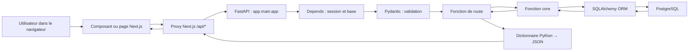

# Comprendre et modifier l’API Python du Life Regime Tracker

## Ce manuel est fondé sur le dépôt réel

Ce cours décrit l’état du code présent dans le dépôt lors de l’analyse des 31 juillet et 1er août 2026. Il ne suppose aucune connaissance préalable de Python. Son périmètre applicatif initial est constitué des 51 fichiers Python repérés dans `interface_API/` et `services/`, soit 4 974 lignes. Le timer demandé pendant la rédaction porte l’inventaire actuel à 52 fichiers Python ; il reste séparé de l’API.

Le backend n’est pas une seule application monolithique. Il comprend :

- l’API métier FastAPI dans `interface_API/app/` ;
- le lanceur de développement `interface_API/run.py` ;
- le microservice FastAPI de transcription `services/whisper_service.py` ;
- les tests Python dans `interface_API/tests/` ;
- le schéma PostgreSQL propriétaire dans `prisma/schema.prisma` ;
- les proxies Next.js qui relaient les appels du navigateur vers FastAPI.

Une règle de lecture essentielle : Prisma possède le schéma et les migrations, tandis que SQLAlchemy permet au code Python d’utiliser les tables existantes. `models.py` mappe ces tables mais ne les crée pas.

## Résultat visé

Après lecture et réalisation des exercices, vous devrez pouvoir :

1. lire la syntaxe Python employée dans le projet ;
2. expliquer comment Uvicorn charge l’objet FastAPI ;
3. suivre une requête depuis le navigateur jusqu’à PostgreSQL puis jusqu’à la réponse ;
4. distinguer contrat Pydantic, route HTTP, logique `core`, modèle SQLAlchemy et table Prisma ;
5. comprendre les injections `Depends`, décorateurs de routes, gestionnaires d’erreur et transactions ;
6. expliquer pourquoi seules les routes de transcription sont `async def` dans l’API métier ;
7. ajouter une fonctionnalité simple en conservant validation, authentification, isolation utilisateur et tests.

## Ordre de lecture conseillé

### Étape A — Acquérir le vocabulaire

1. [Périmètre, méthode et carte de vérité](00-perimetre-et-methode.md)
2. [Python depuis zéro](01-python-de-zero.md)
3. [Lire les fonctions et les imports](02-lire-les-fonctions-et-imports.md)

### Étape B — Voir l’ensemble avant les détails

4. [Architecture, arborescence et dépendances](03-architecture-dependances.md)
5. [HTTP et FastAPI](04-http-fastapi.md)

### Étape C — Lire l’API réelle

6. [Référence complète des routes](05-routes-reference.md)
7. [Base de données, ORM et transactions](06-base-de-donnees.md)
8. [Référence guidée des fonctions métier `core/`](07-reference-fonctions-core.md)
9. [Callbacks, exécution indirecte, async et await](08-callbacks-async.md)
10. [Flux complets client → réponse](09-flux-complets.md)

### Étape D — Devenir autonome

11. [Erreurs, débogage et tests](10-erreurs-debug-tests.md)
12. [Tutoriels pour modifier l’API](11-modifier-api-tutoriels.md)
13. [Glossaire et index exhaustifs](12-glossaire-index.md)
14. [Lecture ligne par ligne de l’exécution réelle](13-lecture-guidee-execution.md)
15. [Laboratoire HTTP non destructif](14-laboratoire-http.md)

## Carte mentale minimale



Ce diagramme est volontairement général. Certaines routes courtes ne passent pas par un module `core`. Par exemple, `PATCH /api/settings` modifie directement l’objet `User`. La transcription ajoute un saut vers le service Whisper du port 8001.

## Les quatre processus à ne pas confondre

| Processus | Port local | Technologie | Rôle |
| --- | ---: | --- | --- |
| Interface web | `3000` | Next.js/React | affiche les pages et expose des proxies same-origin |
| API métier | `8000` | FastAPI/Uvicorn | authentifie, valide, calcule et accède aux données |
| Transcription | `8001` | FastAPI/Whisper | transforme un fichier audio en texte |
| Base de données | `5432` | PostgreSQL | conserve les données persistantes |

## Point d’entrée et ordre réel au démarrage

La commande documentée est exécutée depuis `interface_API/` :

```powershell
python run.py
```

Ordre réel simplifié :

1. Python exécute `run.py`.
2. `import uvicorn` charge le serveur ASGI.
3. `from app.config import get_settings` exécute `config.py` une première fois.
4. `config.py` calcule `BASE_DIR` et charge deux fichiers `.env` éventuels.
5. La condition `if __name__ == "__main__":` est vraie parce que le fichier est exécuté directement.
6. `get_settings()` construit puis met en cache un objet `Settings`.
7. `uvicorn.run("app.main:app", ...)` demande à Uvicorn d’importer le module `app.main` et d’y récupérer la variable `app`.
8. L’import de `app.main` entraîne l’import de la configuration et de tous les routeurs listés dans ce fichier.
9. Chaque routeur crée un `APIRouter` et ses décorateurs enregistrent des fonctions de route.
10. `app.main` crée l’objet `FastAPI`, ajoute CORS, enregistre trois gestionnaires d’erreur, puis inclut les routeurs.
11. Uvicorn ouvre le port configuré et commence à accepter les connexions.

Le service Whisper se lance séparément. Il ne fait pas partie du même processus Python que l’API métier.

## Conventions du manuel

### « Code existant »

Un bloc portant cette mention reproduit ou simplifie fidèlement le comportement actuel. Le chemin du fichier est donné à proximité.

### « Exemple pédagogique minimal »

Ce code sert uniquement à isoler une notion Python. Il n’est pas présenté comme un fichier du dépôt.

### « Proposition d’évolution »

Ce code n’existe pas encore. Il est séparé explicitement pour éviter de confondre observation et recommandation.

### Noms Python et noms JSON

Le projet utilise souvent deux orthographes pour la même information :

| Couche | Exemple |
| --- | --- |
| attribut Python Pydantic | `start_friction` |
| clé JSON du navigateur | `startFriction` |
| colonne SQLAlchemy/Prisma existante | `startFriction` |

`ApiRequest` configure Pydantic pour convertir automatiquement le `camelCase` reçu en `snake_case` Python. Cette conversion ne renomme pas les colonnes existantes de la base.

## Comment étudier activement

Ne lisez pas dix chapitres d’un trait. Pour chaque chapitre :

1. prédisez ce que fait l’extrait avant de lire l’explication ;
2. reformulez le flux avec vos mots sans regarder ;
3. effectuez l’exercice ;
4. comparez votre production à la correction ;
5. ouvrez ensuite le fichier réel cité.

Le cours fournit des corrections, mais la maîtrise ne peut pas être déduite de la simple lecture. Dans la mémoire pédagogique, les concepts restent donc à l’état `exposé` tant qu’aucune production de votre part n’a été évaluée.

## Commandes de travail sûres

Depuis la racine du dépôt :

```powershell
# Compiler le petit timer sans le lancer cinq minutes
python -m py_compile scripts\course_timer.py

# Lancer le timer de cinq minutes
python scripts\course_timer.py

# Lancer un test rapide du timer
python scripts\course_timer.py --seconds 1

# Exécuter les tests Python de l’API
Set-Location interface_API
python -m unittest discover -s tests -v
```

Le timer est un outil pédagogique autonome. Il ne démarre ni FastAPI ni PostgreSQL et ne modifie aucune donnée.

## Limites documentées

- L’analyse décrit les fichiers actuels, y compris les modifications non validées présentes dans l’arbre de travail.
- Les réponses FastAPI n’ont pas toutes un `response_model` déclaré ; plusieurs formes de réponse sont donc déduites des dictionnaires effectivement retournés.
- Les modèles SQLAlchemy ne déclarent pas de `relationship()`. Les relations existent dans Prisma et dans PostgreSQL, mais le code Python les relie surtout par requêtes et identifiants explicites.
- Les tests existants n’utilisent pas une vraie base PostgreSQL de test ; ils couvrent surtout contrats, sessions, parité numérique et deux frontières HTTP.
- `PUT` est expliqué comme notion HTTP, mais aucune route Python actuelle n’emploie `PUT`.
- Aucun mécanisme FastAPI `BackgroundTasks`, aucun WebSocket et aucun hook de démarrage/arrêt applicatif n’est défini dans le code actuel.

## Vérification rapide de compréhension

Sans relire, répondez en trois phrases : quel fichier crée l’objet FastAPI, quel mécanisme fournit la session SQLAlchemy à une route, et quel composant effectue finalement le `commit` ?

Correction attendue : `app/main.py` crée l’objet `app`. `Depends(get_db)` demande à FastAPI d’exécuter le générateur `get_db`. Après la fin réussie de la fonction de route, le générateur reprend après `yield` et appelle `db.commit()`.
