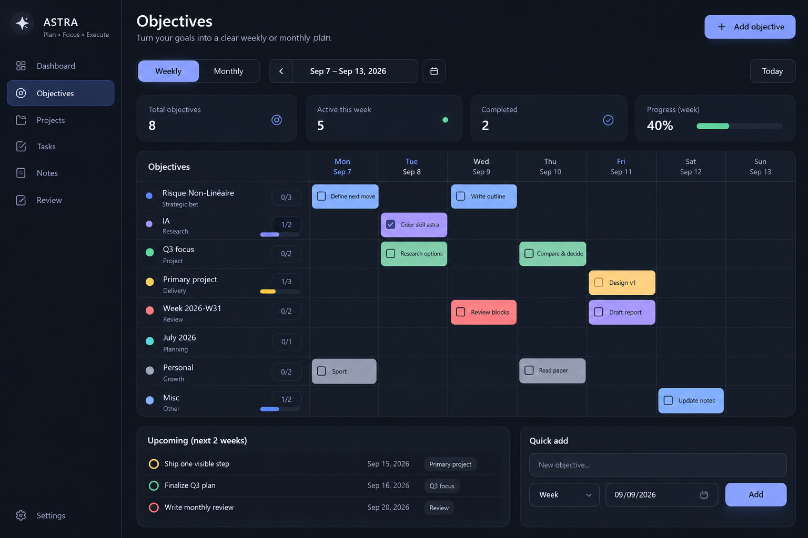
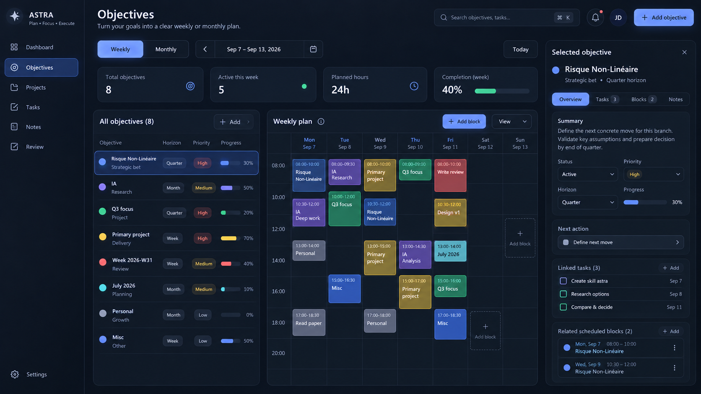
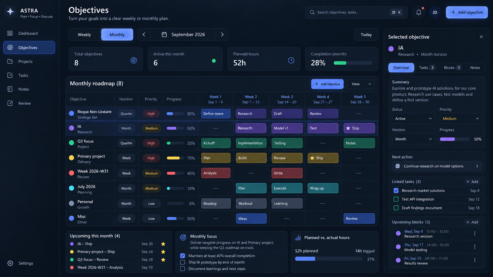
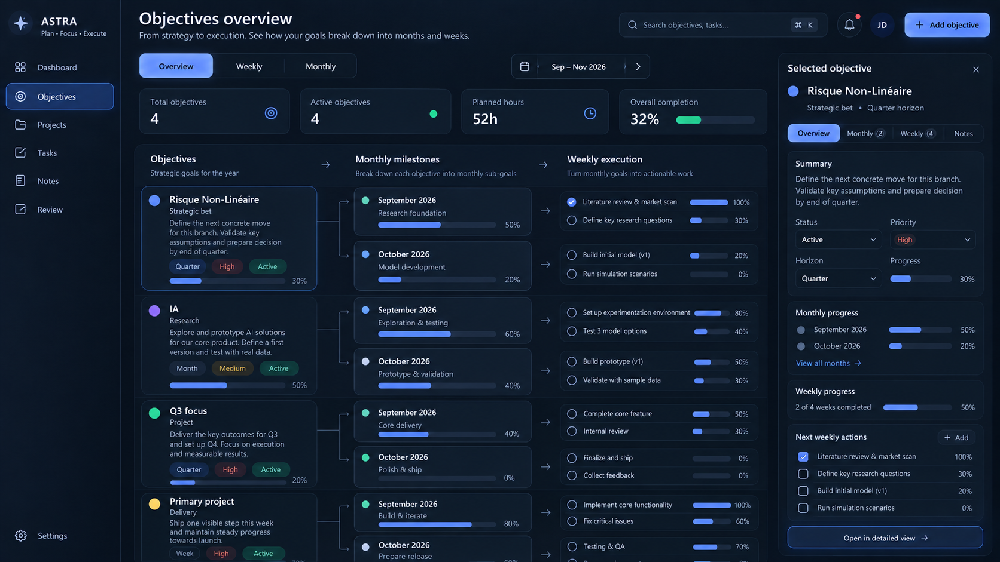
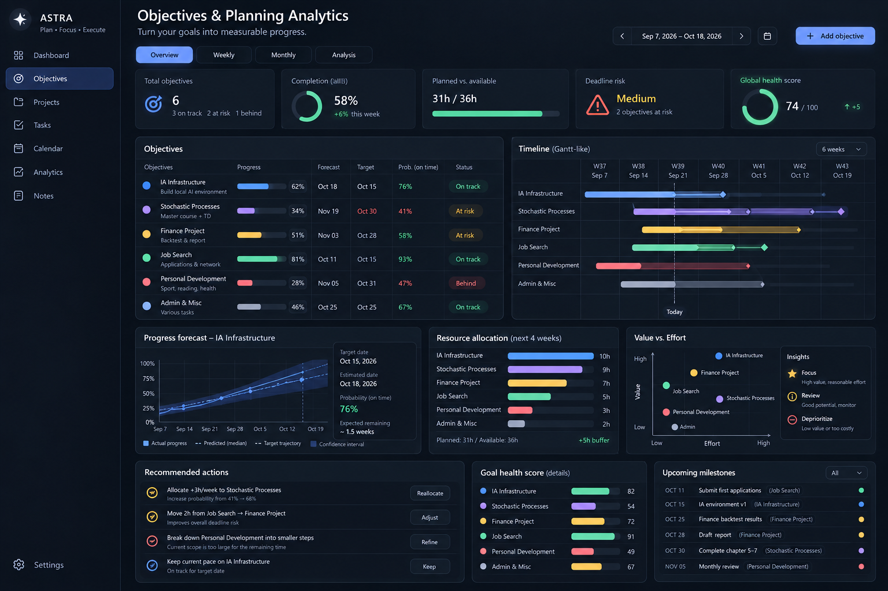
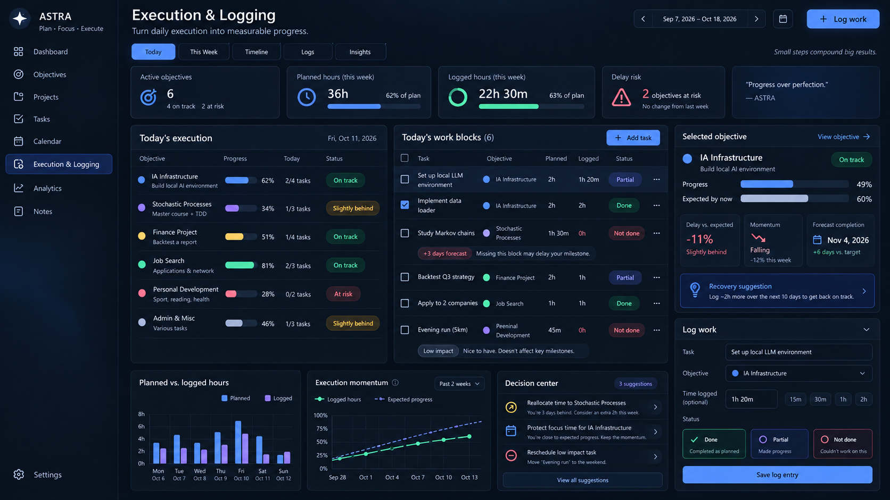

# ASTRA — Objectives, Planning, Analytics & Logging

Ce document regroupe les idées de fonctionnalités discutées autour de la page **Objectives** d’ASTRA, avec les maquettes générées pendant la discussion.

L’objectif général est de faire évoluer la page d’un simple gestionnaire d’objectifs vers un **système de pilotage** : voir les objectifs, les décliner en sous-objectifs mensuels et hebdomadaires, suivre l’exécution réelle, détecter le retard, prévoir les dates d’achèvement et proposer des arbitrages sans transformer l’outil en système culpabilisant.

---

## 1. Image — `a_clean_dark_mode_ui_mockup_with_a_minimalist_proj.png`

**Rôle :** première proposition d’une vue Objectives plus claire, organisée autour d’une vue Weekly / Monthly et d’un tableau d’objectifs lisible.

[Ouvrir l’image](images/a_clean_dark_mode_ui_mockup_with_a_minimalist_proj.png)



### Idées principales

- Un bouton **Weekly / Monthly** en haut de page.
- Tous les objectifs restent visibles dans une liste latérale ou un tableau.
- Chaque objectif possède une couleur, un horizon et une progression.
- Les tâches / blocs sont placés directement dans la semaine.
- La vue doit rester beaucoup plus simple que la première interface très hiérarchique.
- L’utilisateur doit pouvoir comprendre immédiatement : **sur quoi je travaille, quand et à quel objectif cela contribue**.

---

## 2. Image — `astra_objectives_planning_dashboard.png`

**Rôle :** vue **Weekly** plus détaillée, avec les heures de la journée, tous les objectifs visibles et un panneau de détail cliquable.

[Ouvrir l’image](images/astra_objectives_planning_dashboard.png)



### Vue Weekly

- Les objectifs restent affichés en permanence.
- Le calendrier hebdomadaire contient les **heures**.
- Les blocs de travail sont liés à un objectif précis.
- Chaque objectif affiche : horizon, priorité, progression et couleur.
- Cliquer sur un objectif ouvre un panneau latéral avec :
  - résumé ;
  - statut ;
  - priorité ;
  - horizon ;
  - prochaine action ;
  - tâches liées ;
  - blocs planifiés.
- Les heures peuvent être utilisées pour mesurer la charge réelle de la semaine.

### Intention UX

La vue Weekly ne doit pas être uniquement un calendrier. Elle doit répondre rapidement à :

1. Qu’est-ce que je dois réellement faire cette semaine ?
2. Combien de temps ai-je réservé ?
3. À quels objectifs ces blocs contribuent-ils ?
4. Est-ce que la semaine est réaliste ?

---

## 3. Image — `neon_monthly_objectives_dashboard.png`

**Rôle :** vue **Monthly** sous forme de roadmap plutôt que d’un calendrier classique.

[Ouvrir l’image](images/neon_monthly_objectives_dashboard.png)



### Vue Monthly

- Les lignes représentent les objectifs.
- Les colonnes représentent les semaines du mois.
- Chaque case contient un **jalon**, une sous-action ou un résultat attendu.
- On garde les informations essentielles :
  - progression ;
  - priorité ;
  - horizon ;
  - heures planifiées ;
  - prochaines échéances.
- Les milestones importants peuvent être marqués par une étoile ou un indicateur de livraison.

### Principe

La vue Monthly sert à répondre à :

> « Qu’est-ce qui doit être obtenu ce mois-ci, et pendant quelle semaine ? »

Elle doit rester plus stratégique que la vue Weekly.

---

## 4. Image — `astra_objectives_roadmap_dashboard.png`

**Rôle :** vue générale de la hiérarchie **Objectif → Sous-objectifs mensuels → Exécution hebdomadaire**.

[Ouvrir l’image](images/astra_objectives_roadmap_dashboard.png)



### Architecture des objectifs

La structure principale devient :

```text
OBJECTIF
   ↓
SOUS-OBJECTIFS / MILESTONES MENSUELS
   ↓
SOUS-OBJECTIFS / ACTIONS HEBDOMADAIRES
   ↓
TÂCHES / BLOCS DE TRAVAIL
   ↓
LOG D’EXÉCUTION
```

### Exemple

```text
Risque Non-Linéaire
│
├── Septembre : Research foundation        50 %
│   ├── Literature review                  100 %
│   └── Define research questions           30 %
│
└── Octobre : Model development             20 %
    ├── Build initial model                  20 %
    └── Run simulations                       0 %
```

### Ce que la page Overview doit montrer

- Tous les objectifs principaux.
- Les sous-objectifs mensuels rattachés.
- Les actions hebdomadaires rattachées.
- Une barre de progression à chaque niveau.
- Le statut de l’objectif : actif, à risque, terminé, en pause.
- Un panneau détaillé à droite après clic sur un objectif.

Cette vue devient la **carte générale du système**.

---

## 5. Image — `a_wide_high_resolution_dark_themed_dashboard_ui_s.png`

**Rôle :** page **Analytics / Decision Center** destinée à transformer les données d’exécution en décisions.

[Ouvrir l’image](images/a_wide_high_resolution_dark_themed_dashboard_ui_s.png)



### 5.1 Forecast de date d’achèvement

Ne pas seulement afficher une date cible. Afficher aussi une date estimée.

Exemple :

```text
Target date       30 Oct
Forecast date      4 Nov
P(on time)          41 %
Schedule slip      +5 days
```

La prédiction peut être construite à partir de la vitesse historique et, plus tard, d’une simulation Monte-Carlo.

### 5.2 Progression attendue vs progression réelle

Le retard ne doit pas signifier seulement « progression faible ».

```text
Expected today   60 %
Actual           49 %
Delay           -11 pts
```

Le produit peut également traduire ce retard en temps :

```text
Schedule slip ≈ +5 days
```

### 5.3 Velocity

La **velocity** mesure la vitesse d’avancement récente.

```text
Velocity = variation de progression / temps
```

Exemple :

```text
Current velocity    +3.1 % / week
Required velocity   +5.8 % / week
```

### 5.4 Momentum

Le momentum ne correspond pas à la progression cumulée. Il mesure si la vitesse récente **accélère, reste stable ou ralentit**.

Conceptuellement :

```text
Momentum ≈ velocity actuelle − velocity précédente
```

Affichage utilisateur :

```text
↑ Accelerating
→ Stable
↓ Falling
```

Il peut être enrichi avec :

- la régularité ;
- le respect des blocs planifiés ;
- la tendance récente ;
- le nombre de jours sans activité.

### 5.5 Goal Health Score

Un score global peut synthétiser :

- probabilité de respecter la deadline ;
- velocity ;
- régularité ;
- blocages ;
- charge restante ;
- progression réelle vs attendue.

Exemple :

```text
IA Infrastructure        82 / 100
Stochastic Processes     54 / 100
Finance Project          72 / 100
Job Search               91 / 100
```

### 5.6 Resource Allocation

Une vue montre où part le temps disponible.

```text
IA Infrastructure       10 h
Stochastic Processes     9 h
Finance Project          7 h
Job Search               5 h
Personal Development     3 h
Admin                     2 h
```

L’objectif n’est pas seulement de mesurer les heures, mais d’aider à arbitrer.

Exemple de recommandation :

> Déplacer 2 h de Job Search vers Stochastic Processes augmente la probabilité de respecter l’échéance.

### 5.7 Value vs Effort

Chaque objectif peut être positionné selon :

- valeur / impact ;
- effort requis.

Cela permet d’identifier :

- **Focus** : forte valeur, effort raisonnable ;
- **Review** : potentiel mais à surveiller ;
- **Deprioritize** : effort élevé pour faible valeur.

Cette logique peut être vue comme une version simple de la frontière de Pareto appliquée aux objectifs.

### 5.8 PERT / Critical Path

Pour les gros objectifs composés de tâches dépendantes, utiliser une logique de chemin critique.

Exemple :

```text
Research → Architecture → Backend → Integration → Testing → Ship
```

Les tâches qui déterminent directement la date finale deviennent le **critical path**.

### 5.9 Decision Center

La partie la plus importante de l’Analytics : ne pas simplement afficher des données, mais proposer 2 à 4 décisions utiles.

Exemple :

```text
1. Allocate +3 h/week to Stochastic Processes.
2. Move 2 h from Job Search → Finance Project.
3. Break Personal Development into smaller milestones.
4. Keep the current pace on IA Infrastructure.
```

---

## 6. Image — `futuristic_execution_and_logging_dashboard.png`

**Rôle :** page **Execution & Logging**, où l’utilisateur peut enregistrer ce qui a réellement été fait sans que le tracking devienne obligatoire ou culpabilisant.

[Ouvrir l’image](images/futuristic_execution_and_logging_dashboard.png)



### 6.1 Logging volontaire

Pour un bloc planifié, seulement trois états principaux :

```text
Done
Partial
Not done
```

Le temps réel reste **facultatif**.

Exemple :

```text
Planned: 2h
Logged: 1h20
Status: Partial
```

### 6.2 Ne pas créer une dette psychologique automatique

Un bloc raté ne doit pas automatiquement produire :

> « Tu dois récupérer 2 h. »

Le système évalue d’abord son impact.

#### Impact faible

```text
0h logged
Low impact
No meaningful effect on target date.

[Ignore]
```

#### Impact significatif

```text
0h logged
Potential impact: +3 days on forecast

[Replan] [Reduce scope] [Ignore]
```

### 6.3 Planned vs Logged

Une petite visualisation compare :

- temps planifié ;
- temps réellement logué.

Mais cette métrique ne doit pas devenir un score moral de productivité.

### 6.4 Recovery Suggestion

Lorsque le retard devient réel :

```text
Progress         49 %
Expected         60 %
Delay           -11 pts
Forecast         Nov 4
Target           Oct 30

Recovery suggestion
+2h15 over the next 10 days
```

L’utilisateur garde le choix :

```text
[Replan automatically]
[Reduce objective]
[Accept new date]
[Ignore]
```

### 6.5 Charge mentale / pression

Le produit doit éviter une logique où chaque tâche ratée génère du rouge et une dette.

Le système devrait plutôt répondre :

> « Est-ce que ce bloc raté change réellement ma trajectoire ? »

Puis proposer **le plus petit ajustement nécessaire**.

---

# 7. Architecture produit proposée

## Niveau 1 — Overview

Vue générale et stable.

```text
Objective
→ Monthly milestones
→ Weekly goals
→ Progress
→ Health
```

## Niveau 2 — Weekly

Exécution concrète.

```text
Days + hours
→ Work blocks
→ linked objective
→ planned duration
```

## Niveau 3 — Monthly

Roadmap.

```text
Objectives × Weeks
→ milestones
→ deliveries
→ progress
```

## Niveau 4 — Execution & Logging

Réalité observée.

```text
Done / Partial / Not done
→ optional logged time
→ impact recalculation
```

## Niveau 5 — Analytics

Aide à la décision.

```text
Progress
Velocity
Momentum
Delay
Forecast
Resource allocation
Value / Effort
Health score
Decision Center
```

---

# 8. Les quatre métriques visibles les plus importantes

Pour éviter une interface trop chargée, les quatre métriques principales d’un objectif seraient :

### Progress

> Où en suis-je ?

### Velocity

> À quelle vitesse est-ce que j’avance ?

### Momentum

> Est-ce que ma vitesse augmente ou diminue ?

### Schedule Delay

> Suis-je en avance ou en retard par rapport à la trajectoire prévue ?

Le forecast et les autres calculs peuvent rester en arrière-plan ou dans Analytics.

---

# 9. Exemple de carte objectif synthétique

```text
STOCHASTIC PROCESSES

Progress              49 %
Expected today         60 %
Schedule delay        -11 pts

Velocity        3.1 % / week
Required        5.8 % / week
Momentum        ↓ Falling

Target          Oct 30
Forecast        Nov 04
Slip            +5 days

Last missed block
Tue Sep 15 — 2 h

Recovery
+2h15 over next 10 days

[Replan] [Reduce scope] [Accept delay]
```

---

# 10. Principes UX à conserver

1. **Tout le tracking doit rester compréhensible en quelques secondes.**
2. **Logging optionnel**, surtout pour le temps réel.
3. Ne pas transformer les heures manquées en « dette » automatique.
4. Le rouge doit signaler une conséquence réelle, pas simplement une tâche non cochée.
5. Montrer en priorité **les décisions utiles**, pas les statistiques pour elles-mêmes.
6. Toujours relier une tâche / un bloc à un objectif quand cela a du sens.
7. Les vues Weekly, Monthly et Overview doivent représenter le même système à différents niveaux de zoom.
8. L’Analytics doit dire **quoi changer**, pas seulement ce qui s’est passé.
9. Le moteur peut devenir mathématiquement sophistiqué en arrière-plan tout en gardant une UI simple.
10. L’utilisateur doit pouvoir accepter volontairement un retard : une nouvelle date n’est pas nécessairement un échec.

---

# 11. MVP conseillé

Pour une première version réellement utile :

```text
OBJECTIVES
- Objective → Monthly → Weekly hierarchy
- Progress bars

WEEKLY
- Hour-based planning
- Blocks linked to objectives

MONTHLY
- Roadmap by week
- Milestones

LOGGING
- Done / Partial / Not done
- Optional actual time

ANALYTICS
- Progress vs expected
- Velocity
- Momentum
- Schedule delay
- Forecast date
- Resource allocation

DECISION CENTER
- Maximum 3–4 recommendations
```

Les modèles plus complexes — Monte-Carlo, PERT, Critical Path, optimisation d’allocation — peuvent être ajoutés progressivement derrière ces mêmes composants sans modifier complètement l’interface.
